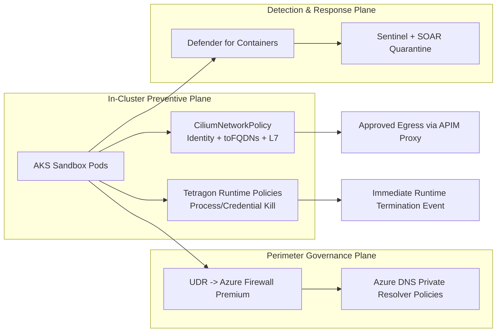
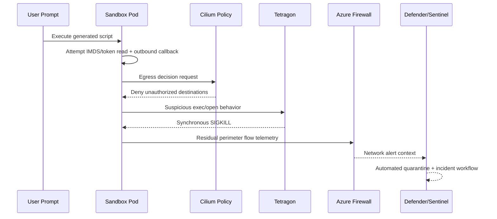

# Untrusted Agent Sandbox Runtime Defense Selection FAQ: AKS Cilium+Tetragon Preventive Enforcement vs Azure Firewall Perimeter Governance vs Defender Detective Controls

> 🌐 **Language switch**: [中文](ebpf-cilium-tetragon-syscall-egress-sandboxes-aks-vs-azure-firewall-vs-defender-selection-faq.md) · **English (current)**

> Audience: Cloud & Kubernetes Solution Architects, platform security architects, SRE/SecOps leads.  
> Scope: enterprise AI agent platforms running untrusted Python/Bash/Node execution sandboxes at scale.  
> Core challenge: allow selective package/API egress while deterministically blocking IMDS access, token theft, reverse shells, and DNS exfiltration.  
> Outcome: a production architecture decision model across `Option A / B / C` with control boundaries, TCO, and day-2 operating implications.  

## 1. Problem framing: why this cannot be solved by “adding one firewall layer”

Enterprise code-execution sandboxes face a structural tension.  
They must permit controlled outbound access to legitimate dependencies and APIs,  
while simultaneously preventing lateral abuse and data exfiltration.

In practice, this includes approved access to destinations such as:

- `pypi.org` and package mirrors,  
- internal GitHub Enterprise artifact endpoints,  
- approved webhook or APIM gateways.

At the same time, adversarial prompt payloads can trigger immediate abuse paths:

- `curl 169.254.169.254` to query Azure IMDS,  
- reads of mounted service account token files,  
- reverse shell launch via `nc`/`socat`,  
- DNS tunneling of sensitive CSV or notebook output.

If the control stack is only asynchronous,  
the platform may generate excellent alerts  
after the actual data loss has already happened.

Therefore the architecture question is not “network or security tooling preference.”  
It is “where does synchronous prevention happen, and where does detective response happen?”

## 2. Boundary clarification: how this differs from runtime-isolation and MCP supply-chain topics

This guide is not a compute-boundary comparison between VM and container isolation models.  
That is the primary focus of runtime-hosting topics (for example ACA Dynamic Sessions vs AKS Kata decisions).

This guide is also not about MCP manifest signing, schema pinning, or tool supply-chain trust controls.  
Those controls are necessary but address a different layer.

This guide focuses on cloud and Kubernetes architecture controls for:

1. pod identity-aware egress governance,  
2. synchronous process/file/credential abuse interruption,  
3. perimeter vs in-cluster responsibility split,  
4. operational and FinOps consequences of each model.

## 3. Option landscape: A in-cluster prevention, B perimeter enforcement, C managed sandbox + CDR

**Option A**: `AKS Azure CNI Powered by Cilium + Tetragon`  
Primary role: in-cluster preventive control plane with pod identity and syscall-aware interruption.

**Option B**: `Hub-and-Spoke + Azure Firewall Premium`  
Primary role: centralized perimeter governance and inspection across workloads.

**Option C**: `ACA Dynamic Sessions + APIM forward proxy + Defender + Sentinel`  
Primary role: managed sandbox operations with cloud-native detective and response orchestration.

These options are not strictly mutually exclusive.  
Most enterprise programs converge on layered deployment.  
The critical design choice is responsibility allocation:

- which layer must block in milliseconds,  
- which layer can detect in seconds/minutes and orchestrate response.

## 4. Option A deep dive: AKS Cilium + Tetragon preventive zero-trust runtime plane

### 4.1 Fit profile

Option A is strongest when:

- untrusted code execution volume is high,  
- tenant isolation requirements exceed subnet-level segmentation,  
- the platform requires synchronous runtime interruption.

### 4.2 Core architectural controls

- `CiliumNetworkPolicy` with workload identity selectors,  
- tenant-specific `toFQDNs` allowlisting with optional L7 HTTP methods/path constraints,  
- explicit deny controls for IMDS and disallowed control-plane paths,  
- `automountServiceAccountToken: false` by default for sandbox pods,  
- Tetragon policies for process and credential abuse termination (`SIGKILL`).

### 4.3 Strengths

- strongest preventive posture against in-pod abuse chains,  
- fine-grained multi-tenant policy discrimination,  
- reduced blast radius within shared node/subnet deployments.

### 4.4 Constraints

- policy lifecycle complexity increases significantly,  
- requires mature SecOps + platform engineering collaboration,  
- requires disciplined GitOps and validation pipelines for policy rollout.

## 5. Option B deep dive: Azure Firewall Premium perimeter governance plane

### 5.1 Fit profile

Option B is strong when organizations:

- already operate hub-and-spoke network governance,  
- need centralized inspection/reporting standards,  
- prioritize consistent perimeter policy for mixed workload estates.

### 5.2 Core architectural controls

- UDR-driven egress concentration through Firewall Premium,  
- TLS inspection and IDPS rule stacks,  
- DNS policy coupling with Private Resolver governance,  
- subscription-wide policy harmonization.

### 5.3 Strengths

- governance consistency across diverse workloads,  
- familiar operating model for network/security teams,  
- strong central reporting and compliance alignment.

### 5.4 Constraints

- subnet-level context cannot reliably distinguish sibling pods from different tenants,  
- process-level abuse interruption is outside perimeter scope,  
- data-processing charges may dominate cost at high outbound volume.

## 6. Option C deep dive: managed sandbox + detective controls (ACA + Defender/Sentinel)

### 6.1 Fit profile

Option C is strongest for teams that:

- need rapid delivery with lower platform-operational burden,  
- can accept managed runtime constraints,  
- want standardized cloud-native security integration.

### 6.2 Core architectural controls

- dynamic sessions with strict default egress posture,  
- APIM-mediated approved outbound pathways,  
- Defender for Containers workload detections,  
- Sentinel SOAR playbooks for quarantine and incident escalation.

### 6.3 Strengths

- reduced platform engineering overhead,  
- faster initial deployment cadence,  
- strong native integration into cloud SOC workflows.

### 6.4 Constraints

- detective signals are usually asynchronous,  
- fine-grained process-level prevention is more limited than Option A,  
- customization flexibility is lower for highly specialized multi-tenant platforms.

## 7. Twelve-dimension selection matrix (A vs B vs C)

| Dimension | Option A: Cilium + Tetragon | Option B: Azure Firewall Premium | Option C: ACA + Defender/Sentinel |
|---|---|---|---|
| Pod identity granularity | Very High | Low | Medium |
| Synchronous prevention strength | Very High | Medium | Medium |
| Centralized perimeter governance | Medium | Very High | High |
| IMDS/token abuse interruption | Very High | Medium | Medium |
| DNS exfiltration control precision | High | Medium | Medium |
| Day-2 policy complexity | High | Medium | Medium-Low |
| Initial delivery speed | Medium | Medium | Fast |
| Multi-tenant blast-radius control | High | Medium | High |
| Detection/forensics ecosystem integration | High | High | Very High |
| Cost predictability under variable traffic | Medium | Medium-Low | Medium |
| 3-year TCO | Medium | Medium-High | Medium |
| Strategic role | Preventive runtime core | Perimeter governance core | Managed detective/response core |

Practical pattern:

- high-risk sandboxes: A as primary, B as perimeter complement, C as detection layer,  
- enterprise perimeter-first organizations: B primary with staged A adoption,  
- fast-moving teams: C primary with targeted A controls for high-risk tenants.

## 8. Reference architecture: preventive in-cluster layer + perimeter + SOC response



Architecture takeaway:

- perimeter governance alone is insufficient for pod-level abuse prevention,  
- preventive and detective planes must be intentionally complementary.

## 9. Attack-chain execution sequence: prompt-injected script to block or incident



Operational requirement:

- prevention path must be deterministic and low latency,  
- detection path must preserve high-fidelity forensic context.

## 10. Production YAML snippet: CiliumNetworkPolicy for IMDS block + tenant-scoped allowed egress

```yaml
apiVersion: cilium.io/v2
kind: CiliumNetworkPolicy
metadata:
  name: tenant-a-sandbox-egress-guard
  namespace: tenant-a
spec:
  endpointSelector:
    matchLabels:
      app: agent-sandbox
  egressDeny:
    - toCIDR:
        - "169.254.169.254/32"
  egress:
    - toFQDNs:
        - matchName: "apim-egress.contoso.com"
        - matchName: "pypi.org"
        - matchName: "files.pythonhosted.org"
    - toPorts:
        - ports:
            - port: "443"
              protocol: TCP
          rules:
            http:
              - method: "GET"
                path: "/.*"
              - method: "POST"
                path: "/api/v1/.*"
```

Design notes:

- explicit IMDS deny baseline is mandatory,  
- only approved tenant-scoped FQDN destinations are allowed,  
- L7 HTTP rules restrict method and path shape for sensitive channels.

## 11. Production YAML snippet: Tetragon policy for process and service-account token abuse

```yaml
apiVersion: cilium.io/v1alpha1
kind: TracingPolicy
metadata:
  name: sandbox-runtime-credential-guard
spec:
  kprobes:
    - call: "sys_execve"
      syscall: true
      selectors:
        - matchArgs:
            - index: 0
              operator: Prefix
              values:
                - "/bin/nc"
                - "/usr/bin/socat"
                - "/bin/bash"
          matchActions:
            - action: Sigkill
    - call: "sys_openat"
      syscall: true
      selectors:
        - matchArgs:
            - index: 1
              operator: Prefix
              values:
                - "/var/run/secrets/kubernetes.io/serviceaccount/token"
          matchActions:
            - action: Sigkill
```

Design notes:

- runtime process execution and credential-file reads are blocked in-path,  
- policy should be scoped by namespace/labels in production for tenant differentiation.

## 12. Capacity planning and 3-year TCO (USD, $k): firewall data charges vs in-cluster controls

### 12.1 Baseline assumptions

- daily ephemeral sandboxes: `10,000`,  
- peak concurrent pods: `1,800`,  
- average monthly egress: `32 TB`,  
- policy update cadence: `2` releases per week.

### 12.2 Monthly cost model (USD, $k/month)

| Cost category | Option A heavy | Option B heavy | Option C heavy |
|---|---:|---:|---:|
| AKS compute and platform nodes | 78 | 62 | 28 |
| Cilium/Tetragon platform operations | 26 | 9 | 6 |
| Firewall Premium + data processing | 18 | 96 | 24 |
| Defender/Sentinel telemetry and response | 21 | 26 | 34 |
| APIM controlled egress proxy | 14 | 14 | 19 |
| SecOps/SRE labor allocation | 39 | 33 | 30 |
| **Total** | **196** | **240** | **141** |

### 12.3 Three-year TCO (USD, $k)

- Option A: `7,056`.  
- Option B: `8,640`.  
- Option C: `5,076`.

### 12.4 Economic interpretation

Option C may look least expensive in direct run cost,  
but may carry higher residual preventive risk for high-threat workloads.

Option B provides governance consistency,  
but data-processing sensitivity can materially raise spend at scale.

For high-risk untrusted code execution,  
Option A often yields better risk-adjusted economics despite higher policy operations cost.

## 13. Scenario A: global investment bank quant sandbox platform with desk-level FQDN allowlists

### 13.1 Business goals

- enforce per-desk outbound destination controls,  
- guarantee IMDS and token theft prevention,  
- isolate research sandbox behavior from trading production planes.

### 13.2 Architecture composition

- A for desk-level pod identity + runtime prevention,  
- B for enterprise perimeter and centralized inspection,  
- C for SOC workflow integration and incident automation.

### 13.3 Measured/target outcomes

- unauthorized egress blocked: `99.7%`,  
- IMDS successful access: `0%`,  
- median security containment time: `11 min -> 2.4 min`.

## 14. Scenario B: multi-tenant B2B automation ISV with 10,000 daily ephemeral sandboxes

### 14.1 Business goals

- block prompt-injected reverse shell attempts,  
- suppress DNS exfiltration paths,  
- keep onboarding velocity acceptable for new tenants.

### 14.2 Architecture composition

- A for high-risk tenant preventive policies,  
- C for managed baseline and detector-driven workflows,  
- B for centralized egress governance and forensic consistency.

### 14.3 Measured/target outcomes

- reverse-shell success rate: `2.9% -> 0.1%`,  
- DNS exfil incidents: quarterly `31 -> 4`,  
- tenant onboarding cycle: `4 weeks -> 10 days` with risk-tiered policy templates.

## 15. Quantitative FAQ + five-step rollout (Good fit vs Not for)

### 15.1 Quantitative FAQ

**Q1. Is Defender-only alerting sufficient for high-risk sandbox workloads?**  
A1. Usually no.  
Detective controls are critical, but cannot replace deterministic in-path prevention for runtime abuse.

**Q2. Can perimeter firewalls distinguish sibling pods in shared subnets?**  
A2. Not with pod-native granularity.  
Perimeter controls should be complemented by in-cluster identity-aware policies.

**Q3. Does `toFQDNs` policy add operational overhead?**  
A3. Yes, especially around DNS governance and policy lifecycle.  
For high-risk tenants, the preventive value typically justifies that overhead.

**Q4. How should teams reduce policy drift risk?**  
A4. Use policy-as-code, staged rollout, regression tests, and explicit rollback playbooks with auditable change records.

**Q5. When should Option C be primary?**  
A5. When delivery speed and reduced platform complexity are top priorities and threat profile is moderate.

**Q6. When should Option A be primary?**  
A6. When untrusted code risk is high and synchronous runtime interruption is mandatory.

### 15.2 Five-step rollout plan

1. **Risk-tier workloads first**: classify tenants and execution profiles by abuse potential.  
2. **Set non-negotiable baselines**: disable automatic token mounts and block IMDS globally.  
3. **Introduce Cilium FQDN/L7 controls**: enforce tenant-specific allowed egress patterns.  
4. **Add Tetragon preventive interruption**: terminate high-risk process/credential behavior in-path.  
5. **Operationalize continuously**: monthly policy audit, quarterly adversarial simulation, semiannual TCO and control efficacy review.

### 15.3 Good fit

- high-volume untrusted execution sandboxes,  
- strict tenant isolation and low tolerance for exfiltration risk,  
- organizations able to operate policy-centric platform security at scale.

### 15.4 Not for

- low-risk internal-only automation with minimal outbound exposure,  
- teams without capacity to maintain policy lifecycle governance,  
- environments unwilling to adopt layered preventive + detective control architecture.

---

**Bottom line**:  
for enterprise untrusted AI agent sandboxes,  
perimeter-only and detective-only strategies are not enough.  
A resilient architecture uses:  
`A` as preventive runtime core,  
`B` as perimeter governance complement,  
`C` as cloud-native detection and response multiplier.  

A practical rollout sequence is to launch `C` as managed baseline controls first,  
promote high-risk namespaces to `A` for deterministic synchronous blocking,  
then standardize `B` as the shared perimeter and audit plane across all environments.  
