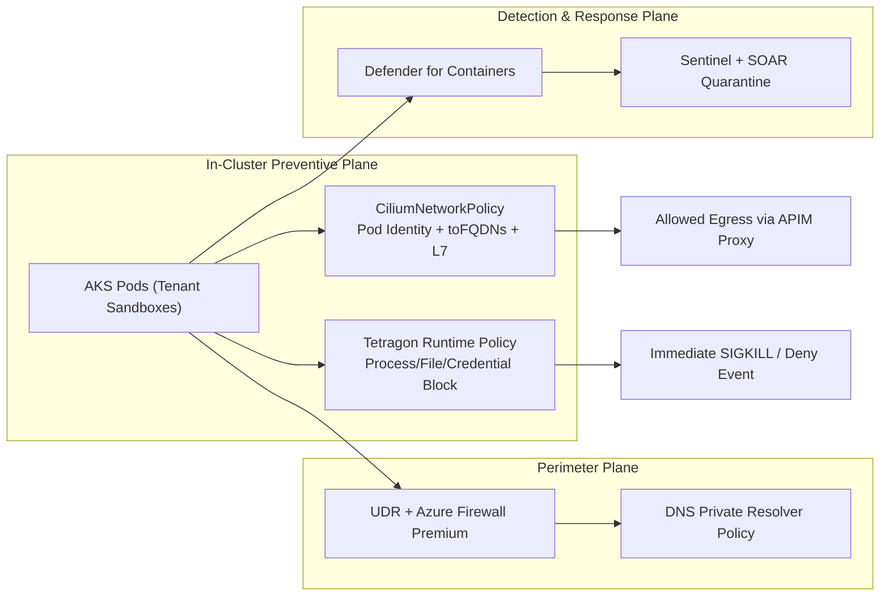
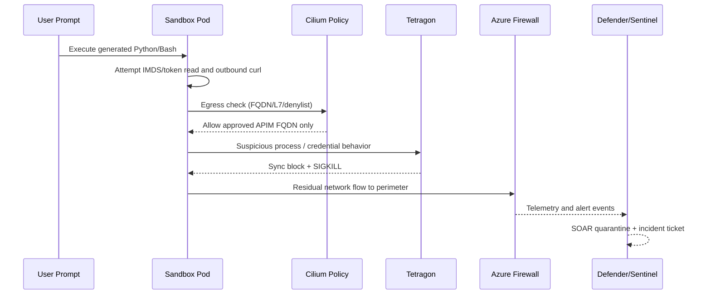

# 智能体沙箱运行时防护选型 FAQ：AKS Cilium+Tetragon 进程级阻断 vs Azure Firewall 周界管控 vs Defender 检测编排

> 🌐 **语言切换**：**中文（当前）** · [English](ebpf-cilium-tetragon-syscall-egress-sandboxes-aks-vs-azure-firewall-vs-defender-selection-faq.en.md)

> 读者对象：Cloud & Kubernetes Solution Architect、平台安全架构师、SRE/SecOps 负责人。  
> 适用范围：承载不受信任代码执行的企业 AI Agent 平台（代码解释器、数据科学脚本、浏览器自动化沙箱）。  
> 核心问题：如何在“允许必要外网访问”的同时，阻断 IMDS 访问、Token 窃取、反连 shell、DNS 外传。  
> 目标输出：对 `Option A/B/C` 给出云架构层面的职责边界、成本模型、实施顺序与适用边界。  

## 1. 业务问题重述：为什么这不是“只加一个防火墙”就能解决的题

企业 AI Agent 沙箱常见诉求是矛盾的。  
一方面，平台必须允许受控外联。  
例如 `pypi.org`、内部 GitHub Enterprise、批准的 SaaS API。  
另一方面，平台必须阻断恶意出站与凭据窃取路径。  

在 AKS 多租户场景中，  
仅做子网级出站治理通常不足。  
因为同一子网里的不同 Pod 风险级别并不一致。  
Tenant A 与 Tenant B 可能共享 Node 与 CIDR。  

攻击往往发生在秒级。  
例如提示注入触发脚本后立即执行：  

- `curl 169.254.169.254` 读取 IMDS 元数据。  
- 读取挂载的 service account token。  
- 通过 `nc` / `socat` 建立反向 shell。  
- 通过 DNS 隧道分片外传敏感数据。  

如果控制只在“异步告警”层，  
即使最终产生告警，也可能已经发生数据外泄。  

## 2. 边界澄清：与“计算隔离选型”与“MCP 供应链治理选型”的区别

本题不讨论“计算边界是否是 VM”。  
那是 `#1` 的重点（ACA Dynamic Sessions vs AKS Kata 等）。  

本题也不讨论“工具描述签名与 schema 钉扎”。  
那是 `#159` 的重点（MCP 供应链完整性）。  

本题聚焦云与 K8s 运行时防护层：  

1. Pod 身份与 egress 细粒度策略。  
2. 进程/文件/凭据访问的同步阻断。  
3. 周界设备与主机/集群检测的职责拆分。  
4. Day-2 运维复杂度与成本。  

## 3. 三种架构路径：A 集群内预防、B 网络周界、C PaaS 混合检测

**Option A**：`AKS Azure CNI Powered by Cilium + Tetragon`。  
定位：集群内、Pod 身份感知、同步阻断优先。  

**Option B**：`Hub-and-Spoke + Azure Firewall Premium`。  
定位：统一周界出站与 TLS/IDPS 能力。  

**Option C**：`ACA Dynamic Sessions + APIM egress proxy + Defender + Sentinel`。  
定位：PaaS 沙箱 + 云原生检测编排，降低平台自运维复杂度。  

三者不是互斥。  
大型企业常采用“主路径 + 补充路径”的分层。  
关键是先明确：哪一层负责“同步阻断”，哪一层负责“异步取证”。  

## 4. Option A：AKS Cilium + Tetragon 的集群内预防型零信任平面

### 4.1 适用条件

- 平台承载大量自定义容器与脚本。  
- 租户隔离要求高于子网级控制。  
- 需要秒级阻断而非分钟级告警。  

### 4.2 核心能力

- `CiliumNetworkPolicy` 以 Pod 身份建模。  
- `toFQDNs` 与 L7 HTTP 规则实现允许名单。  
- 明确阻断 `169.254.169.254/32` 与非批准控制面地址。  
- `Tetragon` 对异常进程/凭据访问触发同步 `SIGKILL`。  

### 4.3 平台收益

- 在攻击发生点就地阻断。  
- 可按租户、工作负载、命名空间细分策略。  
- 对“同子网不同风险”场景治理效果显著。  

### 4.4 主要代价

- 策略数量与复杂度上升。  
- 需要更成熟的 eBPF/策略发布流程。  
- 对平台团队 SRE/SecOps 协同要求高。  

## 5. Option B：Azure Firewall Premium 周界平面的统一出站治理

### 5.1 适用条件

- 企业已采用 Hub-and-Spoke 网络模型。  
- 需要统一跨系统出站审计和策略。  
- 安全团队偏好中心化网络控制。  

### 5.2 核心能力

- UDR 收口到集中防火墙。  
- TLS Inspection 与 IDPS 提供网络侧检测。  
- 与 DNS Private Resolver 联动控制解析路径。  
- 便于跨订阅统一策略治理。  

### 5.3 平台收益

- 治理边界清晰，组织协同成熟。  
- 对传统应用与容器工作负载有一致体验。  
- 审计报表与合规流程可复用。  

### 5.4 关键限制

- 子网级视角难区分同节点多租户 Pod 行为。  
- 对进程级异常缺少原位同步阻断。  
- 高流量场景下按 GB 计费压力明显。  

## 6. Option C：ACA Dynamic Sessions + Defender/Sentinel 的托管检测与响应

### 6.1 适用条件

- 团队更关注业务交付速度。  
- 希望减少自建 K8s 安全栈复杂度。  
- 可接受部分场景以检测和响应为主。  

### 6.2 核心能力

- Dynamic Sessions 默认零信任出站起点。  
- 通过 APIM 代理提供受控外联出口。  
- Defender for Containers 提供异常检测。  
- Sentinel 剧本触发自动隔离与取证。  

### 6.3 平台收益

- 运维门槛低，交付快。  
- 与云原生检测体系集成顺滑。  
- 适合中等规模与快速上线团队。  

### 6.4 关键限制

- 异步检测存在告警时延。  
- 对超细粒度运行时控制能力有限。  
- 对高度定制沙箱平台灵活度不足。  

## 7. 12 维选型矩阵：A / B / C

| 维度 | Option A：Cilium+Tetragon | Option B：Azure Firewall Premium | Option C：ACA+Defender |
|---|---|---|---|
| Pod 级身份感知 | 极高 | 低 | 中 |
| 同步阻断能力 | 极高 | 中 | 中 |
| 周界统一治理 | 中 | 极高 | 高 |
| IMDS/TOKEN 原位防护 | 极高 | 中 | 中 |
| DNS 外传阻断颗粒度 | 高 | 中 | 中 |
| Day-2 策略复杂度 | 高 | 中 | 中到低 |
| 交付速度 | 中 | 中 | 快 |
| 多租户隔离精度 | 很高 | 中 | 高 |
| 取证与告警生态 | 高 | 高 | 很高 |
| 成本可预测性 | 中 | 中到低（流量敏感） | 中 |
| 3 年 TCO | 中 | 中到高 | 中 |
| 推荐角色 | 预防主平面 | 周界主平面 | 托管混合平面 |

组合建议：  

- 高风险代码沙箱：A 为主，B 为辅。  
- 传统企业网络统一治理：B 为主，A 逐步引入。  
- 快速上线项目：C 为主，再按风险补 A。  

## 8. 参考架构图：集群内预防 + 周界治理 + 检测响应分层



关键点：  
预防与检测不冲突。  
但必须先明确谁负责“马上挡住”。  

## 9. 攻击链与防护时序图：提示注入脚本执行到阻断/告警



生产要求：  

- 阻断链路必须可在秒级生效。  
- 告警链路必须保留完整上下文。  

## 10. 生产 YAML 片段：CiliumNetworkPolicy（阻断 IMDS 与异常出口，允许 tenant 级 FQDN）

```yaml
apiVersion: cilium.io/v2
kind: CiliumNetworkPolicy
metadata:
  name: tenant-a-sandbox-egress-guard
  namespace: tenant-a
spec:
  endpointSelector:
    matchLabels:
      app: agent-sandbox
  egressDeny:
    - toCIDR:
        - "169.254.169.254/32"   # Azure IMDS
    - toEndpoints:
        - matchLabels:
            "k8s:io.kubernetes.pod.namespace": kube-system
            "k8s:k8s-app": kube-dns
      toPorts:
        - ports:
            - port: "53"
              protocol: UDP
          rules:
            dns:
              - matchPattern: "*"
  egress:
    - toFQDNs:
        - matchName: "apim-egress.contoso.com"
        - matchName: "pypi.org"
        - matchName: "files.pythonhosted.org"
    - toPorts:
        - ports:
            - port: "443"
              protocol: TCP
          rules:
            http:
              - method: "GET"
                path: "/.*"
              - method: "POST"
                path: "/api/v1/.*"
```

设计说明：  

- `egressDeny` 明确拦截 IMDS。  
- 仅放行租户批准域名。  
- 出站必须经过受控 HTTPS 通道。  

## 11. 生产 YAML 片段：Tetragon TracingPolicy（同步阻断可疑进程与凭据访问）

```yaml
apiVersion: cilium.io/v1alpha1
kind: TracingPolicy
metadata:
  name: sandbox-process-credential-guard
spec:
  kprobes:
    - call: "sys_execve"
      syscall: true
      selectors:
        - matchPIDs:
            - operator: In
              followForks: true
              isNamespacePID: true
          matchArgs:
            - index: 0
              operator: Prefix
              values:
                - "/bin/nc"
                - "/usr/bin/socat"
                - "/bin/bash"
          matchActions:
            - action: Sigkill
    - call: "sys_openat"
      syscall: true
      selectors:
        - matchArgs:
            - index: 1
              operator: Prefix
              values:
                - "/var/run/secrets/kubernetes.io/serviceaccount/token"
          matchActions:
            - action: Sigkill
```

设计说明：  

- 对高风险进程执行路径做同步拦截。  
- 对 serviceaccount token 读取做即时处置。  
- 与 Cilium 网络策略形成“双保险”。  

## 12. 容量规划与 3 年 TCO（USD，$k）：比较流量计费与集群内控制成本

### 12.1 基线假设（示例）

- 每日临时沙箱：`10,000`。  
- 峰值并发 Pod：`1,800`。  
- 平均出站流量：`32 TB/月`。  
- 规则变更频率：`每周 2 次`。  

### 12.2 月度成本模型（USD，$k/月）

| 成本项 | Option A 主导 | Option B 主导 | Option C 主导 |
|---|---:|---:|---:|
| AKS 计算与系统节点 | 78 | 62 | 28 |
| Cilium/Tetragon 平台运维 | 26 | 9 | 6 |
| Azure Firewall Premium + 数据处理 | 18 | 96 | 24 |
| Defender/Sentinel 检测与日志 | 21 | 26 | 34 |
| APIM 受控出口代理 | 14 | 14 | 19 |
| 安全运维人力折算 | 39 | 33 | 30 |
| **合计** | **196** | **240** | **141** |

### 12.3 三年 TCO（USD，$k）

- Option A：`7,056`。  
- Option B：`8,640`。  
- Option C：`5,076`。  

### 12.4 结果解释

Option C 账面成本最低，  
但同步阻断能力弱于 A。  

Option B 对传统网络治理友好，  
但高流量下数据处理费上升明显。  

高风险不受信任代码场景里，  
A 的风险收益比通常更优。  

## 13. 场景一：全球投行量化代码解释器平台（按交易台隔离 FQDN）

### 13.1 业务目标

- 按 Desk 实施差异化外联白名单。  
- 严禁 IMDS 与 token 窃取。  
- 保证研究沙箱不影响生产交易平面。  

### 13.2 架构落点

- A：按租户命名空间策略下发。  
- B：统一周界与审计出口。  
- C：对异常行为进行云侧编排响应。  

### 13.3 结果指标（示例）

- 非授权外联阻断率：`99.7%`。  
- IMDS 访问成功率：`0%`。  
- 沙箱安全事件平均止损时间：`11 min -> 2.4 min`。  

## 14. 场景二：多租户 B2B 自动化 ISV（每日 10k+ 临时沙箱）

### 14.1 业务目标

- 阻断提示注入触发的反连 shell。  
- 防止 DNS 分片外传。  
- 在不牺牲交付速度前提下降低风险。  

### 14.2 架构落点

- A：对高风险租户采用强策略。  
- C：低风险租户使用托管沙箱与检测。  
- B：统一出口策略与取证日志。  

### 14.3 结果指标（示例）

- 反连 shell 成功率：`2.9% -> 0.1%`。  
- DNS 外传事件：季度 `31 -> 4`。  
- 租户上线周期：`4 周 -> 10 天`（分层策略后）。  

## 15. 深度定量 FAQ + 五步落地（Good fit vs Not for）

### 15.1 定量 FAQ

**Q1：仅靠 Defender 告警能否满足高风险沙箱防护？**  
A1：通常不够。  
检测适合取证和响应，  
但不能替代同步阻断。  

**Q2：Azure Firewall 能否区分同子网不同 Pod 租户？**  
A2：原生周界视角有限。  
需配合集群内身份感知策略补齐。  

**Q3：Cilium `toFQDNs` 会不会影响性能？**  
A3：会增加策略复杂度与解析治理成本。  
但在高风险场景收益通常大于代价。  

**Q4：如何控制策略漂移风险？**  
A4：采用 GitOps + 审批发布 + 回滚机制。  
并保留策略版本与变更审计。  

**Q5：何时优先选 Option C？**  
A5：团队人力紧张且业务需快速上线时。  
但高风险租户仍建议补 A。  

**Q6：何时优先选 Option A？**  
A6：当攻击面来自不受信任脚本执行，  
且需要秒级同步阻断时。  

### 15.2 五步落地

1. **先分级**：按租户风险等级划分防护强度。  
2. **先兜底**：全量禁 IMDS、禁 token 自动挂载。  
3. **再细化**：引入 Cilium FQDN/L7 精细策略。  
4. **再增强**：接入 Tetragon 同步阻断高危行为。  
5. **持续运营**：月度策略审计、季度红蓝演练、半年 TCO 复盘。  

### 15.3 Good fit

- 高风险不受信任代码执行平台。  
- 多租户隔离要求高。  
- 需要同步阻断而非仅事后告警。  

### 15.4 Not for

- 仅低风险内部固定任务。  
- 缺乏策略运营能力且短期无法补齐。  
- 不接受分层治理带来的工程复杂度。  

---

**结论**：  
在 AI Agent 代码沙箱场景，  
“周界防火墙 + 异步告警”不足以覆盖实时攻击面。  
应以 `A（集群内预防）` 为核心，  
叠加 `B（周界治理）` 与 `C（检测响应）`，  
形成可阻断、可审计、可演进的零信任运行时防护体系。  
