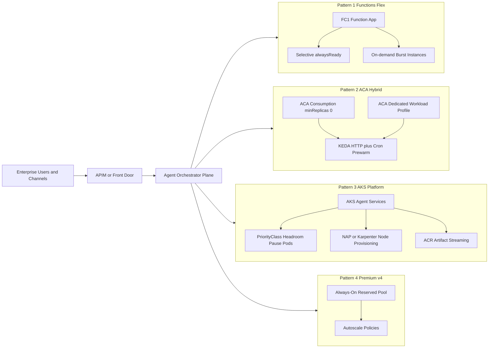
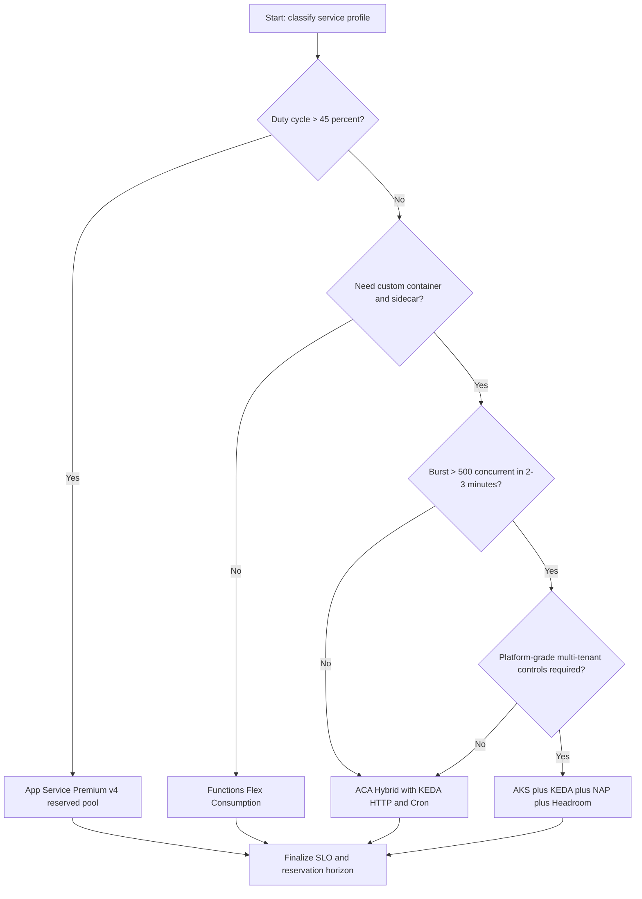

# Enterprise Elastic Scale-to-Zero Burst Agent Hosting Selection FAQ: Functions Flex Consumption vs ACA KEDA Hybrid vs AKS NAP+Headroom vs App Service Premium v4
> Audience: Cloud & AI Solution Architects, platform engineering, SRE, FinOps, and enterprise architecture boards.  
> Scope: I/O-bound enterprise agent orchestrators and MCP servers with `0 RPS` overnight, then `500+` concurrent bursts around Monday `09:00`, with `15–60s` SSE waits.  
> Objective: keep idle-period spend close to zero while preventing morning burst cold-start collapse.
## 1. Decision Boundary: Model the Workload Shape First, Pick the Platform Second
These systems are often mislabeled as ordinary web APIs.
In reality they are mixed workloads:
high async wait time,
strong diurnal traffic asymmetry,
and sharp time-window bursts.
CPU is rarely the first bottleneck.
The architecture control points are:
connection orchestration,
burst absorption behavior,
and scale-up readiness.
If those are not designed explicitly,
tail latency explodes during peak windows.
Use four baseline metrics in review gates.
- Burst-visible cold-start `P99`.  
- Async concurrency per instance/pod.  
- Stable maximum SSE stream duration.  
- Effective monthly duty cycle per agent service.  
If duty cycle is persistently below `20%`,
true scale-to-zero routes usually dominate.
If duty cycle is consistently above `45%`,
reserved always-on pools often become more economical.
The key architectural question is not “serverless or not”.
It is “where do you absorb burst shock”.
At instance scale layer,
at container pre-warm layer,
or at node headroom layer.
## 2. Four Candidate Patterns and Their Practical Fit
This guide compares four production-capable Azure patterns.
All four can work.
Their operational burden and cost inflection points are very different.
Pattern 1 is Functions Flex Consumption (`FC1`).
It emphasizes pay-per-use with selective warm retention.
Pattern 2 is ACA hybrid hosting.
Consumption tier for nights and weekends.
Dedicated profiles for business-hour heavy paths.
KEDA `http` + `cron` as a dual trigger strategy.
Pattern 3 is AKS + KEDA + NAP/Karpenter + Headroom.
Low-priority pause pods absorb immediate bursts.
Node provisioning catches up asynchronously in the background.
Pattern 4 is App Service Premium v4 always-on pools.
It does not target zero idle.
It targets stable predictable latency for high-duty systems.
Rule of thumb:
low duty cycle favors Pattern 1 or 2.
platform-scale multi-tenant density favors Pattern 3.
high-duty predictable enterprise lanes favor Pattern 4.
## 3. Pattern 1: Azure Functions Flex Consumption (`FC1`) with Selective `alwaysReady`
Pattern 1 is strongest for long-tail cost control.
When many departmental agents are mostly idle,
Flex reduces standing cost significantly.
The design goal is not “everything cold”.
The goal is “hot where it matters”.
Keep auth, routing, and high-hit orchestrator functions warm.
Keep long-tail handlers on pure on-demand scale.
For async I/O-bound turns,
tune HTTP concurrency by function type.
Higher concurrency for lightweight orchestrators.
Lower concurrency for heavy parsing or CPU-bound handlers.
Strengths:
- Fast burst-out behavior with scale envelope up to `1,000` instances.  
- VNet private networking support for enterprise boundaries.  
- Strong integration with event triggers and queue-driven orchestration.
Trade-offs:
- Long-lived stream-heavy workflows are less ergonomic than container-first paths.  
- Sidecar-heavy designs are constrained.  
- Local state reuse across instances is limited.
Practical recommendation:
keep control-plane turns on Flex,
move stream-heavy or stateful proxy lanes to ACA or AKS.
This creates a clean split between lightweight control and heavy runtime.
## 4. Pattern 2: ACA Hybrid Consumption + Dedicated Profiles with KEDA HTTP/Cron
ACA offers a strong balance:
container freedom with managed platform operations.
You keep custom images and sidecars,
without taking full AKS control-plane ownership.
For diurnal enterprise traffic,
single-tier ACA is often suboptimal.
A hybrid profile split works better.
Consumption for low-duty services.
Dedicated profiles for sustained daytime streams.
KEDA `http` rules react to queued request pressure.
KEDA `cron` pre-warms before business-hour spikes,
for example at `08:45` in local time.
This combination materially reduces Monday morning jitter.
Strengths:
- `minReplicas: 0` for idle-period scale-to-zero.  
- Better long-stream and custom container flexibility than function-only paths.  
- Sidecar-friendly integrations for telemetry and policy proxies.
Trade-offs:
- Container cold pull still matters under extreme first-wave bursts.  
- Poor image hygiene amplifies tail startup latency.  
- Config surface area is larger than Pattern 1.
Practical recommendation:
time-zone-aware pre-warm schedules,
plus mandatory image-size governance in CI,
are critical for stable behavior.
## 5. Pattern 3: AKS + KEDA + NAP/Karpenter + PriorityClass Headroom + ACR Streaming
For multi-hundred-service platforms and strong tenant isolation needs,
AKS is often the long-term operating plane.
But it only achieves low burst latency with deliberate headroom design.
The headroom mechanism uses low-priority pause pods.
They reserve schedulable capacity and can be preempted immediately.
Business pods can land in seconds on already-ready nodes.
NAP/Karpenter then replenishes capacity asynchronously.
ACR artifact streaming reduces startup drag from image materialization.
This is especially useful when many services scale out simultaneously.
Strengths:
- Highest flexibility and scaling ceiling for platform teams.  
- Fine-grained quota, class, and tenant policy controls.  
- Excellent fit for complex protocol gateways and model/tool routers.
Trade-offs:
- Highest operational complexity and SRE maturity requirement.  
- Under-sized headroom still causes queueing spikes.  
- Cost governance must be explicit at pool and tenant granularity.
Practical recommendation:
size headroom by observed burst probability,
not by permanent worst-case paranoia.
Continuously recalibrate with weekly peak replays.
## 6. Pattern 4: Azure App Service Premium v4 / Reserved Always-On Pools
If duty cycle is high and stable,
always-on pools can be the most predictable option.
This is common for enterprise-core global agents
that do not truly go idle overnight.
Premium v4 emphasizes operational predictability.
Startup jitter is minimized by resident capacity.
Ops workflows are mature in many enterprises.
Reservation plans improve cost stability.
Strengths:
- Stable first-response behavior for strict internal SLAs.  
- Lower operational learning curve than AKS-heavy paths.  
- Strong compatibility with existing App Service governance models.
Trade-offs:
- Idle-time spend is materially higher than scale-to-zero paths.  
- Burst ceiling and workload specialization are lower than AKS platforms.  
- Sidecar/runtime freedom is below ACA/AKS levels.
Practical recommendation:
keep high-duty predictable lanes on Premium,
offload long-tail sporadic lanes to Flex/ACA.
This layered portfolio avoids overpaying for idle demand.
## 7. Four-Tier Burst Absorption Topology (Mermaid)

The diagram represents a portfolio view.
These are not mutually exclusive.
Large enterprises often run two or more patterns in parallel.
## 8. SA Decision Flow by Duty Cycle and Stream Duration (Mermaid)

Run this decision tree before SKU sizing debates.
It reduces architecture churn by keeping intent and constraints explicit.
## 9. Config Example #1: ACA Bicep with Combined KEDA `http` + `cron`
```bicep
resource env 'Microsoft.App/managedEnvironments@2024-03-01' existing = {
  name: 'aca-agent-prod-env'
}
resource app 'Microsoft.App/containerApps@2024-03-01' = {
  name: 'agent-orchestrator-aca'
  location: resourceGroup().location
  properties: {
    managedEnvironmentId: env.id
    configuration: {
      ingress: {
        external: true
        targetPort: 8080
        transport: 'http'
      }
      activeRevisionsMode: 'Single'
    }
    template: {
      containers: [
        {
          name: 'orchestrator'
          image: 'acrprod.azurecr.io/agent/orchestrator:2026.11.22'
          resources: {
            cpu: 1.0
            memory: '2Gi'
          }
        }
      ]
      scale: {
        minReplicas: 0
        maxReplicas: 120
        rules: [
          {
            name: 'http-burst'
            custom: {
              type: 'http'
              metadata: {
                concurrentRequests: '40'
              }
            }
          }
          {
            name: 'weekday-prewarm'
            custom: {
              type: 'cron'
              metadata: {
                timezone: 'Asia/Shanghai'
                start: '45 8 * * 1-5'
                end: '15 10 * * 1-5'
                desiredReplicas: '12'
              }
            }
          }
        ]
      }
    }
  }
}
```
This snippet captures three practical controls:
overnight scale-to-zero,
weekday pre-warm,
and request-pressure burst expansion.
## 10. Config Example #2: AKS PriorityClass Headroom + NodePool
```yaml
apiVersion: scheduling.k8s.io/v1
kind: PriorityClass
metadata:
  name: headroom-low
value: -5
globalDefault: false
description: "Preemptible headroom pods for burst absorption"
---
apiVersion: apps/v1
kind: Deployment
metadata:
  name: headroom-buffer
  namespace: platform-system
spec:
  replicas: 60
  selector:
    matchLabels:
      app: headroom-buffer
  template:
    metadata:
      labels:
        app: headroom-buffer
    spec:
      priorityClassName: headroom-low
      containers:
        - name: pause
          image: mcr.microsoft.com/oss/kubernetes/pause:3.9
          resources:
            requests:
              cpu: "500m"
              memory: "512Mi"
            limits:
              cpu: "500m"
              memory: "512Mi"
---
apiVersion: karpenter.sh/v1beta1
kind: NodePool
metadata:
  name: agent-general-burst
spec:
  template:
    spec:
      requirements:
        - key: kubernetes.io/arch
          operator: In
          values: ["amd64"]
        - key: node.kubernetes.io/instance-type
          operator: In
          values: ["Standard_D16d_v6","Standard_D32d_v6"]
      taints:
        - key: workload
          value: agent
          effect: NoSchedule
  disruption:
    consolidationPolicy: WhenUnderutilized
  limits:
    cpu: "4000"
```
The core idea is architectural separation:
seconds-level absorption by headroom,
minutes-level replenishment by auto-provisioning.
## 11. 12-Dimension Selection Matrix
| Dimension | Functions Flex FC1 | ACA Hybrid + KEDA | AKS + NAP + Headroom | App Service Premium v4 |
|---|---|---|---|---|
| 1. Overnight scale-to-zero | High | High | Medium | Low |
| 2. Monday 9 AM burst absorption | Medium-high | High | High | Medium |
| 3. SSE stream stability | Medium | High | High | Medium-high |
| 4. Custom container/sidecar freedom | Low | High | High | Medium |
| 5. Multi-tenant governance granularity | Medium | Medium-high | High | Medium |
| 6. Operational complexity | Low | Medium | High | Low |
| 7. Release/rollback flexibility | Medium | High | High | Medium |
| 8. Peak scaling ceiling | High | High | Very high | Medium |
| 9. Cost predictability | Medium | Medium | Medium | High |
| 10. Idle-period cost efficiency | High | High | Medium | Low |
| 11. Team onboarding curve | Low | Medium | High | Low |
| 12. Best fit for >45% duty cycle | Low | Medium | Medium-high | High |
The most common enterprise answer is layered adoption.
Long-tail lanes on Flex/ACA.
Core high-duty lanes on Premium/AKS.
## 12. Quantitative Comparison: Burst `P99`, Max SSE Duration, and 50-Agent Monthly TCO
> Assumptions: 50 enterprise agent services, weekday primary peak windows, near-zero overnight traffic.  
> Values are for architecture planning comparison, not commercial commitments.  
> Units: burst cold-start in seconds, maximum stable SSE duration in seconds, TCO in USD/month.
| Pattern | Burst cold-start P99 | Max stable SSE duration | 50-agent monthly TCO | Interpretation |
|---|---:|---:|---:|---|
| Functions Flex FC1 | 2.8 | 120 | 6,900 | Lowest long-tail idle cost, moderate stream capability |
| ACA Hybrid + KEDA | 1.9 | 900 | 8,400 | Best general enterprise balance |
| AKS + NAP + Headroom | 1.2 | 1,800 | 11,600 | Highest burst capacity and control |
| App Service Premium v4 | 0.9 | 600 | 9,700 (about 8,500 with 1Y reservation) | Stable high-duty predictable lane |
Do not optimize only for the smallest infrastructure number.
Peak-hour timeout impact on business outcomes
often costs more than moderate monthly platform deltas.
## 13. Enterprise Scenario A: Cross-BU Office Agents (Long-Tail Dominant Traffic)
This scenario has many agent services with low per-service utilization.
Examples:
expense FAQ assistant,
HR workflow helper,
contract status concierge.
Traffic is concentrated in business-hour windows.
Recommended architecture:
control and lightweight orchestration on Functions Flex,
stream-heavy lanes on ACA Consumption,
targeted cron pre-warm before business peaks.
Why it works:
idle-period cost remains low,
morning jitter is reduced,
and teams avoid full AKS operational overhead.
## 14. Enterprise Scenario B: Multi-Tenant Agent Platform (High Burst + Strong Isolation)
This scenario appears in B2B SaaS platform programs.
Tenant count is high,
burst concurrency is high,
and governance requirements are strict.
MCP gateway, model routing, and policy audit all need central control.
Recommended architecture:
AKS + NAP + headroom as the primary serving plane,
ACA for long-tail overflow and incubation lanes,
Premium v4 for specific always-on core services.
Why it works:
AKS provides strongest control granularity,
headroom protects first-wave burst latency,
and asynchronous node provisioning restores buffer capacity.
## 15. Day-0 / Day-2 Checklist and 8 Quantitative FAQs
### Day-0 (before launch)
- Build a 30-day traffic profile with hourly burst and stream-duration distributions.  
- Tag each service by duty-cycle band (`<20%`, `20–45%`, `>45%`).  
- Define SLOs for first-byte, burst `P99`, and stream interruption rate.  
- Configure time-zone-aware cron pre-warm windows for ACA lanes.  
- Define AKS headroom minimum budget and replenishment RTO targets.  
- Enforce image-size and startup-budget guardrails in CI/CD.  
- Apply mandatory cost tags (env, tenant, service, team, region).  
- Run Monday-peak replay tests before production cutover.
### Day-2 (operations)
- Review burst cold-start `P95/P99` and queueing delay weekly.  
- Track pre-warm hit rates and over-warm waste weekly.  
- Measure headroom preemption and refill timings weekly.  
- Reclassify duty-cycle bands monthly as usage evolves.  
- Review reservation utilization and savings monthly.  
- Run failure-injection drills for cross-tier failover paths monthly.  
- Audit stream interruption root causes and retry-amplification monthly.  
- Recompute TCO break-even quarterly.
**Q1: If overnight traffic is near zero, what should we start with?**  
A1: Start with Functions Flex or ACA Consumption and add selective pre-warm only for peak-sensitive entry points.
**Q2: What is the biggest risk in a 500-concurrent Monday burst?**  
A2: Combined image cold pull, node unavailability, and no pre-warm policy; use cron pre-warm or AKS headroom to mitigate.
**Q3: Is Functions Flex a good fit for long SSE workloads?**  
A3: It fits short-to-medium orchestration streams; sustained long-stream concurrency is usually more stable on ACA or AKS.
**Q4: When does AKS headroom become worth the complexity?**  
A4: When burst absorption must be seconds-level and multi-tenant governance granularity becomes a core requirement.
**Q5: Why keep App Service Premium v4 in the decision set?**  
A5: For high-duty workloads it offers predictable latency and simpler operations, often improving risk-adjusted economics.
**Q6: Does pre-warming waste money?**  
A6: Yes, but controlled pre-warm windows usually cost less than repeated peak-hour timeout incidents.
**Q7: What signals indicate migration from ACA to AKS?**  
A7: Strong tenant isolation requirements, complex scheduling needs, and platform-standardized governance are common triggers.
**Q8: How should a 50-agent portfolio be layered in practice?**  
A8: A common pattern is Flex/ACA for long-tail lanes plus Premium/AKS for core high-duty lanes, with unified gateway governance.
