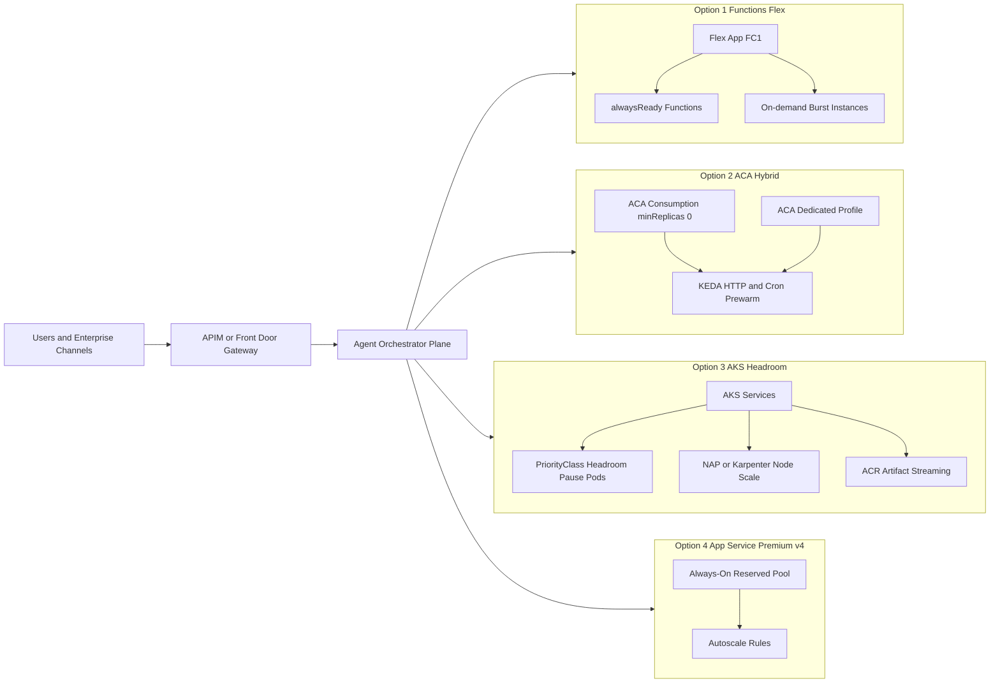
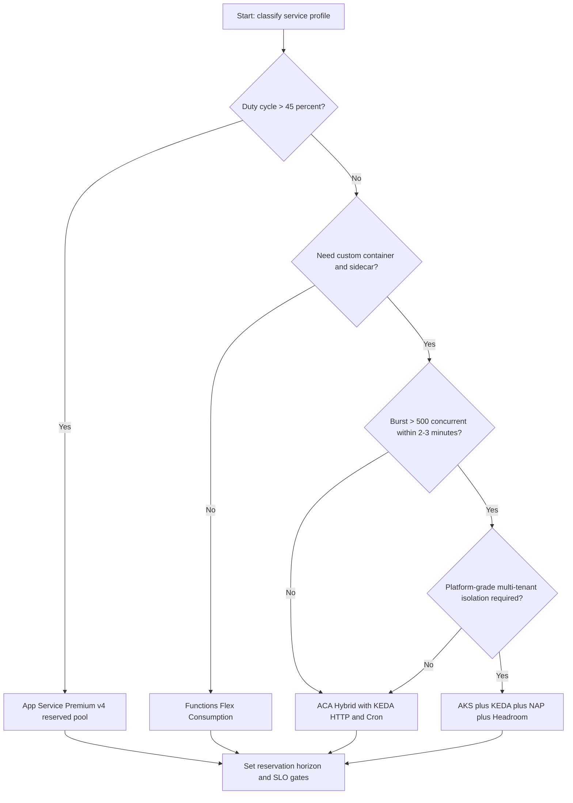

# 企业弹性 Scale-to-Zero 突发 Agent 宿主选型 FAQ：Functions Flex Consumption vs ACA KEDA 混合档位 vs AKS NAP+Headroom vs App Service Premium v4
> 适用角色：Cloud & AI Solution Architect、平台工程、SRE、FinOps、企业应用架构委员会。  
> 场景边界：I/O 密集型企业 Agent 编排器与 MCP 服务器，夜间 `0 RPS`，工作日 `09:00` 出现 `500+` 并发突发，请求中存在 `15–60s` SSE/LLM/工具等待。  
> 目标：在稳定 SLO 的前提下，把空闲时段成本压到接近零，并避免早高峰冷启动雪崩。
## 1. 决策边界：先回答“负载像什么”，再回答“平台选什么”
这类工作负载最容易误判成“普通 Web API”。
实际上它是“高并发 I/O 等待 + 时间段强波峰”的混合体。
CPU 并不是主要瓶颈。
连接管理、并发调度和冷启动吸收能力才是关键。
在架构评审中，建议先锁定四个基准指标。
- 峰值突发 `P99` 冷启动可见时延。  
- 单实例可承载的异步并发上限。  
- SSE 长连接稳定时长与中断率。  
- 单个 Agent 组合（模型+工具）在 30 天中的有效 duty cycle。  
如果 duty cycle 长期低于 `20%`，
优先考虑真正按需计费的 Scale-to-Zero 路线。
如果 duty cycle 长期高于 `45%`，
预留型常驻池的成本曲线可能更优。
真正的架构分歧不在“是否无服务器”。
而在“你把突发吸收放在哪一层”。
可以放在平台实例扩容层。
可以放在容器池预热层。
也可以放在节点级头部冗余层。
## 2. 四种候选架构总览与推荐边界
本指南比较四条在 Azure 上可生产落地的路径。
每条路径都能跑起来。
但治理复杂度与成本拐点完全不同。
路径一是 Functions Flex Consumption（`FC1`）。
特点是按需计费与快速弹出实例。
并通过 `alwaysReady` 小规模保温关键函数。
路径二是 ACA 混合架构。
夜间使用 Consumption `minReplicas: 0`。
白天关键服务挂到 Dedicated Workload Profile。
用 KEDA `http` + `cron` 组合控制预热窗口。
路径三是 AKS + KEDA + NAP/Karpenter + Headroom。
通过低优先级 `pause` Pods 预占可抢占资源。
把 `3s` 内突发吸收交给已就绪节点。
并让 NAP 在后台异步补齐节点容量。
路径四是 App Service Premium v4 常驻池。
放弃夜间归零，
换取 24x7 稳定首包时延和最小运维路径。
适合高 duty cycle 的核心企业代理。
推荐原则：
低 duty cycle 看路径一或路径二。
中高并发且多租户平台看路径三。
高 duty cycle 且治理求稳看路径四。
## 3. 路径一：Azure Functions Flex Consumption（FC1）+ Selective alwaysReady
Functions Flex Consumption 的价值是把“空闲成本”压到最低。
对大量长尾部门 Agent，
夜间和周末几乎可以做到接近零的实例驻留成本。
该模式的关键不是盲目全冷启动。
而是“选择性 alwaysReady”。
把登录、鉴权、路由、热点工具代理函数设为保温实例。
其余低频函数保持纯按需。
对 I/O 密集型 Agent Turn，
要把每实例并发调高到异步友好区间。
例如按函数类型区分 `httpConcurrency`。
解析器与编排器高并发。
重 CPU 函数低并发。
架构优势：
- 突发扩展速度快，官方上限可到 `1,000` 实例级别。  
- VNet 私网集成可满足企业安全边界。  
- 与 Event Grid、Service Bus、Queue 触发器结合顺滑。  
架构约束：
- 单请求超长运行与复杂会话保持不如容器平台直观。  
- 大量自定义 sidecar 诉求受限。  
- 实例局部缓存复用能力较弱。  
典型建议：
把编排控制面优先放在 Flex。
把重连接态流服务放在 ACA 或 AKS。
形成“轻控制 + 重流式”的双平面。
## 4. 路径二：ACA 混合 Consumption + Dedicated Workload Profiles（KEDA HTTP + Cron 预热）
ACA 的核心优势是容器自由度和平台托管平衡。
你可以保留自定义镜像、sidecar、连接代理、协议桥。
同时不承担 AKS 级别的控制面运维负担。
在日内波峰明显的企业负载中，
推荐“混合档位”而不是单档位。
低频服务跑 Consumption。
高频流式入口跑 Dedicated Workload Profile。
这样可同时兼顾夜间降本和白天稳定。
KEDA `http` 触发适合按排队长度触发扩缩容。
KEDA `cron` 触发适合在 `08:45` 预热。
两者叠加可把周一 `09:00` 突发抖动显著压低。
架构优势：
- `minReplicas: 0` 可实现夜间归零。  
- SSE、WebSocket、长连接代理能力较完整。  
- 支持 Dapr、OpenTelemetry、sidecar 安全代理。  
架构约束：
- 极端突发下仍受容器冷拉起与镜像体积影响。  
- 若镜像治理不严，首轮扩容尾延迟会被放大。  
- 配置维度比 Functions 更复杂，需要平台基线模板。  
典型建议：
预热窗口由业务时区驱动。
按区域配置本地时区 cron。
并在发布流程中强制镜像瘦身门禁。
## 5. 路径三：AKS + KEDA + NAP/Karpenter + PriorityClass Headroom + ACR Artifact Streaming
当平台目标是“数百 Agent 服务密度 + 多租户隔离 + 自定义组件自由度”，
AKS 往往是最终归宿。
但它不是天然低延迟。
必须通过 headroom 设计解决第一波突发吸收。
Headroom 方案核心是低优先级 `pause` Pods。
这些 Pod 预占资源但可被高优先级业务 Pod 立刻驱逐。
因此业务突发可在已有节点上 `3s` 级落位。
同时 NAP/Karpenter 在后台补节点，恢复缓冲池。
ACR Artifact Streaming 可减少镜像完整落盘等待。
对多服务同时扩容的首波阶段，
能明显降低镜像拉取放大效应。
架构优势：
- 弹性上限高，适合平台化多团队共享。  
- 资源治理粒度细，可做租户级配额和优先级。  
- 对协议网关、模型代理、工具路由器等组件最灵活。  
架构约束：
- 平台复杂度最高，SRE 体系要求最严。  
- 若 headroom 预算不足，突发时仍会出现调度排队。  
- 成本治理必须细化到节点池与租户标签。  
典型建议：
把 headroom 预算与业务峰值概率绑定。
不要按“最坏永远发生”设常驻冗余。
用周一早高峰历史回放持续校准。
## 6. 路径四：App Service Premium v4 / 预留 Always-On 池
当业务 duty cycle 高且稳定，
常驻池可能是最省心的企业路径。
尤其是总部级核心代理，
工作日与夜间都有持续流量，
Scale-to-Zero 的收益会明显变小。
Premium v4 的价值在于可预测性。
实例常驻、冷启动少、发布和运维路径成熟。
结合 1 年或 3 年预留可显著压低单位成本波动。
架构优势：
- 稳定首包时延，适合高 SLA 内部系统。  
- 平台治理简单，运维团队学习曲线低。  
- 与企业现有 App Service 运维体系兼容性高。  
架构约束：
- 夜间空闲成本不可忽略。  
- 弹性天花板与超大突发吸收能力不如 AKS 平台化。  
- 自定义运行时和 sidecar 自由度低于 ACA/AKS。  
典型建议：
把高 duty cycle 服务放 Premium 常驻层。
把低 duty cycle 长尾服务外溢到 Functions/ACA。
形成分层成本结构。
## 7. 四层冷启动与突发吸收拓扑（Mermaid）

这张图表达的不是替代关系。
而是四条可并存的承载层。
许多大型企业最终是组合部署。
## 8. 按 duty cycle 与流时长的 SA 决策流（Mermaid）

在评审会里建议先走这个流程。
再进入 SKU 和预算细化。
可显著减少反复改方案的成本。
## 9. 配置示例一：ACA Bicep（KEDA HTTP + Cron 预热）
```bicep
resource env 'Microsoft.App/managedEnvironments@2024-03-01' existing = {
  name: 'aca-agent-prod-env'
}
resource app 'Microsoft.App/containerApps@2024-03-01' = {
  name: 'agent-orchestrator-aca'
  location: resourceGroup().location
  properties: {
    managedEnvironmentId: env.id
    configuration: {
      ingress: {
        external: true
        targetPort: 8080
        transport: 'http'
      }
      activeRevisionsMode: 'Single'
    }
    template: {
      containers: [
        {
          name: 'orchestrator'
          image: 'acrprod.azurecr.io/agent/orchestrator:2026.11.22'
          resources: {
            cpu: 1.0
            memory: '2Gi'
          }
        }
      ]
      scale: {
        minReplicas: 0
        maxReplicas: 120
        rules: [
          {
            name: 'http-burst'
            custom: {
              type: 'http'
              metadata: {
                concurrentRequests: '40'
              }
            }
          }
          {
            name: 'weekday-prewarm'
            custom: {
              type: 'cron'
              metadata: {
                timezone: 'Asia/Shanghai'
                start: '45 8 * * 1-5'
                end: '15 10 * * 1-5'
                desiredReplicas: '12'
              }
            }
          }
        ]
      }
    }
  }
}
```
这个模板体现三点实践。
夜间归零。
上班前预热。
突发按并发请求自动放大。
## 10. 配置示例二：AKS Headroom（PriorityClass + Pause Deployment + NodePool）
```yaml
apiVersion: scheduling.k8s.io/v1
kind: PriorityClass
metadata:
  name: headroom-low
value: -5
globalDefault: false
description: "Preemptible headroom pods for burst absorption"
---
apiVersion: apps/v1
kind: Deployment
metadata:
  name: headroom-buffer
  namespace: platform-system
spec:
  replicas: 60
  selector:
    matchLabels:
      app: headroom-buffer
  template:
    metadata:
      labels:
        app: headroom-buffer
    spec:
      priorityClassName: headroom-low
      containers:
        - name: pause
          image: mcr.microsoft.com/oss/kubernetes/pause:3.9
          resources:
            requests:
              cpu: "500m"
              memory: "512Mi"
            limits:
              cpu: "500m"
              memory: "512Mi"
---
apiVersion: karpenter.sh/v1beta1
kind: NodePool
metadata:
  name: agent-general-burst
spec:
  template:
    spec:
      requirements:
        - key: kubernetes.io/arch
          operator: In
          values: ["amd64"]
        - key: node.kubernetes.io/instance-type
          operator: In
          values: ["Standard_D16d_v6","Standard_D32d_v6"]
      taints:
        - key: workload
          value: agent
          effect: NoSchedule
  disruption:
    consolidationPolicy: WhenUnderutilized
  limits:
    cpu: "4000"
```
要点不是 YAML 语法本身。
而是把“秒级吸收”和“分钟级补量”拆开治理。
前者靠 headroom。
后者靠 NAP/Karpenter。
## 11. 12 维选型矩阵（架构、运维、成本一体化）
| 维度 | Functions Flex FC1 | ACA Hybrid + KEDA | AKS + NAP + Headroom | App Service Premium v4 |
|---|---|---|---|---|
| 1. 夜间归零能力 | 高 | 高 | 中 | 低 |
| 2. 周一 9 点突发吸收 | 中高 | 高 | 高 | 中 |
| 3. SSE 长连接稳定性 | 中 | 高 | 高 | 中高 |
| 4. 自定义容器/sidecar | 低 | 高 | 高 | 中 |
| 5. 多租户治理粒度 | 中 | 中高 | 高 | 中 |
| 6. 平台运维复杂度 | 低 | 中 | 高 | 低 |
| 7. 发布与回滚灵活性 | 中 | 高 | 高 | 中 |
| 8. 峰值扩展上限 | 高 | 高 | 很高 | 中 |
| 9. 成本可预测性 | 中 | 中 | 中 | 高 |
| 10. 空闲期成本控制 | 高 | 高 | 中 | 低 |
| 11. 团队学习门槛 | 低 | 中 | 高 | 低 |
| 12. 适合 duty cycle >45% | 低 | 中 | 中高 | 高 |
实践上最常见的是双层组合。
长尾服务放 Functions 或 ACA。
核心高 duty 服务放 Premium 或 AKS 稳态池。
## 12. 定量对比：P99 冷启动、最大 SSE 时长、50-Agent 月度 TCO
> 假设：50 个企业 Agent 服务，工作日 9:00-18:00 主峰，夜间接近零流量。  
> 说明：以下数据用于架构规划对比，不是官方价格承诺。  
> 指标单位：P99 冷启动（秒）、最大 SSE 建议时长（秒）、月度 TCO（USD）。
| 方案 | P99 突发冷启动 | 建议最大 SSE 时长 | 50-Agent 月度 TCO | 结论 |
|---|---:|---:|---:|---|
| Functions Flex FC1 | 2.8 | 120 | 6,900 | 长尾成本最低，复杂流式能力中等 |
| ACA Hybrid + KEDA | 1.9 | 900 | 8,400 | 平衡型最优，适合多数企业 |
| AKS + NAP + Headroom | 1.2 | 1,800 | 11,600 | 峰值能力最强，需成熟平台团队 |
| App Service Premium v4 | 0.9 | 600 | 9,700（1Y 预留后约 8,500） | 高 duty cycle 稳态可靠 |
阅读这张表时不要只看最低价。
应把可用性风险的隐性成本也纳入。
例如周一早高峰超时导致业务中断，
其代价通常高于几百美元基础设施差额。
## 13. 企业场景 A：跨 BU 办公自动化 Agent 组合（长尾流量为主）
该场景特点是 Agent 数量多、单个流量低、夜间几乎归零。
例如财务报销问答、HR 办公流程、合同状态追踪。
业务峰值集中在上班后的 90 分钟。
推荐主架构：
编排和轻工具调用放 Functions Flex。
需要长连接和定制容器的服务放 ACA Consumption。
关键入口加 `08:45` 预热规则。
推荐原因：
可以把空闲成本压得很低。
并通过小规模预热避免早高峰全冷启动抖动。
不需要引入 AKS 级运维体系。
## 14. 企业场景 B：多租户 Agent 平台（高峰突发 + 高隔离要求）
该场景通常来自 B2B SaaS 平台团队。
租户数量多、并发峰值高、隔离要求强。
并且需要统一治理 MCP 网关、模型路由、策略审计。
推荐主架构：
核心承载层放 AKS + NAP + Headroom。
长尾与试验型服务外溢到 ACA。
部分总部常驻核心服务可放 Premium v4。
推荐原因：
AKS 能提供最细颗粒度的资源和租户治理。
headroom 把第一波突发吸收在秒级。
NAP 让后续容量补齐自动完成。
## 15. Day-0 / Day-2 清单与 8 个定量 FAQ
### Day-0（上线前）
- 建立 30 天流量画像，至少包含小时粒度并发和停留时长分布。  
- 为每个 Agent 服务标注 duty cycle 分组（`<20%`、`20–45%`、`>45%`）。  
- 给流式入口定义可量化 SLO（`TTFB`、`P99`、中断率）。  
- 为 ACA/KEDA 设定时区化 cron 预热窗口。  
- 为 AKS headroom 定义最小缓冲预算和回补时限。  
- 为镜像发布建立体积门禁，避免突发期镜像拖慢扩容。  
- 建立成本标签体系（环境、租户、服务、团队、区域）。  
- 演练“周一 9 点峰值回放”，验证扩容链路。
### Day-2（运营期）
- 每周复盘峰值 `P95/P99` 冷启动与排队时延。  
- 每周评估预热命中率与过度预热浪费。  
- 每周检查 headroom 被驱逐时间与补量耗时。  
- 每月校准 duty cycle 分组与承载层映射。  
- 每月评估预留实例使用率与节省率。  
- 每月回放故障注入，验证跨层降级路径。  
- 每月审计长连接中断原因和重试放大效应。  
- 每季度重做 TCO 拐点分析。  
**Q1：夜间几乎无流量，应该默认选哪条？**  
A1：优先从 Functions Flex 或 ACA Consumption 起步，再对热点入口做 selective 预热。  
**Q2：周一 9 点 500 并发尖峰最怕什么？**  
A2：最怕“镜像冷拉取 + 节点未就绪 + 无预热”叠加，建议至少启用 cron 预热或 headroom。  
**Q3：SSE 长连接 60 秒以上时，Functions 是否合适？**  
A3：可用于中短连接编排；若大量长连接并发，ACA 或 AKS 通常更稳。  
**Q4：什么时候值得上 AKS Headroom？**  
A4：当突发吸收要求进入秒级且多租户平台治理需求明显上升时，AKS 方案价值最大。  
**Q5：App Service Premium v4 为什么仍有价值？**  
A5：在 duty cycle 高于 `45%` 且要求稳定低抖动时，常驻池常比反复扩缩容更可预测。  
**Q6：预热会不会浪费很多钱？**  
A6：会，但可控；关键是把预热时间窗压到真实峰值前后，并按周复盘命中率。  
**Q7：如何判断该从 ACA 迁移到 AKS？**  
A7：当你需要细粒度租户隔离、复杂资源调度、或跨团队平台标准化治理时，是典型迁移信号。  
**Q8：50-Agent 组合里如何做分层承载最稳妥？**  
A8：常见做法是“长尾放 Functions/ACA，核心放 Premium/AKS”，并用统一网关做路由与审计。  
