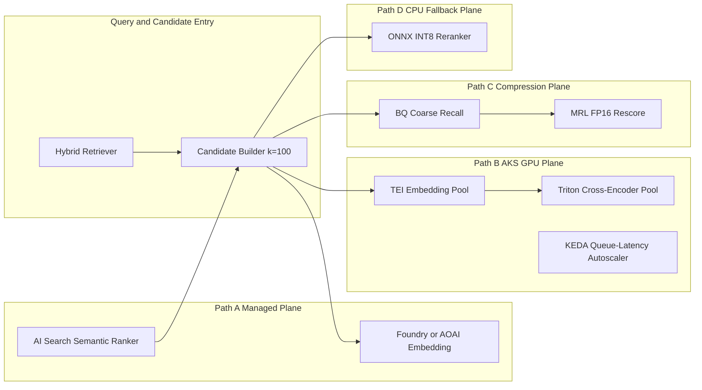
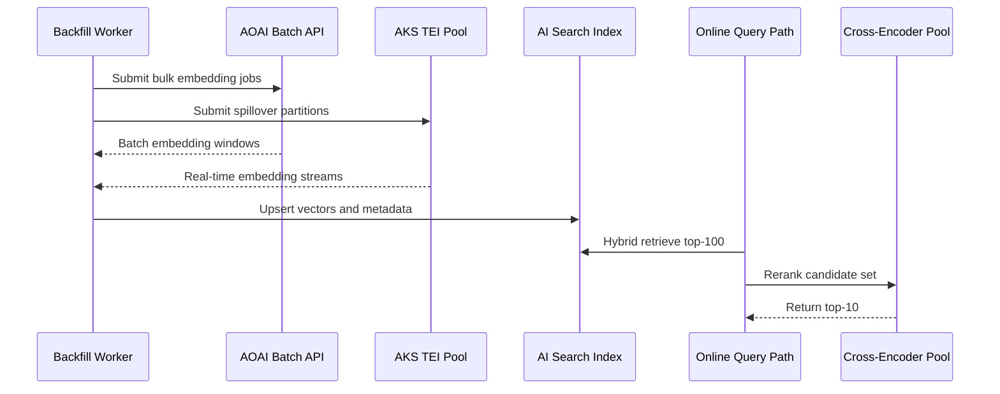

# Enterprise Embedding and Reranker Serving FAQ: Foundry MaaS vs AKS TEI/Triton vs MRL+BQ Two-Stage vs CPU INT8 ONNX
> 🌐 **Language Switch**: [中文](embedding-reranker-serving-foundry-maas-vs-aks-tei-triton-vs-matryoshka-cpu-onnx-selection-faq.md) | **English (current)**  
> Audience: Cloud & AI Solution Architects, platform engineering leads, search relevance owners, LLMOps/SRE, and FinOps stakeholders.  
> Scope: Infrastructure and governance decisions for high-throughput embedding, late-interaction retrieval, and cross-encoder reranking on Azure.  
> Out-of-scope: This guide does not repeat GPU fractional slicing (#15) or broad RAG product comparisons (#31/#32).  
## 1. Executive outcome: retrieval model serving is now the first bottleneck
Many teams optimize only the primary chat model.  
In production agent systems, retrieval quality often fails first.  
When embedding throughput saturates, indexing backlogs grow quickly.  
When reranker latency spikes, user trust drops immediately.  
When candidate scoring is unstable, downstream answer quality looks random.  
When platform quotas are opaque, incident response becomes reactive.  
A modern enterprise stack needs a dedicated retrieval serving plane.  
This guide provides four architecture paths for that plane.  
Path A is managed Foundry/AOAI embedding plus AI Search semantic reranking.  
Path B is AKS GPU pools with TEI and Triton dynamic batching.  
Path C is Matryoshka plus binary quantization in asymmetric two-stage search.  
Path D is CPU INT8 ONNX fallback for constrained sovereign regions.  
These paths are complementary, not mutually exclusive.  
The production target is a blended operating model.  
The model must support latency SLOs and predictable cost curves.  
The model must preserve relevance while traffic and corpus size increase.  
The model must remain operable under quota pressure and region limits.  
The model must provide auditable routing and traceability evidence.  
## 2. Decision frame and measurable success criteria
Architecture decisions should start with measurable boundaries.  
A good boundary set combines quality, latency, throughput, and cost.  
A mature boundary set also includes quota and governance metrics.  
Recommended online objective is end-to-end rerank `P95 <= 25ms`.  
Recommended candidate set is `k=100` reduced to `k=10` output.  
Recommended quality baseline uses `NDCG@10` and `Recall@50`.  
Recommended cost metric is USD per 1K queries.  
Recommended ingest metric is chunks per second at steady state.  
Recommended batch objective is a full `100M` document re-embed window.  
A practical first target is completion in `<= 36` hours.  
Quota SLO should include two-hour burst without queue collapse.  
Governance SLO should include request-to-model-version trace coverage.  
Operational SLO should include retry-rate and timeout-rate ceilings.  
Change SLO should include controlled canary rollout windows.  
All four architecture paths should be evaluated against the same dataset.  
All path comparisons should use the same query mix and language mix.  
All cost comparisons should include standby and orchestration overhead.  
All quality comparisons should be tracked after every model change.  
Without this frame, platform choices become preference debates.  
With this frame, the conversation becomes deterministic engineering.  
## 3. Four-way architecture comparison at enterprise scale
Path A optimizes delivery speed and governance simplicity.  
Path B optimizes sustained high throughput and low unit cost.  
Path C optimizes storage economics and index scalability.  
Path D optimizes region portability and quota resilience.  
Path A reduces platform ownership burden for platform teams.  
Path B increases platform ownership but unlocks deep tuning.  
Path C requires evaluation discipline to avoid quality drift.  
Path D offers predictable fallback behavior under GPU scarcity.  
Path A is strong for low-to-mid steady loads and pilot phases.  
Path B is strong for high and sustained production traffic.  
Path C is strong for very large indexes and long-term cost control.  
Path D is strong for sovereign constraints and deterministic continuity.  
Most enterprise deployments combine all four paths with routing policies.  
A serves baseline and managed compliance coverage.  
B serves peak and premium workloads with strict latency goals.  
C controls index memory and storage slope over time.  
D absorbs constrained regions and incident fallback windows.  
The operating objective is not one “best” path.  
The objective is a stable, auditable, and economical portfolio.  
## 4. Twelve-dimension architecture matrix
| Dimension | A: Managed MaaS + Semantic Ranker | B: AKS GPU TEI/Triton | C: MRL + BQ Asymmetric Two-Stage | D: CPU INT8 ONNX Fallback |
|---|---|---|---|---|
| Delivery speed | Very high | Medium | Medium | High |
| Peak throughput ceiling | Medium | Very high | High | Medium |
| P95 latency potential | High | Very high | High | Medium |
| Bulk backfill efficiency | Medium-high | High | High | Medium |
| Unit cost elasticity | Medium | High | Very high | Medium-high |
| Relevance controllability | High | High | Medium-high | Medium |
| Quota independence | Low | High | High | High |
| Regional portability | High | Medium | Medium-high | High |
| Ops complexity | Low | High | Medium-high | Medium |
| Supply-chain explainability | High | Medium-high | High | High |
| AI Search alignment | High | High | High | High |
| Three-year TCO convergence | Medium | High | Very high | Medium-high |
The matrix should be weighted per business profile.  
Retail search tends to weight latency and throughput higher.  
Regulated workloads tend to weight portability and auditability higher.  
Long-tail knowledge platforms tend to weight storage economics higher.  
Global teams should keep one matrix template and vary weights only.  
That preserves governance consistency while allowing workload-specific choices.  
## 5. Path A details: Foundry/AOAI managed embedding and semantic reranking
Path A is the fastest route to production readiness.  
It minimizes cluster engineering and model serving operations.  
It integrates cleanly with enterprise identity and access controls.  
It also aligns with managed safety and policy enforcement layers.  
For teams with limited MLOps bandwidth, this path is pragmatic.  
For new programs, this path often enables first delivery milestones.  
Batch API support can cut backfill cost by up to `50%`.  
That makes initial corpus ingestion financially attractive.  
The trade-off appears under sustained high QPS.  
At higher load, per-request managed pricing may become the bottleneck.  
Another boundary is semantic reranker candidate limits.  
When workloads require >50-document semantic rerank windows, architecture expands.  
In those cases, teams often blend with Path B or Path C.  
Path A should still remain as baseline or overflow lane.  
Path A also provides governance continuity during incident windows.  
A common anti-pattern is treating Path A as permanently sufficient.  
A better pattern is to design Path A with migration hooks.  
Those hooks include route tags, telemetry labels, and model registries.  
When hooks exist, moving traffic later is low-risk.  
Without hooks, migration becomes expensive and disruptive.  
## 6. Path B details: AKS GPU TEI/Triton for sustained high density
Path B is built for sustained throughput and tight latency SLOs.  
TEI is effective for high-throughput embedding generation.  
Triton is effective for cross-encoder serving with dynamic batching.  
This combination is strong for `k=100` rerank workloads.  
Practical deployments often report `4–9ms` rerank `P95` bands.  
Continuous batching reduces waste from short/long request mixtures.  
It also raises effective token utilization per GPU minute.  
At higher sustained QPS, unit economics improve materially.  
Many enterprise workloads see `75%–88%` monthly serving reduction.  
The cost advantage is real but not automatic.  
It depends on queue-aware autoscaling and capacity planning discipline.  
It depends on image supply-chain stability and fast rollbacks.  
It depends on observability beyond raw GPU utilization metrics.  
Queue latency should be a first-class scaling signal.  
Admission control should protect latency-critical traffic classes.  
Warm-pool budgets should be explicit in monthly FinOps planning.  
Model version rollout should use canary and shadow validation.  
Path B is ideal for premium and high-SLA retrieval surfaces.  
Path B should not be deployed without incident runbooks.  
Path B pays off when platform ownership is intentional.  
## 7. Path C details: MRL dimension reduction and BQ coarse retrieval
Path C addresses index growth economics directly.  
MRL can reduce dimensionality from `3072` to `1024` or `512`.  
BQ can further compress vectors into bit-oriented representations.  
Combined, index memory and storage can drop by `8x–24x`.  
That reduction changes long-term TCO slope significantly.  
Compression introduces a known relevance trade-off risk.  
A two-stage architecture is therefore recommended.  
Stage one uses BQ for low-cost coarse candidate retrieval.  
Stage two restores quality with FP16 MRL or cross-encoder scoring.  
A common pattern is `k -> 4k -> k` candidate contraction.  
Over-sampling protects recall while preserving serving efficiency.  
Well-tuned systems can keep relative `NDCG@10` above `99%`.  
The key is disciplined and repeated evaluation.  
Every compression parameter change should trigger benchmark replay.  
Every corpus domain should maintain separate quality thresholds.  
Every model update should include a drift report.  
Without this discipline, quality regression is often silent.  
With this discipline, Path C becomes a durable cost lever.  
Path C is especially valuable for multi-hundred-million document estates.  
Path C should be treated as a governance program, not only an algorithm.  
## 8. Path D details: CPU AMX/AVX-512 INT8 ONNX fallback
Path D is the continuity layer for constrained regions.  
It preserves serviceability when GPU quotas are unavailable.  
It can run with ONNX Runtime or OpenVINO in standard pools.  
For top-`25` reranking, `<18ms` `P95` is realistic in many setups.  
It also simplifies image and node governance.  
Operationally, CPU pools can be easier to scale deterministically.  
This path is useful for sovereign and compliance-heavy deployments.  
It is also valuable for disaster-readiness drills.  
Path D has clear throughput ceilings under sustained peak traffic.  
At `500+ QPS`, GPU pools usually regain cost advantage.  
Therefore Path D is best as fallback or regional primary by policy.  
It is rarely optimal as a global default for all workloads.  
A mature design keeps Path D always healthy and tested.  
Failover tests should be performed in scheduled windows.  
Route policies should support rapid cutover without schema drift.  
Quality baselines should be maintained separately for CPU-serving models.  
Capacity plans should include CPU-only operation envelopes.  
Path D transforms risk posture from “best effort” to “engineered”.  
This matters for regulated contracts and formal continuity audits.  
It also improves negotiation confidence with compliance stakeholders.  
## 9. Reference architecture: layered embedding and reranking plane

This topology is designed for route-level policy control.  
Each plane can be versioned and scaled independently.  
Each plane can also publish separate quality and cost telemetry.  
The architecture avoids coupling serving and indexing release windows.  
It supports controlled migration without customer-visible disruption.  
It aligns platform governance with workload segmentation.  
It also enables faster blast-radius isolation during incidents.  
## 10. Sequence design: parallel `100M` backfill and online serving

The sequence keeps offline and online channels decoupled.  
Backfill can prioritize low-cost windows without blocking online latency.  
Online lanes can enforce strict SLOs irrespective of backfill spikes.  
Spillover from Batch to TEI can be policy-driven by deadline.  
This enables deterministic completion windows for large corpus updates.  
It also avoids all-or-nothing dependence on a single channel.  
Combined telemetry supports accurate SLA and TCO reporting.  
## 11. Quantitative Q&A for architects and FinOps reviews
**Q1: Where is the practical break-even across `10 / 80 / 500 QPS`?**  
A1: Managed lanes typically win near `10 QPS`, crossover appears around `80 QPS`, and AKS GPU lanes commonly lead near `500 QPS`, subject to region pricing and token mix.  
**Q2: How should `100M` document backfill be estimated across Batch and Spot GPU?**  
A2: Batch usually lowers unit cost but can introduce queue uncertainty, while Spot GPU shortens wall-clock time with higher variability; use deadline and budget dual constraints.  
**Q3: Why use `k -> 4k -> k` in BQ+MRL pipelines?**  
A3: Oversampling protects recall during coarse binary retrieval and allows the second stage to recover relevance with bounded additional compute.  
**Q4: How does token-based batching compare with request-based batching?**  
A4: Token-based batching generally reduces padding waste in mixed-length traffic and improves effective throughput under long-tail query distributions.  
**Q5: Does reranking from `50` to `100` candidates double latency?**  
A5: Not necessarily; with tuned dynamic batching and queue controls, growth is often sub-linear, but queue latency can erase gains if autoscaling is misconfigured.  
**Q6: When does CPU INT8 outperform reserved GPU from an operating perspective?**  
A6: In low-to-mid sustained load and quota-constrained regions, CPU paths can provide better continuity and governance simplicity despite lower throughput ceilings.  
**Q7: How should teams reason about semantic reranker candidate limits?**  
A7: Candidate ceilings can reduce evidence breadth in long-tail queries, so teams should use pre-bucketing and second-stage reranking for complex cases.  
**Q8: How do we control quality risk when reducing dimensions `3072 -> 512`?**  
A8: Run domain-specific benchmark suites and reject global one-size-fits-all thresholds; legal, financial, and multilingual corpora behave differently.  
These Q&As should be attached to architecture review packets.  
They reduce subjective debates and improve decision traceability.  
They also provide reusable inputs for recurring governance boards.  
Each answer should map to measurable validation evidence.  
Each evidence set should be archived with version metadata.  
## 12. Production deployment example: TEI + KEDA queue-latency scaling
```yaml
apiVersion: apps/v1
kind: Deployment
metadata:
  name: tei-embedding
spec:
  replicas: 3
  selector:
    matchLabels:
      app: tei-embedding
  template:
    metadata:
      labels:
        app: tei-embedding
    spec:
      containers:
      - name: tei
        image: ghcr.io/huggingface/text-embeddings-inference:1.6
        args:
        - "--model-id"
        - "BAAI/bge-m3"
        - "--dtype"
        - "float16"
        - "--max-batch-tokens"
        - "32768"
        - "--max-concurrent-requests"
        - "512"
        ports:
        - containerPort: 8080
        resources:
          requests:
            cpu: "6"
            memory: "24Gi"
            nvidia.com/gpu: "1"
          limits:
            cpu: "8"
            memory: "32Gi"
            nvidia.com/gpu: "1"
---
apiVersion: keda.sh/v1alpha1
kind: ScaledObject
metadata:
  name: tei-embedding-keda
spec:
  scaleTargetRef:
    name: tei-embedding
  minReplicaCount: 2
  maxReplicaCount: 24
  cooldownPeriod: 120
  triggers:
  - type: prometheus
    metadata:
      serverAddress: http://prometheus.monitoring:9090
      metricName: tei_queue_latency_p95_ms
      query: avg(tei_queue_latency_p95_ms)
      threshold: "12"
```
Queue latency is the critical scaling signal in this pattern.  
GPU utilization alone is not enough to protect user latency.  
Admission control and priority classes should be configured explicitly.  
Canary rollout should include relevance regression gates.  
Capacity envelopes should be tested with synthetic burst traffic.  
Observability should capture queue depth, batch size, and tail latency.  
## 13. Production pipeline example: MRL+BQ asymmetric reranking
```python
from typing import List, Tuple
import numpy as np

def stage1_bq_search(query_vec_bq: np.ndarray, doc_bq: np.ndarray, k: int) -> List[int]:
    dist = np.bitwise_xor(doc_bq, query_vec_bq).sum(axis=1)
    return np.argsort(dist)[: 4 * k].tolist()

def stage2_mrl_rescore(query_vec_fp16: np.ndarray, doc_mrl_fp16: np.ndarray, candidates: List[int], k: int) -> List[int]:
    sub = doc_mrl_fp16[candidates]
    score = sub @ query_vec_fp16
    order = np.argsort(-score)[:k]
    return [candidates[i] for i in order]

def optional_cross_encoder(query: str, docs: List[str]) -> List[Tuple[int, float]]:
    # Placeholder for Triton or ONNX cross-encoder RPC
    return [(i, 1.0 / (i + 1)) for i in range(len(docs))]
```
This pipeline separates low-cost recall from high-precision ranking.  
It enables explicit quality-cost tuning per workload segment.  
It also supports regional fallback by replacing only stage-two backend.  
Benchmark automation should replay this pipeline on every release.  
Telemetry should include stage-level latency and quality deltas.  
The same interface should be used across managed and self-hosted paths.  
## 14. Enterprise scenarios and FinOps modeling
### Scenario A: global commerce and B2B catalog search agent (`850 QPS` peak)
This platform reranks `100` candidates per user query.  
The SLA requires `P95 <= 25ms` during campaign peaks.  
A managed-only stack reached governance goals quickly.  
But peak periods showed instability and rising unit cost.  
The team introduced Path B for premium traffic classes.  
Path A remained as baseline and controlled overflow lane.  
Path C reduced long-tail index memory growth pressure.  
The final architecture stabilized latency and reduced spend variance.  
### Scenario B: sovereign legal and tax knowledge platform (`120M` clauses)
This program operates in regions with constrained GPU quotas.  
The platform prioritized compliance and deterministic continuity.  
Batch embedding was used for economical baseline ingestion.  
CPU INT8 reranking served online requests in sovereign boundaries.  
Limited Spot GPU windows accelerated critical migration phases.  
The resulting posture met region policy and delivery timelines.  
The operating model remained auditable and contract-friendly.  
### FinOps and latency comparison (illustrative planning values)
| Architecture | Peak `P95` | USD / 1K queries | `100M` backfill wall-clock | Monthly total cost |
|---|---:|---:|---:|---:|
| A managed-first | 31ms | \$0.92 | 71h | \$142k |
| B GPU-first | 14ms | \$0.28 | 34h | \$79k |
| C compression-heavy | 19ms | \$0.21 | 39h | \$63k |
| D CPU-fallback-first | 24ms | \$0.37 | 56h | \$88k |
| A+B+C+D blended | 17ms | \$0.24 | 36h | \$68k |
These values are used for design reasoning, not direct procurement.  
Production programs must recalculate with regional prices and token profiles.  
Versioned assumptions should be stored with each architecture decision record.  
Quarterly recomputation is recommended to capture market and quota drift.  
## 15. Day-0 and Day-2 twelve-item execution checklist
- Define responsibility boundaries across embedding, reranker, and semantic ranker lanes.  
- Set dual objectives for online `P95` and offline backfill completion windows.  
- Build one shared benchmark dataset for managed and self-hosted comparisons.  
- Enable token-level batching telemetry in TEI and Triton pools.  
- Scale from queue-latency metrics, not only host-level utilization.  
- Establish per-domain relevance gates for MRL and BQ parameter changes.  
- Implement and validate `k -> 4k -> k` contraction strategy.  
- Configure explicit regional switches for CPU INT8 continuity lanes.  
- Create repeatable `100M` backfill drills with cost and latency evidence capture.  
- Define Batch and Spot scheduling policies with guardrails and fallback rules.  
- Review weekly four-quadrant metrics: QPS, P95, NDCG, and unit cost.  
- Recompute break-even thresholds quarterly and update routing defaults.  
This checklist should be split across platform, relevance, SRE, and FinOps owners.  
Programs in migration mode can start with the first six controls.  
The remaining controls should enter the next quarter roadmap.  
The final objective is not minimum unit price at any cost.  
The final objective is sustainable quality, latency, compliance, and economics.  
