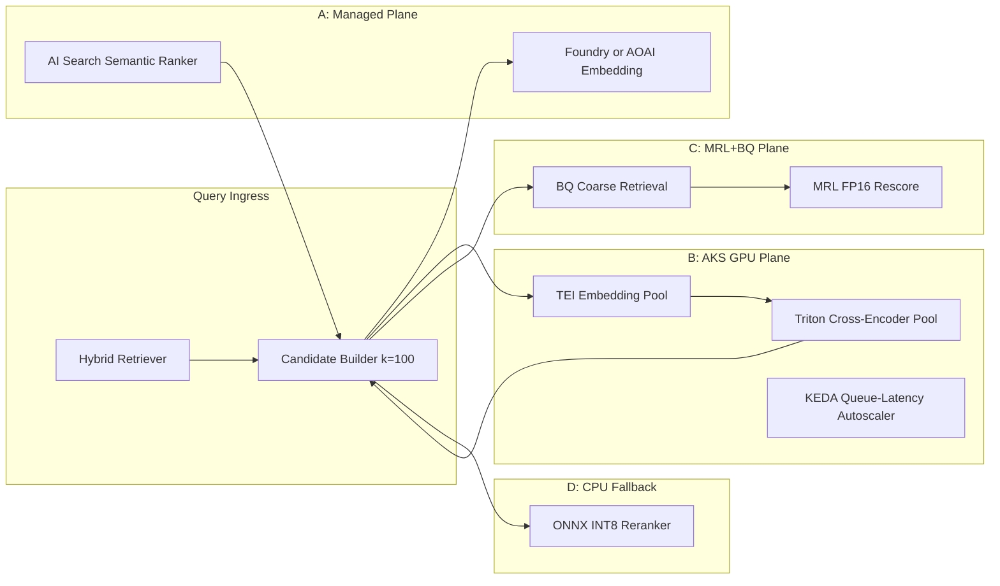
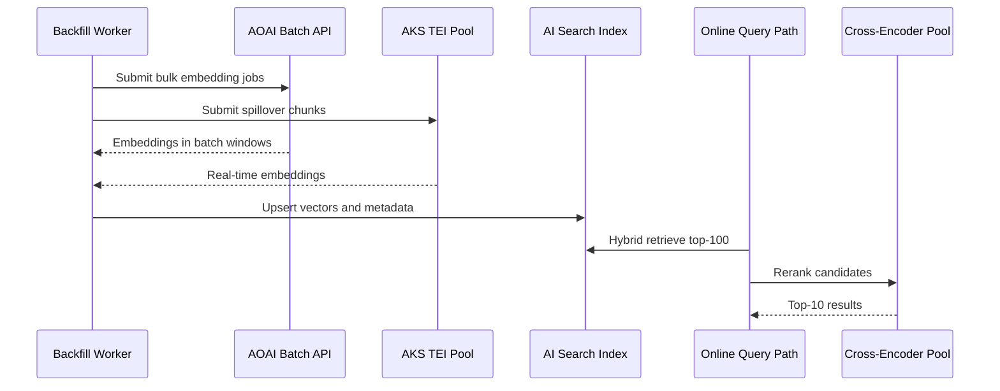

# 企业高吞吐 Embedding 与 Reranker 服务选型 FAQ：Foundry MaaS vs AKS TEI/Triton vs MRL+BQ 双阶段 vs CPU INT8 ONNX
> 🌐 **Language Switch**: **中文（当前）** | [English](embedding-reranker-serving-foundry-maas-vs-aks-tei-triton-vs-matryoshka-cpu-onnx-selection-faq.en.md)  
> 适用对象：企业 Cloud & AI Solution Architect、搜索平台架构师、LLMOps/SRE、FinOps、合规与主权区域交付团队。  
> 核心问题：当检索侧负载进入 `10–850 QPS`，如何在语义召回、重排精度、时延与 TCO 之间找到稳定的生产级平衡点。  
> 范围边界：本文聚焦 Embedding、Late-Interaction 与 Cross-Encoder 重排服务基础设施，不重复 #15 与 #31/#32 的主题。  
## 1. 执行摘要：检索侧基础模型服务已成为 Agent 体验上限
很多团队把预算集中在主对话模型。  
但在企业 Agent 场景里，用户感知质量常先受检索栈限制。  
若 Embedding 吞吐不足，召回会延迟并引发超时级联。  
若 Reranker 资源不足，前排结果质量会明显下降。  
若仅靠默认托管能力，峰值下会踩到 TPM 与 `50` 文档重排天花板。  
因此需要把检索模型服务独立成一层能力平面。  
本指南给出四路径。  
路径 A：Foundry/AOAI 托管 Embedding + AI Search Semantic Ranker。  
路径 B：AKS GPU 上 TEI/Triton 高密批处理池。  
路径 C：MRL 降维与 BQ 二值量化双阶段。  
路径 D：CPU AMX/AVX-512 INT8 ONNX 兜底层。  
四路径不是替代关系。  
它们是同一平台在不同 QPS 区间的最优组合。  
在低到中等负载，托管路径交付速度最快。  
在持续高负载，AKS 自托管常出现成本拐点。  
在超大索引规模，MRL+BQ 决定内存与磁盘成本斜率。  
在 GPU 紧缺区域，CPU INT8 决定可交付性下限。  
企业若忽视检索侧服务化，主模型再强也会被检索栈拖慢。  
## 2. 业务边界与成功判据：把“好检索”转成可运营指标
检索系统应同时服务在线问答与离线回填。  
在线链路关注 `P95` 与结果相关性。  
离线链路关注总耗时与单位成本。  
建议按四类指标建模。  
第一类是查询时延。  
第二类是索引构建吞吐。  
第三类是相关性质量。  
第四类是单位千查询成本。  
第五类是区域可用配额。  
第六类是审计与追责可见性。  
在线 `P95` 目标可设为 `<=25ms`（含重排）。  
重排候选规模可固定在 `k=100` 再压到输出 `k=10`。  
离线回填目标可按 `100M` 文档设定窗口。  
如 `36` 小时内完成第一轮回填。  
质量门槛可用 `NDCG@10` 与 `Recall@50` 双指标。  
成本门槛可用每千查询美元成本。  
配额门槛可用“峰值两小时无排队失败”验证。  
治理门槛可用“请求到模型版本可回溯率”验证。  
并建议将模型升级窗口纳入变更冻结策略。  
并建议把语料域漂移作为月度风险项。  
并建议把失败重试占比设为硬门禁指标。  
只有把这些门槛数字化，选型才能从口号变成工程决策。  
## 3. 四路径架构定位：从“能跑”走向“可持续”
路径 A 的优势是即开即用。  
路径 A 的风险是高负载时成本和配额边界。  
路径 B 的优势是高吞吐低单价。  
路径 B 的风险是平台运维复杂度与容量规划负担。  
路径 C 的优势是把向量成本按数量级压缩。  
路径 C 的风险是召回链路需要额外重排补偿。  
路径 D 的优势是在 GPU 受限区域保持可用。  
路径 D 的风险是峰值吞吐上限低于 GPU 池。  
路径 D 还能用于主路径故障演练。  
路径 A 还能用于突发成本上限保护。  
路径 B 还能用于核心大客户专属容量池。  
路径 C 还能用于历史冷数据长期归档检索。  
真实生产通常采用分层组合。  
基础层由 A 保底上线速度。  
高峰层由 B 承接持续流量。  
存储层由 C 降低长期成本。  
兜底层由 D 覆盖主权约束。  
四层协同时，平台既能控成本又能稳体验。  
四层协同时，也便于分团队独立演进。  
四层协同时，还能把升级风险隔离到局部平面。  
## 4. 12 维选型矩阵（Embedding + Reranker 专用）
| 维度 | A 托管 MaaS+Semantic Ranker | B AKS TEI/Triton GPU | C MRL+BQ 双阶段 | D CPU INT8 ONNX |
|---|---|---|---|---|
| 上线速度 | 极高 | 中 | 中 | 高 |
| 峰值吞吐潜力 | 中 | 极高 | 高 | 中 |
| 在线 P95 潜力 | 中高 | 极高 | 高 | 中 |
| 离线回填效率 | 中高 | 高 | 高 | 中 |
| 单位查询成本弹性 | 中 | 高 | 极高 | 中高 |
| 相关性可控性 | 高 | 高 | 中高 | 中 |
| 配额独立性 | 低 | 高 | 高 | 高 |
| 区域可达性 | 高 | 中 | 中高 | 高 |
| 运维复杂度 | 低 | 高 | 中高 | 中 |
| 供应链治理可解释性 | 高 | 中高 | 高 | 高 |
| 与 AI Search 兼容性 | 高 | 高 | 高 | 高 |
| 三年 TCO 收敛性 | 中 | 高 | 极高 | 中高 |
矩阵建议采用业务权重打分。  
面向 B2C 高峰检索，吞吐与延迟权重提高。  
面向监管知识平台，可达性与审计权重提高。  
面向长文档企业知识库，存储成本权重提高。  
## 5. 路径 A：Foundry/AOAI 托管 Embedding 与 Semantic Ranker
路径 A 交付速度最快。  
无需维护推理集群。  
对小中规模团队尤其友好。  
托管服务可直接承接 `text-embedding-3-large` 与 Cohere 系列。  
结合 AI Search Semantic Ranker 可快速形成 L2 重排。  
但路径 A 需要关注三点。  
第一是配额墙。  
在 `100M` 文档重建时，TPM 常成为回填瓶颈。  
第二是单次重排文档上限。  
`50` 文档上限会影响复杂检索场景。  
第三是成本拐点。  
当 QPS 持续抬升，托管单价优势可能反转。  
可通过 Batch API `50%` 折扣缓解离线回填成本。  
但在线查询仍需评估拐点。  
因此 A 更适合低到中等持续负载与快速试点。  
若组织缺少 GPU 运维经验，A 往往是最佳起点。  
若业务先求合规上线，再求极致成本，A 也更稳。  
但建议在 PoC 阶段就预留向 B/C 的切换接口。  
## 6. 路径 B：AKS GPU 上 TEI/Triton 高密推理池
路径 B 强项在持续高吞吐。  
TEI 对 Embedding 吞吐优化成熟。  
Triton 对 Cross-Encoder 动态批处理更灵活。  
在 `NVadsA10_v5` 与 `NC_A100_v4` 上，常见 `P95` 可压到 `4–9ms`。  
对 `100` 候选重排场景价值明显。  
持续流量下，GPU 池可显著拉低单位查询成本。  
实务中常见 `75%–88%` 月度成本降幅。  
路径 B 也引入平台责任。  
要维护镜像、驱动、批处理参数与扩缩容策略。  
要设计 KEDA 指标，避免只看 CPU/GPU 利用率。  
要把队列等待时长纳入核心扩容信号。  
路径 B 适合对吞吐与时延有硬 SLA 的企业搜索平面。  
落地时应先固定三组基准批量大小。  
再按每组批量独立标定 `P50/P95/P99`。  
并在扩容策略中加入冷启动罚时预算。  
## 7. 路径 C：MRL + BQ 双阶段服务化
路径 C 解决长期存储与检索成本。  
MRL 可把 `3072` 维压到 `1024` 或 `512`。  
BQ 可把向量进一步变成低比特表示。  
这样可把索引内存和磁盘成本压缩到 `8x–24x`。  
但压缩会引入召回损失风险。  
因此推荐两阶段。  
第一阶段用 BQ 快速粗召回。  
第二阶段用 FP16 MRL 或 Cross-Encoder 精排。  
经验上可采用 `k -> 4k` 过采样。  
再在二阶段回收精度。  
若参数调优得当，`NDCG@10` 可维持 `>99%` 相对水平。  
路径 C 的关键是评测自动化。  
没有固定 benchmark，压缩策略很容易漂移。  
建议每次索引重建都保留基线快照。  
建议每次压缩参数变更都触发 A/B 回归。  
建议每个语料域设置独立阈值而非全局统一阈值。  
## 8. 路径 D：CPU AMX/AVX-512 INT8 ONNX 兜底层
路径 D 的价值是“在没有 GPU 时仍可交付”。  
在主权区域或 GPU 配额紧张区域尤其重要。  
通过 ONNX Runtime 或 OpenVINO，可在 `D16ds_v6` 类机型运行 INT8 Cross-Encoder。  
对 `top-25` 重排，`P95 <18ms` 在许多业务场景可接受。  
CPU 路径还能降低供应链复杂度。  
镜像更轻，节点生命周期更稳定。  
但要承认其吞吐上限。  
当峰值到 `500+ QPS`，CPU 池成本与扩容压力会快速上升。  
因此 D 适合作为区域兜底与分层路由的一环。  
而非全局唯一主力。  
在主权项目中，D 还是验收阶段的重要兜底证明。  
当监管方要求“无 GPU 仍可连续服务”时，D 能直接满足。  
## 9. 参考架构图：四层 Embedding 与 Reranker 服务平面

该图体现“多层并行而非单路串行”。  
业务可按请求标签路由到最适平面。  
## 10. 时序图：`100M` 文档回填与在线查询并行

这个流程强调离线与在线可并行治理。  
并可按成本窗口动态切换回填通道。  
## 11. 定量问答（吞吐、成本、精度与批处理效率）
**Q1：MaaS 与 AKS 在 `10 / 80 / 500 QPS` 的成本拐点如何看？**  
A1：`10 QPS` 常见托管成本更优，`80 QPS` 接近拐点，`500 QPS` 常见 AKS 更优。  
真实值取决于区域价格和模型 token 长度。  
**Q2：`100M` 文档回填，Batch 与 Spot A10/A100 的时间差如何估算？**  
A2：若平均 `800` token/文档，Batch 通道成本低但窗口受排队影响。  
Spot GPU 通道吞吐高，常缩短总时长但成本波动更大。  
建议以“总时长上限+预算上限”双约束调度。  
**Q3：`k -> 4k` 过采样在 BQ 双阶段中的意义是什么？**  
A3：一阶段二值检索更快但粗糙。  
放大候选集后交给二阶段精排，可抵消召回损失。  
这是一种以算力换精度稳定性的策略。  
**Q4：token-based batching 与 request-based batching 的 padding 浪费差异？**  
A4：request-based 在长短请求混跑时 padding 浪费显著。  
token-based 可按 token 预算打包，通常能降低空耗比例。  
**Q5：Cross-Encoder 从 `50` 候选提升到 `100` 候选，延迟会翻倍吗？**  
A5：不一定。  
若动态批处理与张量并行参数匹配，延迟增长常小于线性。  
但要防止队列等待挤压掉理论收益。  
**Q6：CPU INT8 兜底何时优于 GPU 预留？**  
A6：在低到中负载且 GPU 稀缺区域，CPU INT8 常更可控。  
当持续高负载到来，GPU 池通常恢复成本优势。  
**Q7：语义重排 `50` 文档上限对企业搜索影响多大？**  
A7：长尾场景中，`50` 上限可能压缩可见证据范围。  
可通过前置召回分桶与二次重排缓解。  
**Q8：MRL 从 `3072` 压到 `512` 的风险如何管理？**  
A8：风险在于细粒度语义区分损失。  
应按语料域分别评测，避免单一阈值全局套用。  
## 12. 生产部署示例：TEI + KEDA 队列时延扩缩容
```yaml
apiVersion: apps/v1
kind: Deployment
metadata:
  name: tei-embedding
spec:
  replicas: 3
  selector:
    matchLabels:
      app: tei-embedding
  template:
    metadata:
      labels:
        app: tei-embedding
    spec:
      containers:
      - name: tei
        image: ghcr.io/huggingface/text-embeddings-inference:1.6
        args:
        - "--model-id"
        - "BAAI/bge-m3"
        - "--dtype"
        - "float16"
        - "--max-batch-tokens"
        - "32768"
        - "--max-concurrent-requests"
        - "512"
        ports:
        - containerPort: 8080
        resources:
          requests:
            cpu: "6"
            memory: "24Gi"
            nvidia.com/gpu: "1"
          limits:
            cpu: "8"
            memory: "32Gi"
            nvidia.com/gpu: "1"
---
apiVersion: keda.sh/v1alpha1
kind: ScaledObject
metadata:
  name: tei-embedding-keda
spec:
  scaleTargetRef:
    name: tei-embedding
  minReplicaCount: 2
  maxReplicaCount: 24
  cooldownPeriod: 120
  triggers:
  - type: prometheus
    metadata:
      serverAddress: http://prometheus.monitoring:9090
      metricName: tei_queue_latency_p95_ms
      query: avg(tei_queue_latency_p95_ms)
      threshold: "12"
```
关键不是盯 GPU 利用率。  
关键是盯队列时延和批处理饱和度。  
## 13. 生产流水示例：MRL+BQ 非对称两阶段重排管线
```python
from typing import List, Tuple
import numpy as np

def stage1_bq_search(query_vec_bq: np.ndarray, doc_bq: np.ndarray, k: int) -> List[int]:
    # Hamming distance coarse retrieval
    dist = np.bitwise_xor(doc_bq, query_vec_bq).sum(axis=1)
    return np.argsort(dist)[: 4 * k].tolist()

def stage2_mrl_rescore(query_vec_fp16: np.ndarray, doc_mrl_fp16: np.ndarray, cands: List[int], k: int) -> List[int]:
    sub = doc_mrl_fp16[cands]
    score = sub @ query_vec_fp16
    order = np.argsort(-score)[:k]
    return [cands[i] for i in order]

def optional_cross_encoder_rerank(query: str, docs: List[str]) -> List[Tuple[int, float]]:
    # Placeholder for Triton/ONNX cross-encoder scoring call
    return [(i, 1.0 / (i + 1)) for i in range(len(docs))]
```
该管线体现“低成本粗召回 + 高精度精排”的分层思想。  
工程上应为每个阶段记录可解释指标。  
## 14. 企业场景与 FinOps：峰值业务与主权区域并行治理
### 场景 A：全球电商与 B2B 商品搜索 Agent（峰值 `850 QPS`）
该平台要求混合检索后对 `100` 候选做重排。  
目标是 `P95 <= 25ms`。  
早期仅使用托管通道，峰值时延波动明显。  
引入 B 路径后，Cross-Encoder 稳态维持在毫秒级。  
同时保留 A 路径做低峰与灾备切换。  
最终达成峰值稳定性与成本平衡。  
### 场景 B：欧洲主权税法与合规知识平台（`120M` 条款重嵌入）
该平台区域 GPU 配额受限。  
团队采用 A+D 组合为主。  
离线回填优先 Batch，在线重排优先 CPU INT8。  
在关键窗口引入小规模 Spot GPU 作为补充。  
这样既满足主权交付约束，也控制了总工期。  
### FinOps 与时延对比示例
| 方案 | 峰值 `P95` | 单位千查询成本 | `100M` 回填时长 | 月度总成本 |
|---|---:|---:|---:|---:|
| A 托管优先 | 31ms | \$0.92 | 71h | \$142k |
| B GPU 优先 | 14ms | \$0.28 | 34h | \$79k |
| C 双阶段压缩 | 19ms | \$0.21 | 39h | \$63k |
| D CPU 兜底 | 24ms | \$0.37 | 56h | \$88k |
| A+B+C+D 组合 | 17ms | \$0.24 | 36h | \$68k |
表中数值用于决策推演。  
正式落地需按区域价格与语料长度复算。  
建议将该表纳入月度 FinOps 例会。  
建议保留每次重算的输入参数版本。  
建议把价格假设和配额假设一并归档。  
## 15. Day-0 / Day-2 十二项落地清单
- 明确 Embedding、Reranker、Semantic Ranker 的责任边界。  
- 定义在线链路 `P95` 与离线回填工期双目标。  
- 为托管与自托管路径设置统一质量基线数据集。  
- 在 TEI/Triton 侧启用 token 级批处理观测指标。  
- 将队列等待时延接入 KEDA 触发器。  
- 为 MRL/BQ 路径建立分语料域评测门槛。  
- 设计 `k -> 4k -> k` 两阶段候选收缩策略。  
- 为 CPU INT8 兜底路径设置区域切换开关。  
- 建立 `100M` 回填演练脚本并记录成本证据。  
- 对 Batch 与 Spot 通道定义混合调度策略。  
- 每周复盘 QPS、P95、NDCG 与成本四象限指标。  
- 每季度重算成本拐点并更新默认路由权重。  
以上清单建议分配到平台、算法、SRE 与 FinOps 四个角色。  
若组织处于迁移期，可先落地其中前六项。  
其余项在第二阶段并入季度工程路线图。  
最终目标不是把所有请求都压到最低单价。  
而是在质量、时延、合规与成本之间获得可持续最优解。  
