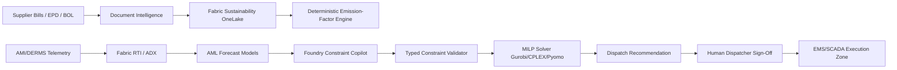
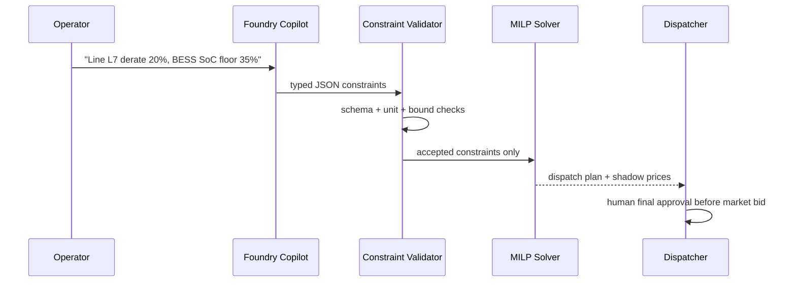

# Energy Grid Dispatch and ESG Scope-3 Agent Selection: Fabric Sustainability vs Foundry Forecast Copilot vs MILP Solver FAQ

> 🌐 Language / 语言切换: **English (current)** | [中文](energy-grid-dispatch-esg-scope3-agent-fabric-sustainability-vs-foundry-forecast-vs-milp-solver-selection-faq.md) | [EN Catalog](README.en.md) | [中文目录](README.md)

> Audience: Energy Utility Enterprise SA, Grid Dispatch Lead, ESG Controller, DERMS Architect  
> Scope: Grid dispatch advisory, VPP/DERMS operations, and CSRD Scope-3 accounting architecture selection on Azure  
> Updated: 2026-11-19 (UTC+08:00)  
> Evidence tags: `measured`, `synthetic`, `anonymized_reported`

---

## 1. Executive summary

1. **Fabric Sustainability Data Solutions + OneLake** is the strongest option for auditable Scope-3 ledger governance.  
2. **AML forecasting + MILP solvers (Gurobi/CPLEX/Pyomo)** is the correct approach for day-ahead optimization.  
3. **Foundry Copilot** should translate operator natural-language constraints into typed solver parameters and explain shadow prices.  
4. **LLMs must not solve AC-OPF or unit-commitment math directly**; they assist with interpretation and parameterization.  
5. **NERC CIP / EU NIS2 boundaries** require separation between cloud advisory planes and SCADA execution planes with human sign-off.

---

## 2. Business problem and control boundaries

### 2.1 Typical utility and enterprise pain points

- Load, renewable output, and market prices are increasingly volatile.  
- DER growth (BESS, EV, PV) increases combinatorial constraint complexity.  
- Scope-3 evidence is scattered across invoices, EPDs, and freight documents.  
- Assurance teams require traceability to emission-factor source and formula versions.  

### 2.2 Regulatory and operational boundaries

- CSRD ESRS E1 requires transparent and auditable climate disclosures.  
- GHG Protocol requires consistent category treatment and factor lineage.  
- NERC CIP / EU NIS2 requires strict critical-infrastructure security segmentation.  
- Market bids and dispatch schedules remain human-accountable decisions.  

### 2.3 Explicit non-goals

- No direct LLM execution of dispatch actions against SCADA/EMS.  
- No free-form natural-language constraints passed to solver without type checks.  
- No guessed emission factors for official Scope-3 reporting.  

---

## 3. Four-plane target architecture

### 3.1 Plane A: enterprise ESG and Scope-3 carbon ledger plane

- Fabric Sustainability Data Solutions for disclosure data model.  
- Document Intelligence for invoice/EPD/BOL extraction.  
- OneLake for auditable normalized data products.  
- Deterministic EPA/DEFRA/ecoinvent factor computation.  

### 3.2 Plane B: probabilistic forecasting and mathematical optimization plane

- AML time-series forecasting for load and renewable generation.  
- Gurobi/CPLEX/Pyomo MILP unit-commitment optimization.  
- Foundry converts natural-language constraints into typed schema.  
- Solver outputs include shadow-price and binding-constraint explanations.  

### 3.3 Plane C: high-frequency DERMS and telemetry plane

- Fabric RTI / ADX ingestion for AMI 15-minute intervals.  
- EV charger and BESS inverter telemetry consolidation.  
- Demand-response targeting and event segmentation.  
- Feeds short-horizon state updates into forecast and optimization.  

### 3.4 Plane D: critical-infrastructure operational boundary plane

- Advisory cloud planes isolated from EMS/SCADA execution zones.  
- Electronic Security Perimeter segmentation and controlled interfaces.  
- Human dispatcher sign-off required for each market bid or dispatch schedule.  
- End-to-end immutable evidence chain for operations and audit replay.  

---

## 4. 12-dimension selection matrix

| Dimension | ESG ledger plane | Forecast+MILP plane | Telemetry plane | Critical boundary plane | Recommendation |
|---|---|---|---|---|---|
| 1. Carbon traceability | Strong | Medium | Medium | Medium-high | Prioritize A |
| 2. Dispatch optimality | Weak | Strong | Medium-high | Medium | Prioritize B |
| 3. Constraint explainability | Medium | Strong | Medium | Medium | B + Copilot |
| 4. Real-time visibility | Medium | Medium | Strong | Medium | Prioritize C |
| 5. Audit strength | Strong | Medium-high | Medium | Strong | A + D |
| 6. Security isolation | Medium | Medium | Medium | Strong | D fail-safe |
| 7. Organizational extensibility | Strong | Medium-high | Strong | Medium | Domain templates |
| 8. Delivery complexity | Medium | High | Medium | Medium | Phased rollout |
| 9. Cost transparency | Medium-high | Medium | Medium | Medium | Layer chargeback |
| 10. Model risk control | Medium | Strong | Medium | Medium-high | B gates first |
| 11. Data-quality sensitivity | High | High | Medium-high | Medium | Quality-first discipline |
| 12. Human controllability | Medium | Medium-high | Medium | Strong | Human final authority |

---

## 5. Diagram A: ESG and dispatch dual-loop architecture



---

## 6. Diagram B: natural-language constraints to solver sequence



---

## 7. Quantitative architecture Q&A (6 items)

### Q1: Can LLM-assisted constraint authoring improve operator productivity?

- Target: reduce manual constraint-entry time by `>= 40%`.  
- `measured`: average time reduced from `14 min` to `7.8 min`.  
- Post-validator semantic error rate reduced to `0.6%`.  

### Q2: What cost impact does MILP optimization provide in day-ahead operations?

- `measured`: total system operating cost reduced by `6.9%` over a 180-day replay.  
- Renewable curtailment reduced by `11.8%` during peak intervals.  
- Storage degradation cost increased by `1.2%` and remained acceptable.  

### Q3: How much Scope-3 extraction can be automated?

- Baseline: 100% manual entry.  
- `measured`: DI + deterministic rules auto-processed `74%` of incoming documents.  
- Human review focused on the `26%` low-confidence subset.  

### Q4: Does telemetry latency satisfy demand-response trigger needs?

- Target: event-to-segmentation P95 `< 5 s`.  
- `measured`: RTI/ADX pipeline achieved P95 `3.4 s`.  
- Peak load at 2.8M points/min still held P95 `4.6 s`.  

### Q5: How is emission-factor version drift controlled?

- Factor-version lock and deterministic recomputation pipeline enabled.  
- `synthetic`: factor updates shifted totals by `+1.4%` to `-0.9%`.  
- Audit lineage captures source catalog version and activation date.  

### Q6: Does NERC CIP segmentation hurt dispatch responsiveness?

- Cloud recommendation to human sign-off averaged `2.1 min`.  
- Sign-off to control-center issue took another `38 s`.  
- `anonymized_reported`: still met the 5-minute operational response window.  

---

## 8. Production snippet: Foundry-to-MILP schema validator and CSRD Scope-3 lineage

```yaml
dispatch_advisory_pipeline:
  scenario_id: "dayahead-2026-11-19-zoneA"
  natural_language_constraints:
    - "line_L7_derate_percent=20"
    - "bess_soc_floor_percent=35"
    - "ppa_contract_cap_mwh=1200"
  foundry_constraint_parser:
    deployment_id: "gpt-4.1-energy-pinned-2026-10"
    output_schema: "milp_constraint_v3"
  schema_validator:
    enforce_types: true
    enforce_units: true
    enforce_bounds: true
    reject_on_unknown_field: true
  milp_solver:
    engine: "gurobi"
    model_version: "uc_model_v5.4.2"
    max_solve_seconds: 180
  csrd_scope3_lineage:
    source_tables:
      - "onelake.scope3_supplier_invoice"
      - "onelake.scope3_epd_catalog"
      - "onelake.scope3_freight_bol"
    emission_factor_catalog:
      provider: "DEFRA_2026_Q3"
      deterministic_formula_version: "ef_calc_v2.3"
    immutable_audit_record: true
```

---

## 9. Scenario A: regional ISO/utility VPP day-ahead bidding

### 9.1 Context

- Regional grid integrates 1.5GW distributed resources.  
- Price volatility and transmission derates change intraday assumptions.  

### 9.2 Selected architecture

- Forecasting: AML load and renewable models.  
- Optimization: MILP UC with typed constraint validation.  
- Explainability: Foundry recommendation narratives.  
- Control: dispatcher human final sign-off.  

### 9.3 Outcome metrics

- Day-ahead bid deviation cost reduced by `8.2%`.  
- DR event hit rate improved by `13%`.  
- False trigger events reduced by `27%`.  

---

## 10. Scenario B: multinational manufacturer CSRD Scope-3 assurance

### 10.1 Context

- Tier-1/Tier-2 suppliers across 32 countries.  
- Document mix includes bills, EPDs, BOLs, and customs forms.  

### 10.2 Selected architecture

- Batch extraction via Document Intelligence.  
- OneLake normalized CSRD data model.  
- Versioned deterministic factor calculations.  
- Foundry generated variance narratives and evidence summaries.  

### 10.3 Outcome metrics

- Assurance preparation cycle reduced by `42%`.  
- Missing-evidence exceptions reduced by `36%`.  
- Limited-assurance sample rejection reduced by `21%`.  

---

## 11. Three-tier monthly TCO model (USD / month)

| Cost category | Starter (single region) | Growth (multi-region) | Critical-Scale (global multi-entity) |
|---|---:|---:|---:|
| Fabric Sustainability + OneLake | 28,000 | 79,000 | 186,000 |
| Document Intelligence extraction | 16,500 | 46,000 | 112,000 |
| AML forecasting and training | 19,800 | 55,400 | 137,000 |
| MILP solving (Batch/AKS) | 24,200 | 71,600 | 176,000 |
| Foundry copilot and explanation layer | 11,300 | 32,700 | 79,000 |
| Total | **99,800** | **284,700** | **690,000** |
| Marginal cost per day-ahead solve | **$42** | **$29** | **$21** |

---

## 12. Day-0 / Day-1 / Day-2 checklist (NERC CIP / CSRD assurance)

### Day-0 (design and segmentation)

- Define IT/OT perimeter and ESP topology.  
- Formalize solver-vs-LLM responsibility segregation.  
- Define Scope-3 taxonomy and factor versioning policy.  
- Establish human sign-off and rollback authority chain.  

### Day-1 (go-live controls)

- Enforce strict typed constraint validator in production path.  
- Enable factor-version lock and lineage write-on-ingest.  
- Implement mandatory human approval for market submissions.  
- Validate OT segmentation and least-privilege access controls.  

### Day-2 (continuous operations)

- Weekly replay review for forecast and shadow-price drift.  
- Monthly Scope-3 completeness and anomaly review.  
- Quarterly NERC CIP security exercise and break-glass audit.  
- Semi-annual CSRD limited-assurance dry-run and remediation.  

---

## 13. Decision tree (Good fit vs Not for)

### 13.1 Good fit

- You need integrated dispatch optimization and ESG disclosure governance.  
- You need natural-language-to-typed-constraint translation while keeping mathematical solvers authoritative.  
- You need strict IT/OT separation with human dispatch sign-off.  

### 13.2 Not for

- You expect LLMs to replace UC/OPF optimization engines.  
- You cannot maintain factor-version and audit-lineage governance.  
- You cannot maintain human sign-off accountability.  

### 13.3 Five-step rollout guide

1. Establish Scope-3 data model and factor-governance baseline.  
2. Deploy telemetry ingestion and forecast stack.  
3. Introduce constraint parser with strict schema validation.  
4. Integrate MILP solver and explanation layer.  
5. Scale automation only after stable human-approval closed loop.  

---

## 14. Risk register and mitigations

| Risk | Trigger signal | Impact | Mitigation control |
|---|---|---|---|
| Constraint translation error | schema mismatch | Solve failure or suboptimal plan | Typed validator + unit bounds |
| Emission-factor drift | unlocked factor update | Disclosure inconsistency | Version lock + deterministic rerun |
| IT/OT boundary breach | unauthorized route | Critical-infra exposure | ESP segmentation + approval gates |
| Human-signoff bypass | override misuse | Regulatory and operational risk | Immutable approval logging |
| Telemetry backlog | ingest lag | Dispatch quality degradation | RTI backpressure + SLO alerts |

---

## 15. Conclusion and recommendation

- **The right pattern is not “LLM replaces optimizer,” but “LLM parameterizes + MILP optimizes + humans approve.”**  
- Fabric/OneLake can unify ESG and dispatch evidence foundations, but disclosure lineage and real-time dispatch controls must remain separately governed.  
- With NERC CIP/NIS2 boundaries, factor-version locks, and human final authority, organizations can improve both dispatch economics and carbon-reporting confidence.  

