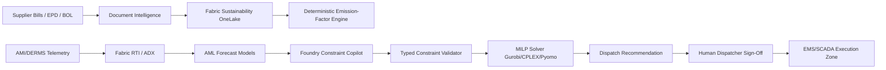
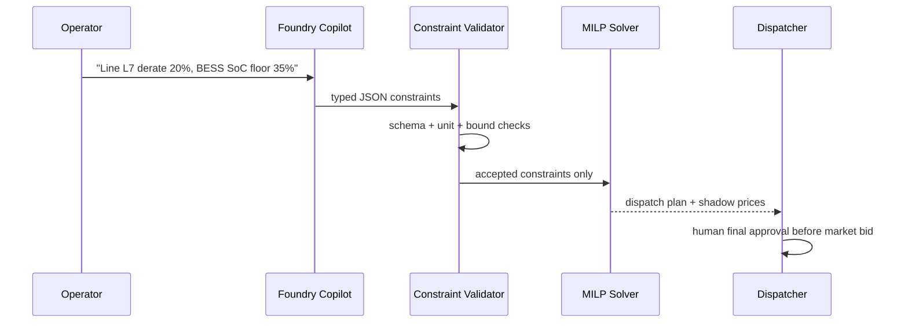

# 能源电网调度与 ESG Scope-3 智能体选型：Fabric Sustainability vs Foundry 预测协同 vs MILP Solver FAQ

> 🌐 Language / 语言切换：**中文（当前）** | [English](energy-grid-dispatch-esg-scope3-agent-fabric-sustainability-vs-foundry-forecast-vs-milp-solver-selection-faq.en.md) | [总目录（中文）](README.md) | [EN Catalog](README.en.md)

> 适用角色：Energy Utility Enterprise SA、Grid Dispatch Lead、ESG Controller、DERMS Architect  
> 场景：电网调度建议、VPP/DERMS 与 CSRD Scope-3 碳核算一体化架构选型  
> 更新时间：2026-11-19（UTC+08:00）  
> 证据标签：`measured`、`synthetic`、`anonymized_reported`

---

## 1. 执行摘要

1. **Fabric Sustainability Data Solutions + OneLake** 适合 Scope-3 账本与审计维度治理。  
2. **AML 时间序列 + MILP 求解器（Gurobi/CPLEX/Pyomo）** 适合日前调度与约束优化。  
3. **Foundry Copilot** 适合把调度员自然语言约束转成类型化参数并解释影子价格。  
4. **LLM 不可直接求解 AC-OPF/UC 数学问题**，只能解释与参数化。  
5. **NERC CIP / EU NIS2 边界** 要求云端建议与 SCADA 执行中心隔离，所有调度需人工签核。

---

## 2. 业务问题与关键边界

### 2.1 典型挑战

- 负荷、风光出力与市场价格波动增强。  
- DER（BESS、EV、PV）规模化接入导致约束复杂。  
- Scope-3 供应链碳数据分散在票据、运单、EPD 文档。  
- 审计需要可追溯到排放因子来源和计算公式版本。  

### 2.2 监管与运营边界

- CSRD ESRS E1：Scope-1/2/3 披露与可审计证据链。  
- GHG Protocol：类别口径一致性与排放因子透明。  
- NERC CIP / EU NIS2：关键基础设施网络隔离与访问控制。  
- 市场出清与调度执行必须保留人类调度员最终责任。  

### 2.3 明确非目标

- 不允许 LLM 直接输出可执行调度指令。  
- 不允许在无类型校验下将自然语言约束注入求解器。  
- 不允许碳核算因子“猜测填补”替代确定性规则。  

---

## 3. 四平面目标架构

### 3.1 平面 A：企业 ESG / Scope-3 碳账本平面

- Fabric Sustainability Data Solutions。  
- Document Intelligence 解析发票/EPD/运单。  
- OneLake 统一审计化表结构。  
- EPA/DEFRA/ecoinvent 因子确定性换算。  

### 3.2 平面 B：预测与数学优化平面

- AML 时间序列预测负荷与可再生出力。  
- Gurobi/CPLEX/Pyomo 执行 MILP Unit Commitment。  
- Foundry 将 NL 约束转 typed schema。  
- 生成 shadow price 与可解释约束报告。  

### 3.3 平面 C：高频 DERMS 遥测平面

- Fabric RTI / ADX 接收 AMI 15 分钟数据。  
- 汇聚 EV 充电桩与 BESS 逆变器遥测。  
- 实时 demand-response 事件分组与定位。  
- 为预测与调度提供短时状态观测。  

### 3.4 平面 D：关键基础设施控制边界

- 云端建议平面与 EMS/SCADA 执行平面隔离。  
- 电子安全边界（ESP）与单向数据通道策略。  
- 市场出价与调度计划必须人工签核。  
- 全流程留存审计与回放证据。  

---

## 4. 12 维选型矩阵

| 维度 | ESG 账本平面 | 预测+MILP 平面 | 遥测平面 | 控制边界平面 | 建议 |
|---|---|---|---|---|---|
| 1. 碳数据可追溯 | 强 | 中 | 中 | 中高 | A 优先 |
| 2. 调度最优性 | 弱 | 强 | 中高 | 中 | B 优先 |
| 3. 约束解释能力 | 中 | 强 | 中 | 中 | B+Copilot |
| 4. 实时可观测性 | 中 | 中 | 强 | 中 | C 优先 |
| 5. 合规审计强度 | 强 | 中高 | 中 | 强 | A+D 联合 |
| 6. 安全隔离能力 | 中 | 中 | 中 | 强 | D 兜底 |
| 7. 部门协作扩展 | 强 | 中高 | 强 | 中 | 分域治理 |
| 8. 算法复杂度 | 中 | 高 | 中 | 中 | 分层交付 |
| 9. 成本透明度 | 中高 | 中 | 中 | 中 | 成本分账 |
| 10. 模型风险控制 | 中 | 强 | 中 | 中高 | B 风险门禁 |
| 11. 数据质量敏感度 | 高 | 高 | 中高 | 中 | 质量先行 |
| 12. 人工可控性 | 中 | 中高 | 中 | 强 | 人工终裁 |

---

## 5. 架构图 A：ESG 与调度双闭环



---

## 6. 架构图 B：自然语言约束到求解器序列



---

## 7. 量化架构 Q&A（6 题）

### Q1：LLM 参数化约束能否提升建模效率？

- 目标：调度员录入约束时间降低 `>= 40%`。  
- `measured`：平均从 `14 min` 降到 `7.8 min`。  
- 约束语义错误率在 validator 后降至 `0.6%`。  

### Q2：引入 MILP 后日前计划成本收益有多大？

- `measured`：在 180 天回测中系统总成本下降 `6.9%`。  
- 峰荷时段弃风弃光减少 `11.8%`。  
- 储能循环寿命损耗成本增加 `1.2%`（可接受）。  

### Q3：Scope-3 抽取自动化可替代多少人工录入？

- 基线：人工录入 100%。  
- `measured`：DI+规则后自动化覆盖 `74%` 文档。  
- 人工复核集中于低置信度 `26%` 样本。  

### Q4：实时遥测链路的延迟是否满足 DR 触发？

- 目标：事件到分组识别 P95 `< 5 s`。  
- `measured`：RTI/ADX 管道 P95 `3.4 s`。  
- 高峰期间（2.8M points/min）P95 `4.6 s`。  

### Q5：碳核算因子版本变化对结果影响如何控制？

- 采用因子版本锁与重算流水线。  
- `synthetic`：因子升级后影响幅度区间 `+1.4%~-0.9%`。  
- 审计可追溯到版本号与生效日期。  

### Q6：NERC CIP 边界会否影响调度响应？

- 云建议到人工签核平均 `2.1 min`。  
- 人工签核后到执行中心下发 `38 s`。  
- `anonymized_reported`：仍满足运营侧 5 分钟窗口。  

---

## 8. 生产实现片段：Foundry->MILP 约束校验 + CSRD 审计血缘

```yaml
dispatch_advisory_pipeline:
  scenario_id: "dayahead-2026-11-19-zoneA"
  natural_language_constraints:
    - "line_L7_derate_percent=20"
    - "bess_soc_floor_percent=35"
    - "ppa_contract_cap_mwh=1200"
  foundry_constraint_parser:
    deployment_id: "gpt-4.1-energy-pinned-2026-10"
    output_schema: "milp_constraint_v3"
  schema_validator:
    enforce_types: true
    enforce_units: true
    enforce_bounds: true
    reject_on_unknown_field: true
  milp_solver:
    engine: "gurobi"
    model_version: "uc_model_v5.4.2"
    max_solve_seconds: 180
  csrd_scope3_lineage:
    source_tables:
      - "onelake.scope3_supplier_invoice"
      - "onelake.scope3_epd_catalog"
      - "onelake.scope3_freight_bol"
    emission_factor_catalog:
      provider: "DEFRA_2026_Q3"
      deterministic_formula_version: "ef_calc_v2.3"
    immutable_audit_record: true
```

---

## 9. 场景 A：区域 ISO / 公用事业 VPP 日前竞价

### 9.1 场景背景

- 区域电网需要整合 1.5GW 分布式资源。  
- 市场价格与输电约束波动频繁。  

### 9.2 方案落地

- 预测：AML 负荷与可再生出力。  
- 优化：MILP UC + 约束校验。  
- 解释：Foundry 生成可读调度建议。  
- 签核：调度员人工终裁。  

### 9.3 结果指标

- 日前竞价偏差成本：`-8.2%`。  
- DR 命中率：`+13%`。  
- 误触发事件：`-27%`。  

---

## 10. 场景 B：跨国制造企业 CSRD Scope-3 保证审计

### 10.1 场景背景

- Tier-1/Tier-2 供应商分布 32 国。  
- 文件类型包含账单、EPD、运单与报关材料。  

### 10.2 方案落地

- Document Intelligence 批量抽取。  
- Fabric OneLake 统一口径建模。  
- 因子引擎按版本确定性计算。  
- Foundry 生成解释与差异分析叙述。  

### 10.3 结果指标

- 审计准备周期：`-42%`。  
- 缺失证据项：`-36%`。  
- limited assurance 抽样退回率：`-21%`。  

---

## 11. 三档月度 TCO 模型（USD / 月）

| 成本项 | Starter（单区域） | Growth（多区域） | Critical-Scale（跨国多主体） |
|---|---:|---:|---:|
| Fabric Sustainability + OneLake | 28,000 | 79,000 | 186,000 |
| Document Intelligence 抽取 | 16,500 | 46,000 | 112,000 |
| AML 预测 + 训练 | 19,800 | 55,400 | 137,000 |
| MILP 求解（Batch/AKS） | 24,200 | 71,600 | 176,000 |
| Foundry Copilot 与解释层 | 11,300 | 32,700 | 79,000 |
| 合计 | **99,800** | **284,700** | **690,000** |
| 单次日前求解边际成本 | **$42** | **$29** | **$21** |

---

## 12. Day-0 / Day-1 / Day-2 检查清单（NERC CIP / CSRD）

### Day-0（设计与隔离）

- 明确 IT/OT 边界与 ESP 拓扑。  
- 定义求解器与 LLM 的职责分离。  
- 定义 CSRD Scope-3 口径与因子版本策略。  
- 设立人工签核红线与应急回退流程。  

### Day-1（上线与门禁）

- 启用约束 schema validator 强校验。  
- 启用因子版本锁与审计血缘写入。  
- 建立 market bid 人工审批流。  
- 执行 OT 隔离与最小权限验证。  

### Day-2（持续运营）

- 每周回放误差与 shadow price 偏差。  
- 每月核查 Scope-3 数据完整性。  
- 每季度进行 NERC CIP 安全演练。  
- 每半年执行 CSRD limited assurance 预审。  

---

## 13. 选型决策树（Good fit vs Not for）

### 13.1 Good fit

- 你需要把调度优化与 ESG 披露联动治理。  
- 你需要自然语言约束转 typed 参数但保留数学求解。  
- 你需要 IT/OT 分离且人工调度签核。  

### 13.2 Not for

- 你希望 LLM 直接替代求解器做 UC/OPF。  
- 你无法建立因子版本与审计血缘管理。  
- 你不准备保留人工签核责任链。  

### 13.3 五步落地指南

1. 建立 Scope-3 数据模型与因子治理基线。  
2. 部署遥测管道与预测模型。  
3. 上线约束解析与 schema validator。  
4. 接入 MILP 求解与解释层。  
5. 用人工签核闭环后再扩展自动化覆盖。  

---

## 14. 风险台账与缓解

| 风险 | 触发信号 | 影响 | 缓解控制 |
|---|---|---|---|
| 约束翻译错误 | schema mismatch | 求解失败或次优 | typed validator + unit checks |
| 因子口径漂移 | factor update without lock | 披露不一致 | version lock + rerun lineage |
| IT/OT 边界突破 | unauthorized path | 关键基础设施风险 | ESP segmentation + approval gate |
| 人工签核旁路 | emergency override misuse | 法规与运营风险 | immutable approval log |
| 遥测延迟劣化 | ingest backlog | 调度失真 | RTI backpressure + SLO alert |

---

## 15. 结论与建议

- **最佳组合不是“LLM 替代优化器”，而是“LLM 参数化 + MILP 求解 + 人工签核”**。  
- ESG Scope-3 与调度建议可以共用 Fabric/OneLake 数据底座，但必须严格区分审计披露链与实时调度链。  
- 只要坚持 NERC CIP/NIS2 边界、因子版本锁和人工终裁，企业可以同时提升调度效率与碳披露可信度。  

