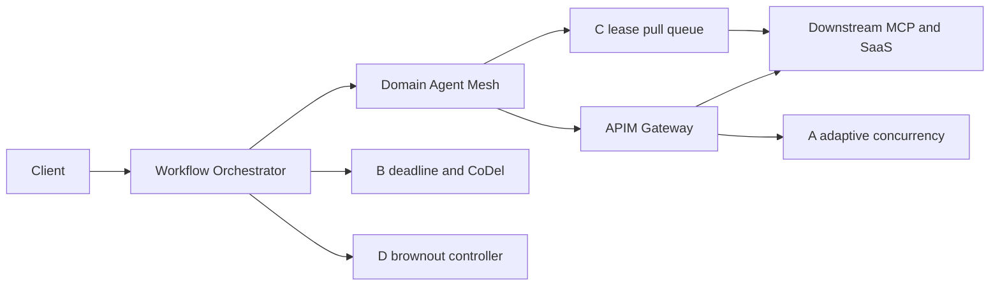
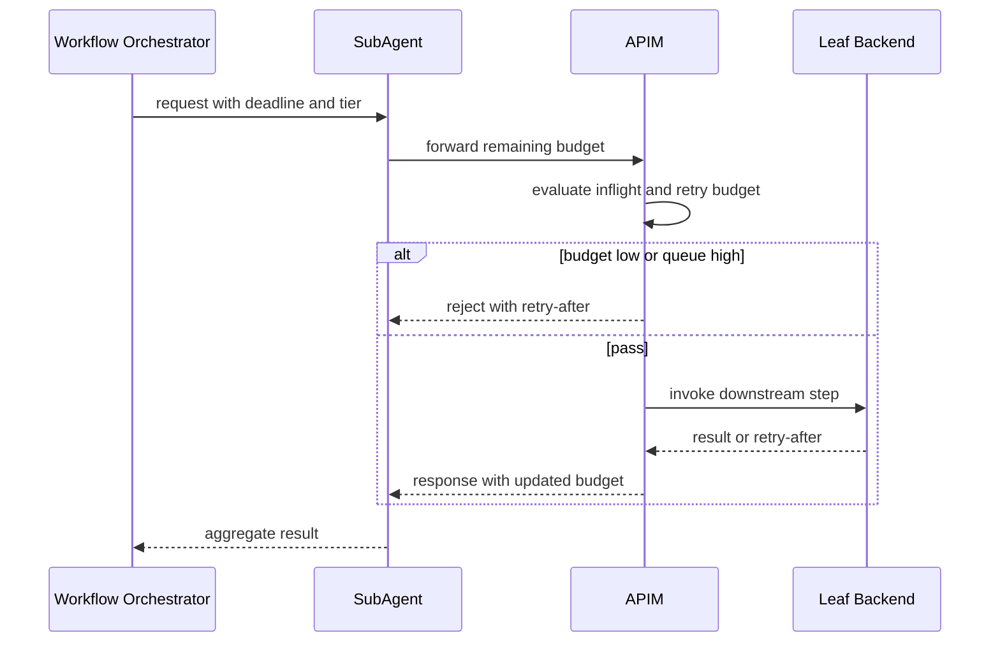
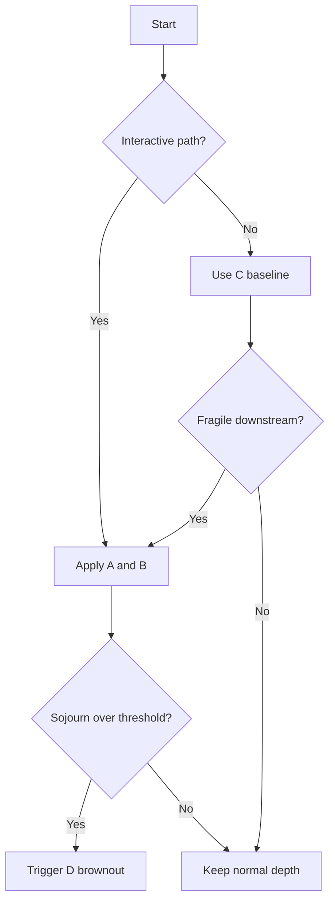

# 多跳 Agent 背压与亚稳态重试防御选型 FAQ：Gradient2 并发控制 vs Deadline+CoDel 准入 vs Service Bus Pull 租约 vs 图深度 Brownout
> **适用场景**：Workflow Orchestrator -> Domain Agent -> APIM -> ERP/DB/SaaS MCP 多跳调用图。
> **决策压力**：防止乘法重试风暴、僵尸 token 消耗与队列塌陷。
> **核心目标**：构建端到端背压、预算传播与关键级保活机制。

## 1. 执行摘要
- 多跳系统的主要风险是控制环耦合导致的亚稳态崩溃。
- 默认建议是 A+B，异步突发叠加 C，资源紧张时启用 D。
- 必须统一重试归属，避免每跳都重试。
- 必须传播剩余预算与关键级别，阻断无价值调用。
- 必须在过载前做并发收敛，而不是等待错误码爆发。
- 必须在峰值时做认知降级，优先保全关键交易路径。
- 关键指标包括 `retry_ratio`、`wasted_token_ratio`、`queue_sojourn`、`goodput`。
- 成本视角应同时看成功成本与失败补救成本。

## 2. 适用边界与非目标
- 适用：企业级多跳 Agent 编排与跨系统工具链路。
- 适用：高峰波动明显、SLO 严格、成本敏感的平台。
- 适用：同步交互与异步批处理并存场景。
- 非目标：单跳链路微优化。
- 非目标：底层模型算子、工业物理参数。
- 非目标：无治理边界的突发试错。

## 3. 亚稳态失效机理
- 放大量可近似为 `A = Π(1 + p_fail,i * R_i)`。
- 当 A 超阈值时，少量故障即可引发雪崩。
- FIFO 在过载下会让陈旧请求长期占位。
- 预算不传播会让上游超时后下游仍高成本执行。
- 关键级别不传播会导致低优先任务挤占高优先容量。
- 缺少异步租约会让突发 fan-out 直接冲击脆弱后端。

## 4. 四类候选架构
- **架构 A**：Gradient2 自适应并发 + 重试令牌桶。
- **架构 B**：Deadline 预算传播 + Criticality 分层 + LIFO+CoDel。
- **架构 C**：Service Bus Pull 租约 + Durable 补偿游标。
- **架构 D**：图深度 Brownout（多代理降到单代理与快路径）。
- A 控并发、B 控准入、C 控突发、D 控资源稀缺下可用性。

## 5. 架构 A 细节
- 使用 `g = RTT_noload / RTT_short` 估计拥塞膝点。
- 通过 AIMD 收敛 in-flight 上限。
- 约束 `retry_ratio <= 0.10`。
- 区分 per-try 与 total timeout。
- 结合 `L = λW` 维持稳定工作点。
- 适合高并发交互主链路。

## 6. 架构 B 细节
- 传播 `X-Deadline-Unix-Ms` 与 `X-Criticality-Tier`。
- 对剩余预算不足的高成本步骤提前拒绝。
- 过载时先 shed T2，再保护 T1/T0。
- LIFO+CoDel 控制 sojourn 时间并淘汰陈旧请求。
- 显著降低僵尸 token 预算浪费。

## 7. 架构 C 细节
- 采用 Pull 消费避免 Push 洪峰。
- 以 lease/credit 约束 worker 消费速率。
- Retry-After 触发延时重入队。
- Durable 管理补偿与幂等状态。
- 适合合规扫描、报表、批处理等异步场景。

## 8. 架构 D 细节
- 以队列 sojourn 与资源利用率触发 brownout。
- 优先移除反思与辩论环节。
- 进阶降级为单代理压缩上下文。
- 最终保留确定性工具/缓存快路径。
- 保障关键业务可用而非全面失败。

## 9. 十二维对比矩阵
| 维度 | 架构 A | 架构 B | 架构 C | 架构 D |
|---|---|---|---|---|
| 同步稳定性 | 很高 | 高 | 中 | 高 |
| 异步抗峰值 | 中 | 中 | 很高 | 中 |
| 重试抑制 | 很高 | 高 | 中高 | 中 |
| 僵尸消耗抑制 | 中高 | 很高 | 中 | 高 |
| 队列陈旧治理 | 中 | 很高 | 高 | 中 |
| 关键级保活 | 高 | 很高 | 高 | 很高 |
| 实施复杂度 | 中 | 中高 | 中高 | 中 |
| 运维负担 | 中 | 中 | 中高 | 中 |
| 成本可预测性 | 高 | 高 | 中高 | 高 |
| 过载可解释性 | 中 | 高 | 高 | 很高 |
| 峰值韧性 | 高 | 高 | 很高 | 高 |
| 推荐角色 | 主控环 | 准入环 | 缓冲环 | 降级环 |

## 10. 多跳背压拓扑

## 11. 预算传播与重试治理时序

## 12. 同步与异步控制决策树

### Q1. 多跳崩溃为何呈现亚稳态
- 局部重试在全局形成正反馈。
- 队列与并发环路互相放大。
- 预算失真导致无价值执行持续。
- 关键级错配让资源分配反向。
- 错误码反馈滞后于拥塞形成。
- 缺少降级会把局部问题扩散全局。
- 需要四环联动而非单点修补。

### Q2. A/B/C/D 协同顺序是什么
- A 先收敛并发。
- B 再筛选价值。
- C 吸收突发。
- D 保全关键可用。
- 统一观测与策略版本。
- 明确冲突优先级。
- 按关键级做差异化阈值。

### Q3. 如何量化重试放大与 goodput
- 放大公式：`A = Π(1 + p_fail,i * R_i)`。
- 稳态关系：`L = λW`。
- goodput 应按成功且有价值的响应计算。
- 过载 `1.5x-3x` 下应比较 FIFO 与 LIFO+CoDel。
- 预算拒绝可减少无效 token 消耗。
- 重试归属统一可显著降低 A。
- 结果应进入发布门禁。

### Q4. 如何降低僵尸 token 消耗
- 严格传播剩余预算。
- 低预算高成本步骤直接拒绝。
- 取消信号与下游执行绑定。
- Retry-After 回灌代替忙等重试。
- 关键级分层优先保留高价值路径。
- brownout 减少单位请求资源。
- 周期复盘持续校准策略。

### Q5. `5M/50M/500M` 月调用规模建议
- `5M`：A+B 起步。
- `50M`：A+B+C 联动。
- `500M`：A+B+C+D 全栈。
- 全规模都要跟踪 wasted-token。
- 全规模都要跟踪成功与补救双成本。
- 全规模都要做季度阈值重标定。
- 全规模都要保留审计证据。

### Q6. 反模式与上线清单
- 反模式：每跳重试。
- 反模式：不传播剩余预算。
- 反模式：FIFO 唯一路径。
- 反模式：过载不降级。
- 上线前核对并发阈值、预算契约、重试归属。
- 审计前核对关键级策略与证据完整性。
- 上线后核对 goodput 与浪费成本趋势。

## 13. Day-0 上线清单
- 定义链路与关键级
- 部署 A 控制环
- 部署 B 准入环
- 部署 C 租约队列
- 部署 D 降级环
- 统一 trace 字段
- 完成过载压测
- 固化回滚策略
- 固化发布门禁
- 归档演练证据

## 14. Day-2 运维清单
- 周复盘并发命中
- 周复盘重试放大量
- 周复盘队列 sojourn
- 月复盘僵尸 token
- 月复盘 brownout 影响
- 月校准关键级策略
- 季重跑压测
- 季复核租约参数
- 持续关闭例外工单
- 持续维护证据目录

## 15. Good fit vs Not for
- Good fit：多跳复杂平台
- Good fit：关键级保活要求高
- Good fit：同步异步混合控制
- Not for：低并发单跳
- Not for：无统一治理能力
- Not for：拒绝降级策略

## 16. 五步落地指南
- 步骤 1：建图分级
- 步骤 2：上线 A+B
- 步骤 3：接入 C
- 步骤 4：接入 D
- 步骤 5：季度复盘

## 17. 季度治理指标包
- 追踪 P95 端到端时延
- 追踪 retry_ratio
- 追踪 重试放大量
- 追踪 wasted-token 占比
- 追踪 CoDel 淘汰率
- 追踪 队列 sojourn
- 追踪 关键路径成功率
- 追踪 降级后成功率
- 追踪 单位成功成本
- 追踪 单位补救成本
- 追踪 SLA 达标率
- 追踪 SLO 预算消耗
- 追踪 告警噪音比
- 追踪 恢复时长
- 追踪 审计证据完整率
- 追踪 策略漂移告警
- 追踪 容量模型偏差
- 追踪 例外工单关闭率
- 追踪 回滚率
- 追踪 平台稳定性评分
- 追踪 Retry-After 命中率
- 追踪 worker 利用率
- 追踪 429/503 比例
- 追踪 criticality 误分类率
- 追踪 补偿事务成功率
- 追踪 跨团队协同效率
- 追踪 峰值保活率
- 追踪 预算拒绝率
- 追踪 in-flight 命中率
- 追踪 发布门禁通过率
- 追踪并发控制的滞后波动。
- 追踪并发控制的偏差分布。
- 追踪并发控制的异常聚类。
- 追踪并发控制的工单积压。
- 追踪并发控制的阈值漂移。
- 追踪并发控制的审批拥塞。
- 追踪并发控制的恢复稳定性。
- 追踪并发控制的通过率趋势。
- 追踪预算传播的滞后波动。
- 追踪预算传播的偏差分布。
- 追踪预算传播的异常聚类。
- 追踪预算传播的工单积压。
- 追踪预算传播的阈值漂移。
- 追踪预算传播的审批拥塞。
- 追踪预算传播的恢复稳定性。
- 追踪预算传播的通过率趋势。
- 追踪重试治理的滞后波动。
- 追踪重试治理的偏差分布。
- 追踪重试治理的异常聚类。
- 追踪重试治理的工单积压。
- 追踪重试治理的阈值漂移。
- 追踪重试治理的审批拥塞。
- 追踪重试治理的恢复稳定性。
- 追踪重试治理的通过率趋势。
- 追踪异步租约的滞后波动。
- 追踪异步租约的偏差分布。
- 追踪异步租约的异常聚类。
- 追踪异步租约的工单积压。
- 追踪异步租约的阈值漂移。
- 追踪异步租约的审批拥塞。
- 追踪异步租约的恢复稳定性。
- 追踪异步租约的通过率趋势。
- 追踪关键级分层的滞后波动。
- 追踪关键级分层的偏差分布。
- 追踪关键级分层的异常聚类。
- 追踪关键级分层的工单积压。
- 追踪关键级分层的阈值漂移。
- 追踪关键级分层的审批拥塞。
- 追踪关键级分层的恢复稳定性。
- 追踪关键级分层的通过率趋势。
- 追踪排队治理的滞后波动。
- 追踪排队治理的偏差分布。
- 追踪排队治理的异常聚类。
- 追踪排队治理的工单积压。
- 追踪排队治理的阈值漂移。
- 追踪排队治理的审批拥塞。
- 追踪排队治理的恢复稳定性。
- 追踪排队治理的通过率趋势。
- 追踪降级策略的滞后波动。
- 追踪降级策略的偏差分布。
- 追踪降级策略的异常聚类。
- 追踪降级策略的工单积压。
- 追踪降级策略的阈值漂移。
- 追踪降级策略的审批拥塞。
- 追踪降级策略的恢复稳定性。
- 追踪降级策略的通过率趋势。
- 追踪审计运营的滞后波动。
- 追踪审计运营的偏差分布。
- 追踪审计运营的异常聚类。
- 追踪审计运营的工单积压。
- 追踪审计运营的阈值漂移。
- 追踪审计运营的审批拥塞。
- 追踪审计运营的恢复稳定性。
- 追踪审计运营的通过率趋势。

## 18. 数据来源声明
- `anonymized_reported`：容量、时延、成本区间来自匿名化企业实践与可复现实验假设。
- 建议保留策略版本、压测批次与审计追踪 ID。
- 建议分层存档业务指标、技术证据与治理报告。
- 当业务结构变化时重算 TCO 与阈值。
