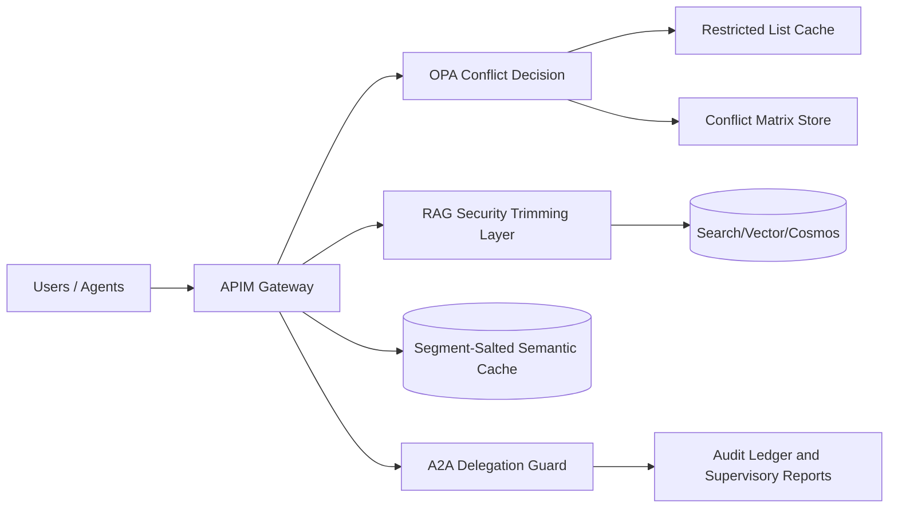
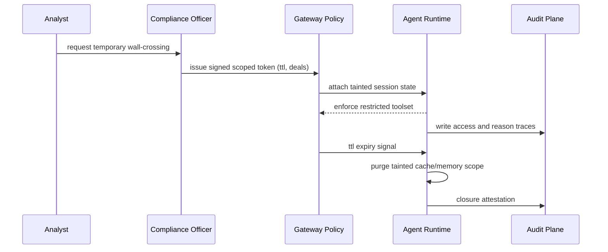

# Enterprise Agent Information-Barrier (MNPI Ethical Wall) Selection FAQ: Route A (Purview IB native segmentation) vs Route B (APIM+OPA real-time conflict matrix with exclusion-aware RAG) vs Route C (CMK-per-wall cryptographic and compute ring-fencing) vs Route D (shared cache/shared orchestrator anti-pattern)

> Audience: global investment banks, broker-dealers, law firms, Big-4 advisory practices, and sovereign/regulatory programs running multi-agent knowledge systems.
> Objective: ensure an enterprise agent can never become an accidental wall-crossing proxy between conflicted segments, deal teams, research desks, or client-matter boundaries.

## 1. Executive Summary

For regulated industries, information barriers are not an optional enhancement.

They are a production admission requirement.

If architecture applies plain RBAC without:

- bilateral conflict logic,
- restricted-list immediacy,
- cache and memory segmentation,
- delegation-chain enforcement,

then an agent platform can leak sensitive context through indirect paths even while nominal role checks pass.

This guide compares four routes:

1. **Route A** — Purview Information Barriers in M365-native collaboration surfaces.
2. **Route B** — APIM+OPA sub-minute ethical-wall control plane across custom Foundry/AKS agents.
3. **Route C** — per-wall cryptographic and compute ring-fencing for tier-0 matters.
4. **Route D** — shared RAG and shared semantic cache with no bilateral conflict enforcement.

Recommended strategy:

- use A as baseline in M365-centric estates,
- add B for real-time conflict and custom agent workloads,
- apply C selectively for highest-sensitivity rings,
- explicitly ban D from critical regulated production paths.

## 2. Problem Definition and Regulatory Boundary

Typical conflict domains include:

- private-side deal teams versus public-side research and trading desks,
- law-firm client-matter conflicts and lateral-hire restrictions,
- audit-versus-advisory separation obligations,
- sovereign defense and strategic industry compartments.

The agent-era challenge is broader than user access:

- retrieval boundaries,
- semantic cache boundaries,
- episodic memory boundaries,
- cross-agent delegation boundaries,
- supervisory evidence and attestation boundaries.

A compliant architecture must therefore govern both **direct** and **indirect** information flow.

## 3. Route Definitions

### Route A — Purview Information Barriers + M365 Native Segmentation

- enforces bilateral communication/content restrictions in M365 surfaces,
- maps to established enterprise segment attributes,
- operationally strong for SharePoint/Teams/Graph-centric knowledge planes.

Trade-off:

- policy recalculation timing is generally acceptable for many workflows,
- but not always sufficient for strict near-real-time restricted-list changes.

### Route B — APIM + OPA Real-Time Ethical-Wall Plane

- evaluates bilateral conflict policy at gateway time,
- enforces exclusion-aware retrieval and cache segmentation,
- validates each A2A delegation hop before execution,
- supports event-driven restricted-list and watchlist propagation.

Route B is typically required when custom agent stacks and custom RAG pipelines dominate.

### Route C — Cryptographic and Compute Ring-Fencing

- dedicated landing-zone/stamp boundaries per segment or matter class,
- key-per-wall CMK strategy for data planes,
- isolated index/cache/state stores by wall boundary.

Route C provides strongest non-commingling guarantees and incident blast-radius control, at higher platform cost and operational complexity.

### Route D — Shared-Plane Anti-Pattern

- shared vector index,
- unsalted global semantic cache,
- unconstrained cross-segment orchestration,
- no taint-aware temporary wall-crossing controls.

Route D is difficult to defend under supervisory review.

## 4. 12-Dimension Comparison Matrix

| Dimension | Route A | Route B | Route C | Route D |
|---|---|---|---|---|
| Bilateral conflict enforcement depth | Medium | High | High | Low |
| Activation latency for new restrictions | Medium | High | High | Unbounded |
| M365-native fit | High | Medium | Medium | Low |
| Custom agent/RAG fit | Medium | High | High | Superficial |
| Cache/memory segregation | Medium | High | High | Low |
| A2A delegation control | Medium | High | High | Low |
| Supervisory audit quality | High | High | Very High | Low |
| Operational complexity | Medium | Medium-High | High | Hidden High |
| Cost predictability | High | Medium-High | Medium | Low |
| Scale to 10,000+ wall relationships | Medium | High | Medium | Low |
| Temporary wall-crossing governance | Medium | High | Medium-High | Weak |
| Recommended boundary | M365-centric baseline | mixed and custom platforms | tier-0 ring-fenced matters | not recommended |

## 5. Quantitative Q&A (Q1..Q6)

### Q1. Why does unidirectional RBAC fail ethical-wall symmetry?

A practical policy expression:

`Allow(u, r) = RBAC(u, r) ∧ ¬Conflict(Seg(u), Seg(r)) ∧ ¬OnRestrictedList(Seg(u), Ticker(r))`

Interpretation:

- RBAC pass is necessary but not sufficient,
- bilateral segment conflict must be evaluated,
- restricted-list overlap must be evaluated at request time.

Any architecture that omits one of these terms remains vulnerable to authorized-but-conflicted access.

### Q2. How can the wall-activation window `ΔT_wall` be reduced to sub-minute targets?

A control-room event path:

`Compliance Action -> Event Grid -> Restricted-List Cache Update -> Cache Epoch Bump -> Gateway Policy Refresh`

Key practices:

- event-driven list updates instead of batch-only polling,
- epoch-based cache invalidation rather than TTL-only expiration,
- request-time policy reads against current conflict epoch.

This sharply reduces stale-policy exposure.

### Q3. How do indirect wall-crossing paths emerge in multi-agent systems?

Common hidden channels:

- global semantic cache entries reused across conflicting segments,
- shared entity-graph surfaces exposing unusual relationship spikes,
- delegation chains where an unconstrained public agent calls a private-side sub-agent.

Mitigation:

- segment and matter salted cache keys,
- exclusion-aware graph traversal guards,
- per-hop delegation validation in gateway policy.

### Q4. How do we make temporary wall-crossing auditable and reversible?

A robust flow:

1. compliance-issued, time-bounded token with explicit deal scope,
2. tainted-session state marking with reduced tool privileges,
3. publication and outbound tool block while tainted,
4. automatic expiry, state purge, and closure attestation.

This transforms temporary wall-crossing from ad-hoc exception to governed workflow.

### Q5. How do we scale legal/financial wall sets without clause explosion?

Avoid filter explosion by combining:

- inverted conflict-group token sets,
- compact bitmap or tokenized conflict references,
- layered filtering (gateway pre-check plus data-plane scoped filter).

This keeps policy throughput manageable as wall cardinality grows.

### Q6. What should daily supervisory attestation prove?

At minimum:

- zero successful cross-wall retrieval hits,
- zero cross-wall cache hits,
- zero unauthorized cross-wall delegation events,
- full traceability for approved temporary wall-crossing sessions.

Attestation should be signed and archived with immutable retention policy.

## 6. Architecture Overview (Mermaid #1)



## 7. Temporary Wall-Crossing Lifecycle (Mermaid #2)



## 8. Production Code Example #1 — OPA Rego Bilateral Ethical-Wall Policy

```rego
package ethicalwall

default allow = false

allow {
  input.rbac_allow == true
  not segment_conflict
  not restricted_overlap
  not blocked_delegation
}

segment_conflict {
  some i
  input.user_segments[i] == input.resource_conflicts[_]
}

restricted_overlap {
  some t
  input.request_tickers[t] == input.restricted_list[_]
}

blocked_delegation {
  input.delegate_target_segment == input.blocked_target_segment
  not input.has_chaperone_token
}
```

## 9. Production Code Example #2 — Salted Cache Keys and Exclusion-Aware Filter Builder

```python
from hashlib import sha256

def semantic_cache_key(tenant: str, segment: str, matter: str, query: str) -> str:
    digest = sha256(query.encode("utf-8")).hexdigest()
    return f"sem:{tenant}:{segment}:{matter}:{digest}"

def conflict_filter(user_segment: str, excluded_segments: list[str], matter_scope: list[str]) -> str:
    exclusions = " and ".join(
        [f"not search.in(excluded_segments, '{seg}', ',')" for seg in excluded_segments]
    )
    matter_clause = " or ".join(
        [f"search.in(matter_scope, '{m}', ',')" for m in matter_scope]
    )
    return (
        f"allowed_segments/any(s: s eq '{user_segment}') and "
        f"({exclusions}) and ({matter_clause})"
    )

def delegation_blocked(source_seg: str, target_seg: str, blocked_pairs: set[tuple[str, str]]) -> bool:
    return (source_seg, target_seg) in blocked_pairs
```

## 10. Enterprise Scenario A — Global Bulge-Bracket Bank

Context:

- 18,000+ professionals across advisory, DCM, ECM, sales, and research,
- rapid restricted-list updates during active deal windows,
- mixed M365 and custom agent platform surfaces.

Recommended route composition:

- Route A for native M365 communication and content segmentation,
- Route B for sub-minute ethical-wall controls in custom RAG/A2A systems,
- Route C for selected tier-0 strategic mandates requiring strongest ring-fence controls.

Operational objective:

- maintain near-real-time restriction activation while preserving supervisory evidence quality.

## 11. Enterprise Scenario B — AmLaw 50 Global Law Firm

Context:

- 45,000+ client-matter conflict relationships,
- lateral-hire and multi-jurisdictional conflict rules,
- mixed drafting, retrieval, and review agent workflows.

Recommended route composition:

- Route B as default for custom drafting/retrieval controls,
- Route A for M365 collaboration boundaries,
- Route C for highly sensitive regulated matters.

Expected gain:

- lower conflict-violation risk,
- higher audit explainability,
- cleaner and faster conflict exception handling.

## 12. Three-Year TCO Comparison (Illustrative)

| Route | Annual Platform/Licensing | Annual Governance/Ops | 3-Year Total | Interpretation |
|---|---:|---:|---:|---|
| Route A | `$520k` | `$180k` | `$2.10M` | strong baseline for M365-centric controls |
| Route B | `$610k` | `$260k` | `$2.61M` | best real-time policy depth for custom stacks |
| Route C | `$760k` | `$320k` | `$3.24M` | strongest compartment guarantees, highest cost |
| Route D | `$430k` | `$540k` | `$2.91M` | hidden incident/remediation costs dominate |

Notes:

- figures are planning bands and must be calibrated with tenant count, matter cardinality, and supervisory SLA obligations,
- route blending is common; tiering by sensitivity often outperforms one-size-fits-all policy.

## 13. Day-0 / Day-1 / Day-2 Checklist

### Day-0 (Policy Baseline)

- define segment taxonomy and conflict matrix ownership,
- define restricted-list ingestion SLA and source-of-truth contracts,
- define temporary wall-crossing approval and revocation workflows,
- define route boundary by sensitivity class.

### Day-1 (Production Controls)

- deploy gateway conflict decisions and cache salting policy,
- enable event-driven restricted-list and epoch invalidation flow,
- instrument cross-wall block, delegation deny, and exception metrics,
- verify attestation pipeline and immutable retention.

### Day-2 (Governance Operations)

- optimize filter and conflict-group encoding performance,
- review false deny / false allow exception data,
- publish daily supervisory attestation and monthly risk summaries,
- rehearse emergency wall activation for major deal events.

## 14. Good Fit vs Not For

### Good Fit

- organizations with explicit ethical-wall or matter-conflict obligations,
- multi-agent systems with retrieval, cache, and delegation pathways,
- environments requiring regulator-ready explainability.

### Not For

- low-risk internal Q&A with no conflict-driven segregation duties,
- teams unwilling to operate continuous policy and evidence controls,
- platforms that cannot enforce per-hop delegation policy.

## 15. Final Recommendation

Ethical-wall architecture is not solved by “more RBAC.”

It requires a unified control system spanning:

- bilateral conflict logic,
- restricted-list immediacy,
- segmented cache/memory behavior,
- delegation-hop policy checks,
- temporary wall-crossing taint governance,
- supervisory-grade evidence generation.

Execution order:

- establish Route A baseline in native collaboration surfaces,
- deploy Route B for real-time controls in custom agent/RAG paths,
- reserve Route C for highest-criticality rings with strongest non-commingling requirements,
- prohibit Route D in regulated production systems.

This route strategy minimizes cross-wall leakage risk while preserving operational agility and audit defensibility.

### 15.1 Suggested Supervisory Evidence Package

- daily blocked cross-wall event summary with reason-code distribution,
- temporary wall-crossing issuance/expiry/revocation ledger,
- cache-segmentation consistency checks,
- delegation-chain policy pass/fail report,
- signed compliance attestation with immutable retention pointer.

With a standardized evidence package, organizations can answer supervisory and internal-audit queries quickly and consistently.

### 15.2 Operational KPIs and Alert Thresholds (Suggested Baseline)

Treat ethical-wall governance as an operational SLO domain, not only a monthly compliance artifact.

| KPI | Definition | Recommended Target | Severity |
|---|---|---:|---|
| `wall_conflict_block_rate` | Correctly blocked conflicted requests | `>= 99.99%` | P1 |
| `restricted_list_activation_p95` | P95 from list update to enforced policy | `<= 30s` | P1 |
| `cross_wall_cache_hit_count` | Cross-wall semantic cache hits | `= 0` | P0 |
| `delegation_revalidation_coverage` | Per-hop delegation re-check coverage | `= 100%` | P1 |
| `wall_crossing_expired_cleanup_rate` | Expired tainted-session cleanup success | `>= 99.9%` | P1 |

Telemetry should be partitioned across three planes:

- **Gateway plane**: deny reason codes, segment pair, restricted-list version, policy epoch.
- **Data plane**: retrieval trimming outcomes and cache segmentation consistency.
- **Orchestration plane**: delegation chain path, per-hop decision, and final action.

### 15.3 Common Failure Modes and Root-Cause Patterns

1. **List updated but conflicted retrieval still succeeds**
   - Typical cause: TTL-only cache strategy without epoch invalidation.
   - Fix: event-driven epoch bump and policy-version verification at request admission.
2. **A2A path bypasses primary policy gateway**
   - Typical cause: internal direct service-to-service calls.
   - Fix: enforce gateway or policy-sidecar mediation on every delegated hop.
3. **Temporary wall-crossing sessions not fully revoked**
   - Typical cause: UI timer without server authoritative expiry.
   - Fix: server-side TTL, mandatory cleanup job, closure attestation in audit ledger.
4. **Filter clause expansion impacts retrieval latency**
   - Typical cause: direct per-matter clause fan-out.
   - Fix: tokenized conflict-group encoding and layered filtering strategy.

### 15.4 Staged Route Composition Blueprint (A + B + C)

- **Phase 1 (4-8 weeks)**: establish Route A baseline for native collaboration segmentation.
- **Phase 2 (6-10 weeks)**: deploy Route B on custom agent/RAG/API gateway pathways.
- **Phase 3 (selective rollout)**: apply Route C to tier-0 and sovereign/highly restricted rings.

Each phase should have dual acceptance:

- **Engineering acceptance**: latency, throughput, deny precision, fail-closed behavior.
- **Compliance acceptance**: evidence completeness, replayability, and exception workflow closure.

### 15.5 ROI Framing Model (Governance Cost vs Risk Reduction)

Use a simple planning equation:

`Annual_ROI = (Risk_Avoided + Audit_Efficiency_Gain + Incident_Response_Saving - Governance_Run_Cost) / Governance_Run_Cost`

Where:

- `Risk_Avoided` estimates avoided penalties and remediation from prevented policy breaches.
- `Audit_Efficiency_Gain` captures reduced supervisory preparation and review effort.
- `Incident_Response_Saving` captures reduced triage and legal investigation effort.

In many regulated programs, Route B adoption improves response and evidence readiness within two to four audit cycles.

### 15.6 Practical Decision Tree (Condensed)

1. **M365-dominant surface and minute-level policy activation acceptable?**
   - Start with Route A baseline.
2. **Custom RAG, semantic cache, and A2A delegation in scope?**
   - Route B becomes mandatory.
3. **Tier-0 sovereign or legally non-comminglable data involved?**
   - Add Route C ring-fencing.
4. **Still planning shared cache/index or unconstrained cross-segment orchestration?**
   - classify as Route D anti-pattern and block production approval.

