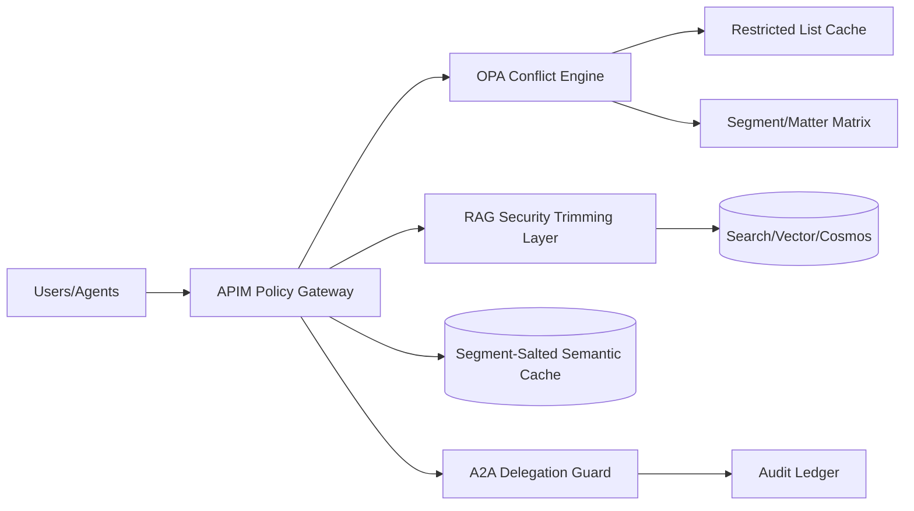
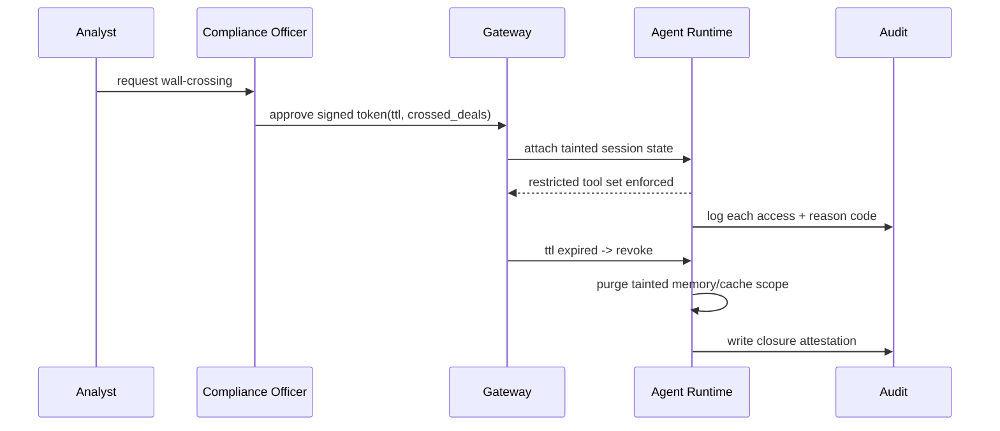

# 企业 Agent 信息隔离墙（MNPI/伦理墙）选型 FAQ：Route A（Purview IB 原生分段）vs Route B（APIM+OPA 实时冲突矩阵 + RAG 排除裁剪）vs Route C（CMK 分段加密与专属 Stamp 环形隔离）vs Route D（共享缓存与共享编排反模式）

> 适用对象：投行、券商、律所、四大、主权/国防项目中的 Cloud & AI Solution Architect、合规官、平台安全团队。
> 目标：防止智能体成为“跨墙代理”，确保 Private-Side 与 Public-Side、冲突客户/事项之间不发生任何隐式或显式信息穿透。

## 1. 执行摘要

在受监管行业，信息隔离墙是“能否上线 AI Agent”的准入门槛，而不是上线后的优化项。

如果只做读权限 RBAC，而不做双边冲突约束、缓存隔离和代理调用链治理，智能体很容易通过间接路径泄露 MNPI。

本指南给出四条路线：

1. **Route A**：Purview Information Barriers + M365 原生隔离。
2. **Route B**：APIM+OPA 的亚分钟级实时伦理墙控制平面。
3. **Route C**：按墙分区的密钥与数据平面硬隔离（加密与计算双环形）。
4. **Route D**：共享索引、共享缓存、共享编排器的反模式。

建议实践：M365 主体组织先 A，再引入 B 处理实时冲突；超高敏业务采用 C；明确禁止 D。

## 2. 问题定义与监管边界

典型冲突场景：

- 投行并购团队与卖方研究团队之间的隔离。
- 律所不同客户事项之间的冲突隔离。
- 审计与咨询服务线之间的信息边界。

监管要求通常覆盖：

- 访问控制（谁可看）
- 沟通控制（谁可联络）
- 缓存与记忆控制（谁可复用）
- 审计与追责（谁在何时为何访问）

智能体时代还需新增：

- Agent-to-Agent 委派控制
- 语义缓存与向量索引冲突清洗
- 临时越墙（Over-the-Wall）授权的时效与污染态管理

## 3. 四条路线定义

### Route A：Purview Information Barriers 原生分段

- 基于 Entra 分段属性在 M365 生态内执行沟通与内容隔离。
- 适用于 M365 主数据面与协作平面占主导的组织。
- 优势：治理模型清晰、与现有管理体系契合。
- 约束：策略生效存在批量重算窗口，不适合秒级紧急墙启停。

### Route B：APIM + OPA 实时伦理墙控制平面

- 在 API 与 Agent 网关层执行双边冲突判定。
- 对 RAG、缓存、工具调用、A2A 委派统一拦截。
- 配合事件流在数十秒内刷新限制列表和缓存 epoch。
- 适用于自建 Foundry/AKS Agent 平台。

### Route C：CMK + 专属 Stamp 的加密与计算环形隔离

- 每墙/每事项单独密钥与专属数据平面。
- 通过订阅/资源组/数据平面物理/逻辑分环实现“可证明不混用”。
- 适用于 Tier-0 交易与主权敏感项目。

### Route D：共享平面反模式

- 共享向量索引
- 共享语义缓存
- 共享多 Agent 编排链
- 无冲突 taint 传播

该路线在审计中几乎无法自证“零跨墙”。

## 4. 12 维比较矩阵

| 维度 | Route A | Route B | Route C | Route D |
|---|---|---|---|---|
| 双边冲突控制 | 中 | 高 | 高 | 低 |
| 生效时延 | 中 | 高 | 高 | 无保障 |
| M365 适配 | 高 | 中 | 中 | 低 |
| 自建 Agent 适配 | 中 | 高 | 高 | 表面高 |
| 缓存隔离能力 | 中 | 高 | 高 | 低 |
| A2A 委派治理 | 中 | 高 | 高 | 低 |
| 监管可审计性 | 高 | 高 | 很高 | 低 |
| 运维复杂度 | 中 | 中高 | 高 | 隐性高 |
| 成本可预测性 | 高 | 中高 | 中 | 低 |
| 扩展到 1w+ 墙 | 中 | 高 | 中 | 低 |
| 临时越墙流程 | 中 | 高 | 中高 | 弱 |
| 适用边界 | M365 主体 | 混合/自建主体 | 极高敏场景 | 不建议 |

## 5. 定量问题 Q1..Q6

### Q1：为什么单向 RBAC 不足以实现伦理墙？

必须满足：

`Allow(u, r) = RBAC(u, r) ∧ ¬Conflict(Seg(u), Seg(r)) ∧ ¬OnRestrictedList(Seg(u), Ticker(r))`

含义：

- 仅有角色权限不够；
- 还需检查“用户分段与资源分段是否冲突”；
- 还需检查“是否命中限制列表”。

若缺少任一条件，智能体可在“授权但冲突”的状态下越墙访问。

### Q2：如何把墙启停窗口 `ΔT_wall` 压到 `<15s`？

参考链路：

`Control Room -> Event Grid -> Redis Bitmap/Set -> Cache Epoch Bump -> Gateway Policy Refresh`

工程重点：

- 限制列表变更事件化
- 缓存版本化（epoch）而非仅 TTL
- 网关层强制读取最新冲突版本

这样可避免“名单更新了但缓存仍可命中旧结果”的窗口风险。

### Q3：如何防止间接越墙（Indirect Wall-Crossing）？

间接越墙常见于：

- 共享语义缓存命中跨墙上下文
- 共享实体图谱出现异常度数变化
- A2A 委派把请求转发给冲突分段 Agent

治理策略：

- 缓存 key 必须做 segment/matter 盐化
- 实体图谱访问附带冲突过滤条件
- 委派链每跳都重验冲突矩阵

### Q4：如何实现可审计“临时越墙”流程？

推荐流程：

1. 合规官签发时效 JWT（含 `crossed_deals`）。
2. 用户进入“污染态会话”并限制发布类工具。
3. 到期自动回收并强制上下文清洗。

这保证临时越墙是“可授权、可约束、可回收”的受控动作。

### Q5：如何扩展到 10,000+ 客户事项而不爆过滤子句？

避免直接拼接超长过滤表达式，改为：

- 冲突组倒排编码
- 位图/令牌化冲突集合
- 网关先做粗筛，索引再做细筛

这样可在规模增长时保持策略性能可控。

### Q6：如何做监管日审证明“零跨墙命中”？

建议每日产出三类证明：

- 跨墙拒绝统计与样本核验
- 缓存命中分段一致性报告
- A2A 委派链冲突验证报告

并形成监管可读的签名日报与留档。

## 6. 架构总览（Mermaid 图 1）



## 7. 临时越墙与污染态回收（Mermaid 图 2）



## 8. 生产代码示例 1（OPA Rego 双边冲突策略）

```rego
package ethicalwall

default allow = false

allow {
  input.rbac_allow == true
  not conflict_segment
  not restricted_ticker
  not blocked_delegation
}

conflict_segment {
  some i
  some j
  input.user_segments[i] == input.resource_conflicts[j]
}

restricted_ticker {
  some t
  input.request_tickers[t] == input.restricted_list[_]
}

blocked_delegation {
  input.delegate_target_segment == input.blocked_target_segment
  not input.has_chaperone_token
}
```

## 9. 生产代码示例 2（缓存盐化与冲突过滤构建）

```python
from hashlib import sha256

def build_cache_key(tenant_id: str, user_seg: str, matter_id: str, query: str) -> str:
    salt = f"{tenant_id}:{user_seg}:{matter_id}"
    digest = sha256(query.encode("utf-8")).hexdigest()
    return f"sem:{salt}:{digest}"

def build_search_filter(user_seg: str, excluded_segments: list[str], matter_ids: list[str]) -> str:
    seg_exclusion = " and ".join([f"not search.in(excluded_segments, '{s}', ',')" for s in excluded_segments])
    matter_scope = " or ".join([f"search.in(matter_scope, '{m}', ',')" for m in matter_ids])
    return f"allowed_segments/any(s: s eq '{user_seg}') and ({seg_exclusion}) and ({matter_scope})"

def requires_block(delegate_target_seg: str, blocked_pairs: set[tuple[str, str]], source_seg: str) -> bool:
    return (source_seg, delegate_target_seg) in blocked_pairs
```

## 10. 企业场景 A：全球投行私墙与公墙分离

背景：

- 18,000+ 员工
- 并购、债承、研究、销售交易多线并行
- 限制名单变化频繁

建议：

- M365 平面用 Route A
- 自建 Agent/RAG/A2A 平面用 Route B
- 超高敏 Deal Room 用 Route C

目标：

- 限制名单在秒级到分钟级完成生效
- 零跨墙命中可审计

## 11. 企业场景 B：AmLaw 50 律所事项冲突隔离

背景：

- 45,000+ client-matter 隔离关系
- 跨办公室、跨司法辖区协作频繁

建议：

- 事项级冲突组编码
- 文档检索与缓存强制事项盐化
- 临时越墙必须经合规签发并限时

收益：

- 降低冲突违规风险
- 提升合规审计可解释性

## 12. 三年 TCO 对比（示例）

| 路线 | 年平台与许可 | 年治理与运维 | 三年总计 | 说明 |
|---|---:|---:|---:|---|
| Route A | `$520k` | `$180k` | `$2.10M` | M365 生态治理效率高 |
| Route B | `$610k` | `$260k` | `$2.61M` | 实时控制能力强 |
| Route C | `$760k` | `$320k` | `$3.24M` | 极高敏隔离代价更高 |
| Route D | `$430k` | `$540k` | `$2.91M` | 事故与整改成本吞噬节省 |

## 13. Day-0 / Day-1 / Day-2 清单

### Day-0

- 梳理分段模型与冲突矩阵定义
- 明确限制列表来源与更新 SLA
- 定义越墙审批与回收策略

### Day-1

- 部署网关冲突策略与缓存盐化
- 打通事件驱动限制列表刷新
- 上线跨墙拒绝与委派审计看板

### Day-2

- 优化过滤性能与冲突组编码
- 复盘误拒绝/漏拒绝案例
- 形成监管日报与月度证据包

## 14. Good fit vs Not for

### Good fit

- 强监管机构或法律冲突敏感组织
- 多 Agent 协作且存在跨墙风险
- 需要可证明的审计证据链

### Not for

- 仅做低风险内部知识问答
- 无冲突矩阵治理能力
- 不愿维护持续合规运营

## 15. 结论

伦理墙治理的关键不是“再加一层权限”，而是把“分段冲突、缓存隔离、委派链审计、临时越墙回收”做成统一控制平面。

推荐顺序：

- 以 Route A 打牢原生协作隔离基线；
- 以 Route B 建立实时网关与缓存治理；
- 在 Tier-0 事项上采用 Route C 的密钥与计算环形隔离；
- 明确禁止 Route D 进入生产。

这样才能在智能体规模化落地时，持续满足监管、风控与业务效率三重目标。

### 15.1 监管证据包建议结构

- 每日：跨墙拒绝总览、越墙授权记录、异常委派链报告。
- 每周：冲突矩阵变更回放、缓存隔离一致性抽检。
- 每月：零跨墙证明摘要、整改闭环与责任人确认。

通过标准化证据包，组织可在监管抽查与内审中快速给出可验证答案。

### 15.2 运行指标与告警阈值（建议基线）

建议把伦理墙治理纳入平台 SLO，而非仅作为合规月报指标：

| 指标 | 定义 | 建议阈值 | 告警级别 |
|---|---|---:|---|
| `wall_conflict_block_rate` | 冲突请求被正确阻断占比 | `>= 99.99%` | P1 |
| `restricted_list_activation_p95` | 限制名单变更到生效 P95 | `<= 30s` | P1 |
| `cross_wall_cache_hit_count` | 跨墙缓存命中次数 | `= 0` | P0 |
| `delegation_revalidation_coverage` | 委派链每跳复验覆盖率 | `= 100%` | P1 |
| `wall_crossing_expired_session_cleanup` | 越墙到期污染态清理成功率 | `>= 99.9%` | P1 |

可观测面建议同时落在三层：

- **网关层**：策略拒绝原因码、冲突对、命中名单版本。
- **数据层**：检索裁剪命中统计、缓存盐化一致性。
- **编排层**：A2A 委派链路径、每跳策略结果、最终动作。

### 15.3 典型失败模式与根因定位

1. **名单已更新但仍发生疑似跨墙检索**
   常见根因：缓存仅 TTL、未做 epoch 失效；修复：事件驱动 bump epoch 并在网关强校验版本。
2. **A2A 委派路径绕过主网关**
   常见根因：内部服务直连；修复：要求所有子 Agent 调用经统一策略 sidecar/gateway。
3. **临时越墙会话超时未回收**
   常见根因：仅前端计时；修复：服务端 TTL + 强制清理任务 + 审计闭环。
4. **索引安全裁剪过滤过长导致查询超时**
   常见根因：逐事项拼接；修复：冲突组令牌化与分层过滤。

### 15.4 Route A/B/C 组合落地蓝图（分阶段）

- **阶段 1（4-8 周）**：先在 M365 协作面落地 Route A，建立组织分段和沟通边界。
- **阶段 2（6-10 周）**：在自建 Agent 平台引入 Route B，统一网关冲突判定与缓存隔离。
- **阶段 3（按事项推进）**：对 Tier-0 事项上 Route C，实现每墙密钥与数据平面隔离。

阶段验收必须包含“技术验收 + 合规验收”双签字：

- 技术验收看性能、可用性、误拒绝率。
- 合规验收看证据完整性、追责链可读性、例外流程闭环。

### 15.5 ROI 估算模型（治理投入 vs 违规风险暴露）

可采用简化模型：

`Annual_ROI = (Risk_Avoided + Audit_Efficiency_Gain + Incident_Response_Saving - Governance_Run_Cost) / Governance_Run_Cost`

其中：

- `Risk_Avoided`：按历史事件概率与潜在处罚/赔付估算。
- `Audit_Efficiency_Gain`：审计准备与复核工时下降。
- `Incident_Response_Saving`：误共享与越墙调查时间缩短。

多数强监管机构在 Route B 上线后，能在 2-4 个审计周期内看到“响应时效与证据可用性”显著提升。

### 15.6 选型决策树（简版）

1. **是否以 M365 协作面为主且可接受分钟级策略生效？**
   是：先 Route A。
2. **是否存在自建 RAG、语义缓存与 A2A 委派链？**
   是：必须加 Route B。
3. **是否涉及 Tier-0 事项、主权或法定不可混用数据域？**
   是：叠加 Route C。
4. **是否仍计划共享跨分段缓存或共享编排器直连？**
   是：归类 Route D 反模式，禁止生产放行。

### 15.7 控制目标到技术控制项映射（审计友好模板）

为避免“有制度、无技术落点”，建议把控制目标直接映射到可验证控制项：

| 控制目标 | 技术控制项 | 验证证据 |
|---|---|---|
| 防止冲突分段互访 | 网关双边冲突判定 + 检索排除裁剪 | 策略评估日志、拒绝原因码分布 |
| 防止限制名单延迟生效 | Event Grid 事件驱动 + 缓存 epoch 强失效 | 名单变更时间线与生效时间线对账 |
| 防止缓存跨墙污染 | `tenant/segment/matter` 三元盐化 key | 缓存抽样命中一致性报告 |
| 防止委派链绕过 | A2A 每跳重验 + 禁止内部直连 | 委派链路追踪与策略决策明细 |
| 防止越墙会话失控 | 时效 JWT + 污染态工具白名单 + 到期清理 | 越墙授权单、到期清理与闭环证明 |

建议把上述映射固化在“合规控制字典”中，并在每次策略变更时自动触发差异审计。

### 15.8 监管问询高频问题与答复要点

**问：如何证明你们不是“形式隔离”，而是“实质隔离”？**
答复要点：提供跨墙请求拒绝样本、缓存隔离抽检、委派链逐跳决策证据，并附带签名审计报表与不可篡改存档位置。

**问：如果合规官批准临时越墙，如何防止后续持续污染？**
答复要点：展示越墙 token 的 TTL、作用域、自动回收策略，以及会话污染态结束后内存/缓存/工具权限同步清理证明。

**问：发生疑似越墙事件时，多久可以完成回溯？**
答复要点：说明统一追踪 ID 设计，能在分钟级聚合网关、检索、缓存、委派与工具调用证据，支持快速法务与内控联动。

通过预制问答模板，平台团队可以把“临场解释”转为“标准化证据交付”。

