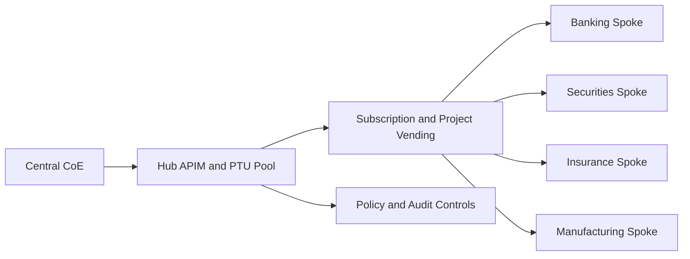
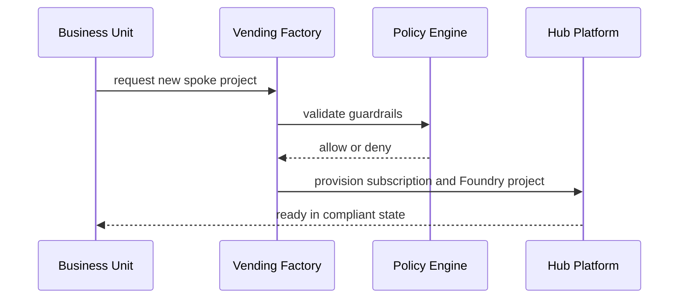

# Enterprise AI CoE Hub-Spoke Landing Zone vs Federated BU Operating Model Selection FAQ

> 🌐 **Language / 语言切换**: **[🇬🇧 English (enterprise-ai-coe-hub-spoke-landing-zone-vs-federated-bu-operating-model-selection-faq.en.md)](enterprise-ai-coe-hub-spoke-landing-zone-vs-federated-bu-operating-model-selection-faq.en.md)** | **[🇨🇳 中文版 (enterprise-ai-coe-hub-spoke-landing-zone-vs-federated-bu-operating-model-selection-faq.md)](enterprise-ai-coe-hub-spoke-landing-zone-vs-federated-bu-operating-model-selection-faq.md)** | **[📚 Architecture Selection FAQ Index](README.en.md)**

## 1) Objective and boundary
- Goal: select group-level AI operating models balancing centralized governance and federated business agility.
- Scope: CoE collaboration, multi-subscription landing-zone engineering, PTU pooling governance, and delivery operating model design.
- Exclusion: no low-level kernel or model-runtime internals.
## 2) Verifiable sources with timestamps
- Azure AI Foundry docs: `https://learn.microsoft.com/azure/ai-foundry/` (fetched 04:29 BJT).
- APIM AI Gateway overview: `https://learn.microsoft.com/en-us/azure/api-management/ai-gateway-overview` (fetched 04:29 BJT).
- APIM changelog: `https://github.com/Azure/API-Management/blob/main/changelogs/api-management-service.md` (fetched 04:29 BJT).
- Azure Policy docs: `https://learn.microsoft.com/azure/governance/policy/` (fetched 04:30 BJT).
- Management groups and subscriptions governance docs: `https://learn.microsoft.com/azure/governance/management-groups/` (fetched 04:30 BJT).
- Azure landing zone docs: `https://learn.microsoft.com/azure/cloud-adoption-framework/ready/landing-zone/` (fetched 04:30 BJT).
- Labels remain measured, synthetic, and anonymized_reported.
## 3) 12-dimension matrix for group operating models
- D1 central AI factory: strongest compliance consistency but risk of central scheduling bottlenecks.
- D2 hub platform plus federated spokes: central platform guardrails with domain-level autonomous delivery velocity.
- D3 decentralized silos: fastest local experimentation but high duplication, shadow AI, and control drift risk.
- D4 platform-owned plus GSI resident model: first-year capacity boost with transfer-risk governance needed.
- D5 onboarding lead time: subscription and project vending can compress environment setup from weeks to minutes.
- D6 PTU economics: shared pool with controlled overflow improves utilization and procurement leverage.
- D7 accountability clarity: chargeback mapping enforces domain cost ownership and demand discipline.
- D8 policy enforcement: no-public-endpoint, central APIM, and mandatory tags must be self-service enforced.
- D9 security posture: delegated scopes need least-privilege identities and tenant-bound operational boundaries.
- D10 delivery throughput: 6 to 10 central platform engineers can support about 15 domain squads if guardrails are automated.
- D11 data isolation: regulated subsidiaries require legal-entity isolation with shared governance abstraction.
- D12 anti-pattern: central-only ticket queues without vending automation stall enterprise AI scale-out.
## 4) Score snapshot and thresholds
- Centralized CoE AI factory: governance5 reuse5 agility2 throughput3.
- Hub platform plus federated spokes: governance4 reuse5 agility5 throughput5.
- Decentralized silos: agility4 governance1 reuse1 cost2.
- Platform plus resident integrator: throughput4 governance3 transfer2 cost3.
- Threshold A: if setup lead time exceeds 3 days, enable automated subscription and Foundry project vending.
- Threshold B: if PTU utilization variance between domains exceeds 35 points, enable shared pool with overflow contracts.
- Threshold C: if policy non-compliance exceeds 1 percent, block self-service rollout until guardrails are codified.
## 5) Five calculable Q&As
### Q1 Why many groups stall after first five PoCs
- Central teams become a bottleneck when every new domain waits in manual platform queues.
- Vending automation shortens setup from roughly three weeks to around fifteen minutes for compliant templates.
### Q2 Shared PTU pool plus PAYGO overflow governance
- Allocate baseline PTU centrally and route burst traffic to domain-level PAYGO overflow with guardrails.
- Showback and chargeback create behavioral incentives for prompt and caching efficiency.
### Q3 Policy-enforced self-service without approval bottlenecks
- Enforce no public endpoint, mandatory central APIM path, and cost tags via policy assignments.
- Self-service remains open while non-compliant configurations are denied at deployment time.
### Q4 Central team to domain squad staffing ratio
- A 6 to 10 person platform team can sustain around 15 domain squads when templates and guardrails are mature.
- Missing automation sharply increases ticket load and weakens delivery predictability.
### Q5 Resident integrator knowledge and access boundaries
- IP, runbooks, and IaC ownership must be contractually transferred into enterprise repositories on each milestone.
- Supplier identities must be isolated with least privilege and revocable break-glass controls.
## 6) Layered reference architecture
- Governance layer: management-group hierarchy and policy initiative packs.
- Platform hub layer: central APIM AI gateway, private DNS, and PTU pool governance plane.
- Vending layer: subscription and Foundry project factory pipelines with compliance defaults.
- Domain spoke layer: business-unit projects with isolated data/network boundaries and delegated delivery autonomy.
- FinOps layer: showback and chargeback plus usage anomaly controls.
- Security layer: identity segmentation, key management, and immutable audit baselines.
- Operations layer: deployment cadence dashboards, compliance scorecards, and incident ownership maps.
## 7) Scenario A financial holding federation
- One central AI governance gateway serves banking, securities, insurance, and asset-management subsidiaries.
- Shared procurement and central controls coexist with strict legal-entity data and network isolation.
- Foundry project vending accelerates compliant domain onboarding without manual platform bottlenecks.
- Policy and audit baselines satisfy both group-level and license-entity supervisory expectations.
- Synthetic gain: delivery cycle time drops while compliance exceptions remain bounded.
## 8) Scenario B global manufacturing platform factory
- Headquarters platform office serves four regions and twelve product lines through standardized vending templates.
- Regional spokes retain delivery autonomy while inheriting central security and cost guardrails.
- Built-in approval and evaluation gates reduce unsafe production promotion risk.
- Reusable agent assets are published to an internal marketplace for cross-domain reuse.
- Synthetic gain: platform reuse and delivery throughput rise in parallel.
## 9) Mermaid diagram 1 hub and spoke operating model

- Hub guardrails centralize risk controls while spokes keep domain-level execution velocity.
## 10) Mermaid diagram 2 self-service vending control flow

- Guardrail evaluation before provisioning preserves autonomy without sacrificing compliance baselines.
## 11) Bicep template (MG policy guardrails + hub APIM + spoke Foundry vending)
```bicep
targetScope = 'managementGroup'
param location string = 'eastus2'
resource policySet 'Microsoft.Authorization/policySetDefinitions@2023-04-01' = {
  name: 'coe-guardrails'
  properties: { policyType: 'Custom', displayName: 'CoE Guardrails' }
}
resource apim 'Microsoft.ApiManagement/service@2023-09-01-preview' = {
  name: 'apim-hub'
  location: location
  sku: { name: 'PremiumV2', capacity: 1 }
}
```
- Production rollout also requires private endpoint policies, identity baselines, and vending RBAC segmentation.
## 12) Azure Policy and vending pipeline snippet
```json
{
  "if": {"field": "type", "equals": "Microsoft.CognitiveServices/accounts"},
  "then": {"effect": "deny", "condition": {"field": "Microsoft.CognitiveServices/accounts/publicNetworkAccess", "equals": "Enabled"}}
}
```
```yaml
steps:
  - task: ValidatePolicyAndTags
  - task: CreateSubscriptionAndFoundryProject
  - task: RegisterChargebackBindings
```
- Policy-first vending allows autonomy while preventing non-compliant resource instantiation.
## 13) KQL for compliance, PTU reuse, and delivery lead time
```kql
let t = CoeOpsLogs | where TimeGenerated > ago(30d);
t
| summarize complianceRate=avg(todouble(Compliant)), ptuReuse=avg(PTUReuseRatio), medianLead=minif(LeadTimeMinutes, LeadTimeMinutes > 0), p95Lead=percentile(LeadTimeMinutes,95) by BusinessUnit
| extend chargebackCoverage=avg(todouble(ChargebackBound))
```
- Compliance and lead-time regressions should trigger immediate template or policy remediation loops.
## 14) Three-year rollout and ROI cadence
- Phase 1: central baseline and guardrails with pilot spokes in high-priority domains.
- Phase 2: expand vending factory and chargeback governance across all business units.
- Phase 3: reduce external dependency and complete runbook and ownership transfer.
- Track avoided duplicate procurement, reduced setup lead time, and improved PTU reuse as ROI pillars.
- Keep quarterly architecture review boards to recalibrate central-versus-federated decision boundaries.
- Enforce immutable audit and tagging quality as non-negotiable operating controls.
- Publish transparent platform service catalog and support SLOs for domain delivery planning.
