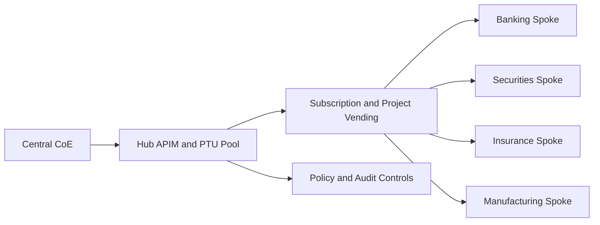
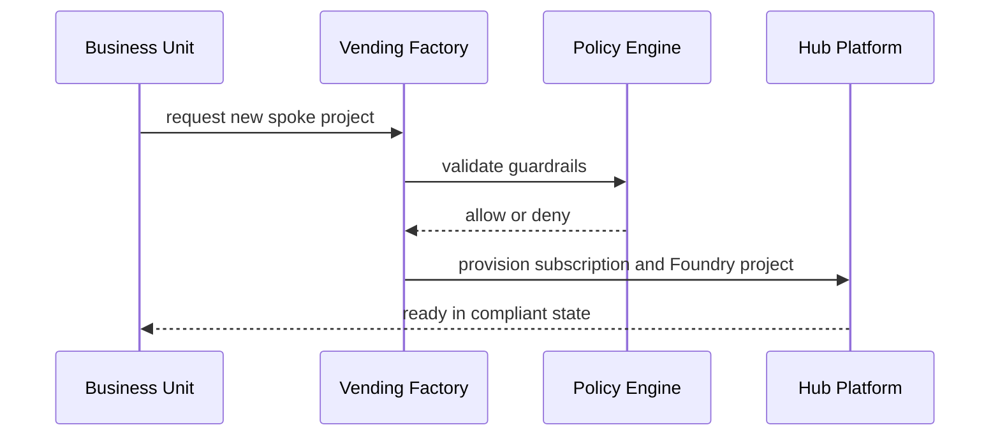

# 企业 AI CoE Hub-Spoke Landing Zone vs 联邦业务线运营模式选型 FAQ

> 🌐 **Language / 语言切换**: **[🇨🇳 中文版 (enterprise-ai-coe-hub-spoke-landing-zone-vs-federated-bu-operating-model-selection-faq.md)](enterprise-ai-coe-hub-spoke-landing-zone-vs-federated-bu-operating-model-selection-faq.md)** | **[🇬🇧 English (enterprise-ai-coe-hub-spoke-landing-zone-vs-federated-bu-operating-model-selection-faq.en.md)](enterprise-ai-coe-hub-spoke-landing-zone-vs-federated-bu-operating-model-selection-faq.en.md)** | **[📚 返回架构选型指南目录](README.md)**

## 1) 研究目标与边界
- 目标：在集团级场景下平衡中央治理能力与业务线敏捷交付速度。
- 范围：CoE协同、多订阅Landing Zone工程、PTU共享治理与交付运营模式。
- 排除：不涉及底层内核与模型运行时实现细节。
## 2) 可验证来源与时间戳
- Azure AI Foundry：`https://learn.microsoft.com/azure/ai-foundry/`（抓取 04:29 BJT）。
- APIM AI Gateway：`https://learn.microsoft.com/en-us/azure/api-management/ai-gateway-overview`（抓取 04:29 BJT）。
- APIM changelog：`https://github.com/Azure/API-Management/blob/main/changelogs/api-management-service.md`（抓取 04:29 BJT）。
- Azure Policy：`https://learn.microsoft.com/azure/governance/policy/`（抓取 04:30 BJT）。
- 管理组治理：`https://learn.microsoft.com/azure/governance/management-groups/`（抓取 04:30 BJT）。
- Landing Zone：`https://learn.microsoft.com/azure/cloud-adoption-framework/ready/landing-zone/`（抓取 04:30 BJT）。
- 证据标签统一 measured、synthetic、anonymized_reported。
## 3) 四类集团级治理与运营模式 12 维矩阵
- 维度1中央AI工厂：合规一致性与复用最强，但中央排期容易成为瓶颈。
- 维度2平台Hub+业务Spoke联邦：中央护栏统一，业务线保持自助敏捷。
- 维度3分散自治Silo：试错快但重复采购、影子AI与治理漂移风险高。
- 维度4平台自持+驻场集成商：首年交付产能高，但知识转移必须强约束。
- 维度5开通时效：订阅与项目自动发放可将环境开通从周级压缩至分钟级。
- 维度6PTU经济性：共享池+溢出契约可提升利用率与集采议价能力。
- 维度7责任归属：Chargeback让业务线对成本与效率承担可追责责任。
- 维度8策略执行：禁公网、强制走中央网关、强制标签应由策略自动兜底。
- 维度9安全边界：委派权限必须遵循最小权限与租户边界隔离。
- 维度10交付吞吐：6至10人平台组在自动化成熟时可支撑约15个业务小队。
- 维度11数据隔离：持牌子公司须满足法人级数据与网络监管隔离要求。
- 维度12反模式：只靠中央工单审批而无自动发放会显著阻断规模化。
## 4) 评分与决策阈值
- 中央CoE AI工厂：治理5、复用5、敏捷2、吞吐3。
- Hub平台+联邦Spoke：治理4、复用5、敏捷5、吞吐5。
- 分散自治Silo：敏捷4、治理1、复用1、成本2。
- 平台+驻场集成商：吞吐4、治理3、转移2、成本3。
- 阈值A：开通时长超过3天即启用订阅与Foundry项目自动发放。
- 阈值B：业务线PTU利用率方差超过35点时启用共享池与溢出契约。
- 阈值C：策略不合规率超过1%时暂停自助扩面并先补齐护栏。
## 5) 五组可复算 Q&A
### Q1 为什么很多集团在前5个PoC后停滞
- 中央平台组会因手工开通与审批积压成为业务扩展主瓶颈。
- 自动发放可把环境开通从约3周缩短到约15分钟并保持合规。
### Q2 共享PTU池与PAYGO溢出治理
- 基线PTU由集团集中采购，突发流量落到业务线溢出池并计费归属。
- Showback/Chargeback可强化提示词与缓存优化的行为约束。
### Q3 无审批自助与策略围栏如何并存
- 用Policy强制禁公网、强制网关路径、强制成本标签继承。
- 自助保持开放，非合规部署在创建阶段即被拒绝。
### Q4 中央平台组与业务小队黄金配比
- 自动化成熟时6至10人平台组可支撑约15个业务领域敏捷小队。
- 若缺模板化与护栏自动化，平台工单量会迅速反噬吞吐能力。
### Q5 驻场外部供应商的IP与权限边界
- IaC与Runbook需按里程碑沉淀到企业自有仓并完成知识交接。
- 供应商账号必须最小权限、可撤销、可审计并有应急断开机制。
## 6) 分层参考架构
- 治理层：管理组层级与策略计划集。
- Hub平台层：中央APIM AI网关、私网DNS、PTU资源池治理平面。
- 发放层：订阅与Foundry项目工厂流水线，内置合规默认值。
- Spoke业务层：业务线独立项目与隔离边界下的自治交付。
- FinOps层：Showback/Chargeback与异常成本控制。
- 安全层：身份分层、密钥管理、不可篡改审计基线。
- 运维层：交付周期仪表盘、合规评分卡与事件责任矩阵。
## 7) 场景A：金控集团联邦工坊
- 一个中央治理网关服务银行、证券、保险、资管多牌照实体。
- 集团级集采议价与统一审计并存，同时满足法人级隔离监管要求。
- Foundry项目自动发放让各持牌子公司在护栏内保持敏捷自助。
- 统一策略基线覆盖集团治理与子公司监管抽检双重要求。
- synthetic收益：交付周期下降且合规例外保持在受控区间。
## 8) 场景B：全球装备制造总部+四大区+12产品线
- 总部平台部以模板化工厂服务四大区域与12条产品线。
- 区域Spoke在继承中央护栏同时保留面向业务的一线交付自主性。
- 内置审批流与评测门禁降低不安全版本晋升风险。
- 可复用智能体资产入驻内部市场提升跨线复用效率。
- synthetic收益：平台复用率与交付吞吐实现同步增长。
## 9) Mermaid 图1：Hub-Spoke 治理与交付模型

- 中央护栏统一风险控制，业务Spoke维持领域化执行速度。
## 10) Mermaid 图2：自助开通控制流

- 先过护栏再发放资源可实现“高自治且不失控”的治理目标。
## 11) Bicep 模板（管理组策略围栏+Hub APIM+Spoke发放）
```bicep
targetScope = 'managementGroup'
param location string = 'eastus2'
resource policySet 'Microsoft.Authorization/policySetDefinitions@2023-04-01' = {
  name: 'coe-guardrails'
  properties: { policyType: 'Custom', displayName: 'CoE Guardrails' }
}
resource apim 'Microsoft.ApiManagement/service@2023-09-01-preview' = {
  name: 'apim-hub'
  location: location
  sku: { name: 'PremiumV2', capacity: 1 }
}
```
- 生产还需补齐私网端点策略、身份基线与发放RBAC细粒度隔离。
## 12) Azure Policy 强制禁公网+标签继承与发放流水线片段
```json
{
  "if": {"field": "type", "equals": "Microsoft.CognitiveServices/accounts"},
  "then": {"effect": "deny", "condition": {"field": "Microsoft.CognitiveServices/accounts/publicNetworkAccess", "equals": "Enabled"}}
}
```
```yaml
steps:
  - task: ValidatePolicyAndTags
  - task: CreateSubscriptionAndFoundryProject
  - task: RegisterChargebackBindings
```
- 先策略校验后资源创建，确保自助开通全程在合规边界内运行。
## 13) KQL：跨订阅合规率/PTU复用率/交付周期审计
```kql
let t = CoeOpsLogs | where TimeGenerated > ago(30d);
t
| summarize complianceRate=avg(todouble(Compliant)), ptuReuse=avg(PTUReuseRatio), medianLead=minif(LeadTimeMinutes, LeadTimeMinutes > 0), p95Lead=percentile(LeadTimeMinutes,95) by BusinessUnit
| extend chargebackCoverage=avg(todouble(ChargebackBound))
```
- 合规率与交付周期异常回归应触发模板与策略即时修复闭环。
## 14) 三年滚动落地与ROI节奏
- 阶段1：搭建中央基线与护栏，在高优先业务域试点联邦Spoke。
- 阶段2：扩展发放工厂与Chargeback治理到全部事业部。
- 阶段3：降低外部依赖并完成运行手册与权限交接闭环。
- ROI 重点跟踪重复采购减少、开通时长下降、PTU复用率提升。
- 设立季度架构评审会动态校准中央与联邦边界。
- 不可篡改审计与标签质量作为硬性运营控制项。
- 发布透明平台服务目录与SLO支撑业务节奏编排。
