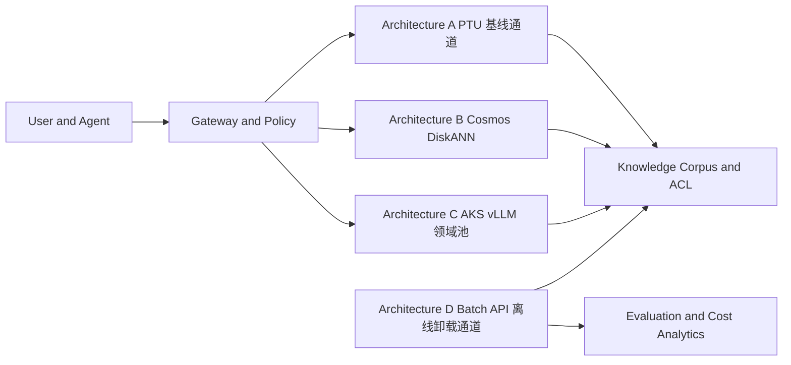
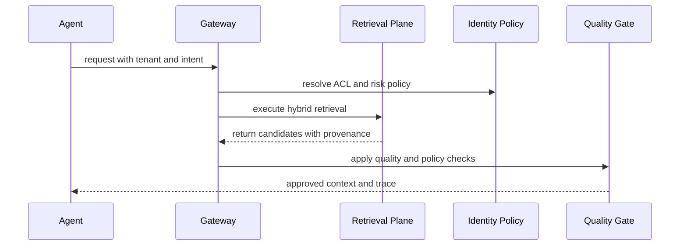
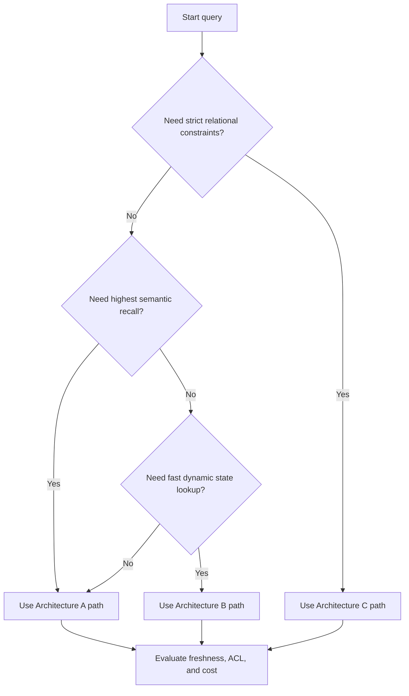

# 企业 AI Gateway 多租户策略路由选型 FAQ：APIM 策略中枢 vs Envoy ExtProc 数据面 vs LLM Proxy 统一入口 vs 混合控制平面
> **适用场景**：企业多租户 AI Gateway、跨模型路由治理、跨区域流量弹性与 Agent 工具调用稳定性。
> **决策压力**：在可用性、策略拦截率、路由时延与单位请求成本之间平衡。
> **核心目标**：建立可治理、可扩展、可审计的企业 AI Gateway 策略治理参考架构。

## 1. 执行摘要
- 企业 AI Gateway 的关键不是“能否路由出去”，而是“能否在策略与配额约束下稳定路由且可审计”。
- 默认路径建议以 APIM 策略中枢 作为主治理平面。
- 对高并发细粒度治理可叠加 Envoy ExtProc 数据面。
- 对复杂模型编排与私有推理场景可引入 LLM Proxy 统一入口。
- 对跨云容灾与跨团队协同场景可引入混合控制平面。
- 四类方案可组合，但需要统一 chunk 规范、ACL 映射和评测门禁。
- 必须监控新鲜度、权限误放、召回漂移和单位问题成本。
- 应以业务关键级别定义网关策略路径与回退策略。

## 2. 适用边界与非目标
- 适用：多租户知识库、文档频繁更新、强权限隔离场景。
- 适用：Agent 需要跨工具与知识路由联合推理。
- 适用：需要统一治理、可观测和 FinOps 管理的企业平台。
- 非目标：无权限要求的单用户个人知识库。
- 非目标：仅离线分析而无在线问答服务。
- 非目标：绕过 ACL 的高风险快捷实现。

## 3. 常见失效机理
- 文档更新与向量更新不一致导致知识陈旧。
- ACL 映射漂移导致越权召回或误拒召回。
- 单一路由策略无法覆盖多类型业务查询。
- 仅看离线指标导致线上实际回答退化。
- 成本模型未分层导致高峰期预算失控。
- 缺少回退路径导致局部故障扩散为全局不可用。

## 4. 四类候选架构
- **架构 A**：PTU 基线通道 Hybrid 路由主平面（关键词+向量+语义重排）。
- **架构 B**：Serverless PAYGO 突发通道 作为低延迟会话与知识混合平面。
- **架构 C**：AKS vLLM 领域池 作为事务与关系增强路由平面。
- **架构 D**：Batch API 离线卸载通道 作为湖仓一体知识沉淀与批流回灌平面。
- A 适合企业路由默认主路径，B 适合高并发动态状态混合，C 适合关系一致性，D 适合全域数据闭环。

## 5. 架构 A 细节
- 结合关键词、向量与语义重排提升复杂问答召回质量。
- 支持企业 ACL 裁剪与多索引分层治理。
- 支持增量索引更新与查询观测。
- 与 APIM、Entra、评测门禁结合实现统一治理。
- 适合作为企业 模型服务 主控路由平面。

## 6. 架构 B 细节
- DiskANN 提供低延迟向量邻近路由能力。
- 同库可管理会话状态与知识特征，简化链路。
- 需重点治理分区热度与 TTL 生命周期。
- 适合高并发、动态特征更新快的场景。
- 常与 A 形成双平面架构。

## 7. 架构 C 细节
- pgvector 与关系模型可共同维护业务约束。
- 适合事务一致性和关系过滤要求高的场景。
- 可复用 SQL 治理、备份与审计体系。
- 需控制索引维护与查询计划稳定性。
- 常用于核心交易型知识增强。

## 8. 架构 D 细节
- OneLake 统一沉淀多域数据并支持批流融合。
- 适合跨域语料治理、回溯分析与离线评测。
- 与在线路由平面联动时需控制同步时延。
- 可提供企业级成本归因和策略分析底座。
- 适合作为容量治理面长期治理中台。

## 9. 十二维对比矩阵
| 维度 | 架构 A | 架构 B | 架构 C | 架构 D |
|---|---|---|---|---|
| 在线召回质量 | 很高 | 高 | 中高 | 中 |
| 在线低延迟 | 高 | 很高 | 高 | 中 |
| 权限裁剪能力 | 很高 | 高 | 高 | 中高 |
| 关系一致性 | 中 | 中 | 很高 | 中 |
| 更新时效 | 高 | 很高 | 中高 | 中 |
| 湖仓分析回流 | 中 | 中 | 中 | 很高 |
| 运维复杂度 | 中 | 中高 | 中高 | 中高 |
| 成本可预测性 | 高 | 中高 | 中高 | 高 |
| 多租户治理 | 高 | 高 | 中高 | 高 |
| 审计可追溯 | 高 | 高 | 很高 | 很高 |
| 扩展弹性 | 高 | 很高 | 中高 | 高 |
| 推荐角色 | 主路由平面 | 动态混合平面 | 事务增强平面 | 数据治理平面 |

## 10. 企业 模型服务 容量治理面拓扑

## 11. 查询执行与权限治理时序

## 12. 路由路径决策树

### Q1. 企业 模型服务 选型首要原则是什么
- 首要原则是权限与时效优先于离线分数。
- 需要把召回质量与治理一致性并行设计。
- 需要定义在线回退策略避免局部故障扩散。
- 需要统一 chunk 与 ACL 映射规范。
- 需要把评测门禁前置到发布流程。
- 需要持续跟踪线上质量与成本偏移。
- 需要按业务关键级别做分层治理。

### Q2. A/B/C/D 如何协同
- A 作为默认主路由平面。
- B 提供动态状态与低延迟增强。
- C 提供关系约束和事务一致性。
- D 提供湖仓治理与批流回灌。
- 统一网关与身份策略是协同前提。
- 统一评测与成本看板是协同基础。
- 统一追踪字段是审计闭环关键。

### Q3. 如何量化质量、时延与成本
- 召回收益可表示为 `Gain = α*Recall + β*ACL_Precision - γ*Latency`。
- 单问答成本可表示为 `Cost_per_answer = (Retrieval + Model + Ops) / Answers`。
- 新鲜度可用 `Freshness_lag` 与更新 SLA 联合治理。
- 应比较缓存命中与重算路径成本差异。
- 需分别计算成功与失败补救成本。
- 需评估多路径回退对 SLO 的影响。
- 量化结果应进入发布门禁。

### Q4. 权限与合规如何内建
- 查询前强制身份解析与 ACL 裁剪。
- 结果返回必须带 provenance 与策略标签。
- 高风险查询路径需审批或人工复核。
- 敏感字段需脱敏与最小披露。
- 审计日志需覆盖查询、召回、回答全链路。
- 跨租户隔离需周期性压力测试。
- 合规例外需闭环整改。

### Q5. `5M/50M/500M` 月查询规模建议
- `5M`：A 主路径，B 作为动态增强。
- `50M`：A+B 双平面并引入 D 治理回流。
- `500M`：A+B+C+D 全栈协同并分域治理。
- 三档都需建立统一质量门禁。
- 三档都需建立权限一致性巡检。
- 三档都需建立成本阈值和预警。
- 三档都需建立季度参数重标定机制。

### Q6. 反模式与上线清单
- 反模式：只看离线召回不看在线权限。
- 反模式：知识更新与索引更新脱节。
- 反模式：没有回退路径与失败补救方案。
- 反模式：只看总成本不看单次有效成本。
- 上线前核对 ACL、freshness、trace、回退策略。
- 审计前核对证据完整性与字段一致性。
- 运行后核对质量漂移与成本漂移趋势。

## 13. Day-0 上线清单
- 定义知识域与权限域
- 统一 chunk 规范
- 统一 ACL 映射
- 建立路由回退策略
- 建立质量门禁
- 建立追踪字段标准
- 建立成本看板
- 完成压测与回放
- 固化回滚策略
- 归档审计证据

## 14. Day-2 运维清单
- 周复盘召回质量
- 周复盘权限误放
- 周复盘 freshness_lag
- 月复盘成本结构
- 月复盘回退命中
- 月清理例外权限
- 季重跑评测集
- 季重校参数阈值
- 持续关闭整改工单
- 持续维护证据目录

## 15. Good fit vs Not for
- Good fit：多租户企业容量治理面平台
- Good fit：强权限与审计要求场景
- Good fit：在线问答与离线分析协同场景
- Not for：单用户轻量路由
- Not for：无权限治理要求场景
- Not for：无法维护评测与观测体系团队

## 16. 五步落地指南
- 步骤 1：划分知识域与权限域
- 步骤 2：建立 A 主平面
- 步骤 3：接入 B/C 增强路径
- 步骤 4：接入 D 治理回流
- 步骤 5：季度复盘优化

## 17. 季度治理指标包
- 追踪 Recall@k
- 追踪 ACL 精准率
- 追踪 Freshness_lag
- 追踪 P95 路由时延
- 追踪 单位成功回答成本
- 追踪 失败补救成本
- 追踪 回退命中率
- 追踪 权限异常率
- 追踪 审计证据完整率
- 追踪 SLA 达标率
- 追踪 SLO 预算消耗
- 追踪 告警噪音比
- 追踪 恢复时长
- 追踪 容量利用率
- 追踪 缓存命中率
- 追踪 索引更新成功率
- 追踪 例外工单关闭率
- 追踪 策略漂移告警
- 追踪 平台稳定性评分
- 追踪 跨域协同效率
- 追踪 查询拒绝率
- 追踪 敏感字段泄漏率
- 追踪 模型重试占比
- 追踪 多租户隔离异常率
- 追踪 数据回灌时延
- 追踪 关系过滤误判率
- 追踪 回放通过率
- 追踪 发布回滚率
- 追踪 评测覆盖率
- 追踪 治理开销占比
- 追踪路由质量的滞后波动。
- 追踪路由质量的偏差分布。
- 追踪路由质量的异常聚类。
- 追踪路由质量的工单积压。
- 追踪路由质量的阈值漂移。
- 追踪路由质量的审批拥塞。
- 追踪路由质量的恢复稳定性。
- 追踪路由质量的通过率趋势。
- 追踪权限治理的滞后波动。
- 追踪权限治理的偏差分布。
- 追踪权限治理的异常聚类。
- 追踪权限治理的工单积压。
- 追踪权限治理的阈值漂移。
- 追踪权限治理的审批拥塞。
- 追踪权限治理的恢复稳定性。
- 追踪权限治理的通过率趋势。
- 追踪时效治理的滞后波动。
- 追踪时效治理的偏差分布。
- 追踪时效治理的异常聚类。
- 追踪时效治理的工单积压。
- 追踪时效治理的阈值漂移。
- 追踪时效治理的审批拥塞。
- 追踪时效治理的恢复稳定性。
- 追踪时效治理的通过率趋势。
- 追踪成本治理的滞后波动。
- 追踪成本治理的偏差分布。
- 追踪成本治理的异常聚类。
- 追踪成本治理的工单积压。
- 追踪成本治理的阈值漂移。
- 追踪成本治理的审批拥塞。
- 追踪成本治理的恢复稳定性。
- 追踪成本治理的通过率趋势。
- 追踪回退策略的滞后波动。
- 追踪回退策略的偏差分布。
- 追踪回退策略的异常聚类。
- 追踪回退策略的工单积压。
- 追踪回退策略的阈值漂移。
- 追踪回退策略的审批拥塞。
- 追踪回退策略的恢复稳定性。
- 追踪回退策略的通过率趋势。
- 追踪审计运营的滞后波动。
- 追踪审计运营的偏差分布。
- 追踪审计运营的异常聚类。
- 追踪审计运营的工单积压。
- 追踪审计运营的阈值漂移。
- 追踪审计运营的审批拥塞。
- 追踪审计运营的恢复稳定性。
- 追踪审计运营的通过率趋势。
- 追踪跨域协同的滞后波动。
- 追踪跨域协同的偏差分布。
- 追踪跨域协同的异常聚类。
- 追踪跨域协同的工单积压。
- 追踪跨域协同的阈值漂移。
- 追踪跨域协同的审批拥塞。
- 追踪跨域协同的恢复稳定性。
- 追踪跨域协同的通过率趋势。
- 追踪发布工程的滞后波动。
- 追踪发布工程的偏差分布。
- 追踪发布工程的异常聚类。
- 追踪发布工程的工单积压。
- 追踪发布工程的阈值漂移。
- 追踪发布工程的审批拥塞。
- 追踪发布工程的恢复稳定性。
- 追踪发布工程的通过率趋势。

## 18. 数据来源声明
- `anonymized_reported`：容量、质量、成本区间来自匿名化企业实践与可复现实验假设。
- 建议保留索引版本、策略版本、评测批次与审计追踪 ID。
- 建议分层存档业务指标、技术证据与治理报告。
- 当知识结构或策略变化时重算 TCO 与阈值。
