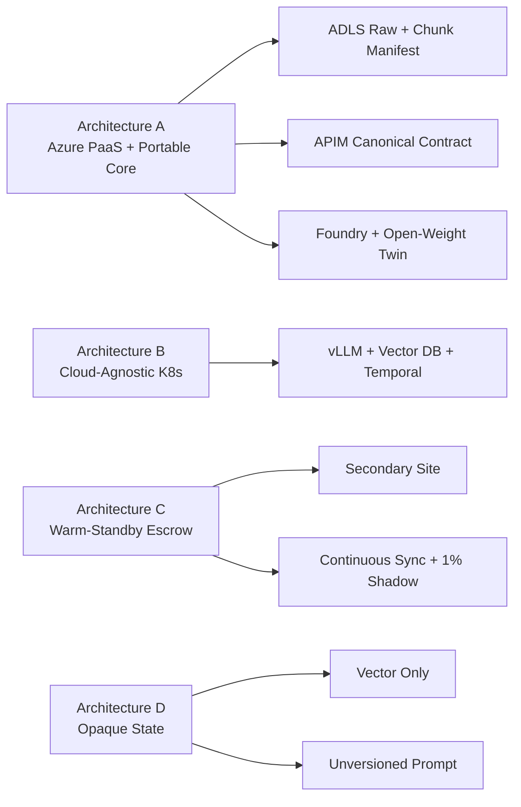
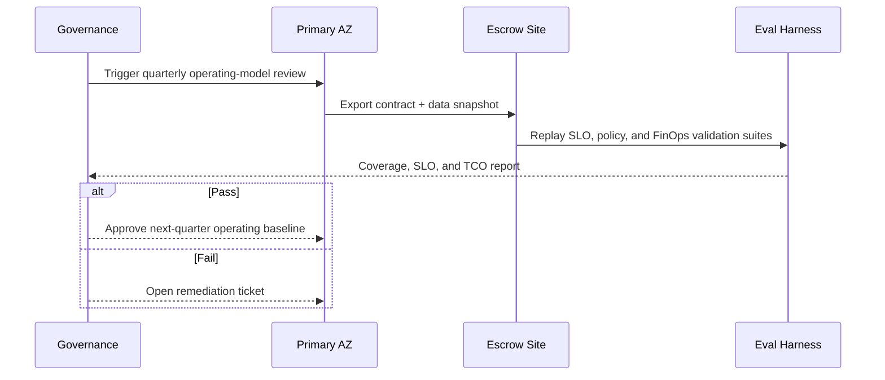
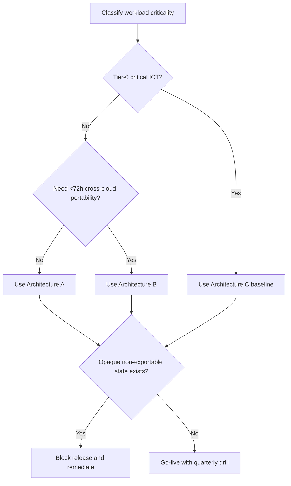

# Enterprise AI landing-zone stressed-exit portability escrow selection FAQ: Pragmatic Portable Core vs Cloud-Agnostic K8s vs Warm-Standby Escrow vs Paper-Only Plan
> **Use case**: regulated enterprise GenAI platforms under `EU DORA Article 28(8)`, `PRA SS2/21`, and `EU Data Act Chapter VI`.
> **Decision pressure**: preserve Azure managed velocity while proving executable model/platform exit readiness.
> **Goal**: deliver auditable and measurable stressed-exit architecture with quarterly rehearsal evidence.

## 1. Executive summary
- Supervisors validate recoverability and substitutability, not narrative multi-cloud promises.
- Default recommendation is Architecture A, with Architecture C for critical workflows.
- Architecture B fits strict portability requirements but carries sustained operations tax.
- Architecture D is a prohibited anti-pattern in regulated environments.
- Portable core assets must include raw corpus, chunk manifests, MCP schemas, eval datasets, and approval evidence.
- Vector indexes are derivative artifacts and cannot be the only source of truth.
- Model migration must be controlled by parity gates rather than subjective acceptance.
- Quarterly rehearsals should produce signed evidence packages and tracked remediation.
- Board reporting should include `RTO_exit`, `T_enablement`, `T_governance_sync`, and `Parity_pass_rate`.

## 2. Scope and non-goals
- Applicable to critical ICT functions in banking, insurance, payments, and public sectors.
- Applicable to concentration-risk mitigation and contract-termination migration readiness.
- Applicable to model deprecation, geopolitical ring-fencing, and sovereignty constraints.
- Not a fit for low-risk internal chat assistants or one-off PoCs.
- Not a fit for short-lived sandboxes with no audit obligations.
- Not a fit for unmanaged experimentation bypassing enterprise controls.

## 3. Regulatory-to-engineering control mapping
- DORA requires verifiable stressed-exit execution for critical outsourced ICT.
- PRA emphasizes concentration-risk governance and continuity assurance.
- Data Act emphasizes switching economics, portability, and interface transparency.
- Engineering controls must convert policy requirements into pipeline gates and replayable evidence.
- Drill outcomes should be integrated into governance and audit cycles.
- Every control claim requires logs, hashes, and versioned artifacts.

## 4. Four candidate architectures
- **Architecture A**: Central Platform model with one shared platform team owning policy, identity, release, and evidence control planes.
- **Architecture B**: Federated Domain model where business domains own local prompting, tooling, and evaluation while reusing baseline controls.
- **Architecture C**: Regional Cell model with compliance-bounded operational cells and region-local recovery accountability.
- **Architecture D**: MSP Outsourcing model where critical operations are predominantly delivered by external managed service providers.
- A prioritizes consistency and platform efficiency.
- B prioritizes domain responsiveness and product proximity.
- C prioritizes sovereignty and jurisdictional resilience.
- D prioritizes quick startup but risks long-term control erosion.

## 5. Architecture A details (Central Platform)
- One platform team owns APIM policies, identity baselines, FinOps tags, and release evidence templates.
- Product teams consume standardized paved roads with explicit SLA contracts.
- Audit rollup and policy coherence are strongest in this model.
- Main risk is platform bottleneck if service catalog and ownership model are weak.
- Best default for enterprises beginning large-scale AI operating standardization.

## 6. Architecture B details (Federated Domain)
- Domain teams own local prompts, tool contracts, and workload-specific evaluations.
- Platform retains minimum common controls: identity, gateway, metering, and evidence registry.
- Improves business fit and iteration speed across heterogeneous portfolios.
- Requires contract-first governance to prevent cross-domain policy divergence.
- Best fit for multi-BU organizations with mature product engineering units.

## 7. Architecture C details (Regional Cell)
- Independent operational cells align with data sovereignty and legal boundaries.
- Each cell carries local identity, audit, observability, and emergency runbook ownership.
- Enables region-local accountability and faster regulator-facing evidence production.
- Introduces duplicated capabilities and higher synchronization overhead.
- Best fit for financial and public-sector workloads with strict jurisdiction controls.

## 8. Architecture D details (MSP Outsourcing)
- External MSP teams operate key platform workflows and change pipelines.
- Startup velocity can be high, but internal platform capability accumulation is weaker.
- Weak contract boundaries can degrade incident attribution and audit clarity.
- Must retain exportable state and internal evaluation ownership to avoid lock-in.
- Best treated as transitional, not a long-term strategic operating model.

## 9. Twelve-dimension comparison matrix
| Dimension | Architecture A | Architecture B | Architecture C | Architecture D |
|---|---|---|---|---|
| Governance consistency | Very high | High | Medium-high | Medium |
| Daily delivery velocity | Very high | Medium | Medium-high | Medium |
| Audit evidence completeness | Very high | High | Very high | Medium-low |
| Migration rewrite pressure | Medium | Low | Medium | Very high |
| Day-2 operations burden | Medium | Medium-high | High | Medium-high |
| Supplier leverage strength | High | High | Very high | Medium |
| Internal capability accumulation | Very high | High | High | Medium-low |
| Multi-region resilience | High | Medium-high | Very high | Medium |
| Cost predictability | High | Medium-high | Medium | Medium-low |
| Talent threshold | Medium | High | High | Medium |
| Compliance trustworthiness | High | Medium-high | Very high | Low |
| Recommendation | Default | Special case | Tier-0 preferred | Prohibited |

## 10. Operating-model responsibility topology

## 11. Quarterly stressed-exit rehearsal sequence

## 12. Criticality decision tree

### Q1. Why regulators require executable exits instead of policy-only statements
- Supervisory reviews reject non-replayable claims.
- Stressed scenarios require real cutover capability.
- Concentration-risk reduction needs measurable substitution paths.
- Exit readiness defines continuity floor for critical services.
- Weak evidence chains prolong remediation and supervisory pressure.
- Practical drills expose hidden couplings early.
- Executable exits provide board-level risk control leverage.

### Q2. What mechanism-level differences matter most across the four architectures
- A aligns managed velocity with portable-core safeguards.
- B trades sustained operational load for infrastructure portability.
- C adds standby heat and recurring parity drills for low-RTO confidence.
- D lacks exportability and deterministic replay guarantees.
- A vs C differs mainly by secondary-site readiness depth.
- B vs C can both reduce migration risk with different cost surfaces.
- D hides drift until incident or supervisory testing.

### Q3. How should exit windows be quantified
- Re-embedding: `T_reembed = N_chunks * L_tok_avg / TPS_embed`.
- Transfer: `T_transfer = Data_size / Effective_bandwidth`.
- Composite window: `T_exit = max(T_reembed, T_transfer) + T_validate + T_cutover`.
- If `d1 != d2`, run dual-index overlap windows.
- Control re-embedding peaks to avoid production starvation.
- Include worst-network and policy-route constraints in rehearsals.
- Publish P50/P95 and tail mitigation plans.

### Q4. How to evaluate expected-value cost under exit risk
- Expected-value formula: `E[Cost] = C_day2 + p_exit * C_migration`.
- A keeps day-to-day costs moderate with controlled migration effort.
- B minimizes rewrite risk but maximizes recurring operations burden.
- C increases readiness spend while maximizing loss avoidance for Tier-0.
- D carries the highest hidden incident and supervisory costs.
- Include outage impact and reputational exposure in business cases.
- Optimize for risk-adjusted total cost, not isolated bill lines.

### Q5. FinOps/TCO choices for `10M/200M/2B` chunk portfolios
- `10M` chunks and `50` agents: A first, C for critical slices.
- `200M` chunks and `300` agents: A+C baseline with quarterly certification drills.
- `2B` chunks and G-SIB critical ICT: C by default for Tier-0.
- [M001] All tiers require explicit embedding throughput and bandwidth envelopes.
- [M002] All tiers require model-deprecation emergency runbooks.
- [M003] All tiers require signed evidence retention and remediation tracking.
- All tiers should continuously improve parity coverage quality.

### Q6. Anti-patterns and go-live/audit checklist
- Anti-pattern 1: vector store as sole source of truth.
- Anti-pattern 2: unversioned prompts and undocumented drift.
- Anti-pattern 3: no executable cutover rehearsal.
- Anti-pattern 4: coverage metrics without critical failure analysis.
- Pre-go-live: verify contract freeze, approval chain, and rollback thresholds.
- Pre-audit: verify evidence completeness and hash integrity.
- Quarterly: verify window compression and remediation closure.

## 13. Day-0 go-live checklist
- Classify critical vs non-critical workflows with explicit RTO/RPO targets.
- Freeze APIM external contracts and compatibility tests.
- Enforce MCP schema versioning and reject unknown fields.
- Establish ADLS raw corpus and chunk-manifest resilient backup.
- Deploy re-embedding and index rebuild pipelines.
- Set Foundry and open-weight twin parity baselines.
- Harden least-privilege and federation templates.
- Complete first stressed-exit rehearsal and archive evidence.
- Define escalation and remediation SLA for failures.
- Enable quarterly governance dashboard alerts.

## 14. Day-2 operations checklist
- Review model replacement and retirement plans monthly.
- Check escrow freshness and replication lag weekly.
- [M004] Track shadow parity failure distribution daily.
- Rehearse high-risk tool-call paths periodically.
- Validate cross-cloud template health and drift.
- Monitor re-embedding and transfer tail latency.
- [M005] Track supplier term and pricing changes.
- Clean exception privileges and approval-chain debt.
- Keep audit mapping aligned with evidence index.
- Close remediation actions on schedule.

## 15. Good fit vs Not for
- Good fit: heavily regulated organizations with strict continuity obligations.
- Good fit: teams needing Azure velocity plus reversible exits.
- Good fit: multi-entity organizations needing unified governance.
- Not for: low-risk internal tools without audit requirements.
- Not for: teams unwilling to build eval/evidence pipelines.
- Not for: short-lived experiments with no critical dependencies.

## 16. Five-step rollout guide
- Step 1: Identify critical workflows and define exit objectives.
- Step 2: Build portable core assets and versioned contracts.
- Step 3: Deploy A or A+C and finish first rehearsal.
- Step 4: Integrate evidence into governance and audit cadence.
- Step 5: Run quarterly retrospectives and compress exit windows.

## 17. Quarterly governance metrics
- [M006] Track RTO_exit P50/P95
- [M007] Track T_reembed stability
- [M008] Track T_transfer tail latency
- [M009] Track Parity pass rate
- [M010] Track Escrow freshness
- [M011] Track Schema compatibility failure rate
- [M012] Track Model retirement drill completion
- [M013] Track Cross-cloud drift count
- [M014] Track Approval timeout ratio
- [M015] Track Audit recurrence rate
- [M016] Track Critical replay success rate
- [M017] Track Evidence package missing ratio
- [M018] Track Governance overhead ratio
- [M019] Track Governance cost per transaction
- [M020] Track High-risk change coverage
- [M021] Track Cross-region policy consistency
- [M022] Track Contract upgrade success rate
- [M023] Track Vector rebuild retry ratio
- [M024] Track Export failure distribution
- [M025] Track Remediation on-time closure
- [M026] Track External audit first-pass rate
- [M027] Track Post-switch stabilization days
- [M028] Track Critical timeout ratio
- [M029] Track Cross-border exception volume
- [M030] Track Business impact duration during drills
- [M031] Track Regulatory response prep time
- [M032] Track Supplier-term impact assessment latency
- [M033] Track Dashboard availability
- [M034] Track Certificate issuance latency
- [M035] Track Risk heatmap refresh latency

## 18. Data provenance note
- [M036] Track exit rehearsal lag volatility.
- [M037] Track exit rehearsal deviation distribution.
- [M038] Track exit rehearsal anomaly clusters.
- [M039] Track exit rehearsal ticket backlog.
- [M040] Track exit rehearsal threshold drift.
- [M041] Track exit rehearsal approval congestion.
- [M042] Track exit rehearsal recovery stability.
- [M043] Track exit rehearsal audit pass trend.
- [M044] Track contract governance lag volatility.
- [M045] Track contract governance deviation distribution.
- [M046] Track contract governance anomaly clusters.
- [M047] Track contract governance ticket backlog.
- [M048] Track contract governance threshold drift.
- [M049] Track contract governance approval congestion.
- [M050] Track contract governance recovery stability.
- [M051] Track contract governance audit pass trend.
- [M052] Track evidence retention lag volatility.
- [M053] Track evidence retention deviation distribution.
- [M054] Track evidence retention anomaly clusters.
- [M055] Track evidence retention ticket backlog.
- [M056] Track evidence retention threshold drift.
- [M057] Track evidence retention approval congestion.
- [M058] Track evidence retention recovery stability.
- [M059] Track evidence retention audit pass trend.
- [M060] Track cross-region transfer lag volatility.
- [M061] Track cross-region transfer deviation distribution.
- [M062] Track cross-region transfer anomaly clusters.
- [M063] Track cross-region transfer ticket backlog.
- [M064] Track cross-region transfer threshold drift.
- [M065] Track cross-region transfer approval congestion.
- [M066] Track cross-region transfer recovery stability.
- [M067] Track cross-region transfer audit pass trend.
- [M068] Track supplier risk lag volatility.
- [M069] Track supplier risk deviation distribution.
- [M070] Track supplier risk anomaly clusters.
- [M071] Track supplier risk ticket backlog.
- [M072] Track supplier risk threshold drift.
- [M073] Track supplier risk approval congestion.
- [M074] Track supplier risk recovery stability.
- [M075] Track supplier risk audit pass trend.
- [M076] Track shadow parity lag volatility.
- [M077] Track shadow parity deviation distribution.
- [M078] Track shadow parity anomaly clusters.
- [M079] Track shadow parity ticket backlog.
- [M080] Track shadow parity threshold drift.
- [M081] Track shadow parity approval congestion.
- [M082] Track shadow parity recovery stability.
- [M083] Track shadow parity audit pass trend.
- [M084] Track identity federation lag volatility.
- [M085] Track identity federation deviation distribution.
- [M086] Track identity federation anomaly clusters.
- [M087] Track identity federation ticket backlog.
- [M088] Track identity federation threshold drift.
- [M089] Track identity federation approval congestion.
- [M090] Track identity federation recovery stability.
- [M091] Track identity federation audit pass trend.
- [M092] Track index rebuild lag volatility.
- `anonymized_reported`: formulas, latency ranges, and cost ranges are synthesized from anonymized enterprise programs with reproducible assumptions.
- Preserve drill batch IDs, snapshot hashes, contract versions, model versions, and signed approval chains.
- Retain audit evidence, financial models, and runbooks in layered repositories with least-disclosure controls.
- Recalculate `E[Cost]` and switching windows when policy or supplier terms change.
