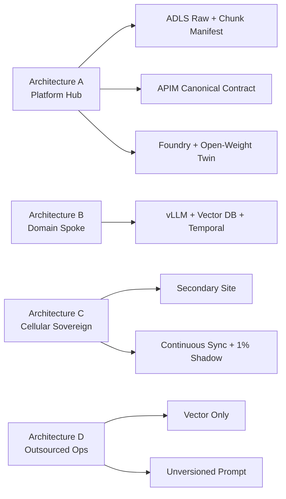
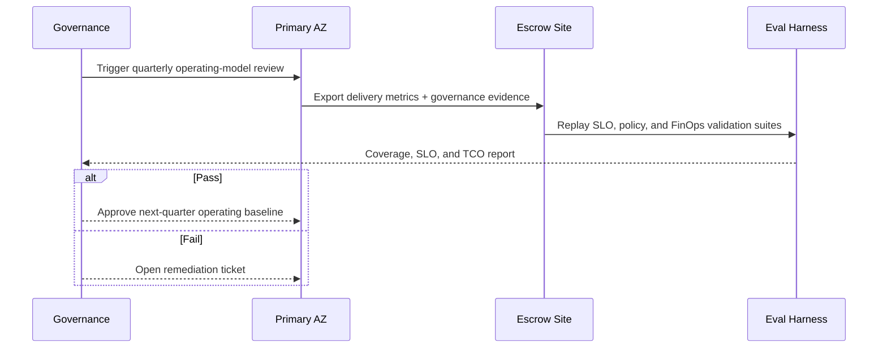
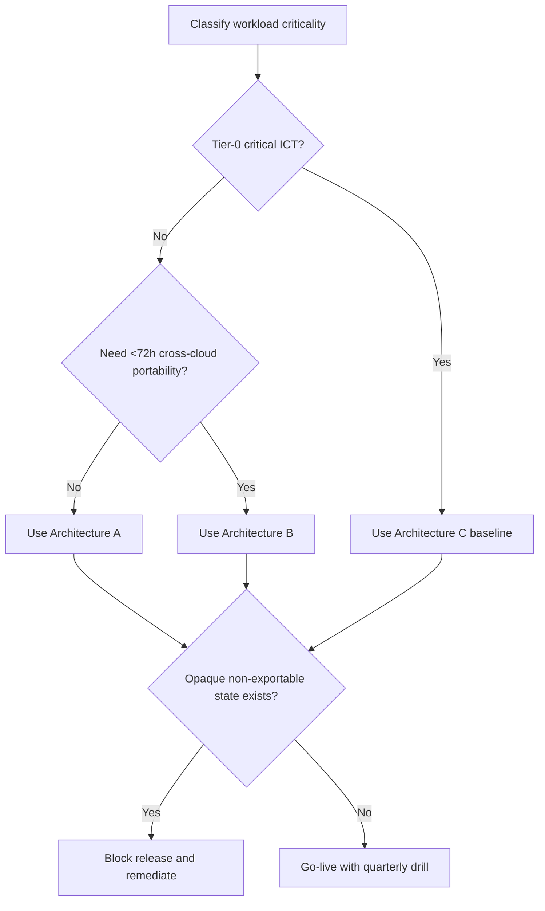

# 企业 AI Landing Zone 共享服务治理选型 FAQ：Platform Hub vs Domain Spoke vs Cellular Sovereign vs Outsourced Ops
> **适用场景**：跨区域企业 AI Landing Zone 在共享服务治理、域自治与主权合规之间的组织架构选型。
> **决策压力**：如何在平台复用效率、区域合规边界、运维复杂度与成本可控之间平衡。
> **核心目标**：建立可扩展、可审计、可持续的企业 AI Landing Zone 共享服务治理参考架构。

## 1. 执行摘要
- 监管关注点是可恢复性与可替代性，不是口头多云承诺。
- 默认建议是架构 A，关键业务加架构 C。
- 架构 B 适合极端 portability 诉求但运维税显著。
- 架构 D 无法通过实战演练，属于禁止模式。
- 可移植核心应覆盖原始语料、chunk manifest、MCP schema、评测集与审批证据。
- 向量索引应被视为派生层，不应作为唯一事实源。
- 模型迁移必须以 parity gate 驱动，不能以主观可用替代。
- 季度演练应输出可追溯证据包并形成整改闭环。
- 推荐指标包括 `RTO_exit`、`T_enablement`、`T_governance_sync` 与 `Parity_pass_rate`。

## 2. 适用边界与非目标
- 适用金融、保险、支付、公共事业等关键 ICT 业务。
- 适用供应商集中风险治理与合同终止迁移预案。
- 适用模型退役、地缘隔离、跨主权合规重构。
- 非目标是低风险内部问答机器人一次性 PoC。
- 非目标是不需要审计证据的短期实验环境。
- 非目标是绕过企业审批链的个人沙箱试验。

## 3. 监管要求映射到工程控制
- DORA 要求企业能在压力场景下可验证退出关键外包 ICT。
- PRA 关注第三方集中风险与连续性治理可信度。
- Data Act 关注切换成本、数据可携性与接口透明度。
- 工程实现必须把条款映射为流水线门禁与可重放证据。
- 退出演练结果应纳入董事会治理与审计材料。
- 所有关键声明必须有日志、哈希和版本号佐证。

## 4. 四类候选架构
- **架构 A**：Platform Hub（集中平台团队）统一交付模型与策略。
- **架构 B**：Domain Spoke（领域联邦）按业务域自治并共享基线能力。
- **架构 C**：Cellular Sovereign（区域单元）按合规边界拆分独立运行单元。
- **架构 D**：Outsourced Ops（外包主导）将主要运维交付给第三方 MSP。
- A 强于标准化与规模效率，适合快速统一治理。
- B 强于业务贴合与团队自治，适合多产品线组织。
- C 强于主权与区域合规，适合跨法域运营集团。
- D 强于短期启动速度，但长期控制力与可迁移性较弱。

## 5. 架构 A 细节（Platform Hub）
- 平台团队统一维护 APIM、身份、评测、成本与发布门禁。
- 业务团队通过标准化产品线自助接入能力目录。
- 发布节奏快，策略一致性高，审计汇总效率好。
- 需要避免“平台成为单点瓶颈”，应建设 clear SLA。
- 适合作为大多数企业的起始 operating model。

## 6. 架构 B 细节（Domain Spoke）
- 领域团队拥有本域提示词、工具链与评测资产主责权。
- 平台保留最小共享底座：身份、网关、计费、证据管道。
- 能显著提升业务语义贴合与迭代速度。
- 需通过合约化接口避免域间策略漂移。
- 适合多 BU、多产品线并行创新场景。

## 7. 架构 C 细节（Cellular Sovereign）
- 按区域监管边界建立独立 cell，控制跨境数据与模型依赖。
- 每个 cell 具备本地身份、审计、观测和应急切换能力。
- 可实现“本地合规、本地恢复、本地问责”运营模式。
- 代价是重复建设与跨区能力同步成本上升。
- 适合金融、公共事业和主权敏感行业。

## 8. 架构 D 细节（Outsourced Ops）
- 外部 MSP 负责主要平台运行与变更操作。
- 短期上线速度快，但核心知识和控制面易外移。
- 合同与交付边界若不清晰，审计与事故归因复杂。
- 需要强制保留可导出状态和内部评测能力。
- 建议仅作为过渡模型而非长期核心路径。

## 9. 十二维横向矩阵
| 维度 | 架构 A | 架构 B | 架构 C | 架构 D |
|---|---|---|---|---|
| 组织治理一致性 | 很高 | 高 | 中高 | 中 |
| 业务贴合速度 | 高 | 很高 | 高 | 中 |
| 审计证据完整度 | 很高 | 高 | 很高 | 中低 |
| 跨区合规适配 | 高 | 中高 | 很高 | 中 |
| Day-2 运维负担 | 中 | 中高 | 高 | 中高 |
| 供应商议价能力 | 高 | 高 | 很高 | 中 |
| 组织能力沉淀 | 很高 | 高 | 高 | 中低 |
| 多区域韧性 | 高 | 中高 | 很高 | 中 |
| 成本可预测性 | 高 | 中高 | 中 | 中低 |
| 人才门槛 | 中 | 高 | 高 | 中 |
| 合规可信度 | 很高 | 高 | 很高 | 中低 |
| 综合建议 | 企业默认起点 | 多域自治优选 | 主权/合规优选 | 过渡性方案 |

## 10. 运营模型职责与治理拓扑

## 11. 季度运营评审与改进时序

## 12. 关键级别决策树

### Q1. 为什么监管场景必须强调可执行退出而非纸面策略
- 监管检查不接受不可复现的口头承诺。
- 压力场景要求真实切换能力而非静态文档。
- 供应商集中风险需要可量化替代路径。
- 退出能力决定关键业务连续性下限。
- 证据链缺失会导致整改周期拉长。
- 可执行演练能提前暴露隐形耦合。
- 可执行退出也是董事会风险治理抓手。

### Q2. 四种架构在机制层面的主要差异是什么
- A 兼顾托管速度与可移植核心治理。
- B 以基础设施可迁移换持续运维复杂度。
- C 以暖备与影子演练换取低 RTO 可信度。
- D 缺乏可导出状态与可重放证据。
- A 与 C 的差异在于是否持续保持次站热度。
- B 与 C 都能降迁移风险但成本形态不同。
- D 最大风险是静默回归直到事故才暴露。

### Q3. 退出窗口应如何量化
- 重嵌入公式：`T_reembed = N_chunks * L_tok_avg / TPS_embed`。
- 传输公式：`T_transfer = Data_size / Effective_bandwidth`。
- 总窗口：`T_exit = max(T_reembed, T_transfer) + T_validate + T_cutover`。
- 维度不一致 `d1 != d2` 时需双索引并行。
- 需控制 re-embed 批次峰值避免挤占生产资源。
- 演练应覆盖最差网络窗口与跨境策略限制。
- 评估结果应给出 P50/P95 与尾延迟处置策略。

### Q4. 成本应如何结合退出概率评估
- 期望成本：`E[Cost] = C_day2 + p_exit * C_migration`。
- A 的 `C_ops` 适中且迁移成本可控。
- B 的 `C_ops` 最高但迁移重写最低。
- C 的 `C_ops` 较高但关键场景损失规避最大。
- D 的隐含事故成本和监管成本最高。
- 财务评估需纳入停机损失与品牌损伤。
- 决策应看总风险调整成本而非局部账单。

### Q5. `10M/200M/2B` chunks 三档 TCO 如何取舍
- `10M` chunks、`50` agents：优先 A，关键流程叠加 C。
- `200M` chunks、`300` agents：A+C 组合与季度证书化演练。
- `2B` chunks、G-SIB：Tier-0 默认 C，非关键域可用 A。
- 各档都要预留 embedding 吞吐与传输带宽预算。
- 各档都要设定模型退役应急 runbook。
- 各档都要保留可审计证据与整改追踪。
- 各档都应持续优化 parity gate 覆盖与准确率。

### Q6. 反模式与上线审计清单
- 反模式一：向量当主事实源。
- 反模式二：提示词无版本治理。
- 反模式三：没有真实 cutover 演练。
- 反模式四：只看覆盖率不看关键失败面。
- 上线前核对契约冻结、审批链、回滚阈值。
- 审计前核对证据包完整性与哈希一致性。
- 季度核对退出窗口收敛与整改闭环有效性。

## 13. Day-0 上线清单
- 定义关键与非关键业务映射及 RTO/RPO 目标。
- 冻结 APIM 外部契约并建立兼容性测试。
- 落实 MCP schema 版本治理与拒绝未知字段。
- 建立 ADLS 原始语料与 chunk manifest 双活备份。
- 部署 re-embed 与索引重建流水线。
- 建立 Foundry 与开源权重双轨基线。
- 固化最小权限与联邦身份模板。
- 完成首次压力退出演练并归档证据。
- 定义失败升级机制与修复 SLA。
- 启用季度治理看板并设定阈值告警。

## 14. Day-2 运维清单
- 按月审查模型替换路线与退役计划。
- 按周检查 escrow 新鲜度与复制延迟。
- 按日观察影子 parity 失败分布。
- 定期复演高风险工具链路。
- 验证跨云模板可用性与漂移项。
- 监控重嵌入与传输窗口尾延迟。
- 跟踪供应商条款和费用变化。
- 清理例外权限并复核审批链。
- 维护审计映射表与证据目录一致。
- 推动整改项按期关闭。

## 15. Good fit vs Not for
- Good fit：强监管与关键连续性要求企业。
- Good fit：既要 Azure 速度又要退出可逆能力。
- Good fit：多实体多区域统一治理组织。
- Not for：低风险内部试验且无审计义务场景。
- Not for：不愿建设评测和证据流水线团队。
- Not for：无关键业务承载的短期实验项目。

## 16. 五步落地指南
- 步骤 1：识别关键业务并定义退出目标。
- 步骤 2：构建可移植核心与版本化契约。
- 步骤 3：部署 A 或 A+C 并完成首轮演练。
- 步骤 4：将证据纳入治理与审计例会。
- 步骤 5：按季度复盘并压缩退出窗口。

## 17. 季度治理指标包
- 追踪 RTO_exit P50/P95
- 追踪 T_reembed 稳定性
- 追踪 T_transfer 尾延迟
- 追踪 Parity 通过率
- 追踪 Escrow 新鲜度
- 追踪 Schema 兼容失败率
- 追踪 模型退役演练完成率
- 追踪 跨云模板漂移数
- 追踪 审批链超时率
- 追踪 审计复发率
- 追踪 关键工具回放成功率
- 追踪 证据包缺失率
- 追踪 治理开销占比
- 追踪 单位交易治理成本
- 追踪 高风险变更覆盖率
- 追踪 跨区域策略一致性
- 追踪 契约升级成功率
- 追踪 向量重建重试率
- 追踪 导出失败分布
- 追踪 整改按期完成率
- 追踪 外部审计一次通过率
- 追踪 迁移后稳定天数
- 追踪 关键超时占比
- 追踪 跨境例外数量
- 追踪 演练业务影响时长
- 追踪 监管问询准备时长
- 追踪 条款变更评估时效
- 追踪 治理看板可用性
- 追踪 退出证书签发时效
- 追踪 风险热力图更新时效

## 18. 数据来源声明
- 追踪退出演练的滞后波动。
- 追踪退出演练的偏差分布。
- 追踪退出演练的异常聚类。
- 追踪退出演练的工单积压。
- 追踪退出演练的阈值漂移。
- 追踪退出演练的审批拥塞。
- 追踪退出演练的恢复稳定性。
- 追踪退出演练的审计通过率。
- 追踪契约治理的滞后波动。
- 追踪契约治理的偏差分布。
- 追踪契约治理的异常聚类。
- 追踪契约治理的工单积压。
- 追踪契约治理的阈值漂移。
- 追踪契约治理的审批拥塞。
- 追踪契约治理的恢复稳定性。
- 追踪契约治理的审计通过率。
- 追踪证据归档的滞后波动。
- 追踪证据归档的偏差分布。
- 追踪证据归档的异常聚类。
- 追踪证据归档的工单积压。
- 追踪证据归档的阈值漂移。
- 追踪证据归档的审批拥塞。
- 追踪证据归档的恢复稳定性。
- 追踪证据归档的审计通过率。
- 追踪跨域传输的滞后波动。
- 追踪跨域传输的偏差分布。
- 追踪跨域传输的异常聚类。
- 追踪跨域传输的工单积压。
- 追踪跨域传输的阈值漂移。
- 追踪跨域传输的审批拥塞。
- 追踪跨域传输的恢复稳定性。
- 追踪跨域传输的审计通过率。
- 追踪供应商风险的滞后波动。
- 追踪供应商风险的偏差分布。
- 追踪供应商风险的异常聚类。
- 追踪供应商风险的工单积压。
- 追踪供应商风险的阈值漂移。
- 追踪供应商风险的审批拥塞。
- 追踪供应商风险的恢复稳定性。
- 追踪供应商风险的审计通过率。
- 追踪影子一致性的滞后波动。
- 追踪影子一致性的偏差分布。
- 追踪影子一致性的异常聚类。
- 追踪影子一致性的工单积压。
- 追踪影子一致性的阈值漂移。
- 追踪影子一致性的审批拥塞。
- 追踪影子一致性的恢复稳定性。
- 追踪影子一致性的审计通过率。
- 追踪身份联邦的滞后波动。
- 追踪身份联邦的偏差分布。
- 追踪身份联邦的异常聚类。
- 追踪身份联邦的工单积压。
- 追踪身份联邦的阈值漂移。
- 追踪身份联邦的审批拥塞。
- 追踪身份联邦的恢复稳定性。
- 追踪身份联邦的审计通过率。
- 追踪索引重建的滞后波动。
- `anonymized_reported`：本文公式、时延区间与成本区间来自匿名化企业落地项目复盘，按可复现实验假设整理。
- 建议保留演练批次号、数据快照哈希、契约版本、模型版本与审批签名链。
- 建议分层留存审计证据、财务估值与技术运行报告。
- 当监管口径或供应商条款变化时，需重算 `E[Cost]` 与退出窗口。
