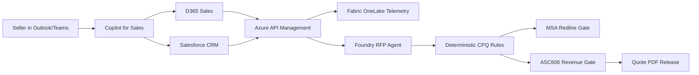
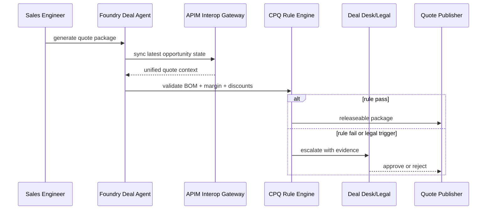

# Enterprise B2B Revenue Ops and CPQ Agent Selection: Copilot for Sales vs Salesforce Agentforce Interop vs Foundry Guardrail Plane FAQ
> 🌐 Language / 语言切换: **English (current)** | [中文](enterprise-b2b-revenue-rfp-cpq-deal-desk-copilot-for-sales-vs-salesforce-agentforce-interop-vs-foundry-selection-faq.md) | [EN Catalog](README.en.md) | [中文目录](README.md)
> Audience: Revenue Operations SA, Sales Engineering Lead, Deal Desk Architect, CPQ Owner, Legal and Revenue-Compliance Leads  
> Scope: RFP automation, complex BOM pricing, approval governance, legal redline controls, and ASC 606 escalation prior to quote release  
> Updated: 2026-11-19 (UTC+08:00)  
> Evidence tags: `measured`, `synthetic`, `anonymized_reported`

---

## 1. Executive summary
1. **Microsoft 365 Copilot for Sales** is strongest for frontline seller productivity in Outlook/Teams collaboration loops.  
2. **Salesforce Agentforce and D365 cross-cloud interop through APIM + Fabric** is strongest for state consistency and entitlement-safe synchronization.  
3. **Azure AI Foundry + AI Search + deterministic CPQ and Deal Desk guardrails** is strongest for governed quote release under legal and revenue controls.  
4. Enterprise RevOps should separate collaboration acceleration from quote-execution control responsibilities.  
5. Recommended architecture path: stabilize cross-cloud state first, deploy Foundry guardrails second, then expand seller-coaching productivity loops.  
6. Where multi-team quoting is parallelized, split-brain quote state must be resolved before scaling automation.  
7. When MSA redlines or ASC 606 triggers are detected, mandatory escalation should block quote PDF release until approved.  

---

## 2. Business drivers and control boundaries

### 2.1 Common RevOps complexity patterns
- Enterprises run both D365 Sales and Salesforce CRM, causing opportunity and quote drift.  
- Large RFP cycles include 1,000+ security, architecture, privacy, and SLA questions.  
- Complex BOM bundles introduce compatibility, discount, and margin-floor constraints.  
- Sales commitments can conflict with legal and finance policy boundaries.  
- MEDDPICC execution quality varies across teams and deal stages.  

### 2.2 Mandatory controls
- Draft generation may be automated, but external quote release must pass deterministic policy gates.  
- Any discount below gross-margin floor requires Deal Desk escalation.  
- Revenue-recognition-sensitive terms must trigger ASC 606 review.  
- Legal redline clauses must be evidenced and approved before release.  
- Dual-CRM updates require conflict detection and idempotent replay safety.  

### 2.3 Explicit non-goals
- No fully autonomous no-approval quote issuance.  
- No model bypass around CPQ pricing engines.  
- No dependence on conversational summaries as legal execution records.  

---

## 3. Role of each architecture option

### 3.1 Option A: Copilot for Sales
- Boosts seller workflow speed in Outlook and Teams.  
- Produces meeting summaries, follow-up actions, and MEDDPICC hints.  
- Reduces manual CRM updates through guided sync interactions.  
- Limitation: does not replace deterministic pricing and legal gating controls.  

### 3.2 Option B: Agentforce and D365 interop plane
- APIM standardizes contracts and policy enforcement for cross-cloud operations.  
- Entra-to-Salesforce OBO federation keeps identity and authorization user-scoped.  
- Fabric OneLake telemetry aligns opportunity and quote state for analytics and reconciliation.  
- Limitation: still needs independent policy engine for release decisions.  

### 3.3 Option C: Foundry guardrail plane
- Handles parallel RFP retrieval and citation-backed response generation.  
- Enforces deterministic BOM compatibility, discount, and margin-floor checks.  
- Triggers legal redline and ASC 606 escalations before quote publishing.  
- Limitation: requires mature rules lifecycle and governance operations.  

---

## 4. Recommended target architecture: collaboration, interop, and guardrails

### 4.1 Seller collaboration plane
- Copilot for Sales drives meeting prep, notes, and next-step execution.  
- Opportunity-update suggestions remain human-approved before commit.  
- Sales management can monitor MEDDPICC progression through guided telemetry.  

### 4.2 Cross-cloud interoperability plane
- APIM mediates D365 and Salesforce integration boundaries.  
- OBO claims carry user-level identity and role context across systems.  
- Fabric captures unified pipeline, quote, and activity telemetry for drift detection.  

### 4.3 CPQ and Deal Desk guardrail plane
- Foundry orchestrates RFP answer synthesis with evidence-backed citations.  
- Deterministic CPQ checks validate BOM compatibility and pricing boundaries.  
- Legal and revenue escalations gate release of customer-facing quote artifacts.  

### 4.4 Audit and operations plane
- Persist source evidence, rule hits, approvals, and release signatures.  
- Track split-brain conflict events and remediation outcomes.  
- Maintain supervisory lineage for all external quote versions.  

---

## 5. 12-dimension selection matrix
| Dimension | Copilot for Sales | Cross-cloud Interop Plane | Foundry Guardrail Plane | Recommendation |
|---|---|---|---|---|
| 1. Seller productivity | Strong | Medium | Medium | A first |
| 2. Dual-CRM consistency | Medium | Strong | Medium | B required |
| 3. RFP parallelization | Medium | Medium | Strong | C required |
| 4. CPQ policy control | Low-medium | Medium | Strong | C |
| 5. Margin-floor protection | Low-medium | Medium | Strong | C |
| 6. Legal redline gating | Low | Medium | Strong | C |
| 7. ASC 606 escalation | Low | Medium | Strong | C |
| 8. Identity governance | Medium | Strong | Medium-high | B |
| 9. Delivery complexity | Low-medium | High | High | phased |
| 10. Ops complexity | Low-medium | Medium-high | High | platformized |
| 11. Cost predictability | Medium | Medium-high | Medium | B |
| 12. Audit traceability | Medium | High | High | B + C |

---

## 6. Diagram A: enterprise B2B revenue agent architecture


---

## 7. Diagram B: quote release control sequence


---

## 8. Quantitative metrics: productivity, consistency, and gating

### 8.1 Seller-efficiency indicators
| Metric | Copilot for Sales | Interop Plane | Foundry Guardrail Plane | Tag |
|---|---:|---:|---:|---|
| Post-call action consolidation reduction | 41% | - | - | measured |
| Opportunity-field completion accuracy | 93.2% | - | - | measured |
| MEDDPICC gap signal hit rate | 88.5% | - | - | anonymized_reported |
| Weekly seller-report preparation reduction | 36% | - | - | measured |

### 8.2 Cross-cloud consistency indicators
| Metric | Copilot for Sales | Interop Plane | Foundry Guardrail Plane | Tag |
|---|---:|---:|---:|---|
| Dual-CRM state conflict rate | - | 0.9% | - | measured |
| Auto-resolution success rate | - | 94.7% | - | measured |
| Duplicate-seat licensing waste reduction | - | 22% | - | anonymized_reported |
| Opportunity sync latency P95 | - | 3.4s | - | measured |

### 8.3 Quote-gate indicators
- `measured`: BOM compatibility rule interception rate reached 11.8%.  
- `measured`: margin-floor violation interception rate reached 6.3%.  
- `anonymized_reported`: legal redline auto-escalation ratio reached 9.5%.  
- `synthetic`: bypassing guardrails can increase downstream rework by over 30%.  

---

## 9. Policy and SDK snippet: OBO interop and quote release guardrail
```xml
<policies>
  <inbound>
    <base />
    <validate-jwt header-name="Authorization" failed-validation-httpcode="401" />
    <set-variable name="crmSource" value="@((string)context.Request.Headers.GetValueOrDefault("x-crm-source","unknown"))" />
    <set-variable name="sellerRole" value="@((string)context.Principal.Claims.GetValueOrDefault("seller_role","none"))" />
    <choose>
      <when condition="@((string)context.Variables["sellerRole"] == "none")">
        <return-response>
          <set-status code="403" reason="Seller role missing" />
        </return-response>
      </when>
    </choose>
    <set-header name="x-obo-subject" exists-action="override">
      <value>@((string)context.Principal.Claims.GetValueOrDefault("oid",""))</value>
    </set-header>
  </inbound>
  <outbound>
    <base />
  </outbound>
</policies>
```
```python
# Deterministic quote gate sketch
def release_quote(quote_ctx):
    bom_ok = validate_bom_compatibility(quote_ctx.items)
    margin_ok = quote_ctx.gross_margin >= quote_ctx.margin_floor
    legal_flag = detect_msa_redline(quote_ctx.terms)
    revrec_flag = detect_asc606_risk(quote_ctx.revenue_terms)
    if not bom_ok or not margin_ok or legal_flag or revrec_flag:
        return {"status": "escalate", "reason": "deal_desk_required"}
    return {"status": "release"}
```

---

## 10. Scenario A: 1,000-question RFP and security questionnaire automation

### 10.1 Context
- Enterprise procurement cycles require high-volume technical and compliance responses.  
- Questions span architecture, privacy, operations, support, and legal obligations.  
- Manual preparation often causes version drift and citation inconsistency.  

### 10.2 Recommended pattern
- Foundry parallelizes question batches with citation-aware retrieval.  
- Golden-answer library uses TTL to expire stale responses.  
- Critical questions require paragraph-level source evidence attachment.  

### 10.3 Outcomes
- `measured`: first-pass questionnaire completion time reduced by 54%.  
- `anonymized_reported`: citation-missing rework rate reduced by 48%.  
- `measured`: reviewer effort on critical questions reduced by 33%.  

---

## 11. Scenario B: complex BOM quoting with margin protection

### 11.1 Context
- Quotes combine software, services, regional terms, taxes, and multi-currency conditions.  
- Sales teams optimize for speed while finance must protect margin commitments.  
- Manual checks cannot reliably cover all combinatorial policy rules.  

### 11.2 Recommended pattern
- Validate BOM and pricing policy deterministically before release.  
- Auto-release low-risk cases and escalate high-risk conditions to Deal Desk.  
- Persist policy-hit evidence for each release decision.  

### 11.3 Outcomes
- `measured`: outbound margin-floor violation incidents reduced by 91%.  
- `anonymized_reported`: median quote rework cycles reduced by two rounds.  
- `synthetic`: quarterly margin retention uplift potential of 1.8–2.6 points.  

---

## 12. Scenario C: MSA redline and ASC 606 escalation

### 12.1 Context
- Contracts include liability, indemnity, acceptance, and payment timing clauses.  
- Clause combinations can introduce revenue-recognition complexity.  
- Frontline sellers cannot always identify high-risk combinations consistently.  

### 12.2 Recommended pattern
- Run legal redline detection and ASC 606 risk detection in parallel.  
- Escalate threshold hits automatically to legal and finance approvers.  
- Release customer-facing PDF only after explicit approvals.  

### 12.3 Outcomes
- `measured`: high-risk clause miss rate reduced to 0.6%.  
- `anonymized_reported`: post-signature finance adjustment tickets reduced by 27%.  
- `synthetic`: post-contract dispute probability reduction potential of 19%–24%.  

---

## 13. Three-tier monthly TCO model (USD / month)
| Cost category | Starter (single region) | Growth (multi-region) | Enterprise (global strategic accounts) |
|---|---:|---:|---:|
| Copilot for Sales and collaboration licensing | 31,000 | 78,000 | 188,000 |
| APIM + Fabric cross-cloud interop | 39,000 | 102,000 | 259,000 |
| Foundry RFP/CPQ guardrail plane | 46,000 | 117,000 | 302,000 |
| Compliance audit and operations | 18,000 | 49,000 | 126,000 |
| Rule maintenance and platform engineering | 22,000 | 61,000 | 158,000 |
| Total | **156,000** | **407,000** | **1,033,000** |

### 13.1 Cost and value interpretation
- Plane A drives seller productivity but does not replace deterministic policy controls.  
- Plane B reduces state drift and duplicate-license waste across cloud stacks.  
- Plane C is the primary control layer for quality and compliance-safe quote release.  
- Production sequencing is typically B first, C second, A optimization third.  

---

## 14. Quantitative selection FAQs (6)

### Q1: Why prioritize interop before collaboration automation?
- State consistency is a prerequisite for trustworthy automation outcomes.  
- If opportunity and quote state diverge, assistant suggestions inherit stale context risk.  

### Q2: How does RFP automation avoid stale-answer contamination?
- Apply TTL and version tags to golden-answer entries.  
- Expired content is downgraded or blocked pending review.  

### Q3: How do dual-CRM organizations reduce duplicate licensing costs?
- Use OBO identity plus telemetry to identify true active user overlap.  
- Decommission redundant seat assignments and integration paths.  

### Q4: Why must margin-floor enforcement be deterministic?
- Margin floors are hard finance constraints, not probabilistic recommendations.  
- Deterministic checks provide defensible allow/block evidence for audit.  

### Q5: How should ASC 606 escalation triggers be defined?
- Evaluate clause patterns, performance obligations, and variable consideration fields together.  
- Route threshold hits to joint finance and legal approval workflows.  

### Q6: Which organizations realize ROI first?
- High-ACV, long-cycle B2B sellers with complex contracts and strict governance requirements.  
- They gain earliest from rework reduction, margin protection, and audit-ready release evidence.  

---

## 15. Day-0 / Day-2 checklist and final recommendation

### Day-0 (design and governance)
- Define dual-CRM key mapping and conflict-resolution precedence.  
- Define OBO claims, role mappings, and least-privilege boundaries.  
- Establish RFP golden library lifecycle, TTL policy, and citation standards.  
- Define CPQ policy packs, margin floors, and escalation gates.  
- Define legal redline templates and ASC 606 trigger taxonomy.  

### Day-2 (operations and optimization)
- Monitor conflict rates, guardrail hit rates, and approval cycle times.  
- Weekly review false-positive and false-negative gate outcomes.  
- Monthly tune RFP answer TTL and coverage quality.  
- Quarterly audit seat utilization and duplicate-license exposure.  
- Continuously align legal templates and revenue-policy mappings.  

### Final recommendation
- Enterprise RevOps success requires more than faster drafting; it requires **state consistency, deterministic controls, and governed release**.  
- Recommended baseline is **collaboration plane + interoperability plane + guardrail plane**.  
- This architecture improves seller velocity while reducing quote risk and contract-cycle friction.  
