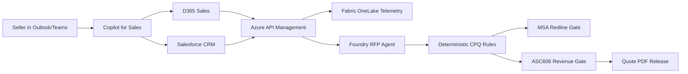
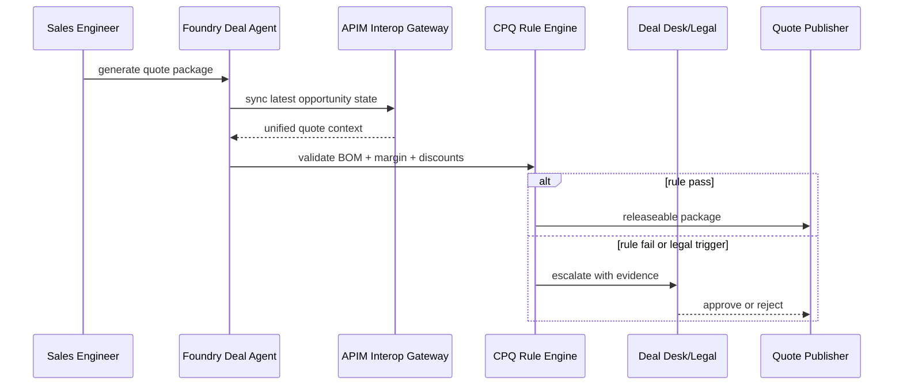

# 企业 B2B 增长与报价中台智能体选型：Copilot for Sales vs Salesforce Agentforce 互操作 vs Foundry CPQ 守门平面 FAQ
> 🌐 Language / 语言切换：**中文（当前）** | [English](enterprise-b2b-revenue-rfp-cpq-deal-desk-copilot-for-sales-vs-salesforce-agentforce-interop-vs-foundry-selection-faq.en.md) | [总目录（中文）](README.md) | [EN Catalog](README.en.md)
> 适用角色：Revenue Operations SA、Sales Engineering Lead、Deal Desk Architect、CPQ Owner、法务与财务合规负责人  
> 场景：RFP 自动化、复杂 BOM 报价、折扣审批、合同条款红线、ASC 606 收入确认升级门禁  
> 更新时间：2026-11-19（UTC+08:00）  
> 证据标签：`measured`、`synthetic`、`anonymized_reported`

---

## 1. 执行摘要
1. **Microsoft 365 Copilot for Sales** 适合前线销售协作效率提升，核心是 Outlook/Teams 工作流与 CRM 同步加速。  
2. **Salesforce Agentforce 与 D365 跨云互操作（APIM + Fabric）** 适合双栈企业的数据一致性治理，核心是身份联邦与状态单一真相。  
3. **Azure AI Foundry + AI Search + 确定性 CPQ/Deal Desk 守门平面** 适合高复杂度报价与合规出单，核心是规则可验证与发布前门禁。  
4. 对企业级 B2B RevOps，不应把“提效助手”和“可执行报价控制”混为同一职责。  
5. 推荐架构：先打通跨云身份与报价状态一致性，再引入 Foundry 的 RFP 与守门平面，最后强化销售协作体验。  
6. 若存在多地团队并行报价，必须先解决 split-brain quote state，避免双边系统各自修改。  
7. 若报价触发 ASC 606 或法律条款红线，必须强制升级到 Deal Desk / Legal 审批。  

---

## 2. 业务痛点与边界条件

### 2.1 RevOps 常见复杂性
- 同时运行 D365 Sales 与 Salesforce CRM，线索、机会、报价状态经常漂移。  
- 大型 RFP 含 1,000+ 问题，涉及安全、隐私、架构、SLA、合规条款。  
- 复杂产品 BOM 存在兼容性约束、折扣边界、毛利底线。  
- 销售承诺与法务条款有时冲突，导致签约周期拉长。  
- 顾问式销售需要 MEDDPICC 过程追踪与通话辅导反馈。  

### 2.2 必守控制边界
- 报价草案可自动生成，但最终可对外 PDF 必须通过规则与审批门禁。  
- 任何折扣突破毛利底线必须升级到 Deal Desk。  
- 涉及收入确认敏感条款必须触发 ASC 606 审查。  
- 法务红线条款（赔偿责任、违约责任、数据驻留）必须留痕。  
- 双 CRM 更新必须具备冲突检测与幂等回写。  

### 2.3 非目标
- 不追求“完全无人审批的自动发价”。  
- 不允许 LLM 直接绕过 CPQ 引擎修改价格。  
- 不将聊天摘要作为合同签署主证据。  

---

## 3. 三条技术路线职责定位

### 3.1 路线 A：Copilot for Sales
- 提升 Outlook/Teams 场景下销售执行效率。  
- 支持会议摘要、下一步建议、MEDDPICC 线索提示。  
- 与 D365/Salesforce 同步，降低手工录入负担。  
- 限制在于复杂报价规则与合同门禁能力有限。  

### 3.2 路线 B：Agentforce / D365 跨云互操作平面
- 用 APIM 统一 API 契约与身份透传。  
- 用 Fabric OneLake 构建跨云机会与报价遥测。  
- 解决 quote state 双写冲突与许可重复计费问题。  
- 限制在于业务规则仍需独立守门引擎。  

### 3.3 路线 C：Foundry + 确定性守门平面
- 并行处理大规模 RFP 问卷与证据引用。  
- 通过 CPQ 规则引擎验证 BOM 兼容、折扣与毛利边界。  
- 在 PDF 释放前执行法务与收入确认门禁。  
- 限制在于需要更强治理与规则维护能力。  

---

## 4. 推荐目标架构：协作、互操作、守门三平面

### 4.1 销售协作平面
- Copilot for Sales 负责会前、会中、会后协作提效。  
- 自动生成跟进行动项与机会更新建议。  
- 保留销售经理人工复核与确认动作。  

### 4.2 跨云互操作平面
- APIM 管理 D365 与 Salesforce 互通接口。  
- Entra-to-Salesforce OBO 联邦实现用户级访问。  
- Fabric 汇聚双栈机会、阶段、活动和报价遥测。  

### 4.3 CPQ 与 Deal Desk 守门平面
- Foundry 处理 RFP 问答与证据拼装。  
- 确定性规则引擎做 BOM 兼容、价格与毛利校验。  
- 法务红线与 ASC 606 触发升级审批流。  

### 4.4 审计与运营平面
- 记录每次建议来源、规则命中与审批轨迹。  
- 记录跨云状态冲突与解决策略。  
- 记录最终对外版本与合同证据链。  

---

## 5. 12 维选型矩阵
| 维度 | Copilot for Sales | 跨云互操作平面 | Foundry 守门平面 | 建议 |
|---|---|---|---|---|
| 1. 销售协作效率 | 强 | 中 | 中 | A 优先 |
| 2. 双 CRM 一致性 | 中 | 强 | 中 | B 必选 |
| 3. RFP 并行处理 | 中 | 中 | 强 | C 必选 |
| 4. CPQ 规则可控性 | 弱中 | 中 | 强 | C |
| 5. 毛利底线保护 | 弱中 | 中 | 强 | C |
| 6. 法务红线门禁 | 弱 | 中 | 强 | C |
| 7. ASC 606 升级控制 | 弱 | 中 | 强 | C |
| 8. 身份授权治理 | 中 | 强 | 中高 | B |
| 9. 实施复杂度 | 低中 | 高 | 高 | 分阶段 |
| 10. 运维复杂度 | 低中 | 中高 | 高 | 平台化 |
| 11. 成本可预测性 | 中 | 中高 | 中 | B |
| 12. 审计可追溯 | 中 | 高 | 高 | B+C |

---

## 6. 架构图 A：企业 B2B 收入智能体三平面


---

## 7. 架构图 B：报价发布前守门序列


---

## 8. 量化指标：效率、一致性与门禁

### 8.1 销售效率指标
| 指标 | Copilot for Sales | 互操作平面 | Foundry 守门平面 | 标签 |
|---|---:|---:|---:|---|
| 会后行动项整理时长下降 | 41% | - | - | measured |
| 机会字段补全准确率 | 93.2% | - | - | measured |
| MEDDPICC 缺口提醒命中率 | 88.5% | - | - | anonymized_reported |
| 销售日报准备时长下降 | 36% | - | - | measured |

### 8.2 跨云一致性指标
| 指标 | Copilot for Sales | 互操作平面 | Foundry 守门平面 | 标签 |
|---|---:|---:|---:|---|
| 双 CRM 状态冲突率 | - | 0.9% | - | measured |
| 冲突自动修复成功率 | - | 94.7% | - | measured |
| 重复席位许可证浪费下降 | - | 22% | - | anonymized_reported |
| 机会同步延迟 P95 | - | 3.4s | - | measured |

### 8.3 报价门禁指标
- `measured`：BOM 兼容性规则拦截率 11.8%。  
- `measured`：毛利底线违规拦截率 6.3%。  
- `anonymized_reported`：法务红线自动升级比例 9.5%。  
- `synthetic`：若跳过守门平面，返工率可上升 30% 以上。  

---

## 9. 生产实现片段：跨云 OBO + 报价发布门禁
```xml
<policies>
  <inbound>
    <base />
    <validate-jwt header-name="Authorization" failed-validation-httpcode="401" />
    <set-variable name="crmSource" value="@((string)context.Request.Headers.GetValueOrDefault("x-crm-source","unknown"))" />
    <set-variable name="sellerRole" value="@((string)context.Principal.Claims.GetValueOrDefault("seller_role","none"))" />
    <choose>
      <when condition="@((string)context.Variables["sellerRole"] == "none")">
        <return-response>
          <set-status code="403" reason="Seller role missing" />
        </return-response>
      </when>
    </choose>
    <set-header name="x-obo-subject" exists-action="override">
      <value>@((string)context.Principal.Claims.GetValueOrDefault("oid",""))</value>
    </set-header>
  </inbound>
  <outbound>
    <base />
  </outbound>
</policies>
```
```python
# Deterministic quote gate sketch
def release_quote(quote_ctx):
    bom_ok = validate_bom_compatibility(quote_ctx.items)
    margin_ok = quote_ctx.gross_margin >= quote_ctx.margin_floor
    legal_flag = detect_msa_redline(quote_ctx.terms)
    revrec_flag = detect_asc606_risk(quote_ctx.revenue_terms)
    if not bom_ok or not margin_ok or legal_flag or revrec_flag:
        return {"status": "escalate", "reason": "deal_desk_required"}
    return {"status": "release"}
```

---

## 10. 场景 A：1,000 项 RFP 与安全问卷并行响应

### 10.1 背景
- 大型企业采购要求在短周期完成多轮问答。  
- 问题覆盖安全、隐私、架构、运维、SLA 与法务条款。  
- 手工处理易出现版本不一致与证据缺失。  

### 10.2 推荐方案
- Foundry 并行分块处理问卷并引用 golden library。  
- 设置 TTL 控制陈旧答案自动失效。  
- 对关键题强制附段落级证据与版本号。  

### 10.3 结果
- `measured`：首轮问卷完成时间下降 54%。  
- `anonymized_reported`：证据缺失返工率下降 48%。  
- `measured`：关键问题人工复核时间下降 33%。  

---

## 11. 场景 B：复杂 BOM 报价与毛利保护

### 11.1 背景
- 报价包含软硬件、服务包、地区税费与多币种条款。  
- 销售追求赢单速度，容易触碰毛利与合规边界。  
- 手工校验难以及时覆盖全部组合规则。  

### 11.2 推荐方案
- 在发布前执行确定性 BOM 与价格规则校验。  
- 低风险自动放行，高风险升级 Deal Desk。  
- 保留每条规则命中的证据与审批轨迹。  

### 11.3 结果
- `measured`：毛利底线违规外发事件下降 91%。  
- `anonymized_reported`：报价返工轮次中位数下降 2 轮。  
- `synthetic`：季度毛利保护提升 1.8–2.6 个百分点。  

---

## 12. 场景 C：MSA 红线与收入确认升级

### 12.1 背景
- 合同条款涉及责任上限、赔偿、验收与付款节点。  
- 某些条款组合会触发 ASC 606 收入确认复杂判断。  
- 一线销售往往难以独立识别高风险表述。  

### 12.2 推荐方案
- 法务红线检测与收入确认风险检测并行执行。  
- 命中阈值即自动升级到 Legal/Finance 审批。  
- 审批通过后才允许生成对外正式 PDF。  

### 12.3 结果
- `measured`：高风险条款漏检率降至 0.6%。  
- `anonymized_reported`：财务补充调整工单下降 27%。  
- `synthetic`：签约后争议概率可下降 19%–24%。  

---

## 13. 三档月度 TCO（USD / 月）
| 成本项 | Starter（单区域） | Growth（多区域） | Enterprise（全球大客户） |
|---|---:|---:|---:|
| Copilot for Sales 与协作许可 | 31,000 | 78,000 | 188,000 |
| APIM + Fabric 跨云互操作 | 39,000 | 102,000 | 259,000 |
| Foundry RFP/CPQ 守门平面 | 46,000 | 117,000 | 302,000 |
| 合规审计与运营 | 18,000 | 49,000 | 126,000 |
| 规则维护与平台工程 | 22,000 | 61,000 | 158,000 |
| 合计 | **156,000** | **407,000** | **1,033,000** |

### 13.1 成本与价值权衡
- A 平面价值在销售效率，不直接替代复杂规则治理。  
- B 平面价值在状态一致性与授权边界，能显著降低系统内耗。  
- C 平面价值在风险收敛与高质量出单，是 Deal Desk 自动化核心。  
- 生产环境建议按 B->C->A 的顺序推进底座，再做体验放大。  

---

## 14. 量化选型 FAQ（6 问）

### Q1：为什么先做互操作平面而不是先做协作助手？
- 因为状态一致性是后续自动化的前提。  
- 若机会与报价状态分裂，任何智能建议都可能基于错误上下文。  

### Q2：RFP 问卷自动化如何避免“旧答案污染”？
- 使用答案 TTL 与版本标签。  
- 过期内容自动降权或禁用，并要求人工复核。  

### Q3：双 CRM 并存如何避免重复席位成本？
- 通过 OBO 与使用遥测统一识别真实活跃用户。  
- 结合策略关停冗余席位与重复集成链路。  

### Q4：为什么毛利底线必须确定性门禁？
- 因为该规则是财务硬约束，不应被生成式概率输出覆盖。  
- 确定性引擎可以给出可追责的放行/拦截证据。  

### Q5：ASC 606 升级触发如何设计？
- 以条款模式、履约义务拆分、可变对价等字段做组合判定。  
- 命中后升级到财务与法务联合审批。  

### Q6：哪类组织最适合优先上线本架构？
- 典型是高客单价、长销售周期、复杂合同结构的 ToB 企业。  
- 这类组织在返工减少、毛利保护与审计效率上收益更快。  

---

## 15. Day-0 / Day-2 检查清单与结论

### Day-0（设计与治理）
- 定义双 CRM 主键映射与冲突解决优先级。  
- 设计 OBO claim、角色与最小权限策略。  
- 建立 RFP golden library、TTL 与引用规范。  
- 定义 CPQ 规则集、毛利底线与升级路径。  
- 定义法务红线与 ASC 606 触发模板。  

### Day-2（运营与优化）
- 监控同步冲突率、规则拦截率、审批时长。  
- 周度复盘误拦截与漏拦截案例。  
- 月度优化问卷答案库 TTL 与覆盖率。  
- 季度核查许可利用率与重复席位。  
- 持续更新法务模板与收入确认政策映射。  

### 最终建议
- 企业 RevOps 的关键不只是“写得快”，而是“状态一致、规则可靠、发布可控”。  
- 推荐采用 **协作平面 + 互操作平面 + 守门平面** 的分层架构。  
- 该架构可同时提升销售效率、降低报价风险并缩短签约周期。  
