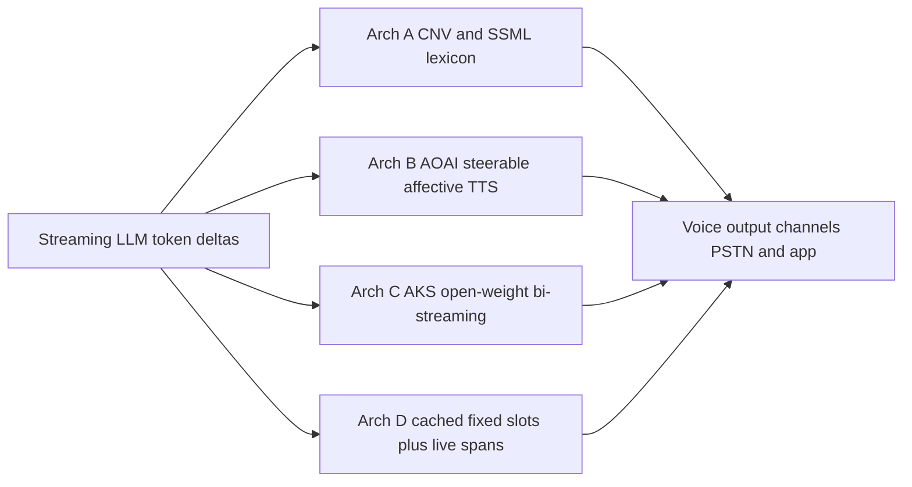
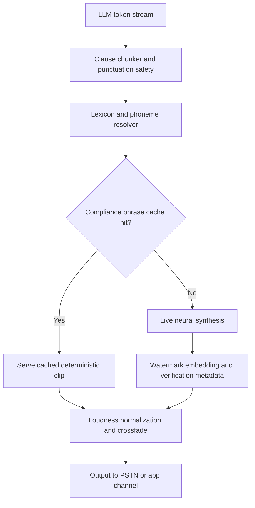
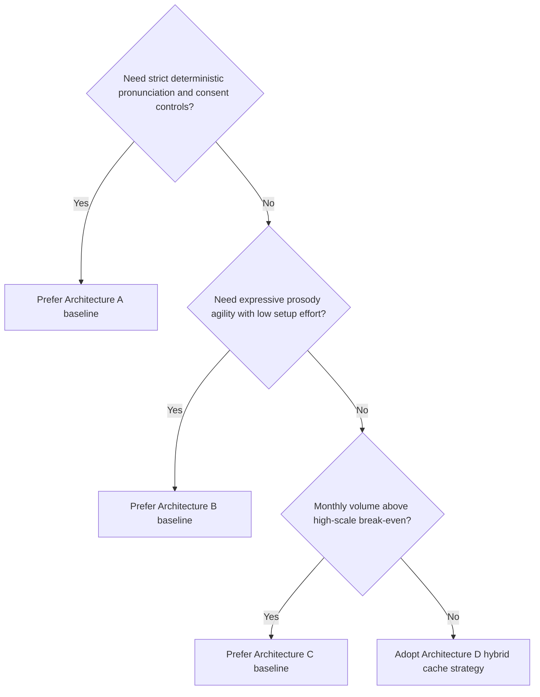

# Enterprise Brand-Voice Streaming TTS Selection FAQ: Azure Speech CNV/Dragon HD vs AOAI Steerable TTS vs AKS CosyVoice+AudioSeal vs Hybrid Cached Slots
> **Applies to**: banks, airlines, telehealth networks, and luxury concierge voice agents with strict brand, compliance, and latency requirements.
> **Decision pressure**: deliver brand-safe speech under sub-`150ms` perceived startup while preserving pronunciation determinism and anti-deepfake controls.
> **Core objective**: choose a production TTS architecture that balances expression, determinism, sovereignty, and cost.

## 1. Executive summary
- Enterprise voice agents must sound consistent, compliant, and trusted at scale.
- Brand identity and legal disclosure correctness are often equally critical.
- Streaming startup delay (`TTFAB`) directly affects user-perceived intelligence.
- Rare medical and financial terms require deterministic pronunciation mechanisms.
- Deepfake abuse risk requires consent evidence and watermark verification controls.
- Four architecture families dominate Azure production programs in 2026.
- Architecture A is strongest for deterministic enterprise voice governance.
- Architecture B is strongest for natural affective style control with low setup effort.
- Architecture C is strongest for large-scale cost efficiency and model freedom.
- Architecture D is strongest for compliance phrase determinism and latency stability.
- Most mature deployments mix A or C with D for disclosure-heavy interactions.
- Final selection should be driven by latency SLO, pronunciation risk, and monthly volume.

## 2. Applicability and explicit non-goals
- Scope includes customer-facing real-time TTS for regulated or premium journeys.
- Scope includes LLM token streaming to TTS chunking and clause-aware synthesis.
- Scope includes pronunciation determinism for `IPA`, clinical terms, and ticker symbols.
- Scope includes speaker-consent attestation and watermark-verification controls.
- Scope is distinct from STT/WhisperX/Pyannote diarization and audio-PII redaction in 3.2.
- Scope is distinct from full-duplex speech-to-speech turn taking in 3.5 realtime flows.
- Scope is distinct from caller-noise MOS benchmarking focus in 3.7 #355.
- Scope excludes generic podcast batch rendering with no latency SLO.
- Scope excludes legal policy drafting for voice-rights agreements themselves.

## 3. Scenario and constraint physics
- Contact-center journeys demand low startup delay and stable conversational pacing.
- Clinical and financial disclosures require exact wording and repeatability.
- Bilingual SKU and name pronunciation errors can create safety or trust incidents.
- PSTN channels require `8kHz G.711` compatibility and robust quality controls.
- Global brands require consistent voice timbre across regions and channels.
- Security teams require deepfake mitigation with auditable consent provenance.
- Platform teams require predictable cost across seasonal and campaign spikes.

## 4. Four architecture candidates
- **Architecture A**: Azure Speech CNV/Dragon HD + deterministic SSML/lexicon + consent gate.
- **Architecture B**: AOAI/Foundry steerable affective TTS via natural-language instructions.
- **Architecture C**: AKS open-weight bi-streaming TTS with AudioSeal and HSM controls.
- **Architecture D**: hybrid cached deterministic slots + live neural variable-span synthesis.
- Arch-A optimizes compliance pronunciation and brand-governed voice custody.
- Arch-B optimizes expressive style agility with minimal SSML maintenance.
- Arch-C optimizes throughput economics and deployment sovereignty.
- Arch-D optimizes latency and wording stability for recurring regulated phrases.

## 5. Architecture A details (CNV and deterministic lexicon)
- CNV and Dragon HD support governed enterprise voice identity workflows.
- Statement-of-Talent consent gating anchors legal and ethical provenance.
- `SSML <phoneme alphabet="ipa">` provides deterministic term pronunciation.
- Custom `.pls` lexicons enforce domain-specific names and abbreviations.
- WebSocket streaming supports low-latency output in PSTN and broadband formats.
- Speech containers enable VNet-isolated deployment for data sovereignty needs.
- Native watermark capability supports transparency and provenance obligations.
- Arch-A is preferred where pronunciation errors are high-severity incidents.

## 6. Architecture B details (steerable affective TTS)
- Instruction-driven prosody adjusts empathy, pace, and emotional tone quickly.
- Teams avoid large SSML template maintenance burdens for broad dialog variety.
- Multilingual and code-switch expression can be tuned per scenario intent.
- Voice inventory is curated rather than arbitrary user-upload cloning.
- Rare nomenclature may still need deterministic fallback controls.
- Cloud-managed pricing and service updates simplify platform operations.
- Arch-B is excellent for concierge and relationship-centered experiences.
- Arch-B usually pairs with deterministic slot strategies for legal disclosures.

## 7. Architecture C details (AKS open-weight + AudioSeal)
- Open-weight engines (`CosyVoice`, `Orpheus`) can deliver strong throughput per GPU.
- Continuous batching drives low real-time factor in high-volume workloads.
- `RTF <= 0.06` supports many concurrent streams per accelerator.
- HSM-signed voiceprint allowlists restrict unauthorized voice-clone enrollment.
- `AudioSeal` frame watermarking can survive transcoding if tuned correctly.
- Teams own model updates, guardrails, and watermark verification lifecycle.
- Engineering complexity is higher but long-run unit economics can be lower.
- Arch-C is attractive above sustained high monthly character volumes.

## 8. Architecture D details (cached deterministic slots + live neural spans)
- Recurring compliance phrases are pre-rendered and cached for instant playback.
- Personalized variable segments are synthesized live by neural TTS.
- Cross-fade stitching and loudness normalization hide splice boundaries.
- `ITU-R BS.1770` `-16 LUFS` alignment improves continuity perception.
- Cache hit rates of `55%–75%` materially reduce synthesis spend.
- Fixed wording for regulated disclosures removes hallucinated text risk.
- Arch-D provides deterministic guardrails without sacrificing personalization.
- Arch-D complements A, B, or C depending on voice custody strategy.

## 9. Twelve-dimension architecture comparison matrix
| Dimension | Architecture A | Architecture B | Architecture C | Architecture D |
|---|---|---|---|---|
| Primary objective | Deterministic governed brand voice | Expressive affective control | Scale economics and sovereignty | Latency and compliance phrase determinism |
| TTFAB performance | High | High | Medium-high | Highest for cached segments |
| Pronunciation determinism | Highest | Medium | High with tooling | Highest for cached phrases |
| Brand voice exclusivity | Highest | Medium | High | High (depends on source model) |
| Operational complexity | Medium | Low-medium | High | Medium |
| Data sovereignty options | High | Medium | Highest | High |
| Deepfake risk controls | High | Medium | High (custom) | High |
| PSTN readiness | High | Medium | Medium-high | High |
| Unit cost at low volume | Medium | Medium | Low efficiency | High efficiency when cache hits |
| Unit cost at high volume | Medium | Medium-high | Highest efficiency | Highest with high reuse |
| Governance auditability | High | Medium | High (custom) | High |
| Rollout velocity | Medium | Highest | Medium | Medium-high |

## 10. Four-architecture topology overview


## 11. Bi-streaming token-to-audio pipeline


## 12. SA decision tree


### Q1. How bi-streaming clause chunking and TTFAB math should be designed
- Early audio start improves conversational perception but risks malformed prosody.
- Abbreviation boundaries (`Dr.`, `No.`) must not trigger premature clause flush.
- Financial tokens (`$3.5M`, `Q4 FY26`) require semantic-safe chunk boundaries.
- Chunker should combine punctuation, timeout, and abbreviation dictionaries.
- Practical formula: `TTFAB_total = TTFT_llm + T_punct_buffer + TTFAB_tts`.
- Lower `T_punct_buffer` reduces startup delay but can increase prosody errors.
- Adaptive buffer windows can depend on domain and sentence confidence.
- Clause starvation must be bounded to avoid robotic long-silence behavior.
- Bi-streaming design should include rollback or continuation stitching logic.

### Q2. How GPU concurrency and RTF sizing plus break-even should be computed
- Real-time factor (`RTF`) captures synthesis speed relative to audio duration.
- Capacity approximation: `Streams_max = floor(eta_batch / RTF_p99)`.
- `eta_batch` represents effective batching gain after scheduler overhead.
- A10 and H100 profiles differ in parallelism and memory headroom.
- Break-even volume depends on infra utilization and managed-service unit pricing.
- Below threshold volumes, managed services often win on total cost simplicity.
- Above sustained thresholds, self-hosted GPU can reduce per-character cost.
- Sizing should include watermarking and post-processing overhead terms.
- Queueing safety margins are required for p99 latency SLO compliance.

### Q3. How SSML phoneme plus lexicon compares with prompted TTS
- Prompted style instructions excel at emotion and conversational naturalness.
- Prompted systems are less deterministic on rare clinical and financial strings.
- `SSML <phoneme>` with `.pls` lexicon gives explicit pronunciation control.
- Deterministic lexicon paths are required for zero-error high-risk terms.
- Hybrid strategy can use prompted TTS for narrative segments and lexicon locks for terms.
- Lexicon lifecycle should include approval, testing, and rollback versioning.
- Regression tests should include bilingual entity lists and acronym stress cases.
- Voice QA should track exact-match pronunciation for critical vocabulary.
- This split approach balances naturalness with legal-grade correctness.

### Q4. How anti-deepfake consent vault and 8kHz-resilient watermarking should work
- Voice enrollment must require explicit consent attestation evidence.
- Consent records should be signed and stored with immutable audit metadata.
- Reference voiceprints should live in HSM-backed vault-controlled registries.
- Unauthorized voice-upload attempts must be rejected before model adaptation.
- Watermark embedding must survive `MP3`, `Opus`, and `8kHz` PSTN transcoding.
- Detector thresholds should be calibrated for low false-negative rates.
- Verification logs should be attached to output transaction IDs.
- Incident playbooks should include quarantine and notification workflows.
- Compliance reporting should map to AI transparency obligations by jurisdiction.

### Q5. What a production async token-to-audio pipeline can look like
- Pipeline should decouple LLM token reception, chunking, synthesis, and output buffering.
- Async stages allow overlapping compute and lower perceived latency.
- Punctuation-safe chunking avoids acronym and currency boundary errors.
- Azure Speech WebSocket can stream deterministic CNV output.
- AudioSeal stage can embed and validate watermark metadata.

```python
import asyncio
import re

ABBR = {"dr.", "mr.", "mrs.", "ms.", "no.", "fig."}

def safe_flush(text: str) -> bool:
    t = text.strip().lower()
    if not t:
        return False
    if any(t.endswith(a) for a in ABBR):
        return False
    if re.search(r"\\$\\d+(\\.\\d+)?[mbk]?$", t):
        return False
    return t.endswith((".", "?", "!", ";", ":"))

async def stream_pipeline(llm_tokens, tts_ws, audioseal):
    buf = ""
    async for tok in llm_tokens:
        buf += tok
        if safe_flush(buf):
            pcm = await tts_ws.synthesize(buf)
            stamped = await audioseal.embed(pcm, sample_rate=24000)
            yield stamped
            buf = ""
    if buf.strip():
        pcm = await tts_ws.synthesize(buf)
        stamped = await audioseal.embed(pcm, sample_rate=24000)
        yield stamped
```

```json
{
  "voice_consent_vault": {
    "hsm_signed_attestation": true,
    "statement_of_talent_required": true,
    "voiceprint_allowlist_enforced": true,
    "jurisdiction_tags": ["eu", "us", "apac"]
  }
}
```

```json
{
  "audio_output_policy": {
    "pstn_profile": "g711_ulaw_8khz",
    "broadband_profile": "opus_24khz",
    "loudness_target_lufs": -16,
    "watermark_mandatory": true
  }
}
```

### Q6. What three-year TCO looks like at 5M, 50M, and 500M characters per month
- Volume scale fundamentally changes optimal architecture economics.
- Managed services reduce operations burden at low to medium volumes.
- Self-hosted GPU can outperform on cost at sustained high throughput.
- Cache-heavy hybrid strategy can collapse repeated disclosure costs.

| Monthly synthesized chars | Architecture A | Architecture B | Architecture C | Architecture D |
|---|---:|---:|---:|---:|
| 5M | \$0.60M–\$1.00M | \$0.50M–\$0.90M | \$0.85M–\$1.40M | \$0.45M–\$0.80M |
| 50M | \$4.20M–\$7.20M | \$4.80M–\$8.20M | \$3.00M–\$5.40M | \$2.70M–\$4.90M |
| 500M | \$34.00M–\$58.00M | \$39.00M–\$66.00M | \$20.00M–\$36.00M | \$18.00M–\$33.00M |

| Monthly synthesized chars | Typical risk reduction with deterministic controls | Typical risk reduction with cache-hybrid controls |
|---|---:|---:|
| 5M | 45%–62% | 40%–58% |
| 50M | 50%–68% | 48%–66% |
| 500M | 55%–72% | 53%–70% |

- Final decision should blend cost curves with brand and compliance risk appetite.
- Governance quality is as important as raw synthesis economics.
- Continuous evaluation should include latency, pronunciation, and watermark fidelity.

## 13. Day-0 rollout checklist
- Define voice-rights and consent evidence requirements by jurisdiction.
- Choose baseline architecture and fallback strategy for regulated phrases.
- Build pronunciation test suites for clinical and financial entities.
- Configure lexicon governance and SSML review workflow.
- Set TTFAB and p99 latency SLOs by channel type.
- Enable watermark embed/detect controls and logging.
- Integrate APIM routing and identity enforcement for sanctioned paths.
- Publish operational runbooks for incident and rollback handling.

## 14. Day-2 operations checklist
- Re-run pronunciation regression packs after model or lexicon changes.
- Monitor TTFAB decomposition (`TTFT_llm`, buffer, TTS startup) by route.
- Track cache-hit rates and splice-quality metrics in hybrid paths.
- Audit consent-vault events and unauthorized voice-enrollment attempts.
- Validate watermark detectability after codec and channel transformations.
- Recompute GPU capacity assumptions from observed `RTF_p99`.
- Tune chunker heuristics for abbreviation and currency-heavy workloads.
- Review TCO and QoE deltas quarterly against architecture assumptions.

## 15. Good fit versus not for
| Category | Guidance |
|---|---|
| ✅ Good fit | Enterprises needing strict brand voice and pronunciation compliance. |
| ✅ Good fit | Voice-agent programs with measurable latency and sovereignty SLOs. |
| ✅ Good fit | Regulated industries requiring consent and anti-deepfake evidence trails. |
| ⛔ Not for | Teams unwilling to maintain pronunciation, consent, and watermark governance. |
| ⛔ Not for | Low-stakes batch-only narration workloads with no latency or compliance constraints. |
| ⛔ Not for | Deployments that require arbitrary voice cloning without legal attestation controls. |

## 16. Five-step implementation guide
1. Classify workloads by compliance strictness, expression needs, and channel latency.
2. Establish consent vault, lexicon governance, and watermark policy baseline.
3. Implement bi-streaming chunker and route-specific synthesis profiles.
4. Add hybrid cache strategy for recurring disclosures and greetings.
5. Operate with quarterly tuning for RTF, TTFAB, pronunciation, and cost.

## 17. Operational metric pack for quarterly steering
- Track TTFAB median and p95 by architecture route.
- Track chunker-induced prosody rollback incidents.
- Measure deterministic pronunciation exact-match rate for critical entities.
- Track lexicon change frequency and post-change regression outcomes.
- Track consent attestation completeness for every production voice profile.
- Measure unauthorized voice enrollment attempts blocked by vault policy.
- Track watermark embed success rates by codec profile.
- Track watermark detect success after PSTN `8kHz` transcode.
- Track APIM route mix across CNV, steerable, open-weight, and hybrid paths.
- Monitor cache hit ratio for fixed compliance phrases.
- Track loudness normalization variance around `-16 LUFS`.
- Track p99 synthesis queue delay under peak demand windows.
- Track GPU stream utilization and achieved `RTF_p99` on AKS.
- Track fallback invocation rates from expressive to deterministic routes.
- Measure customer experience score deltas tied to startup latency shifts.
- Track speech quality complaints linked to pronunciation defects.
- Track policy violation counts for unwatermarked output attempts.
- Track data-sovereignty boundary exceptions and remediation SLA.
- Track monthly unit-cost trend per one million synthesized characters.
- Track incident response time for voice authenticity alerts.
- Track false-positive watermark detection cases requiring investigation.
- Track phrase-cache drift versus latest approved disclosure text.
- Track legal or compliance audit findings related to voice governance.
- Correlate model upgrades with changes in prosody and term fidelity.
- Publish quarterly ROI scorecard combining cost, risk, and UX outcomes.
- Maintain architecture decision log for route changes and rationale.

## 18. Provenance
- `anonymized_reported`: metrics and control patterns are synthesized from anonymized enterprise voice-agent programs and reproducible architecture sizing assumptions.
