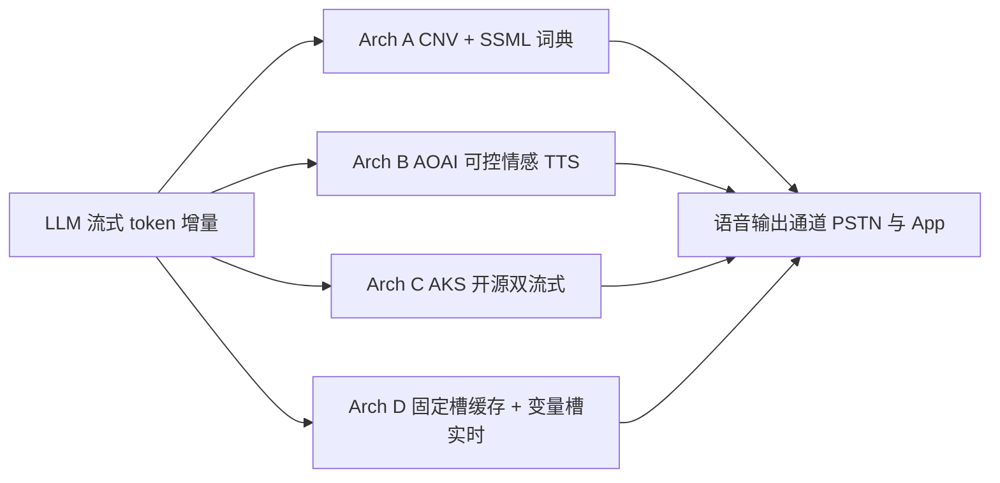
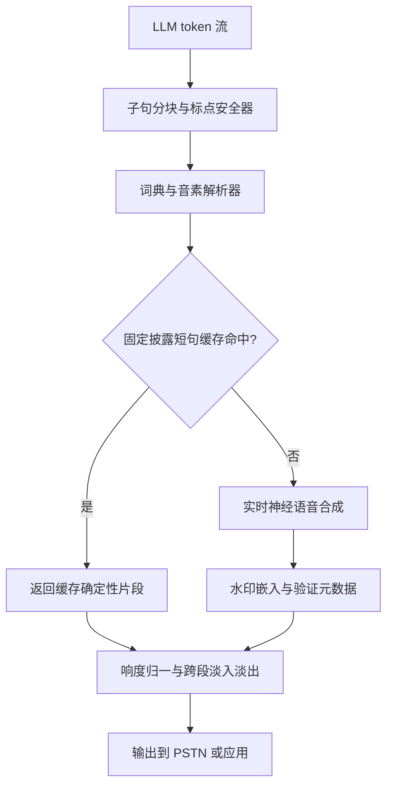
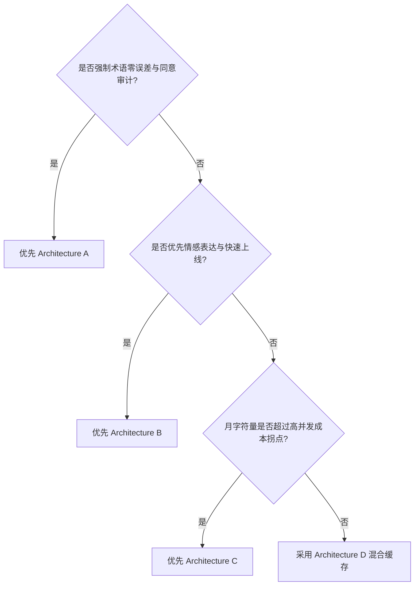

# 企业品牌语音流式 TTS 选型 FAQ：Azure Speech CNV/Dragon HD vs AOAI 可控情感 TTS vs AKS CosyVoice+AudioSeal vs 混合缓存槽位
> **适用场景**：全球银行、航空、远程医疗与奢侈品客服语音智能体，要求品牌一致性与合规可审计。
> **决策压力**：在严格发音正确性与防伪要求下，仍需实现接近实时的语音首包体验。
> **核心目标**：在表达力、确定性、主权部署与成本之间做可运营的生产级平衡。

## 1. 执行摘要
- 企业语音智能体必须同时满足“好听、准确、可信”三重目标。
- 品牌声纹一致性与监管披露准确性通常同等重要。
- `TTFAB` 直接影响用户对智能体“是否聪明”的主观感受。
- 医疗与金融术语常要求接近零误差发音。
- 深度伪造风险要求具备同意证据链与水印可验证能力。
- 2026 年生产实践主要收敛到四类架构路线。
- Architecture A 在治理与确定性上优势最强。
- Architecture B 在情感表达与上线速度上优势明显。
- Architecture C 在超大规模成本效率上更具吸引力。
- Architecture D 在固定披露语句与低时延上表现稳定。
- 成熟平台通常将 A 或 C 与 D 组合使用。
- 最终选型应由延迟 SLO、发音风险与流量规模共同驱动。

## 2. 适用性与明确非目标
- 本文聚焦客户面向的实时 TTS 与多模态语音应答。
- 本文覆盖 LLM token 到 TTS chunk 的双流式编排。
- 本文覆盖 `IPA`、药名、证券代码等高敏术语发音治理。
- 本文覆盖声纹同意、音频水印与防伪验证链路。
- 本文不同于 3.2 中 STT/WhisperX/Pyannote 分离与音频脱敏主题。
- 本文不同于 3.5 的全双工 speech-to-speech 轮转治理主题。
- 本文不同于 3.7 #355 的来电噪声 MOS 评测主题。
- 本文不讨论纯离线播客批量渲染场景。
- 本文不替代法务层面的语音授权合同起草工作。

## 3. 场景与约束物理
- 呼叫中心路径要求低首包时延与稳定语速节奏。
- 医疗与金融披露要求措辞与术语严格一致。
- 双语 SKU/药名发音错误会直接引发信任或合规问题。
- PSTN 通道要求 `8kHz G.711` 兼容和稳健后处理。
- 全球品牌希望跨区域维持声纹一致识别度。
- 安全团队需要可审计的深伪防护与同意证明。
- 平台团队需要跨季节波峰下可预测成本模型。

## 4. 四类候选架构
- **Architecture A**：Azure Speech CNV/Dragon HD + SSML/词典确定性发音 + 同意门禁。
- **Architecture B**：AOAI/Foundry 自然语言指令驱动情感可控 TTS。
- **Architecture C**：AKS 开源权重双流式 TTS + AudioSeal + HSM 控制。
- **Architecture D**：固定语句缓存 + 变量片段实时神经合成混合架构。
- Arch-A 侧重品牌声纹治理与高风险术语确定性。
- Arch-B 侧重表达灵活度与低维护门槛。
- Arch-C 侧重大规模吞吐成本与部署自主权。
- Arch-D 侧重披露稳定性与极低首包时延。

## 5. Architecture A 细节（CNV 与确定性词典）
- CNV/Dragon HD 可满足企业专属品牌语音治理需求。
- Statement-of-Talent 同意链可形成合规可追溯证据。
- `SSML <phoneme alphabet=\"ipa\">` 提供精确发音控制。
- `.pls` 自定义词典可固化专业术语读法。
- WebSocket 流式可覆盖 PSTN 与宽带输出链路。
- Speech Containers 支持 VNet 隔离主权部署。
- 原生水印能力有助于透明化与来源可信声明。
- Arch-A 适合“发音错误成本极高”的业务域。

## 6. Architecture B 细节（可控情感 TTS）
- 自然语言指令可快速调节语气、节奏与情绪。
- 团队无需维护大量脆弱 SSML 模板即可上线。
- 多语与 code-switch 风格可按场景动态切换。
- 声音库是受控集合，不是任意第三方克隆导入。
- 极少见术语仍可能需要确定性兜底机制。
- 云托管模式降低基础运维复杂度。
- Arch-B 适合高体验 concierge 与关系型对话场景。
- Arch-B 常与固定披露缓存策略组合以补足确定性。

## 7. Architecture C 细节（AKS 开源权重 + AudioSeal）
- `CosyVoice`、`Orpheus` 等可在 GPU 上实现高并发合成。
- 连续批处理可显著压低单位音频实时因子。
- `RTF <= 0.06` 可支持更高并发流密度。
- HSM 签名声纹白名单可阻断任意声纹上传滥用。
- `AudioSeal` 需针对转码链路做鲁棒性参数校准。
- 模型升级、安全护栏与检测阈值均需团队自运维。
- 工程复杂度更高，但规模化后成本优势明显。
- Arch-C 在超大月字符量下更容易形成成本拐点优势。

## 8. Architecture D 细节（缓存固定槽位 + 实时变量槽）
- 高频披露语与欢迎语可预渲染缓存近零延迟返回。
- 个性化变量部分由神经 TTS 实时生成。
- Cross-fade 拼接与响度归一用于消除拼接感。
- `ITU-R BS.1770` `-16 LUFS` 可降低听感突变。
- `55%–75%` 命中率可显著压缩合成成本。
- 监管披露语句固定化可避免措辞漂移风险。
- Arch-D 在不牺牲个性化的前提下增强确定性。
- Arch-D 可叠加到 A/B/C 任一路线作为稳态加速层。

## 9. 12 维架构对比矩阵
| 维度 | Architecture A | Architecture B | Architecture C | Architecture D |
|---|---|---|---|---|
| 主要目标 | 品牌声纹与术语确定性治理 | 情感表达灵活性 | 规模化成本与主权控制 | 固定披露低时延与确定性 |
| TTFAB 表现 | 高 | 高 | 中高 | 缓存命中时最高 |
| 发音确定性 | 最高 | 中 | 高（需工程治理） | 固定语句最高 |
| 品牌专属声纹 | 最高 | 中 | 高 | 高（依赖源模型） |
| 运维复杂度 | 中 | 低到中 | 高 | 中 |
| 数据主权可选项 | 高 | 中 | 最高 | 高 |
| 深伪风险控制 | 高 | 中 | 高（自建） | 高 |
| PSTN 适配性 | 高 | 中 | 中高 | 高 |
| 低流量成本表现 | 中 | 中 | 低效率 | 缓存命中时较优 |
| 高流量成本表现 | 中 | 中高 | 最优 | 高命中时最优 |
| 审计可追溯性 | 高 | 中 | 高（自建） | 高 |
| 上线速度 | 中 | 最高 | 中 | 中高 |

## 10. 四架构拓扑总览


## 11. 双流式 Token 到音频管线


## 12. 架构师决策树


### Q1. 双流式分块与 TTFAB 数学如何设计
- 过早出声可提升体感速度，但可能造成韵律断裂。
- `Dr.`、`No.` 等缩写不应触发错误断句。
- `\$3.5M`、`Q4 FY26` 等金融实体需语义安全分块。
- 分块器应结合标点、超时与缩写词典规则。
- 核心公式：`TTFAB_total = TTFT_llm + T_punct_buffer + TTFAB_tts`。
- 降低 `T_punct_buffer` 可提速但会放大发音与停顿错误。
- 可按行业域动态调整缓冲窗长度。
- 还需设置最长等待阈值以避免长静默。
- 双流式实现应具备片段回滚或延续拼接能力。

### Q2. GPU 并发、RTF 与成本拐点如何测算
- `RTF` 表示生成速度相对音频时长的比值。
- 并发近似可用 `Streams_max = floor(eta_batch / RTF_p99)`。
- `eta_batch` 表示扣除调度损耗后的有效批处理增益。
- A10 与 H100 在并发与内存冗余上有不同上限。
- 低月量下托管服务通常更省运维总成本。
- 高月量稳定负载下自建 GPU 常更省单位字符成本。
- 估算时应包含水印和后处理额外开销。
- p99 需预留排队安全余量避免 SLA 突破。
- 拐点判断应结合利用率而非只看峰值吞吐。

### Q3. `SSML <phoneme>` + `.pls` 与 Prompted TTS 如何取舍
- Prompted TTS 在情感和自然度上更灵活。
- Prompted 路径对罕见术语确定性通常不如词典锁定。
- `SSML <phoneme>` + `.pls` 能显式固化关键实体读法。
- 高风险术语场景应强制走确定性路径。
- 可采用“叙述段 Prompted、术语段 Lexicon”混合策略。
- 词典治理需具备审批、测试、版本回滚机制。
- 回归集应覆盖双语药名、代码、缩写压力样例。
- 语音 QA 应跟踪关键术语 exact-match 命中率。
- 该组合可平衡听感自然与合规刚性要求。

### Q4. 反深伪同意金库与 8kHz 水印检测如何落地
- 声纹入库必须附带可验证的同意证明材料。
- 同意证据应签名并写入不可篡改审计记录。
- 参考声纹需保存在 HSM 保护的白名单金库。
- 未授权声纹上传应在训练前即被拒绝。
- 水印嵌入应对 `MP3`、`Opus`、`8kHz` 转码链路保持鲁棒。
- 检测阈值应优先保证低漏检率。
- 每段输出需绑定可追踪的验证元数据。
- 事件处置应包含隔离、告警与法务联动流程。
- 合规报表应映射到各地区透明化义务要求。

### Q5. 生产级异步 token->audio 管线示例
- 管线应拆分接收、分块、合成、后处理并异步并行。
- 阶段解耦可降低感知延迟并提升吞吐弹性。
- 标点安全分块可减少缩写与金额读法误断句。
- Azure Speech WebSocket 可用于确定性 CNV 流式输出。
- AudioSeal 阶段可嵌入并验证水印元数据。

```python
import asyncio
import re

ABBR = {"dr.", "mr.", "mrs.", "ms.", "no.", "fig."}

def safe_flush(text: str) -> bool:
    t = text.strip().lower()
    if not t:
        return False
    if any(t.endswith(a) for a in ABBR):
        return False
    if re.search(r"\\$\\d+(\\.\\d+)?[mbk]?$", t):
        return False
    return t.endswith((".", "?", "!", ";", ":"))

async def stream_pipeline(llm_tokens, tts_ws, audioseal):
    buf = ""
    async for tok in llm_tokens:
        buf += tok
        if safe_flush(buf):
            pcm = await tts_ws.synthesize(buf)
            stamped = await audioseal.embed(pcm, sample_rate=24000)
            yield stamped
            buf = ""
    if buf.strip():
        pcm = await tts_ws.synthesize(buf)
        stamped = await audioseal.embed(pcm, sample_rate=24000)
        yield stamped
```

```json
{
  "voice_consent_vault": {
    "hsm_signed_attestation": true,
    "statement_of_talent_required": true,
    "voiceprint_allowlist_enforced": true,
    "jurisdiction_tags": ["eu", "us", "apac"]
  }
}
```

```json
{
  "audio_output_policy": {
    "pstn_profile": "g711_ulaw_8khz",
    "broadband_profile": "opus_24khz",
    "loudness_target_lufs": -16,
    "watermark_mandatory": true
  }
}
```

### Q6. 5M / 50M / 500M 月字符量三年 TCO 如何对比
- 随着规模扩大，最优架构会发生明显迁移。
- 低中流量下托管路径通常更省平台维护成本。
- 高流量稳态下 GPU 自建更容易出现单位成本优势。
- 高命中混合缓存可进一步压降披露语句边际成本。

| 月合成字符量 | Architecture A | Architecture B | Architecture C | Architecture D |
|---|---:|---:|---:|---:|
| 5M | \$0.60M–\$1.00M | \$0.50M–\$0.90M | \$0.85M–\$1.40M | \$0.45M–\$0.80M |
| 50M | \$4.20M–\$7.20M | \$4.80M–\$8.20M | \$3.00M–\$5.40M | \$2.70M–\$4.90M |
| 500M | \$34.00M–\$58.00M | \$39.00M–\$66.00M | \$20.00M–\$36.00M | \$18.00M–\$33.00M |

| 月合成字符量 | 确定性治理路径典型风险下降 | 混合缓存路径典型风险下降 |
|---|---:|---:|
| 5M | 45%–62% | 40%–58% |
| 50M | 50%–68% | 48%–66% |
| 500M | 55%–72% | 53%–70% |

- 最终决策应把成本曲线与品牌/合规风险共同建模。
- 治理成熟度与模型性能同样决定生产价值。
- 需持续评估延迟、发音准确率与水印鲁棒性。

## 13. Day-0 落地清单
- 依据法域定义语音授权与同意证据标准。
- 选定基线架构与监管披露兜底策略。
- 建立医疗/金融高敏术语发音回归集。
- 上线词典治理与 SSML 审核流程。
- 按通道定义 TTFAB 与 p99 延迟 SLO。
- 启用水印嵌入/检测与全链路留痕。
- 接入 APIM 路由与身份策略约束。
- 发布故障、回滚与应急处置运行手册。

## 14. Day-2 运营清单
- 每次模型或词典变更后执行发音回归。
- 分路线监控 `TTFT_llm`、buffer、`TTFAB_tts` 拆分指标。
- 持续跟踪缓存命中率与拼接质量。
- 审计同意金库事件与异常声纹入库尝试。
- 验证转码后水印可检测性稳定性。
- 用观测到的 `RTF_p99` 回校 GPU 容量模型。
- 迭代缩写与金额分块规则减少韵律错误。
- 季度复盘 TCO 与体验指标偏差并调参。

## 15. Good fit 与 Not for
| 分类 | 指引 |
|---|---|
| ✅ Good fit | 需要品牌声纹与术语确定性双重保障的企业语音智能体。 |
| ✅ Good fit | 对时延、主权部署、可审计防伪有明确 SLO 的组织。 |
| ✅ Good fit | 监管行业中需同意证据链与水印留痕的客服场景。 |
| ⛔ Not for | 不愿维护词典、同意与水印治理能力的团队。 |
| ⛔ Not for | 仅离线批量播报且无时延/合规约束的低风险场景。 |
| ⛔ Not for | 需要任意声纹克隆且无法提供合法授权证明的需求。 |

## 16. 五步实施路径
1. 按合规刚性、表达需求、时延目标做工作负载分层。
2. 建立同意金库、词典治理与水印策略基线。
3. 部署双流式分块器与多路合成策略。
4. 对高复用披露语句引入混合缓存层。
5. 以 RTF、TTFAB、发音准确率、成本四轴季度优化。

## 17. 季度治理指标包（运营看板建议）
- 按架构路线跟踪 TTFAB 中位与 p95。
- 跟踪分块器导致的韵律回滚事件数。
- 统计关键术语发音 exact-match 命中率。
- 跟踪词典变更频率及变更后回归结果。
- 统计每个生产声纹的同意证明完整度。
- 统计被金库策略阻断的非法声纹入库尝试。
- 跟踪不同编码下水印嵌入成功率。
- 跟踪 PSTN `8kHz` 转码后水印检测通过率。
- 跟踪 APIM 在 CNV/Steerable/OpenWeight/Hybrid 的路由占比。
- 跟踪固定披露语句缓存命中率趋势。
- 跟踪 `-16 LUFS` 目标周围响度偏差。
- 跟踪峰值窗口下 p99 合成排队时延。
- 跟踪 AKS GPU 并发利用率与 `RTF_p99` 达标率。
- 跟踪从情感路径降级到确定性路径的触发率。
- 关联启动时延变化与客户体验评分波动。
- 跟踪因发音缺陷引发的投诉工单趋势。
- 跟踪未加水印输出尝试的策略拦截数。
- 跟踪数据主权边界异常与修复 SLA。
- 跟踪每百万字符单位成本月度变化。
- 跟踪语音真实性告警的平均处置时长。
- 跟踪水印误报案例及复核结论。
- 跟踪固定披露缓存内容与最新合规文本偏差。
- 跟踪语音治理相关审计发现项数量。
- 关联模型升级与韵律/术语准确率变化。
- 季度输出成本、风险、体验三维 ROI 评分卡。
- 维护路由决策变更日志与决策依据。

## 18. Provenance
- `anonymized_reported`：文中指标与治理模式来自匿名化企业语音项目观察与可复现容量建模假设。
