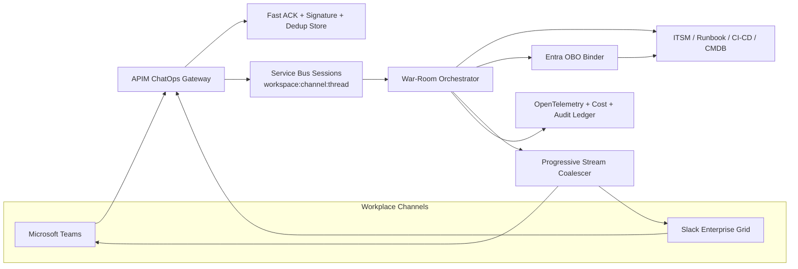
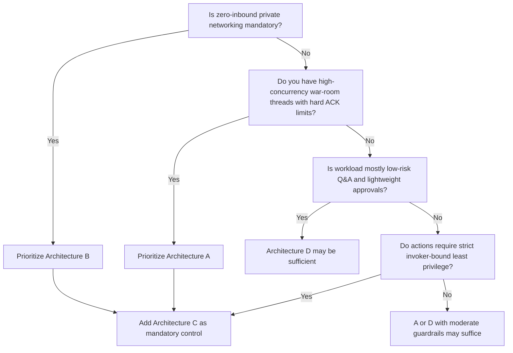

# Enterprise Cross-Platform ChatOps War-Room Agent Selection FAQ: M365 Agents SDK + Teams Graph RSC vs Slack Events/Socket Mode vs APIM + Unified Session Bus

> 🌐 **Language Switch**: [中文](./enterprise-chatops-warroom-agent-m365-agents-sdk-teams-rsc-vs-slack-socket-events-apim-vs-unified-bus-selection-faq.md) | **English (current)**
> **Audience**: Cloud & AI Solution Architects, workplace-platform owners, SecOps/ITSM war-room leads, zero-trust identity architects, platform SRE and FinOps leaders.
> **Scope**: Production architecture choices for multi-user war-room agents running across Microsoft Teams and Slack Enterprise Grid, including inbound reliability, thread-state normalization, actor-bound authorization, stream-throttled response rendering, compliance evidence, and 3-year risk-adjusted TCO.

## 1. Problem framing: why cross-platform war-room ChatOps is a control-plane architecture problem, not a bot integration checklist
In single-team pilots, chat automation often starts as lightweight command handling with simple webhook callbacks and optimistic assumptions about request order, human behavior, and platform rate limits.  
At enterprise scale, that mental model fails because incident war-rooms carry concurrent high-priority actions, mixed trust participants, and severe audit obligations, which means the system is no longer “a chatbot” but a distributed control plane where every message can trigger expensive or irreversible state transitions.  
Slack imposes hard inbound acknowledgement windows and retry semantics, Teams and Slack both enforce practical message-edit throughput envelopes, and shared war-room channels frequently combine privileged responders with observers and external guests, creating a confused-deputy blast radius whenever execution identity is not bound to the true invoker.  
If architecture decisions are made only around developer convenience, the platform usually degrades under stress into duplicate execution storms, stale thread views, throttling loops, and unverifiable approval lineage, all of which increase outage duration and post-incident remediation cost.  
The architecture objective must therefore be explicit: preserve deterministic thread state under bursty concurrency, enforce invoker-bound least privilege for mutating actions, satisfy platform SLA constraints (`3s` ingress acknowledgement and bounded edit rates), and produce complete evidence chains for operational and regulatory review.  

## 2. Four architecture patterns (A/B/C/D) and their boundary of responsibility
**Architecture A (Unified dual-channel gateway)** centralizes Teams/Slack ingress in APIM, performs HMAC/signature verification plus idempotency extraction in the fast path, acknowledges quickly, and routes normalized events to Service Bus Sessions keyed by canonical thread identity.  
**Architecture B (Zero-inbound private networking posture)** replaces public webhook ingress with Slack Socket Mode pull channels and controlled Teams outbound paths, running workers in ACA/AKS private networks with deterministic reconnect-drain behavior and active-active deduplication controls.  
**Architecture C (Shared-channel least-privilege execution)** enforces Graph RSC read-only context access and requires invoker-bound Entra OBO tokens for any mutating action, with signed Adaptive Card Universal Actions or Slack Modals for step-up confirmation and replay-resistant intent binding.  
**Architecture D (Native SaaS declarative surfaces)** uses M365 Copilot declarative agents and Slack AI/Workflow Builder extensions for low-complexity productivity cases, while accepting lower control over deep stateful orchestration, compensation logic, and fine-grained evidence lineage.  
In real enterprise estates these patterns are composable rather than mutually exclusive: A is commonly the ingestion/reliability baseline, C is the security and accountability baseline, B is added where network policy is strict, and D is retained as a low-friction front-door for lightweight experiences.  

## 3. End-to-end reference architecture: ingress trust, thread-state normalization, actor-bound execution, and throttled response streaming


This architecture deliberately separates ingress SLA handling from business execution so platform retry semantics never directly dictate tool-side side effects.  
It also separates thread ordering from rendering cadence, allowing deterministic state progression in the session bus while controlling write-back frequency against platform throttling buckets.  
Most importantly, it separates channel identity from execution identity by making OBO exchange an explicit hop, which prevents bot ambient privilege from being abused in mixed-trust war-room channels.  

## 4. Architecture A deep dive: APIM fast-ack ingress, normalized session keys, and adaptive stream coalescing
Architecture A addresses the highest-frequency production failure pattern: inbound timeout-induced retries combined with downstream non-idempotent execution and fragmented thread updates.  
Slack Events API requires acknowledgement within approximately `3,000ms`, so the fast path should include only signature verification, timestamp skew check, dedup-key extraction, and asynchronous enqueue; all heavy work must be deferred to the worker plane.  
A practical engineering target is `<200ms` end-to-end ingress completion under P95 load, which leaves adequate jitter budget for transient network variance and gateway queueing while avoiding retry amplification.  
Thread normalization should map platform-specific identifiers into a canonical key (`tenant/workspace/channel/thread-root`) and use Service Bus Sessions for strict in-order processing per thread, while allowing broad parallelism across independent incidents.  
Adaptive stream coalescing should merge token deltas into `500–800ms` windows and enforce payload guardrails (e.g., trim or claim-check links beyond `28KB/40KB` channel limits) so rendering remains readable while avoiding edit-rate throttling loops.  
Without this coalescing layer, high-frequency token updates can exceed practical `1–2 Hz` message-edit envelopes and trigger recurring `429` responses that delay visibility exactly when war-room participants need stable situational awareness.  

## 5. Architecture B deep dive: private-network Socket Mode and outbound-only worker pools
Architecture B is designed for environments where inbound internet exposure is disallowed by policy, including regulated sectors that require strict traffic origination control and segmented landing zones.  
Slack Socket Mode allows event reception over outbound WebSocket connections, removing public webhook attack surfaces while introducing connection lifecycle responsibilities such as shard balancing, heartbeat management, reconnect draining, and duplicate suppression during failover windows.  
Teams-side integration can similarly be routed through controlled outbound pathways with private endpoints and egress policy controls, ensuring identity, certificate, and destination governance remain enforceable within internal network boundaries.  
The trade-off is operational complexity: teams must manage connection pools as first-class infrastructure, define deterministic leader/follower behavior per shard, and run recurring resilience drills for disconnect storms and regional failover scenarios.  
When executed well, Architecture B materially improves compliance posture by reducing externally exposed ingress surfaces and making network-policy auditing substantially simpler for security review boards.  

## 6. Architecture C deep dive: confused-deputy defense with invoker-bound OBO and signed step-up actions
Architecture C exists to prevent the most dangerous shared-channel anti-pattern: an unprivileged participant triggering a privileged action through a bot that carries broad ambient permissions.  
The control objective is strict principal continuity from intent to execution, meaning mutating calls must run under the authorized invoker’s delegated context (or explicit approver context), never under generic bot credentials.  
Graph RSC should be treated as context-read capability, not execution-right capability; it is appropriate for message, channel, and participant state retrieval, but any mutating operation must pass explicit OBO exchange and policy checks.  
Step-up actions should include cryptographically signed operation context (thread id, target system, impact summary, approval ticket, expiry) so stale cards or copied payloads cannot be replayed outside their intended decision window.  
The architecture should persist a complete action lineage tuple (`requested_by`, `approved_by`, `executed_as`, `result`, `trace_id`) and correlate it with channel message IDs to produce forensically useful war-room evidence with minimal post-processing effort.  
In high-pressure incidents this pattern prevents authority confusion while preserving rapid collaboration, because participants can still discuss freely while only properly authorized actors can execute high-impact runbooks.  

## 7. Architecture D deep dive: native declarative agent surfaces and their practical boundaries
Native declarative surfaces in M365 and Slack provide excellent time-to-value for low-risk scenarios, especially where users primarily need contextual answers, lightweight approvals, and standard connector workflows.  
However, these surfaces often expose limited control over deep thread-state machines, compensation orchestration, custom idempotency semantics, and actor-bound policy composition across heterogeneous enterprise systems.  
As concurrency and risk increase, organizations frequently discover that declarative convenience must be complemented by a governed execution backbone that can guarantee deterministic ordering, replay control, and auditable authorization lineage.  
A pragmatic strategy is therefore hybrid: keep native surfaces for user experience and low-complexity tasks, while delegating high-impact execution paths to unified gateway + session bus + OBO enforcement layers.  
This preserves adoption velocity while avoiding the governance cliff that appears when lightweight tooling is stretched beyond its operational design center.  

## 8. Twelve-dimension comparison matrix for architecture trade-offs
| Dimension | Architecture A | Architecture B | Architecture C | Architecture D |
|---|---|---|---|---|
| Ingress SLA resilience | Strong | Strong | Medium (depends on A/B) | Medium |
| Zero-inbound compliance fit | Medium | Very strong | Medium | Platform-dependent |
| Deterministic thread ordering | Strong | Strong | Medium | Weak |
| Shared-channel least privilege | Medium | Medium | Very strong | Weak-to-medium |
| Throttling control (`429`) | Strong | Strong | Medium | Weak |
| Multi-tenant isolation posture | Strong | Very strong | Strong | Medium |
| Audit lineage completeness | Strong | Strong | Very strong | Medium |
| Retry/dedup replay safety | Strong | Strong | Strong | Medium |
| Platform lock-in risk | Medium | Medium | Medium | High |
| Initial delivery speed | Medium | Medium-low | Medium | High |
| Day-2 operational complexity | Medium | High | High | Low |
| 3-year risk-adjusted economics | High | Medium-high | High | Medium |

## 9. Quantitative ingress and throttling math: timeout, edit-rate, and session-capacity sizing
Let `N` be active war-room threads, `r` be per-thread edit rate (edits/second), and `B` be effective channel edit bucket throughput; overload factor is `ρ = (N * r) / B`.  
If `N=220`, `r=1.2`, and `B=180`, then `ρ=1.47`, indicating sustained throttling pressure with growing latency and message-state divergence.  
After coalescing at `~650ms`, effective edit rate can drop toward `0.42`, yielding `ρ≈0.51` and restoring healthy headroom for burst variability.  
For Slack ingress, fast-path latency budget should satisfy `t_verify + t_dedup + t_queue + t_margin < 3000ms`; production engineering practice should keep P95 far lower (commonly `<200ms`) to withstand transient spikes.  
Session-capacity planning should size partitions above expected concurrent hot threads (typically `1.2x–1.5x`) to reduce key-hotspot contention and queue-depth variance during incident peaks.  
These formulas should be integrated into capacity reviews and load-test gates, not left as one-time design calculations, because channel traffic shape shifts materially with organizational growth and operating-model changes.  

## 10. Decision tree: choose by compliance boundary first, then concurrency and authorization complexity


This sequence intentionally places compliance and authorization invariants ahead of feature convenience, because delayed correction of trust-boundary mistakes is usually far more expensive than incremental UX enhancement.  

## 11. Production snippet #1: APIM Slack HMAC verification with fast-ack policy shape
```xml
<policies>
  <inbound>
    <base />
    <set-variable name="ts" value="@(context.Request.Headers.GetValueOrDefault("X-Slack-Request-Timestamp","0"))" />
    <set-variable name="sig" value="@(context.Request.Headers.GetValueOrDefault("X-Slack-Signature",""))" />
    <set-variable name="rawBody" value="@(context.Request.Body.As<string>(preserveContent:true))" />
    <set-variable name="basestring" value="@($"v0:{context.Variables["ts"]}:{context.Variables["rawBody"]}")" />
    <set-variable name="computed"
      value="@{
        var secret = context.Vault.GetSecret("slack-signing-secret");
        var data = System.Text.Encoding.UTF8.GetBytes((string)context.Variables["basestring"]);
        var key = System.Text.Encoding.UTF8.GetBytes(secret);
        using (var h = new System.Security.Cryptography.HMACSHA256(key)) {
          return "v0=" + BitConverter.ToString(h.ComputeHash(data)).Replace("-","").ToLowerInvariant();
        }
      }" />
    <choose>
      <when condition="@(!((string)context.Variables["computed"]).Equals((string)context.Variables["sig"], StringComparison.Ordinal))">
        <return-response>
          <set-status code="401" reason="invalid_signature" />
        </return-response>
      </when>
    </choose>
    <set-header name="x-dedup-key" exists-action="override">
      <value>@($"{context.Request.Headers.GetValueOrDefault("X-Slack-Request-Id","na")}:{context.Request.Headers.GetValueOrDefault("X-Slack-Retry-Num","0")}")</value>
    </set-header>
    <return-response>
      <set-status code="200" reason="ok" />
      <set-body>{"ack":"accepted","mode":"async"}</set-body>
    </return-response>
  </inbound>
  <backend><base /></backend>
  <outbound><base /></outbound>
  <on-error><base /></on-error>
</policies>
```

The production extension for this policy is asynchronous persistence of request fingerprints and replay counters, with strict retention windows and alerting thresholds on retry amplification and signature-failure spikes.  

## 12. Production snippet #2: unified thread coalescer with actor-bound OBO execution
```python
import asyncio
import time
from dataclasses import dataclass
from collections import defaultdict

WINDOW_MS = 650
MAX_CARD_BYTES = 28 * 1024

@dataclass
class Chunk:
    tenant: str
    workspace: str
    channel: str
    thread_id: str
    actor_oid: str
    text: str
    ts: float

class ThreadCoalescer:
    def __init__(self):
        self.buffers = defaultdict(list)
        self.last_flush = defaultdict(float)

    async def add(self, chunk: Chunk):
        key = f"{chunk.workspace}:{chunk.channel}:{chunk.thread_id}"
        self.buffers[key].append(chunk)
        now = time.time() * 1000
        if now - self.last_flush[key] >= WINDOW_MS:
            await self.flush(key)

    async def flush(self, key: str):
        chunks = self.buffers[key]
        if not chunks:
            return
        merged = " ".join(c.text for c in chunks)
        if len(merged.encode("utf-8")) > MAX_CARD_BYTES:
            merged = merged[:4000] + " ...[truncated->blob-link]"
        actor = chunks[-1].actor_oid
        token = await acquire_obo_token(actor)
        await execute_mutation_with_actor_token(token, merged)
        self.buffers[key].clear()
        self.last_flush[key] = time.time() * 1000

async def acquire_obo_token(actor_oid: str) -> str:
    await asyncio.sleep(0)
    return f"obo_token_for_{actor_oid}"

async def execute_mutation_with_actor_token(token: str, payload: str):
    await asyncio.sleep(0)
```

The architectural point is not language choice but invariant enforcement: render cadence, payload guardrails, and execution identity must remain linked so throughput tuning never weakens authorization correctness.  

## 13. Enterprise scenario A: global manufacturing Sev1 war-room with Teams and Slack coexistence
The organization ran Slack in North America and Teams across EMEA/APAC, with incident war-rooms frequently crossing regional handoff boundaries and reaching `150–300` concurrent active threads during major outages.  
Before redesign, they experienced webhook retry storms, duplicate ticket creation, throttled message-edit failures, and ambiguous accountability for high-impact automation actions executed under bot credentials.  
After adopting A+C, ingress was decoupled from execution, per-thread ordering became deterministic via session keys, and all mutating actions required invoker-bound delegated tokens plus signed step-up confirmation context.  
Within one quarter, duplicate action incidence dropped materially, channel-state consistency improved under burst load, and evidence assembly time for incident review and internal audit shifted from hours to near-real-time operational reporting.  

## 14. Enterprise scenario B: regulated financial environment with zero-inbound network policy
This enterprise required strict outbound-only communication posture in regulated zones and demanded that all high-risk ChatOps actions carry human-verifiable approval lineage and actor-level authorization traceability.  
They implemented B+C with Socket Mode sharding in private worker pools, controlled outbound integration for Teams paths, and mandatory OBO execution plus dual-approval step-up cards for mutating runbooks.  
Operationally, they accepted higher day-2 complexity in exchange for materially reduced external attack surface and stronger audit defensibility under recurring compliance examinations.  
The design also enabled deterministic failover drills because reconnect and dedup behavior were explicitly engineered and tested rather than emergent side effects of webhook infrastructure.  

## 15. Three-year TCO, quantitative Q&A, and Day-0/Day-2 readiness checklist
### 15.1 Three-year TCO (`50 / 200 / 600` active war-room scale bands, risk-adjusted)
| Cost component (3-year) | Architecture A | Architecture B | Architecture C | Architecture D |
|---|---:|---:|---:|---:|
| Platform infrastructure | `$0.82M` | `$1.05M` | `$0.64M` | `$0.39M` |
| Operations & on-call labor | `$0.71M` | `$0.93M` | `$0.78M` | `$0.42M` |
| Security & audit implementation | `$0.33M` | `$0.41M` | `$0.52M` | `$0.18M` |
| Duplicate-action loss exposure | Low | Low | Very low | Medium-high |
| 3-year risk-adjusted economics | High | Medium-high | High | Medium |

### 15.2 Quantitative Q&A (6)
**Q1: Why target `<200ms` ingress ACK when Slack allows up to `3,000ms`?**  
Because real systems accumulate jitter from verification, network variance, queueing, and occasional runtime pauses, and a low operational target is needed to preserve reliable headroom under burst stress.  

**Q2: Why is `500–800ms` stream coalescing commonly optimal?**  
It materially reduces edit frequency while keeping user-perceived responsiveness, often cutting practical write pressure from around `1.2 edits/s` toward sub-`0.5 edits/s`.  

**Q3: What is the minimum thread key shape for deterministic ordering?**  
At least workspace/channel/thread identifiers, and in multi-tenant environments a tenant dimension should be included to prevent cross-domain collisions during migration or federation.  

**Q4: Why is bot-ambient privilege execution unacceptable in shared channels?**  
It breaks principal continuity and allows low-privilege prompts to trigger high-privilege actions, making accountability and least-privilege enforcement unsound.  

**Q5: Where does Socket Mode operational cost concentrate?**  
Connection-shard lifecycle management, reconnect-drain correctness, duplicate suppression under failover, and sustained observability for long-lived channel health.  

**Q6: When is Architecture D alone sufficient?**  
Only when workflows are low-risk, low-concurrency, low-state-complexity, and do not require strict cross-platform evidence-grade authorization lineage.  

### 15.3 Day-0 checklist
- Define Teams/Slack canonical event mapping and immutable thread-key schema.  
- Implement APIM signature verification, retry dedup, and fast-ack load tests with strict SLO gates.  
- Provision Service Bus Session capacity with DLQ policy and hot-key alerting baselines.  
- Enforce invoker-bound OBO for mutating tools and prohibit bot-ambient execution for privileged actions.  
- Introduce signed step-up action payloads with expiry, nonce, and incident context binding.  
- Establish SLO dashboards for ingress latency, retry amplification, throttling ratio, and duplicate-execution rate.  

### 15.4 Day-2 checklist
- Revalidate platform throttling policies weekly and retune coalescing windows from telemetry evidence.  
- Audit principal continuity samples weekly across request, approval, execution, and result lineage.  
- Run monthly reconnect/failover drills for Socket workers and validate no cross-shard duplicate execution.  
- Rebalance session-partition strategy monthly using hot-thread distribution and queue-depth variance signals.  
- Perform quarterly major-incident retrospectives focusing on retries, compensation success, and authorization exceptions.  
- Refresh risk-adjusted TCO assumptions quarterly with observed utilization and control-effectiveness data.  

### 15.5 Good fit vs Not for
| Decision | Guidance |
|---|---|
| ✅ Good fit | Enterprises with cross-platform Teams/Slack operations, high-concurrency incident war-rooms, privileged automation actions, and strict audit/least-privilege requirements. |
| ⛔ Not for | Lightweight personal productivity assistants with minimal state, low concurrency, and no hard authorization lineage or compliance evidence obligations. |

### 15.6 Operational SLO and alert matrix for war-room governance
At enterprise scale, ChatOps reliability is not measured by message delivery alone; it is measured by whether ingress trust, per-thread ordering, authorization continuity, and compensating controls remain consistent under burst load and incident pressure.  
A practical operating model therefore tracks trend-based indicators across short windows instead of single-point anomalies, because retry amplification and duplicate execution risk usually emerge as cascades rather than one isolated error event.  

| Metric domain | Target baseline | Alert threshold | Preferred response pattern |
|---|---:|---:|---|
| Ingress ACK P95 | `<200ms` | `>350ms` for `5` minutes | Reduce non-critical stream edits, preserve fast-ack path, and scale APIM backend workers |
| Slack retry amplification | `<1.08x` | `>1.20x` for `10` minutes | Re-validate HMAC outcomes, inspect dedup-key collisions, and increase dedup cache lifetime |
| Edit throttling ratio (429) | `<2%` | `>5%` for `10` minutes | Re-tune `500–800ms` coalescing windows and apply per-thread write shaping |
| OBO binding completeness | `100%` | `<99.9%` in any window | Block mutating actions, force read-only responses, and require manual approval recovery |
| Duplicate execution ratio | `<0.2%` | `>0.5%` for `15` minutes | Enable compensation workflows, rebalance Session partitions, and rebuild dedup index |

### 15.7 Progressive implementation milestones (0–90 days)
Phase one should prioritize ingress determinism and authorization continuity, because those controls collapse the highest-severity risks first: retry storms, duplicate execution, and privileged action ambiguity in shared war-room channels.  
Phase two should convert tuning from heroics into repeatable operations by institutionalizing stream-coalescing profiles, session hot-spot mitigation, reconnect playbooks, and compensation telemetry with weekly regression cadences.  
Phase three should productize audit evidence by standardizing approval artifacts, execution lineage, replay snapshots, and integrity hashes so compliance teams can retrieve machine-readable records without ad hoc forensic reconstruction.  

1. **Day 0–14 (control-plane foundation):** canonical event mapping, immutable thread keys, APIM fast-ack, Session partitioning, and mandatory invoker-bound OBO for mutating tools.  
2. **Day 15–45 (throughput and stability):** adaptive stream coalescing, throttling fallback, compensation pipeline, and dual-region failover rehearsal with dedup verification.  
3. **Day 46–90 (governance and evidence):** evidence schema hardening, quarterly drill program, and risk-adjusted TCO linkage to operational KPI reporting.  

### 15.8 Production runbook sample (war-room governance profile)
```yaml
runbook:
  name: warroom-chatops-governance
  version: "2026-11"
  channels:
    - teams
    - slack
  ingress:
    ack_slo_ms_p95: 200
    dedup_ttl_seconds: 900
    signature_validation: required
  thread_normalization:
    key_template: "{tenant}:{workspace}:{channel}:{thread}"
    session_lock_timeout_seconds: 25
    hot_thread_alert_threshold: 200
  authorization:
    mode: invoker_obo_required
    deny_on_missing_actor: true
    step_up_required_for:
      - change_approval
      - production_restart
      - incident_severity_raise
  streaming:
    coalescing_window_ms:
      min: 500
      max: 800
    edit_rate_cap_hz: 0.8
  resiliency:
    socket_reconnect_backoff_seconds:
      - 1
      - 2
      - 5
      - 10
    duplicate_execution_compensation: enabled
  observability:
    dashboards:
      - warroom-ingress-slo
      - warroom-auth-lineage
      - warroom-thread-hotspots
    alerts:
      - ack_latency_breach
      - retry_amplification
      - obo_binding_gap
      - duplicate_execution_ratio
```

### 15.9 Final recommendation
Recommended strategy: use **A as reliability baseline**, **C as mandatory authorization/audit spine**, add **B** when network policy forbids inbound exposure, and treat **D** as a user-facing acceleration layer rather than a sole execution control plane.  
For regulated, multi-region, high-concurrency enterprises, the winning pattern is not the cheapest single architecture but a composable control plane that preserves ingress resilience, actor-bound execution, replayable evidence, and tunable operating cost under real incident pressure.  
