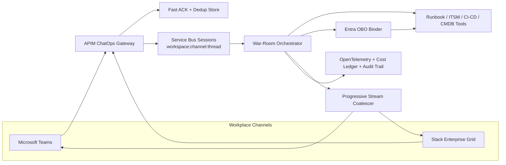
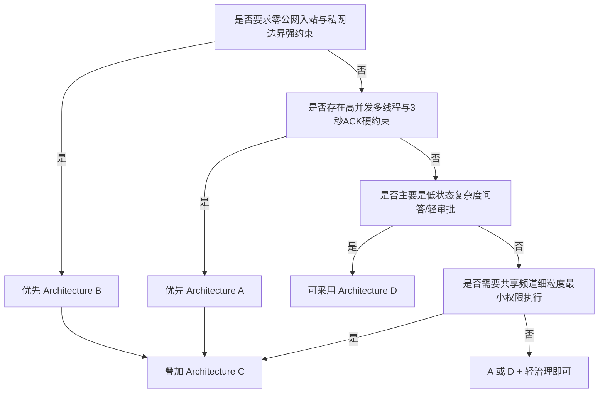

# 企业跨平台 ChatOps 战情室智能体编排选型 FAQ：M365 Agents SDK + Teams Graph RSC vs Slack Events/Socket Mode vs APIM+Service Bus 归一化总线

> 🌐 **Language Switch**：**中文（当前）** | [English](./enterprise-chatops-warroom-agent-m365-agents-sdk-teams-rsc-vs-slack-socket-events-apim-vs-unified-bus-selection-faq.en.md)
> **受众**：Cloud & AI Solution Architect、企业协作平台负责人、SecOps/ITSM 战情室负责人、零信任身份治理团队、平台 SRE 与 FinOps 团队。
> **范围**：面向 Teams 与 Slack 并存的大型企业，给出多用户战情室 Agent 的接入、线程归一化、权限隔离、低时延回写、审计留痕与三年 TCO 选型方法，覆盖 `M365 Agents SDK`、Graph RSC、Slack Events API/Socket Mode、APIM 网关、Service Bus Sessions、Entra OBO 与原生 SaaS 低代码扩展面。

## 1. 问题定义：为什么企业 War-Room ChatOps 在跨平台时代会从“机器人接入”演化为“实时控制平面工程”
当企业仅在单一协作平台上部署轻量问答机器人时，渠道接入通常只是 Webhook 注册与消息回发问题，但一旦业务进入跨 Teams 与 Slack 的多区域协作并引入自动化处置动作，系统就不再是“聊天机器人”而是“多主体协同控制平面”，因为每条线程都承载可执行决策、审批语义、身份边界和审计责任。  
在 Sev1 级战情室中，消息流具有高突发、高并发和高敏感三重特征，若平台无法在 `3,000ms` 内完成 Slack 回调确认、无法在 Teams/Slack 的编辑频控窗口内稳定推送增量、无法把执行权限绑定到真实发起人而不是 Bot 自身，就会出现重复触发、状态漂移和越权执行，最终把协作系统变成放大故障的二次风险源。  
因此架构师必须把 ChatOps 选型目标从“谁接得更快”升级为“谁能在时延、权限、幂等、审计、成本五个维度同时满足生产约束”，并明确区分面向个人生产力的原生 AI 助手与面向多人战情室的状态化编排系统。  

## 2. 四种架构模式（A/B/C/D）与职责边界
**Architecture A（统一双通道 ChatOps Gateway）**：APIM 负责入站验签、`<200ms` 快速 ACK、重试去重与速率护栏，Service Bus Sessions 负责线程级有序状态机，流式输出经 `500–800ms` 自适应分块合并后回写 Teams/Slack。  
**Architecture B（零入站私网化 Socket/Outbound 模式）**：Slack 采用 Socket Mode 主动长连拉取事件，Teams 通过 Bot Service/Graph 出站模式接入，工作负载运行在 ACA/AKS 私网，避免公网入站暴露并提升受监管区域合规可落地性。  
**Architecture C（共享频道权限隔离与反混淆代理）**：Graph RSC 仅授予最小读上下文权限，真正写操作使用“发起人绑定 Entra OBO”令牌执行，Adaptive Card Universal Action/Slack Modal 作为高风险动作二次签名确认。  
**Architecture D（原生 SaaS Declarative Surface）**：M365 Copilot Declarative Agent 与 Slack AI/Workflow Builder 适合低复杂度个人/团队问答与轻流程自动化，但在跨线程状态机、复杂补偿、细粒度归因审计上通常需与 A/C 组合。  

## 3. 端到端参考架构：双平台消息入口、归一化总线、线程状态机与执行平面解耦


该架构的核心价值是把“入站可靠性、线程一致性、权限正确性、回写节流”拆成独立可治理组件，避免将所有职责压在单一 Bot 进程内导致单点复杂度失控。  
统一总线层把 Teams 与 Slack 的事件差异抽象为同一线程语义，从而让上层编排器只关注状态迁移与动作策略，而不必在每个业务流程里重复处理渠道协议差异。  

## 4. Architecture A 详解：APIM 验签快回 + Session 总线归一化 + 流式合并回写
Architecture A 的第一关键控制是“入站秒级可靠确认”，因为 Slack Events API 明确存在 `3,000ms` 超时窗口，若超时未确认即触发重试并附带 `X-Slack-Retry-Num`，在高峰故障会话中会形成指数级重复事件风暴。  
建议在 APIM 入站层完成签名校验、时间戳漂移校验、幂等键提取和最小事件落盘，并在 `50–200ms` 内返回确认，然后把完整处理异步化到 Session 总线，这种“先确认再处理”的分层模式可以把渠道 SLA 风险与业务处理时延解耦。  
第二关键控制是“线程有序一致性”，建议以 `workspace:channel:thread_ts`（Slack）和 `tenant:team:channel:rootMessageId`（Teams）映射为统一 Session Key，确保同线程事件单分区有序，跨线程并行。  
第三关键控制是“编辑限频自适应合并”，由于平台写回频率在高并发战情室容易触达 `429`，必须将 LLM token 流压缩为 `500–800ms` 窗口块并按优先级（告警摘要 > 进度碎片）回写，以减少编辑频率且保持可读性。  
第四关键控制是“卡片负载裁剪”，对于 `28KB/40KB` 负载上限约束，建议正文留结构化摘要并把长附件落 Blob 后返回带签名短链，防止渠道层因大 payload 失败导致线程状态缺口。  

## 5. Architecture B 详解：Socket Mode/私网出站池与无公网入站策略
在金融、国防、主权行业，公开 Webhook 往往被安全基线直接限制，因此 Architecture B 通过 Socket Mode 与私网出站模型实现“零公网入站”目标，并将连接维持、重连排空、租户隔离纳入基础能力。  
Slack 侧采用多连接分片模式，按 workspace 分桶绑定 worker，连接中断时先冻结新任务分发、等待 in-flight 事件完成，再进行平滑重连，避免同一线程在重连窗口被不同实例重复消费。  
Teams 侧可通过 Bot Service 出站与 Private Endpoint 控制路径，将命令入口纳入受控出口网段与证书策略，结合 NAC 与 egress firewall 形成可审计的网络最小面。  
该模式的代价是连接治理复杂度上升，包括心跳抖动、连接池容量、跨区故障转移与证书轮换操作成本，但换来的收益是显著降低外部扫描与回调劫持面。  
对跨区域双活部署，建议执行“区域内活跃、跨区热备”而非双主抢占，以避免 Socket 会话跨区并发消费导致顺序破坏与去重状态竞争。  

## 6. Architecture C 详解：共享频道最小权限执行与反混淆代理防线
共享战情室最常见风险是“低权限成员发起高影响动作”，如果系统直接用 Bot 的高权限令牌执行变更，将形成典型 confused-deputy 漏洞，即执行者与发起者身份脱钩。  
Architecture C 要求所有变更类动作绑定真实发起人身份，使用 Entra OBO 将用户上下文转换为短时可审计令牌，并在执行前检查用户 RBAC、工单状态、变更窗口和环境策略。  
Graph RSC 仅用于读取频道上下文与必要元数据，禁止将 RSC 读取权限隐式提升为执行权限，任何写操作必须走显式 Step-Up 流程并记录动作签名。  
Adaptive Card Universal Action 与 Slack Modal 可作为二次确认界面，提交时携带不可篡改上下文摘要（线程 ID、目标系统、影响范围、审批号），防止复制粘贴旧卡片造成重放执行。  
在审计层面需保证“谁请求、谁审批、谁执行、执行结果”四链可串联，否则即便技术上做了 OBO，仍无法在事后证明权限路径正确。  

## 7. Architecture D 详解：原生 M365/Slack AI 声明式扩展面的优势与边界
原生声明式扩展的优势在于部署速度快、学习成本低、生态连接器丰富，特别适合标准化 FAQ、轻审批提醒、固定字段收集等低状态复杂度场景。  
但在多线程并发编排、跨系统补偿事务、细粒度身份委托和多级成本分摊方面，原生扩展通常缺乏统一控制平面，导致“功能可做但不可运维”。  
因此更现实的企业策略不是二选一，而是将 D 作为“前台高频轻任务入口”，把高风险与高状态复杂度动作下沉到 A/C 控制平面执行，从而兼顾上线速度与治理强度。  
若组织已大量投入 M365 Copilot 或 Slack Workflow Builder，可优先保留用户交互层并逐步外接统一执行总线，降低迁移阻力并实现平滑演进。  

## 8. 12 维对比矩阵：时延、权限、可观测、TCO 与运维复杂度
| 维度 | Architecture A | Architecture B | Architecture C | Architecture D |
|---|---|---|---|---|
| 入口 SLA 适配 | 强（APIM 快回） | 强（Socket 主动拉取） | 中（依赖 A/B） | 弱到中 |
| 零入站可行性 | 中 | 很强 | 中 | 平台相关 |
| 线程有序一致性 | 强（Session） | 强（分片会话） | 中 | 弱 |
| 共享频道权限隔离 | 中 | 中 | 很强（OBO） | 弱到中 |
| 429 节流治理 | 强（统一合并） | 强（连接层+合并） | 中 | 弱 |
| 多租户隔离 | 强 | 很强 | 强 | 中 |
| 变更审计可追溯 | 强 | 强 | 很强 | 中 |
| 事件去重抗重放 | 强 | 强 | 强 | 中 |
| 平台锁定风险 | 中 | 中 | 中 | 高 |
| 初始交付速度 | 中 | 中偏慢 | 中 | 很快 |
| 运维复杂度 | 中 | 高 | 高 | 低 |
| 三年风险调整后经济性 | 高 | 中高 | 高 | 中 |

## 9. 关键数学：Webhook 超时、编辑节流与线程并发容量
设并发战情室线程数为 `N`，每线程平均编辑速率为 `r`（次/秒），平台允许桶速率为 `B`（次/秒），则系统理论超载比为 `ρ = (N * r) / B`，当 `ρ > 1` 时进入稳定 `429` 区间。  
例如 `N=220`、`r=1.2`、`B=180` 时，`ρ=1.47`，若无合并器将持续触发限流并导致状态延迟扩散；当采用 `600ms` 聚合窗口并将平均编辑速率降至 `0.42`，则 `ρ≈0.51`，系统回到稳定区间。  
对于 Slack 入站确认，设验签与去重落盘时延为 `t_verify + t_dedup`，必须满足 `t_verify + t_dedup + t_margin < 3000ms`，实践上应把目标压到 `<200ms` 以覆盖网络抖动和偶发峰值。  
线程容量规划可按 `Qps_thread = events_per_thread * active_threads` 估算并映射到 Session 分区数，建议分区数至少为峰值活跃线程数的 `1.2–1.5x` 以降低热点碰撞。  

## 10. 选型决策树：先判监管边界，再判并发与权限复杂度


该决策树强调“监管与权限边界优先于功能清单”，因为错误的安全边界选择会在后期造成高额重构成本，而 UI 层能力可通过渐进接入逐步补齐。  

## 11. 生产配置片段一：APIM Slack 验签 + `<50ms` 快速 ACK + 去重键提取策略
```xml
<policies>
  <inbound>
    <base />
    <set-variable name="ts" value="@(context.Request.Headers.GetValueOrDefault("X-Slack-Request-Timestamp","0"))" />
    <set-variable name="sig" value="@(context.Request.Headers.GetValueOrDefault("X-Slack-Signature",""))" />
    <set-variable name="rawBody" value="@(context.Request.Body.As<string>(preserveContent:true))" />
    <set-variable name="basestring" value="@($"v0:{context.Variables["ts"]}:{context.Variables["rawBody"]}")" />
    <set-variable name="computed"
      value="@{
        var secret = context.Vault.GetSecret("slack-signing-secret");
        var data = System.Text.Encoding.UTF8.GetBytes((string)context.Variables["basestring"]);
        var key = System.Text.Encoding.UTF8.GetBytes(secret);
        using (var h = new System.Security.Cryptography.HMACSHA256(key)) {
          return "v0=" + BitConverter.ToString(h.ComputeHash(data)).Replace("-","").ToLowerInvariant();
        }
      }" />
    <choose>
      <when condition="@(!((string)context.Variables["computed"]).Equals((string)context.Variables["sig"], StringComparison.Ordinal))">
        <return-response>
          <set-status code="401" reason="invalid_signature" />
        </return-response>
      </when>
    </choose>
    <set-header name="x-dedup-key" exists-action="override">
      <value>@($"{context.Request.Headers.GetValueOrDefault("X-Slack-Request-Id","na")}:{context.Request.Headers.GetValueOrDefault("X-Slack-Retry-Num","0")}")</value>
    </set-header>
    <return-response>
      <set-status code="200" reason="ok" />
      <set-body>{"ack":"accepted","mode":"async"}</set-body>
    </return-response>
  </inbound>
  <backend><base /></backend>
  <outbound><base /></outbound>
  <on-error><base /></on-error>
</policies>
```

该策略展示了“入口验证后立即确认”的关键路径，生产环境应把完整事件通过异步后端或 Event Hub/Service Bus 传递，并在去重存储中保留请求指纹和重试序号。  

## 12. 生产配置片段二：Python 统一线程合并器 + 发起人 OBO 绑定器
```python
import asyncio
import time
from dataclasses import dataclass
from collections import defaultdict

WINDOW_MS = 650
MAX_CARD_BYTES = 28 * 1024

@dataclass
class Chunk:
    tenant: str
    workspace: str
    channel: str
    thread_id: str
    actor_oid: str
    text: str
    ts: float

class ThreadCoalescer:
    def __init__(self):
        self.buffers = defaultdict(list)
        self.last_flush = defaultdict(float)

    async def add(self, chunk: Chunk):
        key = f"{chunk.workspace}:{chunk.channel}:{chunk.thread_id}"
        self.buffers[key].append(chunk)
        now = time.time() * 1000
        if now - self.last_flush[key] >= WINDOW_MS:
            await self.flush(key)

    async def flush(self, key: str):
        chunks = self.buffers[key]
        if not chunks:
            return
        merged = " ".join(c.text for c in chunks)
        payload = merged.encode("utf-8")
        if len(payload) > MAX_CARD_BYTES:
            merged = merged[:4000] + " ...[truncated->blob-link]"
        actor = chunks[-1].actor_oid
        token = await acquire_obo_token(actor)  # issuer=Entra, audience=tool-api
        await execute_with_actor_token(token, merged)
        self.buffers[key].clear()
        self.last_flush[key] = time.time() * 1000

async def acquire_obo_token(actor_oid: str) -> str:
    # 调用 Entra OBO exchange，绑定真实发起人而非 bot 身份
    await asyncio.sleep(0)
    return f"obo_token_for_{actor_oid}"

async def execute_with_actor_token(token: str, merged_text: str):
    # 调用 ITSM/Runbook 变更 API，并写入审计账本
    await asyncio.sleep(0)
```

该实现强调“线程级聚合 + 发起人令牌绑定”是同一条控制链，缺失任一环都会让系统在高并发和高权限场景下产生不可接受的治理漏洞。  

## 13. 企业场景一：全球制造业 Sev1 战情室（Teams+Slack 并存）
该企业在北美使用 Slack、在欧洲与亚太使用 Teams，Sev1 故障时会形成 `150–300` 并发线程，且需要跨区域值班团队共同协作。  
上线前主要问题是 Slack 重试风暴导致重复工单、Teams 频繁编辑触发 `429`、以及 Bot 统一高权限执行引发审计争议。  
采用 A+C 组合后，入站 ACK 与异步处理解耦、线程会话有序执行、变更动作改为 OBO 绑定，三个月内重复工单率和越权告警显著下降，并把事故复盘证据生成时间从小时级压缩到分钟级。  

## 14. 企业场景二：金融行业零入站监管区（私网 Socket Mode）
该组织要求业务区零公网入站，所有协作自动化必须通过受控出站网络访问外部服务，且每个高风险动作需要双人审批与可追溯身份链。  
采用 B+C 组合后，Slack 事件通过 Socket Mode 拉取并在私网池处理，Teams 侧出站接入保持内网边界，所有执行动作经 OBO 与二次确认卡片绑定审批号。  
该方案牺牲了部分运维简洁性，但满足监管对网络边界与最小权限的硬性要求，并在年度审计中提供了可机读的审批与执行关联证据。  

## 15. 三年 TCO：`50/200/600` 活跃战情室规模对比（含风险调整）
| 成本项（3 年） | Architecture A | Architecture B | Architecture C | Architecture D |
|---|---:|---:|---:|---:|
| 平台基础设施 | `$0.82M` | `$1.05M` | `$0.64M` | `$0.39M` |
| 运维与值班人力 | `$0.71M` | `$0.93M` | `$0.78M` | `$0.42M` |
| 安全与审计实施 | `$0.33M` | `$0.41M` | `$0.52M` | `$0.18M` |
| 事故期重复执行损失暴露 | 低 | 低 | 很低 | 中高 |
| 三年风险调整后综合经济性 | 高 | 中高 | 高 | 中 |

从直接成本看 D 最便宜，但在多线程高风险战情室下，重复执行和权限误用带来的隐性成本会显著吞噬其账面优势；A/C 的风险调整后收益通常更优，B 适合有强监管网络边界要求的行业。  

### 15.2 定量 Q&A（6 项）
**Q1：Slack `3,000ms` 窗口下，为什么要把 ACK 压到 `<200ms`？**  
因为签名校验、网络抖动、网关排队和瞬时 GC 都会叠加尾时延，若目标只设在 `1,000ms` 以上会在峰值时快速逼近超时边界并触发重试风暴。  

**Q2：为何推荐 `500–800ms` 流式合并窗口？**  
该区间在可读性与频控之间平衡较好，通常能把 `1.2 edits/s` 降到 `0.35–0.5 edits/s`，显著降低 `429` 同时保持用户感知实时性。  

**Q3：线程 Session Key 的最小推荐粒度是什么？**  
应至少包含 workspace/channel/thread 三元组，跨租户场景再加 tenant 维度，避免同名频道或迁移场景导致状态混线。  

**Q4：为什么 Bot 高权限执行不可接受？**  
因为它破坏“请求者即责任者”原则，无法证明谁真正发起高风险动作，且在共享频道下会把低权限成员输入升级为高权限执行。  

**Q5：Socket Mode 的主要运维代价在哪里？**  
在连接生命周期管理、分片策略、重连排空与跨区漂移控制，特别是高并发时的连接热键和重复消费抑制。  

**Q6：何时可以只用原生 D 模式？**  
当流程为低风险、低并发、低状态复杂度且无需跨平台一致审计时可采用 D；一旦进入多线程战情室与变更执行，应至少引入 A 或 C。  

### 15.3 Day-0 上线清单
- 建立 Teams/Slack 事件模型映射表与统一线程主键规范。  
- 完成 APIM 入站验签、重试去重与快速 ACK 策略压测。  
- 配置 Service Bus Sessions 分区与死信队列告警阈值。  
- 实施 OBO 令牌交换与最小权限工具调用策略。  
- 定义高风险动作二次确认卡片模板与审批字段。  
- 建立 `429`、重试率、线程延迟、重复执行率四类核心指标。  

### 15.4 Day-2 运营清单
- 每周核对平台限频策略变化并回归流式合并参数。  
- 每周抽样核验“请求者-审批者-执行者”链路完整性。  
- 每月进行 Socket 断连与跨区故障演练，验证无重复消费。  
- 每月复核线程热点分布并调整 Session 分区容量。  
- 每季度复盘战情室重大事件中的误触发与补偿成功率。  
- 每季度更新三年 TCO 参数与风险调整假设。  

### 15.5 Good fit vs Not for
| 结论 | 说明 |
|---|---|
| ✅ Good fit | 需要跨 Teams/Slack 协同、具备高并发战情室线程、必须执行可审计变更动作、并要求最小权限与幂等补偿的企业。 |
| ⛔ Not for | 仅做低风险个人问答、无线程状态一致性要求、无跨平台协作、且无严格审计与权限链路要求的轻量场景。 |

### 15.6 战情室治理 SLO 与告警矩阵（建议基线）
在跨平台战情室中，技术问题通常不是“是否能发出消息”，而是“是否能在高压故障时把消息、权限、执行和审计绑定成稳定闭环”，因此需要把入站、执行、回写、审批四条链路纳入同一 SLO 体系并做分层告警。  
推荐把核心告警从“单次错误”升级为“短窗口趋势”，例如连续 `5` 分钟 ACK P95 上升、连续 `3` 个窗口重复执行率上扬、或 OBO 绑定缺失比例突破阈值，避免短时毛刺引发无效 Pager 疲劳。  

| 指标域 | 目标值（建议） | 告警阈值（建议） | 处置动作（建议） |
|---|---:|---:|---|
| 入站 ACK P95 | `<200ms` | `>350ms` 持续 `5` 分钟 | 降级非关键流式回写、优先保留 ACK 通道、扩容 APIM 后端池 |
| Slack 重试放大比 | `<1.08x` | `>1.20x` 持续 `10` 分钟 | 复核 HMAC 失败分布、检查重试去重键冲突、拉升缓存 TTL |
| 编辑节流命中率（429） | `<2%` | `>5%` 持续 `10` 分钟 | 调整 `500–800ms` 合并窗、按线程热度分层回写频率 |
| OBO 绑定完整率 | `100%` | `<99.9%` 任一窗口 | 阻断高风险动作、回退到只读响应并触发人工审核 |
| 重复执行率 | `<0.2%` | `>0.5%` 持续 `15` 分钟 | 启用幂等补偿、检查 Session 分区热点、重建去重索引 |

### 15.7 渐进式落地里程碑（0–90 天）
第一阶段应优先达成“可控入口 + 可追踪执行”，即先上线 A 的快回去重链路与 C 的发起人 OBO 绑定，把最危险的重复执行和越权执行风险先压住，再逐步引入私网化与复杂治理策略。  
第二阶段聚焦“稳定吞吐 + 低噪声运营”，把线程热度、编辑节流、Socket 重连与补偿成功率纳入统一看板，并通过周度回归把参数调优沉淀为可复用 Runbook，而不是依赖值班工程师个人经验。  
第三阶段进入“审计证据产品化”，把审批卡片、执行请求、结果摘要、回放快照与留痕哈希统一归档，确保每次重大战情室事件都能在审计窗口内快速形成结构化证据包。  

1. **Day 0–14（控制面打底）**：完成统一事件模型、线程主键规范、APIM 快回策略、Service Bus Session 分区与 OBO 强制绑定。  
2. **Day 15–45（吞吐与稳定性）**：上线自适应流式合并、节流回退策略、幂等补偿流水线，并完成跨平台双活演练。  
3. **Day 46–90（治理与审计）**：沉淀证据标准、建立季度演练制度、将风险调整 TCO 与运维 KPI 绑定到管理报表。  

### 15.8 生产运行手册样例（War-Room Governance Runbook）
```yaml
runbook:
  name: warroom-chatops-governance
  version: "2026-11"
  channels:
    - teams
    - slack
  ingress:
    ack_slo_ms_p95: 200
    dedup_ttl_seconds: 900
    signature_validation: required
  thread_normalization:
    key_template: "{tenant}:{workspace}:{channel}:{thread}"
    session_lock_timeout_seconds: 25
    hot_thread_alert_threshold: 200
  authorization:
    mode: invoker_obo_required
    deny_on_missing_actor: true
    step_up_required_for:
      - change_approval
      - production_restart
      - incident_severity_raise
  streaming:
    coalescing_window_ms:
      min: 500
      max: 800
    edit_rate_cap_hz: 0.8
  resiliency:
    socket_reconnect_backoff_seconds:
      - 1
      - 2
      - 5
      - 10
    duplicate_execution_compensation: enabled
  observability:
    dashboards:
      - warroom-ingress-slo
      - warroom-auth-lineage
      - warroom-thread-hotspots
    alerts:
      - ack_latency_breach
      - retry_amplification
      - obo_binding_gap
      - duplicate_execution_ratio
```

### 15.9 结论与推荐组合
最终建议：把 **A 作为跨平台可靠入口基线**、把 **C 作为共享频道权限与审计刚性控制**、在受监管区域叠加 **B**、将 **D** 定位为前台轻流程入口而非核心执行平面，这种组合通常能在可靠性、安全性与长期成本之间取得最佳平衡。  
对于跨区域、多团队、强审计企业，最佳实践不是追求单一“最省钱”架构，而是建立“入口可靠性、执行最小权限、证据可回放、成本可调优”的组合式控制面，并通过季度演练验证其在真实故障高压下仍可稳定运行。  
