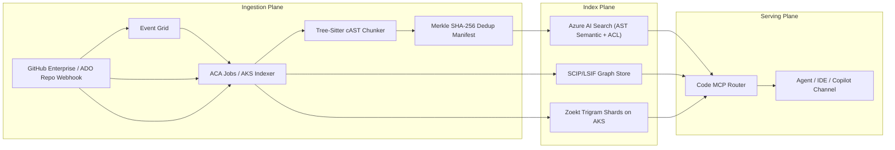
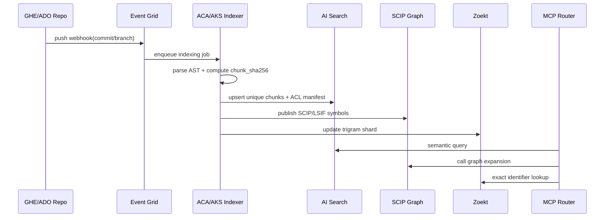
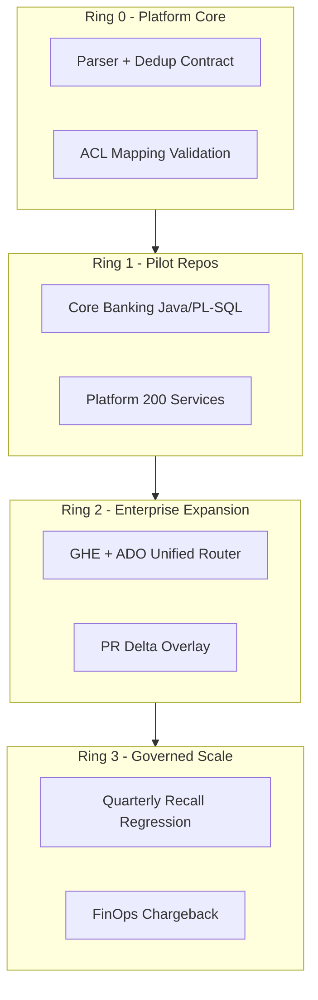

# Enterprise Codebase Intelligence RAG Selection FAQ: Tree-Sitter AST + Merkle-Deduplicated AI Search vs SCIP/LSIF Call Graph vs Zoekt Trigram vs Tri-Modal Code MCP Router

> 🌐 **Language Switch**: [中文](./enterprise-codebase-rag-tree-sitter-ast-merkle-sync-ai-search-vs-scip-call-graph-vs-zoekt-trigram-mcp-selection-faq.md) | **English (current)**
> **Audience**: Cloud & AI Solution Architects, platform engineering leads, developer-experience owners, enterprise search teams, and modernization program owners.
> **Scope**: Production architecture for `10M–150M+` LOC enterprise portfolios across GitHub Enterprise Cloud / Server and Azure DevOps Repos, including retrieval quality, freshness SLA, ACL trimming, and 3-year TCO.

## 1. Why naïve 512-token chunking breaks in enterprise codebases
Code is not continuous prose, and fixed token windows split methods in the middle of signatures, remove import and namespace context, and often drop the symbol boundary that actually disambiguates behavior for an LLM response path.
When teams run dozens of active branches, naïve pipelines re-embed almost identical files repeatedly, so vector and storage spend scales with branch count instead of logical code change and can waste `10x–40x` budget with no quality gain.
Dense embeddings alone are weak for exact identifiers and stack traces, so queries such as `ERR_LEDGER_4091`, `tenant.rls.policy`, or `BillingRetryTimeoutException` are frequently outperformed by lexical trigram or compiler-indexed symbol retrieval.
The architectural objective is therefore not “store source in vectors,” but to align retrieval with language structure, repository topology, and enterprise access boundaries so downstream agent answers remain reliable under scale.

## 2. Four architecture families and role separation
**Architecture A** applies Tree-Sitter cAST boundary chunking with Merkle `chunk_sha256` deduplication, stores unique content in Azure AI Search, and keeps branch or commit visibility in side manifests.
**Architecture B** builds SCIP/LSIF graphs in CI, exposing deterministic `FindReferences`, `GoToDefinition`, and `ImpactRadius` semantics for cross-repository dependency reasoning.
**Architecture C** deploys Zoekt trigram shards on AKS with local NVMe, delivering ultra-fast exact identifier and regex retrieval for high-QPS debugging and migration tasks.
**Architecture D** routes requests by intent across A/B/C and overlays unmerged PR deltas, producing a unified enterprise MCP entry point instead of forcing teams to choose one retrieval backend for all workloads.

## 3. End-to-end reference architecture with three retrieval planes

This architecture keeps ingestion, indexing, and query orchestration decoupled so each plane can scale and fail independently, which is essential when enterprises combine legacy repositories, high-change monorepos, and strict compliance constraints.
The MCP router becomes the contract boundary where intent classification, fallback strategy, confidence ordering, deduplication, and ACL-safe fusion are enforced consistently for all channels.
By separating unique content indexing from branch visibility metadata, teams can keep storage and embedding cost proportional to change volume rather than branch volume, while still answering branch-specific questions correctly.
A minimal shared key set should include `repo_id`, `path`, `branch_ref`, `commit_sha`, and `acl_scope`, otherwise cross-plane joins and provenance tracing become operationally fragile.

## 4. Architecture A: Tree-Sitter AST + Merkle dedup + Azure AI Search
Architecture A splits at symbol-level boundaries and injects scope headers such as repository, path, symbol, and language context so semantic retrieval receives complete units instead of fragmented snippets.
The dedup model stores each unique chunk once and maps visibility through branch or commit bitmaps, which provides major cost and performance leverage in organizations that keep many long-lived integration branches.
Because ACL metadata is attached to chunk visibility manifests, query-time filtering can enforce team or tenant boundaries before response synthesis, reducing the chance of cross-project evidence leakage.
A is strongest for semantic and architectural Q&A but is not a complete replacement for compiler-grade dependency tracing, so it should be paired with B when refactoring and impact radius are first-class requirements.

## 5. Architecture B: SCIP/LSIF compiler-accurate symbol and call-graph plane
Architecture B converts build-time semantic artifacts into a queryable dependency graph that can answer “who calls this API,” “which services implement this interface,” and “what is the blast radius of this schema change” with deterministic semantics.
In modernization programs, this graph plane is often the only trustworthy source for cross-repository impact analysis, because textual similarity cannot reliably infer interface implementation edges or transitive call chains.
B is particularly valuable for regulated enterprises where change approval requires explicit evidence for affected systems, since graph traversals can be reproduced and audited from versioned index artifacts.
Its trade-off is operational complexity in CI integration and language indexer maintenance, which must be planned as platform investment rather than treated as a one-time migration task.

## 6. Architecture C: Zoekt trigram lexical plane on AKS
Architecture C is optimized for exact search workloads including stack traces, feature flags, migration markers, legacy constants, and security signatures where lexical precision dominates semantic approximation.
With trigram posting lists and local NVMe shards, Zoekt can sustain very high QPS and low latency under broad repository footprints while preserving transparent, explainable matching behavior for engineers and auditors.
C also provides a practical resilience path when embedding pipelines are delayed or degraded, because lexical retrieval can continue serving deterministic evidence for critical troubleshooting workflows.
C is not intended to answer broad conceptual architecture questions alone, so routing logic should explicitly classify query intent and avoid forcing lexical engines to emulate semantic reasoning.

## 7. Architecture D: tri-modal router with PR delta overlay
Architecture D routes conceptual questions to A, exact-token and regex requests to C, and dependency or impact requests to B, then merges and ranks evidence with confidence and freshness signals.
For release windows and code reviews, D overlays `git diff base..HEAD` evidence over baseline indices so agent answers remain aligned to pending changes instead of stale `main` state.
This approach gives users one channel and one mental model, while allowing platform teams to improve each backend independently and roll out routing updates through measurable policies.
The critical success factor is observability of route decisions and regression testing of routing policy changes, because silent route drift can degrade quality without obvious infrastructure failures.

## 8. Twelve-dimension head-to-head matrix
| Dimension | A: AST + Merkle + AI Search | B: SCIP/LSIF Graph | C: Zoekt Trigram | D: Tri-Modal Router |
|---|---|---|---|---|
| Conceptual architecture Q&A | High | Medium | Low | High |
| Exact identifier recall | Medium | High | Very high | Very high |
| Cross-repo call-chain reliability | Medium | Very high | Low | Very high |
| Build pipeline complexity | Medium | High | Medium | High |
| Query latency ceiling | Medium | Medium | Very high | Medium to high |
| Multi-branch dedup efficiency | Very high | Medium | Low | High |
| Freshness control | High | Medium to high | High | High |
| ACL security trimming | High | Medium | Medium | High |
| Operational burden | Medium | High | Medium | High |
| Language ecosystem flexibility | High | Medium | High | High |
| Single-plane failure blast radius | Medium | Medium | Medium | Low |
| Best-fit adoption phase | Semantic foundation + cost control | Dependency governance | Fast exact lookup | Enterprise unified entry |

## 9. Quantitative sizing and retrieval formulas
For multi-repo, multi-branch dedup planning, a practical approximation is `UniqueChunks ≈ R * B * F * (1 - (1-δ)^B)`, where `R` is repo count, `B` active branches, `F` chunks per repo, and `δ` changed-file ratio per branch window.
Embedding spend can be normalized as `Cost_embed = UniqueTokens / 1000 * price_per_1K`, so reducing `UniqueTokens` through content-addressable dedup directly converts into budget released for evaluation and governance.
Zoekt capacity planning can use `IndexSize ≈ RawSource * α` with `α` typically in the `2.5x–3.5x` range, then multiplied by shard replication policy and retention windows.
Freshness can be decomposed as `Freshness = T_webhook + T_queue + T_parse + T_index_commit`; hitting `<15s` at P95 requires queue discipline and incremental indexing discipline as much as parser performance.
Quality should be tracked by task family, for example `Recall@10_id`, `Recall@10_sem`, and `Recall@10_call`, because a single composite metric can hide severe blind spots in one query class.
Routing gain can be modeled as `Gain = w1*Recall_id + w2*Recall_sem + w3*Recall_call - λ*Latency`, with weights mapped to business priorities instead of generic benchmark averages.

## 10. Timeline from commit event to query-ready evidence

Parallel updates across all planes are key to minimizing version skew between semantic, lexical, and symbol evidence during high-velocity release periods.
Batching frequent micro-commits into bounded indexing windows can improve throughput without violating freshness SLA, provided the queue and replay policy are explicitly controlled.
When one plane is unavailable, the router should surface explicit degradation metadata instead of silently over-confident answers, so users and downstream evaluators can reason about confidence and risk.
Centralized telemetry for queue delay, parse duration, index commit latency, and route confidence makes SLO operations practical at enterprise scale.

## 11. Enterprise rollout topology and ring-based adoption

Ringed rollout avoids the common failure mode where organizations expand quickly before ACL, parser contracts, and quality baselines are stable, which creates broad trust debt and rollback pressure.
A practical gate can be represented as `Gate_n = (freshness_p95 <= 15s) ∧ (acl_leak_incident = 0) ∧ (recall_call >= target)`, and progression should require consecutive healthy windows, not single-day spikes.
Unified routing over mixed GitHub and Azure DevOps estates reduces user cognitive load and training friction while centralizing governance instrumentation.
Every ring expansion should include a tested rollback and replay playbook so index or router regressions can be contained without long service interruption.

## 12. Production configuration samples: Zoekt on AKS and Event Grid ingestion
```yaml
apiVersion: apps/v1
kind: StatefulSet
metadata:
  name: zoekt-index
spec:
  serviceName: zoekt-index
  replicas: 6
  selector:
    matchLabels:
      app: zoekt-index
  template:
    metadata:
      labels:
        app: zoekt-index
    spec:
      nodeSelector:
        sku: lsv3
      containers:
        - name: zoekt
          image: ghcr.io/sourcegraph/zoekt-indexserver:latest
          args: ["-index", "/data/index", "-repo-cache", "/data/repos", "-listen", ":6072"]
          volumeMounts:
            - name: nvme
              mountPath: /data
  volumeClaimTemplates:
    - metadata:
        name: nvme
      spec:
        accessModes: ["ReadWriteOnce"]
        resources:
          requests:
            storage: 2048Gi
```
```bicep
resource topic 'Microsoft.EventGrid/topics@2022-06-15' = {
  name: 'code-index-webhook-topic'
  location: resourceGroup().location
  sku: { name: 'Standard' }
}

resource sub 'Microsoft.EventGrid/topics/eventSubscriptions@2022-06-15' = {
  name: 'code-index-subscription'
  parent: topic
  properties: {
    destination: {
      endpointType: 'WebHook'
      properties: {
        endpointUrl: 'https://indexer.internal/api/webhook'
      }
    }
    filter: {
      includedEventTypes: [
        'Microsoft.Storage.BlobCreated'
      ]
    }
  }
}
```
This pattern keeps lexical indexing horizontally scalable and independently deployable, while event-driven ingestion controls update fan-out and replay behavior.
Production clusters should use anti-affinity and availability-zone spread to avoid correlated shard impact during node faults.
Event delivery should include retry and dead-letter handling so temporary webhook failures do not become silent freshness regressions.
Release metadata should include image versions, index schema hashes, and parser contract versions for forensic traceability.

## 13. Production code sample: Tree-Sitter scope chunking and Merkle manifests
```python
from __future__ import annotations

import hashlib
from dataclasses import dataclass
from typing import Iterable, List, Dict


@dataclass
class Chunk:
    repo: str
    path: str
    symbol: str
    branch: str
    commit: str
    text: str

    @property
    def sha256(self) -> str:
        return hashlib.sha256(self.text.encode("utf-8")).hexdigest()


def scope_header(repo: str, path: str, symbol: str, language: str) -> str:
    return f"[repo={repo}] [path={path}] [symbol={symbol}] [lang={language}]"


def make_chunk(repo: str, path: str, symbol: str, language: str, body: str, branch: str, commit: str) -> Chunk:
    enriched = scope_header(repo, path, symbol, language) + "\n" + body
    return Chunk(repo=repo, path=path, symbol=symbol, branch=branch, commit=commit, text=enriched)


def dedup_manifest(chunks: Iterable[Chunk]) -> Dict[str, List[Dict[str, str]]]:
    manifest: Dict[str, List[Dict[str, str]]] = {}
    for c in chunks:
        manifest.setdefault(c.sha256, []).append(
            {"repo": c.repo, "path": c.path, "branch": c.branch, "commit": c.commit, "symbol": c.symbol}
        )
    return manifest
```
The core principle is separating content identity from version visibility, which allows unique-content indexing while preserving branch-specific provenance for query-time filtering.
In production, manifest storage is typically persisted in Blob or Cosmos, while search documents remain deduplicated in AI Search for cost and latency efficiency.
For very large repositories, file-level prefilters and parser cache layers are required to keep incremental indexing within SLA under high commit rates.
Regression packs must validate parser upgrades against symbol-boundary stability to prevent silent drift in chunk quality.

## 14. Enterprise scenarios and 3-year TCO comparison
### Scenario A: Fortune 500 core-banking `80M` LOC Java and PL-SQL modernization
This scenario requires deterministic impact analysis for change approval and rapid incident root-cause navigation, making B and C foundational while A provides semantic explanation and architectural summarization for agent channels.
When modernization and incident workflows share one query experience through D, platform teams can reduce context-switch overhead and improve adoption among engineers who do not want to manage backend-specific tooling.

### Scenario B: `1,200` microservice platform API migration
Large migration windows produce heavy branch churn and frequent partial merges, so A’s dedup model controls indexing spend while D’s delta overlay keeps answers aligned with in-flight branch reality.
C remains crucial for exact rename, feature-flag, and configuration-key trace tasks where lexical certainty matters more than semantic approximation.

### Three-year TCO model (example, USD)
| Cost item | A: AST+Merkle+AI Search | B: SCIP/LSIF Graph | C: Zoekt on AKS | D: Tri-Modal Router |
|---|---:|---:|---:|---:|
| Initial build (Year 0) | 420,000 | 560,000 | 380,000 | 470,000 |
| Annual run cost (Year 1–3) | 250,000/year | 290,000/year | 240,000/year | 300,000/year |
| Three-year total cost | 1,170,000 | 1,430,000 | 1,100,000 | 1,370,000 |
| Three-year productivity gain estimate | 2,350,000 | 2,700,000 | 2,050,000 | 2,980,000 |
| Three-year net value | 1,180,000 | 1,270,000 | 950,000 | 1,610,000 |
| Best adoption phase | Semantic foundation and cost control | Impact governance | Fast exact search | Unified enterprise channel |

## 15. Quantitative Q&A, Day-0/Day-2 checklists, and operating dictionaries
### 15.1 Quantitative Q&A (6 worked examples)
**Q1: How can we estimate dedup savings with multi-branch development?** If `R=120`, `B=18`, and `δ=0.04`, unique chunk growth remains a small fraction of naïve branch-linear growth, so storage and embedding reduction above `90%` is commonly achievable.
**Q2: Why does freshness miss SLA even when parser speed looks healthy?** Because queue delay dominates at scale, and increasing `T_queue` from `3s` to `11s` can push total freshness beyond a `<15s` objective even with stable parse and write latencies.
**Q3: How should Zoekt capacity be estimated?** For `12TB` raw source and `α=3.0`, baseline index footprint is near `36TB`, then multiplied by replication and failure-domain policy.
**Q4: How should tri-modal routing gain be measured?** Compare weighted Recall@10 uplift against latency penalty; an increase from `0.72` to `0.86` with only `18ms` extra P95 is usually an attractive trade.
**Q5: When should symbol graph routing be mandatory?** For “who references,” “who implements,” and “which services are impacted,” graph routes should be first because text similarity cannot guarantee dependency correctness.
**Q6: What objective gate should be used before organization-wide rollout?** A practical gate is `Go = (freshness_p95 <= 15s) ∧ (acl_incident = 0) ∧ (recall_call >= 0.8)` held over consecutive operational windows.

### 15.2 Day-0 implementation checklist
1. Lock parser versions, chunk contract, and hash semantics before first production indexing run.
2. Define and test ACL mapping from SCM groups and enterprise identity groups to query-time trimming behavior.
3. Instrument webhook, queue, parser, index writer, and router decision telemetry as one end-to-end pipeline.
4. Build benchmark suites for identifier, conceptual, and call-chain query classes with explicit pass thresholds.
5. Run rollback and replay drills before first broad user enablement.

### 15.3 Day-2 operations checklist
1. Track freshness P95, queue backlog, and index failure rates by repository cohort every week.
2. Review route hit distribution and recall regression outcomes monthly to catch policy drift early.
3. Audit ACL mapping drift and leaked-scope alerts with security and platform owners on a fixed cadence.
4. Rebalance shard heat and NVMe utilization based on observed query skew and growth trends.
5. Refresh TCO and chargeback assumptions quarterly with actual usage and productivity evidence.

### 15.4 Good fit vs Not for
This architecture family is a strong fit for large enterprise estates with frequent cross-team changes, strict governance, and high demand for both semantic and deterministic dependency evidence in one user experience.
It is not ideal for very small repositories with limited query variety, where one simpler plane can satisfy requirements at lower operating complexity.

### 15.5 Audit field dictionary (example)
| Field | Source plane | Governance purpose | Minimum retention |
|---|---|---|---|
| `repo_id` | SCM | Repository ownership mapping | 5 years |
| `branch_ref` | SCM | Branch-scoped visibility | 2 years |
| `commit_sha` | SCM | Version traceability | 5 years |
| `chunk_sha256` | Indexer | Dedup and integrity proof | 5 years |
| `symbol_id` | Parser/SCIP | Symbol-level lineage | 3 years |
| `query_type` | Router | Route policy analytics | 3 years |
| `router_target` | Router | Plane hit analysis | 3 years |
| `freshness_ms` | Pipeline | SLA tracking | 2 years |
| `recall_bucket` | Evaluation | Quality governance | 3 years |
| `acl_scope` | Auth | Access boundary proof | 5 years |
| `zoekt_shard` | Zoekt | Performance triage | 2 years |
| `graph_hop_count` | SCIP | Expansion depth control | 2 years |
| `delta_overlay_hit` | Router | PR overlay effectiveness | 2 years |
| `index_schema_version` | Platform | Compatibility audit | 5 years |
| `cost_center` | FinOps | Chargeback accounting | 5 years |
| `storage_tier` | Infra | Capacity governance | 3 years |
| `incident_ticket` | Ops | Failure traceability | 5 years |
| `rollback_version` | Release | Release rollback evidence | 5 years |
| `evidence_hash` | Archive | Tamper-evidence controls | 7 years |
| `tenant_id` | Gateway | Multi-tenant boundary proof | 5 years |

### 15.6 Runtime alert dictionary (example)
| Alert key | Trigger condition | Immediate action | Owning team |
|---|---|---|---|
| `freshness_sla_breach` | Freshness above `15s` SLO | Inspect queue and index throughput | Platform |
| `acl_trim_miss` | ACL trimming mismatch | Block affected routes and fix mapping | Security |
| `chunk_dedup_drop` | Sudden dedup ratio decline | Validate parser and hash pipeline | Indexing |
| `scip_gap_detected` | Graph coverage regression | Trigger CI re-index and root-cause analysis | Language platform |
| `zoekt_latency_spike` | Lexical P95 spike | Scale shards and rebalance nodes | Search |
| `router_fallback_loop` | Repeated route fallback | Pin temporary route policy and investigate | Router |
| `delta_overlay_stale` | PR overlay out-of-date | Recompute diff overlay immediately | DevEx |
| `index_version_conflict` | Schema compatibility error | Freeze rollout and revert index version | Release |
| `graph_expansion_timeout` | Hop traversal timeout | Reduce hop depth and queue async expansion | Platform |
| `cost_per_query_regress` | Unit-cost regression | Tune routing weights and cache policy | FinOps |
| `repo_webhook_drop` | Missing webhook delivery | Launch compensation scan job | Integration |
| `nvme_capacity_hotspot` | Hotspot above threshold | Execute shard rebalance | Infrastructure |
| `recall_identifier_drop` | Identifier recall decline | Bias route to lexical plane | Search |
| `recall_callchain_drop` | Call-chain recall decline | Bias route to graph plane | Language platform |
| `audit_hash_mismatch` | Evidence hash mismatch | Start forensic review workflow | Compliance |

### 15.7 Phased adoption guidance from pilot to enterprise standard
A robust sequence is often C first for rapid incident-search wins, then A for semantic explainability and cost control, and finally B plus D for deterministic impact analysis and unified user channels.
Promotion gates can be encoded as `Phase2 = (identifier_recall >= 0.9) ∧ (freshness_p95 <= 15s)` and `Phase3 = (callchain_recall >= 0.8) ∧ (acl_incident = 0)` so expansion decisions remain objective and auditable.
If business pressure demands accelerated rollout, validate ACL and evidence lineage first, because remediation cost after a permission incident is usually far higher than short-term performance gains.
When metadata standards differ across platforms, unify taxonomy and contract definitions before adding route-time patch logic, otherwise long-term maintainability and audit confidence degrade quickly.
