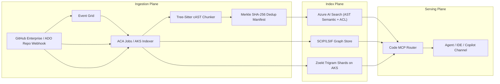
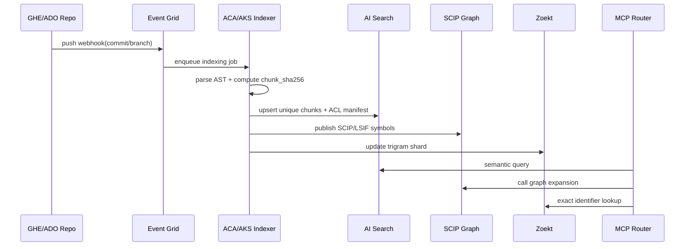
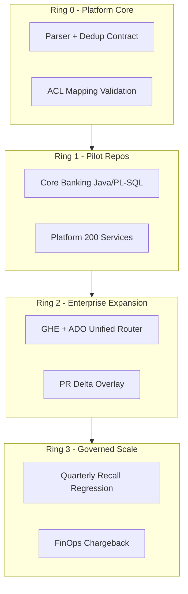

# 企业多仓代码知识底座选型 FAQ：Tree-Sitter AST + Merkle 去重 AI Search vs SCIP/LSIF 调用图 vs Zoekt Trigram vs 三模态代码 MCP 路由

> 🌐 **Language Switch**: **中文（当前）** | [English](./enterprise-codebase-rag-tree-sitter-ast-merkle-sync-ai-search-vs-scip-call-graph-vs-zoekt-trigram-mcp-selection-faq.en.md)
> **适用对象**：Cloud & AI Solution Architect、平台工程负责人、DevEx 团队、企业代码搜索与知识工程团队、SRE 与现代化改造项目组。
> **讨论范围**：面向 `10M–150M+` LOC 的企业多仓与遗留代码库，比较语法感知索引、编译级符号图、词法 trigram 引擎与三模态路由架构，覆盖新鲜度、准确率、访问控制、成本与可运维性。

## 1. 为什么朴素 512-token 切块在企业代码库中会系统性失真
代码不是连续自然语言文本，固定 token 窗口会在函数签名、泛型约束、命名空间边界和 SQL 存储过程体中间硬切，导致检索命中后仍缺少语义闭包，模型只能凭不完整上下文进行推断并放大幻觉风险。
在多分支并行开发中，朴素切块会把几乎相同的文件在每个分支重复嵌入与存储，若 `50+` 活跃分支且改动比例仅个位数，向量与存储成本会被放大 `10x–40x`，并直接挤占更高价值的评测与治理预算。
纯 dense 向量检索对精确标识符、错误码与配置键并不稳定，像 `ERR_LEDGER_4091`、`feature.payment.retry.max` 这类字符串通常更适合词法索引或符号索引优先路由，否则召回会受语义相似噪声干扰。
因此企业代码 RAG 的核心不是“把源码喂进向量库”，而是建立与代码结构一致、与分支拓扑一致、与权限边界一致的多平面检索体系。

## 2. 四类架构路径与目标分工
**Architecture A** 以 Tree-Sitter cAST 做语法边界切分，并用 Merkle `chunk_sha256` 进行跨分支内容寻址去重，把唯一内容索引到 Azure AI Search，再用分支位图清单恢复可见版本。
**Architecture B** 通过 CI 产出 SCIP/LSIF 索引，构建跨仓符号与调用关系平面，提供 `FindReferences`、`GoToDefinition` 与 `ImpactRadius` 能力，优先解决跨服务真实调用链追踪。
**Architecture C** 在 AKS 上部署 Zoekt trigram 引擎，利用本地 NVMe shard 和增量索引提供亚 `35ms` 级精确字符串、正则与栈追踪模式检索。
**Architecture D** 以查询意图路由器组合三种平面，按“语义问题、精确标识符、跨仓影响分析”自动分流，并叠加 PR/分支 delta 覆盖层，避免只看 `main` 索引造成上下文滞后。

## 3. 端到端参考架构：三平面索引与统一查询入口

该拓扑将“索引生成、索引存储、查询路由”严格解耦，使每个平面都能按自身性能与成本特征扩缩容，而不需要把所有查询强行映射到单一检索后端。
对于代码平台团队，这种分层意味着可以独立升级解析器、路由规则和权限裁剪逻辑，并在不中断业务的前提下逐步替换任一子系统。
统一 MCP 路由层承担请求分类、回退、聚合与结果去重职责，能够在单次查询中优先返回可信结果，再补充次级候选，降低模型在不确定证据上的自由发挥空间。
建议把 `repo_id`、`commit_sha`、`branch_ref`、`acl_scope` 作为跨平面最小公共键，否则联邦查询会频繁出现不可拼接结果。

## 4. Architecture A：Tree-Sitter AST + Merkle 去重 + AI Search
A 路径以语法节点为切分单位，为每个 chunk 注入 `repo/path/symbol/imports` 等结构头，显著降低“命中后仍需二次猜测上下文”的概率。
去重策略以 `chunk_sha256` 为全局内容键，索引层只保存唯一 chunk，分支与提交可见性用位图清单表达，从而把“内容索引”与“版本可见性”拆开，获得高比例存储与嵌入节省。
在大型组织中，A 还便于实现安全裁剪，因为 ACL 过滤可在查询阶段结合仓库团队映射与 Entra 组关系执行，保证同一内容在不同租户或团队下呈现不同可见范围。
A 的局限是对精确符号关系推理能力有限，因此应与 B 协同，而不是试图让语义检索单独承担跨仓调用链的全部职责。

## 5. Architecture B：SCIP/LSIF 跨仓符号与调用图平面
B 路径通过编译期索引将语言语义关系显式化，能够稳定回答“谁调用了这个接口”“哪些服务会被这个 schema 变更影响”等问题。
对于 Java/C#/TypeScript/Go 等强类型生态，SCIP/LSIF 的收益尤为明显，因为编译器与类型系统可提供比文本匹配更可靠的引用关系。
在遗留系统现代化中，B 可把旧系统入口与新服务适配层的调用边界可视化，减少“改一处炸一片”式发布风险，并为迁移顺序提供定量证据。
代价是构建链路依赖 CI 稳定性与语言插件完备度，因此平台团队需投入持续维护预算，确保索引新鲜度与版本兼容。

## 6. Architecture C：Zoekt Trigram 词法引擎高 QPS 平面
C 路径对“精确字符串 + 正则 + 短查询”场景非常高效，尤其适用于故障排查中按栈追踪关键字、错误码、配置项进行全局定位。
Zoekt 在大规模代码库中依赖 trigram posting list，查询延迟与吞吐表现通常优于 dense 检索在同类任务中的表现，且结果可解释性更高。
在 AKS `Lsv3` 本地 NVMe 盘上部署 shard 可显著提升索引读取性能，但需要关注节点生命周期与副本恢复策略，避免重建索引导致可用性窗口扩大。
C 的边界是对语义相似需求支持有限，因此应与 A/B 联动由路由层按意图选择，不建议单独承担所有类型查询。

## 7. Architecture D：三模态代码 MCP 路由与 PR Delta Overlay
D 路径将查询分类为三类：概念性架构问题优先走 A，精确标识符优先走 C，跨仓影响半径优先走 B，并支持多路并发后按证据质量聚合。
为了覆盖代码评审与发布窗口，D 需叠加 `git diff base..HEAD` 增量覆盖层，将未合并改动映射到候选证据中，避免回答停留在过时基线。
在多团队协同场景中，D 的最大价值是统一体验与统一治理，使用者不必理解底层索引差异即可获得“问题到答案”的稳定路径。
该模式成功的关键在于路由规则可观测与可回归测试，任何规则调整都应以离线基准与线上召回回归报告作为发布门禁。

## 8. 12 维度对比矩阵
| 维度 | A：AST + Merkle + AI Search | B：SCIP/LSIF 图平面 | C：Zoekt Trigram | D：三模态路由 |
|---|---|---|---|---|
| 概念语义问答能力 | 高 | 中 | 低 | 高 |
| 精确标识符召回 | 中 | 高 | 很高 | 很高 |
| 跨仓调用链可靠性 | 中 | 很高 | 低 | 很高 |
| 构建复杂度 | 中 | 高 | 中 | 高 |
| 查询延迟潜力 | 中 | 中 | 很高 | 中到高 |
| 存储去重能力 | 很高 | 中 | 低 | 高 |
| 新鲜度可控性 | 高 | 中到高 | 高 | 高 |
| ACL 裁剪能力 | 高 | 中 | 中 | 高 |
| 运维复杂度 | 中 | 高 | 中 | 高 |
| 多语言覆盖弹性 | 高 | 中 | 高 | 高 |
| 单平面故障影响面 | 中 | 中 | 中 | 低 |
| 适配目标 | 语义与成本平衡 | 严格依赖关系分析 | 高速精确检索 | 企业统一入口 |

## 9. 定量模型：去重、成本、新鲜度与召回
多仓多分支去重可估算为 `UniqueChunks ≈ R * B * F * (1 - (1-δ)^B)` 的简化近似，其中 `R` 为仓库数、`B` 为活跃分支、`F` 为每仓 chunk 数、`δ` 为分支变更比例。
嵌入成本可写作 `Cost_embed = UniqueTokens / 1K * price_per_1K`，当去重后 `UniqueTokens` 显著下降时，成本节约可直接释放到评测与治理预算。
Zoekt 索引容量可按 `IndexSize ≈ RawSource * α` 粗估，`α` 常落在 `2.5x–3.5x` 区间，容量规划应同时考虑 NVMe 可用空间与副本冗余因子。
新鲜度 SLA 可建模为 `Freshness = T_webhook + T_queue + T_parse + T_index_commit`，目标 `<15s` 时必须控制队列堆积与并发重建窗口。
检索效果建议分三类任务评估：标识符任务 `Recall@10_id`、概念任务 `Recall@10_sem`、调用链任务 `Recall@10_call`，避免单一指标掩盖结构性短板。
路由策略收益可表达为 `Gain = w1*Recall_id + w2*Recall_sem + w3*Recall_call - λ*Latency`，通过权重贴合业务优先级而非追求单一极值。

## 10. 参考时序：代码变更到可检索的全链路

该时序强调“并行更新三平面、查询阶段再融合”，可把索引延迟压缩在同一窗口内，减少平面间版本偏移导致的解释冲突。
对高频仓库建议启用批量合并策略，将短时间内连续 push 合并成单批索引作业，避免队列抖动拖慢整体新鲜度。
当某一平面更新失败时，路由层应返回降级标记并限制高风险推断，明确告知证据不完整，而不是静默退化为弱证据回答。
建议将全链路时序指标写入统一看板，按仓库、语言、分支维度追踪新鲜度与失败率。

## 11. 参考拓扑：企业分环上线与跨平台接入

分环模型让平台先验证解析与权限契约，再逐步扩大到高价值仓库，避免在基础能力未稳时直接扩至全组织导致集中故障。
建议门槛定义为 `Gate_n = (freshness_p95 <= 15s) ∧ (acl_leak_incident = 0) ∧ (recall_call >= target)`，满足后才进入下一环。
对多代码托管平台并存的企业，统一路由层能显著降低使用者心智负担，并把治理差异收敛在平台内部实现。
每次扩环都应附带回滚剧本与索引回放策略，确保上线窗口可控。

## 12. 生产配置示例：AKS Zoekt 与 Event Grid 索引流水线
```yaml
apiVersion: apps/v1
kind: StatefulSet
metadata:
  name: zoekt-index
spec:
  serviceName: zoekt-index
  replicas: 6
  selector:
    matchLabels:
      app: zoekt-index
  template:
    metadata:
      labels:
        app: zoekt-index
    spec:
      nodeSelector:
        sku: lsv3
      containers:
        - name: zoekt
          image: ghcr.io/sourcegraph/zoekt-indexserver:latest
          args: ["-index", "/data/index", "-repo-cache", "/data/repos", "-listen", ":6072"]
          volumeMounts:
            - name: nvme
              mountPath: /data
  volumeClaimTemplates:
    - metadata:
        name: nvme
      spec:
        accessModes: ["ReadWriteOnce"]
        resources:
          requests:
            storage: 2048Gi
```
```bicep
resource topic 'Microsoft.EventGrid/topics@2022-06-15' = {
  name: 'code-index-webhook-topic'
  location: resourceGroup().location
  sku: { name: 'Standard' }
}

resource sub 'Microsoft.EventGrid/topics/eventSubscriptions@2022-06-15' = {
  name: 'code-index-subscription'
  parent: topic
  properties: {
    destination: {
      endpointType: 'WebHook'
      properties: {
        endpointUrl: 'https://indexer.internal/api/webhook'
      }
    }
    filter: {
      includedEventTypes: [
        'Microsoft.Storage.BlobCreated'
      ]
    }
  }
}
```
该配置示例体现“词法平面独立扩缩 + 事件驱动增量索引”两大原则，可在高并发 push 期间保持吞吐稳定。
生产部署时应为索引服务配置节点反亲和与副本分散，避免单 AZ 故障导致查询平面大面积退化。
Event Grid 订阅建议配合重试与死信策略，防止 webhook 抖动造成索引漏更。
同时应把镜像版本、配置哈希和索引 schema 纳入发布元数据，确保问题可追溯。

## 13. 生产代码示例：Tree-Sitter + Merkle 增量索引器
```python
from __future__ import annotations

import hashlib
from dataclasses import dataclass
from typing import Iterable, List, Dict


@dataclass
class Chunk:
    repo: str
    path: str
    symbol: str
    branch: str
    commit: str
    text: str

    @property
    def sha256(self) -> str:
        return hashlib.sha256(self.text.encode("utf-8")).hexdigest()


def scope_header(repo: str, path: str, symbol: str, language: str) -> str:
    return f"[repo={repo}] [path={path}] [symbol={symbol}] [lang={language}]"


def make_chunk(repo: str, path: str, symbol: str, language: str, body: str, branch: str, commit: str) -> Chunk:
    enriched = scope_header(repo, path, symbol, language) + "\n" + body
    return Chunk(repo=repo, path=path, symbol=symbol, branch=branch, commit=commit, text=enriched)


def dedup_manifest(chunks: Iterable[Chunk]) -> Dict[str, List[Dict[str, str]]]:
    manifest: Dict[str, List[Dict[str, str]]] = {}
    for c in chunks:
        manifest.setdefault(c.sha256, []).append(
            {"repo": c.repo, "path": c.path, "branch": c.branch, "commit": c.commit, "symbol": c.symbol}
        )
    return manifest
```
该实现将内容哈希与版本可见性信息分离，便于索引层只存唯一内容并把分支关系放入清单层。
真实生产可将 `manifest` 写入 Blob 或 Cosmos，并在查询时按用户可见分支过滤映射集合。
若仓库规模极大，建议加入文件级预过滤和解析缓存，减少重复 AST 解析开销。
上线前应做语言样本回归，确保解析器升级不会破坏 chunk 边界稳定性。

## 14. 企业场景与三年 TCO
### 场景 A：F500 核心银行 `80M` LOC Java/PL-SQL 事故与现代化 Copilot
该场景同时要求“精确定位故障路径”和“评估改造影响半径”，B 与 C 的组合可显著缩短故障定位时间，A 用于补足语义解释与知识归档。
在季度现代化项目中，D 路由可将架构问答、符号追踪、调用影响分析统一到一个入口，减少工具切换带来的执行损耗。

### 场景 B：`1,200` 微服务平台工程 API 迁移 Agent
迁移窗口内需要同时处理 `main` 与大量特性分支，A 的 Merkle 去重显著降低重复索引成本，D 的 PR delta overlay 则保证检索结果与当前迁移分支一致。
对于大规模标识符改名与配置迁移，C 平面在高 QPS 下提供稳定精确召回，避免语义检索漏掉关键字符串。

### 三年 TCO 对比（示例，单位：USD）
| 项目 | A：AST+Merkle+AI Search | B：SCIP/LSIF | C：Zoekt on AKS | D：三模态路由 |
|---|---:|---:|---:|---:|
| 初始建设（Year-0） | 420,000 | 560,000 | 380,000 | 470,000 |
| 年运营成本（Year-1~3） | 250,000/年 | 290,000/年 | 240,000/年 | 300,000/年 |
| 三年总成本 | 1,170,000 | 1,430,000 | 1,100,000 | 1,370,000 |
| 三年效率收益估算 | 2,350,000 | 2,700,000 | 2,050,000 | 2,980,000 |
| 三年净收益 | 1,180,000 | 1,270,000 | 950,000 | 1,610,000 |
| 适配阶段 | 语义底座与降本 | 关键依赖治理 | 极速精确检索 | 企业统一入口 |

## 15. 六个定量问答与 Day-0/Day-2 清单
### 15.1 定量问答（6）
**Q1：多分支去重收益如何估算？** 若 `R=120`、`B=18`、`δ=0.04`，去重后唯一 chunk 比例显著下降，常见存储与嵌入节省可达 `90%+`。
**Q2：新鲜度为何常被队列拖慢？** 当 `T_queue` 从 `3s` 升至 `11s` 时，即使解析与写入稳定，总 `Freshness` 也会越过 `<15s` 目标。
**Q3：Zoekt 容量如何规划？** 若原始源码 `12TB`，按 `3x` 估算索引约 `36TB`，再乘副本系数后决定 NVMe 节点规模。
**Q4：三模态路由的收益怎么量化？** 可比较 `Recall@10` 的加权提升与时延惩罚：若综合召回从 `0.72` 提升到 `0.86` 且 `P95` 仅增加 `18ms`，通常可接受。
**Q5：何时优先走符号图平面？** 当查询含“谁引用/谁实现/影响哪些服务”语义时，B 平面的确定性通常高于纯语义检索。
**Q6：何时可以扩大到全组织？** 可设 `Go = (freshness_p95 <= 15s) ∧ (acl_incident = 0) ∧ (recall_call >= 0.8)`，连续两周满足再扩环。

### 15.2 Day-0 上线清单
1. 固化解析器版本、chunk 契约与哈希策略。
2. 建立仓库 ACL 到查询裁剪规则映射。
3. 打通 webhook、队列、索引与路由全链路监控。
4. 对三类查询建立离线基准并设置门槛。
5. 完成故障回滚与索引重放演练。

### 15.3 Day-2 运维清单
1. 周度追踪新鲜度 P95 与索引失败率。
2. 月度复盘召回回归与路由命中分布。
3. 审查 ACL 漏配与权限漂移告警。
4. 优化 NVMe 容量与 shard 负载均衡。
5. 季度更新 TCO 与收益区间报告。

### 15.4 Good fit vs Not for
该架构族适合多仓规模大、跨团队协作密集、对变更影响分析有强需求的企业，因为它把语义、词法与符号能力统一为可治理平台能力。
对于仓库规模较小且查询类型单一的团队，不建议一次性引入三平面，可先采用 A 或 C 单平面再渐进演进。

### 15.5 审计字段映射（示例）
| 字段 | 来源层 | 治理目的 | 最低保留期 |
|---|---|---|---|
| `repo_id` | SCM | 仓库归属 | 5 年 |
| `branch_ref` | SCM | 分支可见性 | 2 年 |
| `commit_sha` | SCM | 版本追溯 | 5 年 |
| `chunk_sha256` | Indexer | 去重与一致性 | 5 年 |
| `symbol_id` | Parser/SCIP | 符号追踪 | 3 年 |
| `query_type` | Router | 路由治理 | 3 年 |
| `router_target` | Router | 命中分析 | 3 年 |
| `freshness_ms` | Pipeline | 新鲜度监控 | 2 年 |
| `recall_bucket` | Eval | 质量评估 | 3 年 |
| `acl_scope` | Auth | 权限裁剪 | 5 年 |
| `zoekt_shard` | Zoekt | 性能排障 | 2 年 |
| `graph_hop_count` | SCIP | 调用扩展深度 | 2 年 |
| `delta_overlay_hit` | Router | PR 覆盖命中 | 2 年 |
| `index_schema_version` | Platform | 兼容性审计 | 5 年 |
| `cost_center` | FinOps | 成本分摊 | 5 年 |
| `storage_tier` | Infra | 资源治理 | 3 年 |
| `incident_ticket` | Ops | 故障追踪 | 5 年 |
| `rollback_version` | Release | 回滚证据 | 5 年 |
| `evidence_hash` | Archive | 防篡改证明 | 7 年 |
| `tenant_id` | Gateway | 多租户治理 | 5 年 |

### 15.6 运行时告警字典（示例）
| 告警键 | 触发条件 | 立即动作 | 责任团队 |
|---|---|---|---|
| `freshness_sla_breach` | 新鲜度超 `15s` | 排查队列与索引吞吐 | 平台团队 |
| `acl_trim_miss` | 权限裁剪异常 | 阻断查询并修复映射 | 安全团队 |
| `chunk_dedup_drop` | 去重率突降 | 检查哈希与解析变更 | 索引团队 |
| `scip_gap_detected` | 符号图缺口升高 | 触发 CI 索引补跑 | 语言平台 |
| `zoekt_latency_spike` | 词法检索延迟飙升 | 扩容 shard 与节点 | 搜索团队 |
| `router_fallback_loop` | 路由反复回退 | 临时固定策略并排查 | 路由团队 |
| `delta_overlay_stale` | PR 覆盖过期 | 立即重算 diff overlay | DevEx |
| `index_version_conflict` | schema 冲突 | 冻结发布并回滚 | 发布团队 |
| `graph_expansion_timeout` | 调用图扩展超时 | 下调 hop 并异步补全 | 平台工程 |
| `cost_per_query_regress` | 单次查询成本恶化 | 调整路由权重与缓存 | FinOps |
| `repo_webhook_drop` | webhook 丢失 | 启动补偿扫描任务 | 集成团队 |
| `nvme_capacity_hotspot` | NVMe 热点超阈 | 执行 shard 重平衡 | 基础设施 |
| `recall_identifier_drop` | 标识符召回下降 | 优先切至 C 路径 | 搜索团队 |
| `recall_callchain_drop` | 调用链召回下降 | 优先切至 B 路径 | 语言平台 |
| `audit_hash_mismatch` | 证据哈希不一致 | 启动审计取证流程 | 合规团队 |

### 15.7 组合落地补充（从试点到企业统一入口）
建议先用 C 覆盖故障定位高频需求，再引入 A 解决语义问答与去重降本，最后接入 B 与 D 完成跨仓影响分析和统一体验，这种路径通常比“一步到位三平面”更稳健。
阶段门槛可定义为 `Phase2 = (identifier_recall >= 0.9) ∧ (freshness_p95 <= 15s)` 与 `Phase3 = (callchain_recall >= 0.8) ∧ (acl_incident = 0)`，确保扩环由可量化指标驱动。
若业务方要求快速扩展到全仓，应先验证 ACL 与审计链路再扩容查询流量，因为权限事故的治理成本远高于短期性能收益。
当多平台并存导致元数据不一致时，应优先统一契约和字典，而不是在路由层堆叠临时补丁，否则长期会侵蚀平台可维护性与审计可信度。

### 15.8 企业治理补充：平台 KPI、组织协作与变更门禁
建议在平台层建立三组共同 KPI：质量侧看 `Recall@10_id / Recall@10_sem / Recall@10_call` 与 `Abstention Precision`，时效侧看 `freshness_p95` 与 `index_success_rate`，成本侧看 `cost_per_query` 与 `dedup_ratio`，并将其按 BU、仓库群与语言栈进行分层看板展示。
组织协作上应明确“索引团队负责可检索性、路由团队负责可用性、语言平台负责可解释依赖、业务团队负责验收场景”四方责任边界，避免出现所有缺陷都回流到同一平台团队导致的修复瓶颈。
建议把每一次路由策略发布都纳入标准变更流程，至少包含离线回放集、线上灰度窗口、回退阈值与审计编号，以便在季度审计时可完整复盘“为什么这次策略变更被批准以及如何验证收益”。
在跨区域或跨法域部署中，建议按数据驻留要求对索引平面做物理分区，并在 MCP 路由层执行地域约束，确保查询不会跨法域拼接证据；这类约束应由策略引擎强制，而不是依赖调用方约定。
当企业进入全量推广阶段，建议引入“变更冻结窗口 + 紧急通道”双轨机制：常规路由和索引 schema 变更按周节奏推进，紧急故障修复走受控快通道并强制补齐事后回归，以兼顾稳定性与响应速度。
最后，平台运营评审应把“用户信任”作为一等指标，除性能和成本外持续追踪“证据可追溯率、错误可解释率、权限事件零容忍天数”，因为企业代码智能平台的长期价值取决于可信度而不仅是吞吐量。
