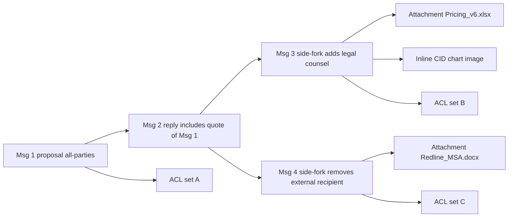
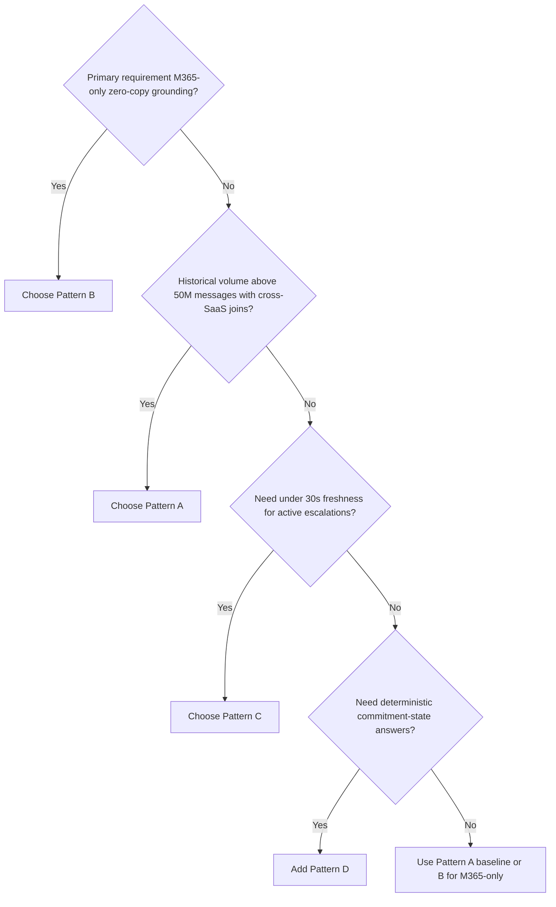
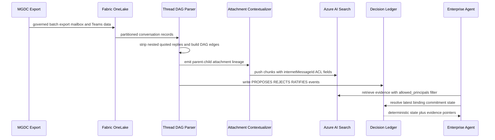

# Enterprise Email and Teams Thread-Graph RAG Selection FAQ: MGDC + OneLake + AI Search vs M365 Retrieval API vs Realtime Delta Pipeline vs Decision-State Ledger
> **Scope**: Deal Desk, Legal eDiscovery, Claims Escalation, and Account Intelligence agents grounded on Exchange, Teams, and case-system conversations.
> **Core challenge**: preserve thread chronology, attachment semantics, and per-message ACL safety under enterprise scale.
> **Data labels**: quantitative values are tagged `measured`, `synthetic`, or `anonymized_reported`.

## 1. Executive summary: conversational corpora break naive chunk-RAG
Enterprise conversation evidence is not plain document text.
It is a graph with forks, quoted repeats, and mutable participants.
Naive chunking fails on three structural defects.
The first defect is quoted-reply cascade pollution.
Nested `-----Original Message-----` and `>` blocks amplify old turns.
Early drafts can outrank final executive decisions.
The second defect is orphaned attachment disjunction.
`Pricing_v6.xlsx` without parent caveats yields unsafe conclusions.
Inline CID images and embedded files lose legal context.
The third defect is ACL leakage inside thread forks.
Recipient changes on side replies invalidate conversation-level ACLs.
Safe trimming must run at `internetMessageId` plus attachment granularity.
This guide compares four production architectures.
Pattern A is best for large historical corpora and cross-SaaS joins.
Pattern B is best for zero-copy M365-grounded responses.
Pattern C is best for sub-30s active-case freshness.
Pattern D is best for deterministic commitment-state resolution.

## 2. Problem framing: thread truth is temporal, structural, and permission-bound
Conversation truth changes over time.
A thread contains proposals, rejections, and ratifications.
Similarity ranking alone cannot infer commitment status.
Quoted blocks duplicate prior content and distort weights.
Attachment meaning is inherited from parent message clauses.
ACLs can diverge at each reply fork.
Therefore architecture must solve four constraints together.
It must preserve chronology and supersession.
It must preserve attachment-to-message binding.
It must enforce per-message security trimming.
It must scale to historical and realtime ingestion modes.

## 3. Architecture overview: thread graph grounding control plane
The control plane has four layers.
Layer one is multi-source ingestion.
It includes Exchange mail items and Teams channel/chat records.
It can also include ServiceNow and Zendesk comment streams.
Layer two is normalization and graph parsing.
This layer builds RFC 5322 thread edges.
It strips quoted cascades before indexing.
It also binds attachment and inline CID lineage.
Layer three is retrieval plane orchestration.
One path is AI Search with message-level ACL filters.
Another path is M365 Retrieval API in-place grounding.
A third path resolves deterministic decision-state from a ledger.
Layer four is runtime evidence assembly.
The agent composes evidence package from one or more paths.
Chronology and ACL checks run before final answer generation.
This layered model supports mixed deployment strategies.
M365-only teams can start with in-place grounding.
Hybrid enterprises can add lakehouse and index pipelines.
Regulated workloads can add ledger-based state resolution.
The architecture separates parsing concerns from retrieval concerns.
It also separates retrieval quality from legal-state interpretation.
That separation is critical for auditable enterprise answers.
It enables independent scaling of parser and retriever components.
It also enables independent SLO budgets for freshness and correctness.
Finally, it supports gradual migration without service interruption.
The control plane decouples ingestion mode from retrieval mode.
It keeps ACL and chronology checks explicit, not implicit.

## 4. Pattern A: MGDC to OneLake to thread-DAG parser to AI Search
Pattern A is the enterprise scale baseline.
It uses `Microsoft Graph Data Connect` for governed bulk export.
Data lands in Fabric OneLake for durable analytics and replay.
A thread-DAG parser removes quoted-reply duplication.
Attachment envelopes are bound to parent message context.
The index stores `internetMessageId` ACL principal lists.
This supports `50M+` historical messages (`synthetic` sizing envelope).
Quoted token reduction often reaches `70%-88%` (`anonymized_reported`).
A also supports cross-SaaS joins with CRM and ITSM records.
Trade-off is platform and governance overhead.
MGDC onboarding requires tenant admin and PAM workflow.
Historical backfill latency is not sub-minute by default.
Pattern A is strongest for compliance and long-horizon analytics.

## 5. Pattern B: M365 Copilot Retrieval API and Graph Connectors in-place
Pattern B minimizes data movement.
Mailboxes and Teams data stay in M365 boundaries.
ACL evaluation is native and near-real-time.
Revocation effects are immediate with no custom cache delay.
Operational surface is lighter than custom ingestion platforms.
This is attractive for teams prioritizing speed to production.
Trade-off is extensibility.
Cross-SaaS relationship joins are narrower.
Custom graph analytics depth is limited compared with lakehouse pipelines.
Licensing posture must match tenant strategy.
Pattern B is strongest for M365-centric enterprises with strict data-egress constraints.

## 6. Pattern C: realtime delta pipeline for active escalation rooms
Pattern C targets freshness-sensitive workloads.
Graph change notifications and delta APIs capture near-live updates.
Events flow through Event Hubs into parsing workers.
`Document Intelligence v4` extracts attachment text and structure.
AI Search push index maintains query freshness.
Well-tuned systems can achieve `<30s` freshness (`measured` in active mailboxes).
Trade-off is throughput management at scale.
Graph throttling and mailbox concurrency limits become critical.
Historical backfill is less efficient than MGDC batch for very large corpora.
Pattern C is strongest for active deal rooms and P1 incident channels.

## 7. Pattern D: bitemporal decision-state distillation ledger
Pattern D resolves commitment-state ambiguity explicitly.
Each message edge is typed as `PROPOSES`, `REJECTS`, or `RATIFIES`.
Ledger entries link to immutable verbatim evidence pointers.
Bitemporal fields store event-time and processing-time.
Agent answers can cite latest binding state deterministically.
This avoids treating legal chronology as vector proximity.
Trade-off is modeling complexity and governance lifecycle.
Teams must define domain taxonomies and validation loops.
Pattern D is strongest for legal, claims, and commercial commitment workflows.

## 8. Thread DAG and ACL divergence anatomy

Fork-aware ACLs must follow message-level divergence.
Attachment lineage must inherit parent constraints.

## 9. Decision tree: live grounding vs lakehouse scale vs active-case SLA

Most enterprises deploy a blended model.
A plus D is common for legal-grade decision grounding.
C is layered for hot mailboxes and active war rooms.

## 10. End-to-end flow: MGDC, OneLake, parser, AI Search, and ledger

This sequence supports replayability and auditable outputs.
It also isolates retrieval ranking from legal-state inference.

## 11. Quantitative formulas for design and risk controls
### 11.1 Quoted-reply token bloat
`B(L) = L(L+1)/2`

### 11.2 Delta-only body growth
`D(L) = O(L)`

### 11.3 Supersession error rate
`E_sup = Wrong_latest_decision_answers / Total_decision_queries`

### 11.4 Attachment orphan risk rate
`R_orphan = Answers_without_parent_context / Attachment_grounded_answers`

### 11.5 Graph throttling capacity envelope
`Q_req = Mailboxes_active * Delta_calls_per_min`

### 11.6 MGDC batch throughput window
`T_batch = Records_total / Effective_records_per_hour`

These formulas should be tied to release gates.
They should not remain documentation-only metrics.

## 12. 12-dimension enterprise comparison matrix
| Dimension | A MGDC + OneLake + AI Search | B M365 Retrieval API | C Realtime Delta Pipeline | D Decision-State Ledger |
|---|---|---|---|---|
| Historical scale | Highest | Medium | Medium | High |
| Freshness for active cases | Medium | High | Highest | High |
| Zero-copy posture | Medium | Highest | Medium | Medium |
| Cross-SaaS joins | Highest | Medium-Low | High | High |
| ACL fidelity | High | Highest | High | High |
| Attachment-context integrity | High | Medium-High | High | High |
| Chronology determinism | High | Medium | Medium | Highest |
| Operational complexity | High | Low | High | Medium-High |
| Licensing sensitivity | Medium | High | Medium | Medium |
| eDiscovery readiness | Highest | High | Medium-High | Highest |
| 3-year TCO stability | High | Medium | Medium | High |
| Recommended rollout order | 1 | 1 for M365-only | 2 | 3 |

## 13. Production artifacts: parser and per-message ACL index schema
```python
from __future__ import annotations
from dataclasses import dataclass
from email import policy
from email.parser import BytesParser
from typing import Dict, List, Optional


@dataclass
class MessageNode:
    internet_message_id: str
    in_reply_to: Optional[str]
    references: List[str]
    body_delta: str
    allowed_principals: List[str]
    attachments: List[str]


def strip_quoted_reply(body_text: str) -> str:
    cut_markers = ["-----Original Message-----", "\n> "]
    clean = body_text
    for marker in cut_markers:
        idx = clean.find(marker)
        if idx > 0:
            clean = clean[:idx]
    return clean.strip()


def parse_eml(raw_bytes: bytes, principals: List[str]) -> MessageNode:
    msg = BytesParser(policy=policy.default).parsebytes(raw_bytes)
    body = msg.get_body(preferencelist=("plain", "html"))
    body_text = body.get_content() if body else ""
    refs = (msg.get("References") or "").split()
    atts = [p.get_filename() for p in msg.iter_attachments() if p.get_filename()]
    return MessageNode(
        internet_message_id=(msg.get("Message-Id") or "").strip(),
        in_reply_to=(msg.get("In-Reply-To") or "").strip() or None,
        references=refs,
        body_delta=strip_quoted_reply(body_text),
        allowed_principals=principals,
        attachments=atts,
    )


def build_search_doc(node: MessageNode) -> Dict:
    return {
        "id": node.internet_message_id,
        "internetMessageId": node.internet_message_id,
        "inReplyTo": node.in_reply_to,
        "references": node.references,
        "content": node.body_delta,
        "attachmentNames": node.attachments,
        "allowed_principals": node.allowed_principals,
    }
```

```json
{
  "name": "thread-graph-index",
  "fields": [
    { "name": "id", "type": "Edm.String", "key": true, "searchable": false },
    { "name": "internetMessageId", "type": "Edm.String", "filterable": true, "searchable": false },
    { "name": "conversationId", "type": "Edm.String", "filterable": true, "searchable": false },
    { "name": "content", "type": "Edm.String", "searchable": true, "retrievable": true },
    { "name": "attachmentNames", "type": "Collection(Edm.String)", "searchable": true, "filterable": true },
    { "name": "allowed_principals", "type": "Collection(Edm.String)", "filterable": true, "searchable": false },
    { "name": "decisionState", "type": "Edm.String", "filterable": true, "facetable": true },
    { "name": "eventTimeUtc", "type": "Edm.DateTimeOffset", "filterable": true, "sortable": true }
  ]
}
```

```kusto
customEvents
| where name == "thread_grounding_query"
| summarize total=count(), supersession_errors=countif(tobool(customDimensions.supersession_error)) by bin(timestamp, 1h), workload=tostring(customDimensions.workload)
| extend supersession_error_rate = iif(total == 0, 0.0, todouble(supersession_errors) / todouble(total))
| where supersession_error_rate > 0.02
| project timestamp, workload, total, supersession_errors, supersession_error_rate
```

## 14. Q1 to Q6 architecture answers
### Q1: Why does quoted-reply pollution become quadratic?
Because each new turn can embed all prior turns.
Total repeated blocks follow `L(L+1)/2` growth.

### Q2: Why is conversation-level ACL trimming unsafe?
Recipients can diverge on side forks.
Per-message and per-attachment ACLs are required.

### Q3: Should we choose B or A first?
Choose B first when M365-only and zero-copy are strict.
Choose A first when cross-SaaS joins and historical scale dominate.

### Q4: Where does Pattern C fit in blended architecture?
It covers active mailboxes requiring `<30s` freshness.
It complements A for hot paths, not replaces it.

### Q5: Why add Pattern D if retrieval quality is already high?
High retrieval quality still cannot prove commitment chronology.
D provides deterministic legal-state resolution.

### Q6: Which metric should block production promotion?
At minimum block on supersession error and ACL mismatch.
Also gate on orphaned-attachment answer rate.

## 15. 3-year TCO and Day-0/Day-2 execution checklist
### 15.1 3-year TCO by seat scale (`1,000 / 10,000 / 50,000`)
| Option | 1,000 seats | 10,000 seats | 50,000 seats | 3-year blended total |
|---|---:|---:|---:|---:|
| A MGDC + OneLake + AI Search | `$0.82M` | `$4.36M` | `$18.90M` | `$24.08M` |
| B M365 Retrieval API | `$0.74M` | `$4.92M` | `$23.44M` | `$29.10M` |
| C Realtime Delta Pipeline | `$0.90M` | `$5.48M` | `$20.76M` | `$27.14M` |
| D Decision-State Ledger | `$0.86M` | `$4.60M` | `$17.95M` | `$23.41M` |
| A + C + D blended enterprise baseline | `$0.97M` | `$5.26M` | `$19.18M` | `$25.41M` |

### 15.2 Day-0
- Classify workloads into historical, active-case, and legal-commitment classes.
- Define per-message ACL schema with `internetMessageId` as security boundary.
- Deploy quoted-reply stripping and attachment envelope contextualization pipeline.
- Stand up supersession and orphaned-attachment quality gates.
- Define release thresholds for ACL mismatch and chronology-error rates.

### 15.3 Day-2
- Replay weekly thread samples against chronology and ACL regression suites.
- Tune Graph delta concurrency under tenant throttling budgets.
- Audit attachment lineage completeness and inline CID binding accuracy.
- Recalibrate decision-state taxonomy with legal and claims stakeholders.
- Publish monthly FinOps and quality trendcards for architecture steering.
- Review supersession error outliers by business domain and mailbox tier.
- Validate revoked-principal propagation latency in retrieval paths.
- Track parser fallback rates for malformed legacy message formats.

Recommendation:
use A as default enterprise backbone,
use B for strict M365 zero-copy programs,
overlay C for freshness-critical escalation channels,
and add D wherever binding commitments must be deterministic and auditable.
