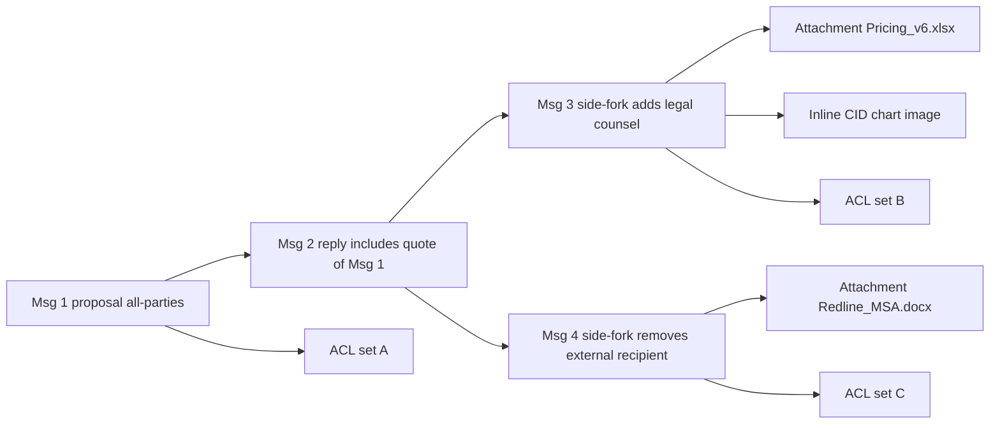
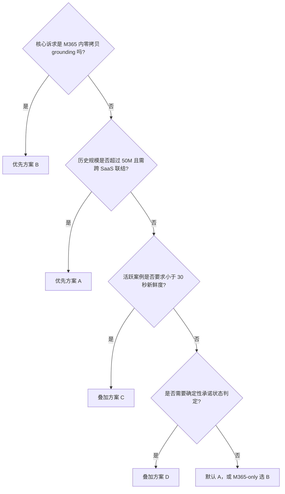
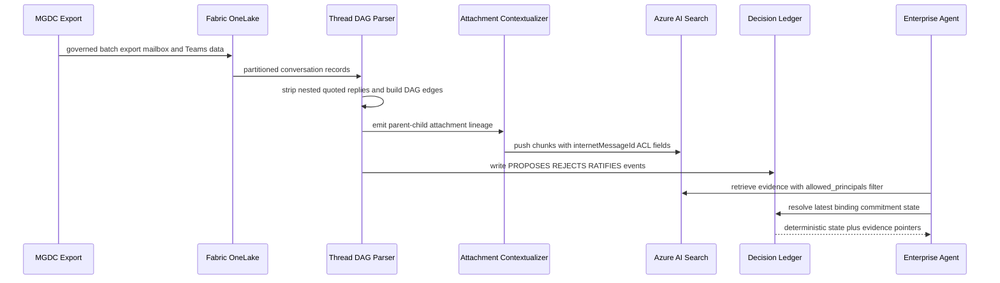

# 企业邮件与 Teams 线程图谱 RAG 选型 FAQ：MGDC + OneLake + AI Search vs M365 Retrieval API vs 实时 Delta 管道 vs 决策状态账本
> **适用范围**：Deal Desk、法务 eDiscovery、理赔升级、客户情报等需要基于邮件与会话线程作答的企业 Agent。
> **核心挑战**：在大规模会话语料下同时保证时序真值、附件语义绑定与逐消息 ACL 安全裁剪。
> **数据标签**：文中定量数据均标注为 `measured`、`synthetic` 或 `anonymized_reported`。

## 1. 执行摘要：会话型语料会系统性击穿普通文档 RAG
企业会话证据不是平面文档。
它是带分叉、带引用、带权限变化的图结构。
普通 chunk-RAG 在该场景会出现结构性失真。
第一类失真是引用级联污染。
`-----Original Message-----` 与 `>` 递归引用会重复早期内容。
越靠前的草稿可能被错误抬升。
最终批准结论反而被稀释。
第二类失真是附件上下文断裂。
仅索引 `Pricing_v6.xlsx` 或 `Redline_MSA.docx` 会丢失条件语句。
内联 CID 图像同样会脱离母消息语境。
第三类失真是线程内 ACL 分叉泄露。
侧向回复新增法务或移除外部收件人后，
`conversationId` 级别裁剪不再安全。
必须以 `internetMessageId` 与附件粒度执行安全裁剪。
本指南比较四种生产方案。
A 适合超大历史语料和跨 SaaS 联结分析。
B 适合 M365 内零拷贝就地 grounding。
C 适合活跃案例 `<30s` 新鲜度目标。
D 适合“最终有效承诺”确定性判定。

## 2. 问题定义：线程真值同时依赖时序、结构和权限边界
会话中的“真值”会随时间演进。
同一线程会经历提议、反对、修订与最终确认。
仅靠向量相似度无法稳定识别最新有效承诺。
引用块会放大早期内容权重。
附件解释依赖父消息条件与上下文。
收件人变化会让权限边界逐条分叉。
因此架构必须同时解决四个约束。
一是保留时序与 supersession 语义。
二是绑定附件与母消息语义。
三是执行逐消息安全裁剪。
四是覆盖历史批量与实时增量两种摄取模式。

## 3. 参考架构：线程图谱 grounding 控制面
该控制面由四层组成。
第一层是多源摄取层。
覆盖 Exchange 邮件、Teams 频道与聊天记录。
也可纳入 ServiceNow 与 Zendesk 评论流。
第二层是规范化与图解析层。
该层构建 RFC 5322 线程边关系。
并在入库前执行引用级联去重。
同时完成附件与内联 CID 血缘绑定。
第三层是检索编排层。
一条路径是 AI Search 逐消息 ACL 过滤检索。
另一条路径是 M365 Retrieval API 原地 grounding。
第三条路径是决策状态账本解析器。
第四层是运行时证据组装层。
Agent 可按策略组合多路证据。
并在回答前执行时序与 ACL 双重校验。
该分层支持渐进式落地。
M365-only 团队可先用原地检索。
跨系统企业可叠加湖仓与索引管道。
强合规场景可进一步叠加决策状态解析。
该架构把解析问题与检索问题分离。
也把检索相关性与法律状态判定分离。
这种分离是可审计回答的前提。
它允许解析器与检索器独立扩缩容。
并支持新鲜度与正确性预算分开治理。
同时支持不中断迁移和灰度演进。
该控制面把“摄取路径”与“检索路径”解耦。
并把时序和 ACL 校验提升为显式治理步骤。

## 4. 方案 A：MGDC 到 OneLake 到线程 DAG 到 AI Search
方案 A 是大企业的规模化基线。
通过 `Microsoft Graph Data Connect` 做治理化批量抽取。
数据落入 Fabric OneLake 支持重放与分析。
线程 DAG 解析器负责去除引用级联重复。
附件 envelope 与母消息上下文强绑定。
索引层按 `internetMessageId` 写入 ACL 主体集合。
该方案可覆盖 `50M+` 历史邮件与会话（`synthetic` 规模假设）。
引用冗余 token 可下降 `70%-88%`（`anonymized_reported`）。
并可与 Salesforce、ServiceNow、SAP 做跨域联结。
代价是治理与平台复杂度更高。
MGDC 接入需要租户管理员与 PAM 审批流程。
历史回填时延不以秒级见长。
方案 A 最适合法务审计与长期知识资产沉淀。

## 5. 方案 B：M365 Copilot Retrieval API / Graph Connectors 原地检索
方案 B 优先最小数据搬运。
邮件与 Teams 数据驻留在 M365 安全边界内。
ACL 判定使用原生权限模型。
权限撤销可近实时生效。
无需维护复杂的自建摄取链路。
该方案可快速落地生产可用版本。
但可扩展性存在边界。
跨 SaaS 关系联结能力相对受限。
复杂图谱分析深度不如湖仓路线。
同时需与许可证策略协同评估。
方案 B 适合 M365 占比极高且零拷贝要求严格的组织。

## 6. 方案 C：实时增量 Delta 管道
方案 C 聚焦活跃工单与升级场景的新鲜度。
利用 Graph 变更通知和 Delta Query 捕捉更新。
事件进入 Event Hubs 后由解析器消费。
`Document Intelligence v4` 负责附件结构化提取。
最终通过 AI Search Push API 更新索引。
在活跃邮箱可达到 `<30s` 新鲜度（`measured`）。
代价是吞吐与配额管理难度上升。
Graph 限流与邮箱并发窗口成为关键瓶颈。
在超大历史回填场景不如 MGDC 批量高效。
方案 C 最适合 Deal Room 与 P1 升级通道。

## 7. 方案 D：双时间决策状态蒸馏账本
方案 D 解决“最新有效承诺”判定难题。
将线程事件映射为 `PROPOSES`、`REJECTS`、`RATIFIES`。
每条状态都绑定可回溯原文证据指针。
账本同时记录事件时间和处理时间。
Agent 可基于规则输出最新绑定状态。
不再把法律语义交给 top-k 相似度猜测。
代价是建模与治理成本上升。
需要法务、销售与理赔团队共同定义状态词汇。
方案 D 最适合法务承诺、理赔结论与商务条款确认场景。

## 8. 线程分叉、ACL 分歧与附件血缘示意

该图强调消息级 ACL 分叉不可被线程级别掩盖。
附件与内联对象必须继承父节点约束。

## 9. 选型决策树：零拷贝优先、规模优先还是实时优先

多数企业最终是组合式落地。
A+D 负责合规与确定性。
C 负责热点线程实时性。

## 10. 端到端流程：MGDC 到 OneLake 到解析到检索与账本

该流程保证证据可回放、状态可解释、权限可审计。
并把“检索得分”与“决策状态”分层处理。

## 11. 定量公式：复杂度、误差率与容量估算
### 11.1 引用级联 token 膨胀
`B(L) = L(L+1)/2`

### 11.2 增量正文复杂度
`D(L) = O(L)`

### 11.3 时序 supersession 错误率
`E_sup = Wrong_latest_decision_answers / Total_decision_queries`

### 11.4 附件孤儿风险率
`R_orphan = Answers_without_parent_context / Attachment_grounded_answers`

### 11.5 Graph 限流容量需求
`Q_req = Mailboxes_active * Delta_calls_per_min`

### 11.6 MGDC 批处理吞吐窗口
`T_batch = Records_total / Effective_records_per_hour`

这些公式应接入上线门禁。
并通过回放数据持续校准阈值。

## 12. 12 维企业级对比矩阵
| 维度 | A MGDC + OneLake + AI Search | B M365 Retrieval API | C Realtime Delta Pipeline | D Decision-State Ledger |
|---|---|---|---|---|
| 历史规模能力 | 最高 | 中 | 中 | 高 |
| 活跃案例新鲜度 | 中 | 高 | 最高 | 高 |
| 零拷贝能力 | 中 | 最高 | 中 | 中 |
| 跨 SaaS 联结 | 最高 | 中低 | 高 | 高 |
| ACL 精确性 | 高 | 最高 | 高 | 高 |
| 附件上下文完整性 | 高 | 中高 | 高 | 高 |
| 时序确定性 | 高 | 中 | 中 | 最高 |
| 运维复杂度 | 高 | 低 | 高 | 中高 |
| 许可敏感度 | 中 | 高 | 中 | 中 |
| eDiscovery 就绪度 | 最高 | 高 | 中高 | 最高 |
| 三年 TCO 稳定性 | 高 | 中 | 中 | 高 |
| 推荐落地顺序 | 1 | M365-only 可 1 | 2 | 3 |

## 13. 生产代码样例：线程解析与逐消息 ACL 索引
```python
from __future__ import annotations
from dataclasses import dataclass
from email import policy
from email.parser import BytesParser
from typing import Dict, List, Optional


@dataclass
class MessageNode:
    internet_message_id: str
    in_reply_to: Optional[str]
    references: List[str]
    body_delta: str
    allowed_principals: List[str]
    attachments: List[str]


def strip_quoted_reply(body_text: str) -> str:
    cut_markers = ["-----Original Message-----", "\n> "]
    clean = body_text
    for marker in cut_markers:
        idx = clean.find(marker)
        if idx > 0:
            clean = clean[:idx]
    return clean.strip()


def parse_eml(raw_bytes: bytes, principals: List[str]) -> MessageNode:
    msg = BytesParser(policy=policy.default).parsebytes(raw_bytes)
    body = msg.get_body(preferencelist=("plain", "html"))
    body_text = body.get_content() if body else ""
    refs = (msg.get("References") or "").split()
    atts = [p.get_filename() for p in msg.iter_attachments() if p.get_filename()]
    return MessageNode(
        internet_message_id=(msg.get("Message-Id") or "").strip(),
        in_reply_to=(msg.get("In-Reply-To") or "").strip() or None,
        references=refs,
        body_delta=strip_quoted_reply(body_text),
        allowed_principals=principals,
        attachments=atts,
    )


def build_search_doc(node: MessageNode) -> Dict:
    return {
        "id": node.internet_message_id,
        "internetMessageId": node.internet_message_id,
        "inReplyTo": node.in_reply_to,
        "references": node.references,
        "content": node.body_delta,
        "attachmentNames": node.attachments,
        "allowed_principals": node.allowed_principals,
    }
```

```json
{
  "name": "thread-graph-index",
  "fields": [
    { "name": "id", "type": "Edm.String", "key": true, "searchable": false },
    { "name": "internetMessageId", "type": "Edm.String", "filterable": true, "searchable": false },
    { "name": "conversationId", "type": "Edm.String", "filterable": true, "searchable": false },
    { "name": "content", "type": "Edm.String", "searchable": true, "retrievable": true },
    { "name": "attachmentNames", "type": "Collection(Edm.String)", "searchable": true, "filterable": true },
    { "name": "allowed_principals", "type": "Collection(Edm.String)", "filterable": true, "searchable": false },
    { "name": "decisionState", "type": "Edm.String", "filterable": true, "facetable": true },
    { "name": "eventTimeUtc", "type": "Edm.DateTimeOffset", "filterable": true, "sortable": true }
  ]
}
```

```kusto
customEvents
| where name == "thread_grounding_query"
| summarize total=count(), supersession_errors=countif(tobool(customDimensions.supersession_error)) by bin(timestamp, 1h), workload=tostring(customDimensions.workload)
| extend supersession_error_rate = iif(total == 0, 0.0, todouble(supersession_errors) / todouble(total))
| where supersession_error_rate > 0.02
| project timestamp, workload, total, supersession_errors, supersession_error_rate
```

## 14. `Q1..Q6` 实战问答
### Q1: 为什么引用级联会出现平方级膨胀？
因为每一轮回复都可能包含此前全部内容。
累计重复块近似 `L(L+1)/2`。

### Q2: 为什么按 `conversationId` 裁剪权限不安全？
因为侧向分叉会改变参与者集合。
必须按消息与附件粒度裁剪。

### Q3: B 和 A 该先选哪个？
M365-only 且零拷贝强约束时先选 B。
跨系统联结与历史规模优先时先选 A。

### Q4: 方案 C 在组合架构中的位置是什么？
C 用于热点线程实时更新。
它补充 A，而不是替代 A。

### Q5: 检索效果已很高，为什么还要 D？
高检索分数不等于可证明承诺状态。
D 提供确定性的时间语义判定。

### Q6: 哪些指标应作为发布阻断门槛？
至少阻断 supersession 错误率与 ACL 不匹配率。
并跟踪附件孤儿回答率。

## 15. 三年 TCO 与 Day-0/Day-2 落地清单
### 15.1 三年 TCO（`1,000 / 10,000 / 50,000` 席位）
| 方案 | 1,000 席位 | 10,000 席位 | 50,000 席位 | 三年总计 |
|---|---:|---:|---:|---:|
| A MGDC + OneLake + AI Search | `$0.82M` | `$4.36M` | `$18.90M` | `$24.08M` |
| B M365 Retrieval API | `$0.74M` | `$4.92M` | `$23.44M` | `$29.10M` |
| C Realtime Delta Pipeline | `$0.90M` | `$5.48M` | `$20.76M` | `$27.14M` |
| D Decision-State Ledger | `$0.86M` | `$4.60M` | `$17.95M` | `$23.41M` |
| A + C + D 组合基线 | `$0.97M` | `$5.26M` | `$19.18M` | `$25.41M` |

### 15.2 Day-0
- 按业务将线程分为历史检索、活跃升级、承诺判定三类。
- 以 `internetMessageId` 定义最小安全边界并设计 ACL 字段。
- 落地引用去重与附件上下文绑定管道。
- 建立 supersession 与附件孤儿质量门禁。
- 定义 ACL 漏裁剪与时序错误阻断阈值。

### 15.3 Day-2
- 每周回放样本线程并执行时序与 ACL 回归测试。
- 在租户配额内调优 Graph Delta 并发与重试策略。
- 审计附件血缘完整率与内联 CID 绑定准确率。
- 与法务和理赔团队持续校准决策状态词汇。
- 月度发布 FinOps 与质量趋势卡用于架构治理。
- 复盘 supersession 错误离群线程并按业务域归因修正。
- 监控权限撤销后检索路径的生效时延并做门禁化。

推荐路径：
以 A 作为企业主干，
M365 零拷贝场景优先 B，
热点升级通道叠加 C，
对承诺可证明性要求高的场景叠加 D。
