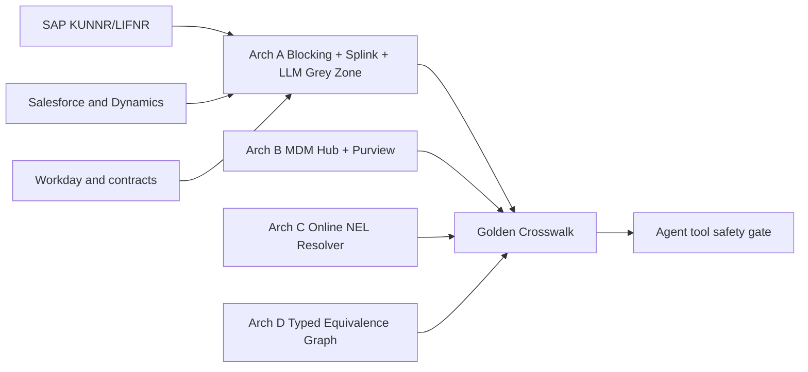
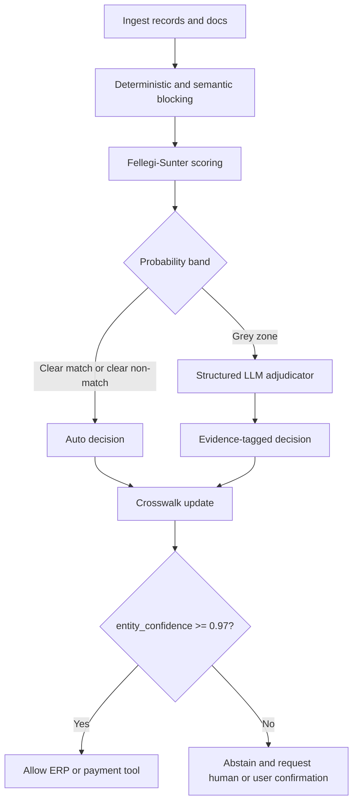
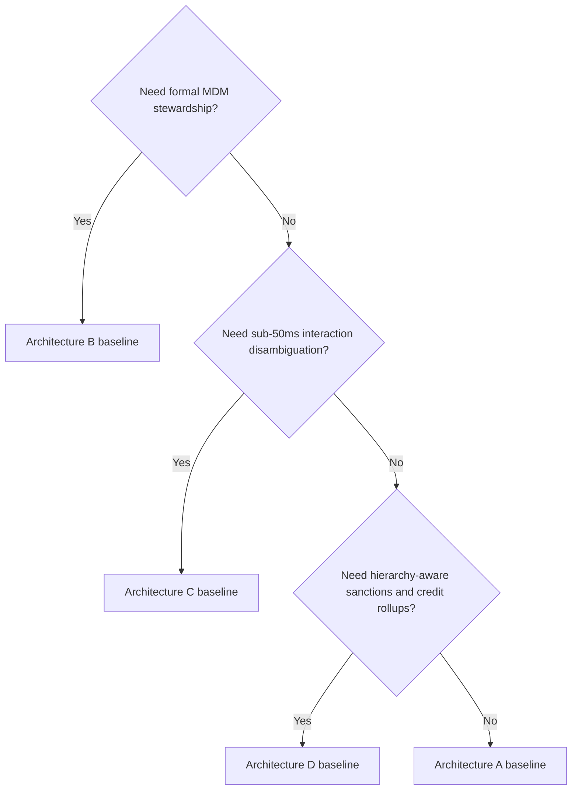

# Enterprise Entity Resolution and Golden-ID Grounding Selection FAQ: Splink + LLM Grey-Zone Adjudication vs MDM Hub vs Online NEL vs Typed Equivalence Graph
> **Applies to**: Customer-360, supplier risk, KYC/sanctions, healthcare EMPI, and AI-agent write-back workflows across mixed structured and unstructured systems.
> **Decision pressure**: an agent must avoid both false split (`same entity treated as different`) and false merge (`different legal entities merged as one`).
> **Core output**: production-safe `canonical_entity_id` for retrieval, reasoning, and downstream tools.

## 1. Executive summary
- Enterprise records carry many aliases for the same legal party.
- Distinct legal entities can look nearly identical in text and embeddings.
- Pure vector-RAG filters often miss hard aliases and over-merge neighbors.
- Tool execution becomes dangerous when identity uncertainty leaks into write paths.
- Production design must split retrieval convenience from legal-entity correctness.
- Four architecture families dominate Azure deployments in 2026.
- Architecture A fits teams that need scale and strong probabilistic control.
- Architecture B fits organizations with formal master-data stewardship mandates.
- Architecture C fits low-latency conversational disambiguation at interaction time.
- Architecture D fits regulated scenarios requiring explicit hierarchy semantics.
- Most programs combine two architectures instead of choosing one forever.
- A practical rollout starts with A or C and adds B or D as governance grows.

## 2. Applicability and explicit non-goals
- Scope includes entity resolution for ERP, CRM, HCM, and document corpora.
- Scope includes multilingual aliases such as `ACME Ind. Ltd.` and `亚克美工业`.
- Scope includes legal counterparty pinning for payment, contract, and sanctions tools.
- Scope includes retrieval-time and batch-time disambiguation operating models.
- Scope excludes near-duplicate chunk deduplication solved in 3.4 #328.
- Scope excludes thematic GraphRAG community summarization covered in 3.4 #356.
- Scope excludes ontology product positioning such as Fabric IQ vs Foundry IQ in 3.4.
- Scope excludes building a full legal M&A structure model from external filings.
- Scope excludes data-quality fixes unrelated to entity identity evidence.

## 3. Scenario and problem physics
- Typical landscapes include `SAP S/4HANA`, `Salesforce`, `Dynamics 365`, and `Workday`.
- Unstructured evidence arrives from `SharePoint` invoices, contracts, and onboarding forms.
- Legacy identifiers (`KUNNR`, `LIFNR`, local vendor IDs) are not globally stable.
- String similarity confuses homonyms across subsidiaries and jurisdictions.
- Embedding cosine can be high for semantically close but legally distinct organizations.
- Transliteration and acronym expansion create severe false-negative risk.
- Healthcare EMPI has parallel risks with homonymous patient names.
- Any write-back action needs confidence gating stricter than retrieval gating.

## 4. Four architecture candidates
- **Architecture A**: multi-stage blocking + Fellegi-Sunter + LLM grey-zone adjudicator.
- **Architecture B**: governed MDM hub with survivorship and steward workflows.
- **Architecture C**: online NEL and entropy-gated interactive disambiguation.
- **Architecture D**: typed equivalence and hierarchy graph with reversible unmerge controls.
- Arch-A minimizes brute-force pair comparisons using deterministic + semantic blocking.
- Arch-B maximizes enterprise governance durability and auditability.
- Arch-C minimizes turn-time ambiguity during agent conversations.
- Arch-D separates `SAME_AS` truth from `SUBSIDIARY_OF` exposure semantics.

## 5. Architecture A details (Fabric + Splink + Foundry)
- Data engineers ingest source systems into OneLake bronze/silver layers.
- Blocking keys combine deterministic IDs and soft linguistic canopies.
- Candidate pairs are scored with Fellegi-Sunter EM-calibrated weights.
- Clear matches and clear non-matches bypass LLM entirely.
- Only a narrow probability band enters structured LLM adjudication.
- Suggested grey-zone range is `0.35 <= P(match) <= 0.88`.
- Batch adjudication output includes explicit evidence fields and abstain flags.
- Approved decisions update `canonical_entity_id` crosswalk tables.
- Search chunks store the crosswalk for retrieval and tool preconditions.
- Arch-A can keep LLM cost low while preserving high recall.

## 6. Architecture B details (Profisee + Purview + stewardship)
- Domain stewards define survivorship at attribute-level granularity.
- Merge and unmerge actions are fully auditable for SOX and HIPAA contexts.
- Golden records publish via event-driven contracts to operational systems.
- Purview lineage captures source-to-master transformations.
- Workflow queues support maker-checker approval before impactful merges.
- MDM hubs excel when identity governs systems beyond AI applications.
- Upstream NER/NEL extraction is still needed for unstructured documents.
- Licensing and model-design effort raise first-phase program cost.

## 7. Architecture C details (online NEL with MCP gate)
- Interaction-time resolver reads alias, BM25, and vector candidate indexes.
- A bi-encoder retrieves top-k candidates within tight latency budgets.
- A cross-encoder reranker computes calibrated posterior values.
- If `p1 - p2 < δ`, the agent must abstain and request clarification.
- Adaptive Card pickers expose legal name, jurisdiction, and tax hints.
- The chosen ID is pinned into tool invocations for that turn.
- Arch-C avoids full-batch pipelines for teams needing instant disambiguation.
- Lack of transitive closure means offline reconciliation is still needed.

## 8. Architecture D details (typed graph and unmerge safety)
- Equivalence edges (`SAME_AS`) are separated from hierarchy edges.
- Exposure edges (`ULTIMATE_PARENT_OF`, `UBO_OF`) remain independent.
- A bad bridge edge cannot silently collapse unrelated corporations.
- Confidence decay and min-cut checks guard against snowball merges.
- Incremental unmerge repairs keep lineage reversible.
- Agents can answer both legal-entity and group-risk questions correctly.
- Graph governance is essential for sanctions and credit concentration use cases.

## 9. Twelve-dimension architecture comparison matrix
| Dimension | Architecture A | Architecture B | Architecture C | Architecture D |
|---|---|---|---|---|
| Primary objective | High-scale linkage with bounded LLM spend | Enterprise golden-record governance | Turn-time disambiguation | Correct legal-vs-group semantics |
| Time-to-first-value | Fast | Medium to slow | Fast | Medium |
| Batch accuracy ceiling | High | High | Medium | High |
| Real-time latency | Medium | Medium | Highest | Medium |
| Stewardship workflow depth | Medium | Highest | Low | Medium |
| Transitive closure support | High | High | Low | High |
| Reversible unmerge controls | Medium | High | Low | Highest |
| Unstructured document fit | High | Medium | High | Medium |
| ERP write-back safety | High | Highest | High | High |
| Cost elasticity | High | Medium | High | Medium |
| Cross-entity hierarchy reasoning | Medium | Medium | Low | Highest |
| Compliance audit richness | High | Highest | Medium | High |

## 10. Architecture topology overview


## 11. Pipeline mechanics (blocking to tool gate)


## 12. SA decision tree


### Q1. Why pure vector cosine fails entity resolution
- Vector similarity is useful for candidate retrieval, not final legal identity decisions.
- `Bank of China` and `Agricultural Bank of China` can score very high cosine while being distinct entities.
- `IBM` and `International Business Machines` can score lower than expected in sparse contexts.
- Cross-language aliases and transliterations create non-linear semantic distance.
- Embeddings capture topical semantics better than registry-grounded identity semantics.
- Legal suffixes (`LLC`, `PLC`, `GmbH`) have jurisdictional meaning that vectors blur.
- Parent-child relationship semantics are often collapsed into flat similarity neighborhoods.
- Customer and supplier names can share industry terms but remain unrelated obligors.
- Patient-name homonyms in EMPI replicate the same failure pattern.
- Therefore vector retrieval must feed a structured resolver rather than directly driving writes.

### Q2. How blocking ratio, Fellegi-Sunter, and grey-zone LLM cost math work
- Naive all-pairs comparison is `N(N-1)/2`, which is prohibitive at enterprise scale.
- Blocking defines candidate set `C` and reduction ratio `RR = 1 - |C| / (N(N-1)/2)`.
- Deterministic keys include `LEI`, `DUNS`, `TaxID`, postal code, and phonetic hashes.
- Semantic canopies add recall for noisy aliases that deterministic keys miss.
- Fellegi-Sunter score uses weighted evidence `sum(log2(m_i/u_i))`.
- EM calibration estimates `m_i` and `u_i` from observed feature distributions.
- Decision bands split into auto-match, auto-non-match, and grey-zone adjudication.
- LLM invocation only on `3%–6%` of pairs can reduce LLM spend by roughly `94%–98%`.
- Example economics: `10M` records with strong blocking can push pair candidates down by orders of magnitude.
- Batch LLM adjudication then becomes a bounded exception process, not the default path.

### Q3. How to avoid transitive snowball collapse and keep unmerge reversible
- Pure transitive closure can over-merge when one bad bridge edge enters a cluster.
- Snowball collapse may connect hundreds of unrelated subsidiaries in one chain.
- Typed edges prevent conflating equivalence with ownership hierarchy.
- `SAME_AS` edges require stronger evidence than `SUBSIDIARY_OF` edges.
- Confidence thresholds can be edge-type specific and jurisdiction-aware.
- Min-cut diagnostics isolate weak bridge edges before irreversible merges.
- Unmerge events must preserve lineage and downstream correction replay.
- Crosswalk versioning should retain before/after cluster membership snapshots.
- Incremental repair avoids full-corpus re-embedding and full retraining each incident.
- This design supports both operational continuity and audit defensibility.

### Q4. How write-tool safety gates should be enforced
- Retrieval confidence and write confidence should use different thresholds.
- Recommended write threshold starts at `entity_confidence >= 0.97` for regulated workflows.
- Tool payload must include `legal_entity_id` and resolver evidence bundle hash.
- Missing or stale crosswalk version must trigger hard abstention.
- ERP, payments, and sanctions tools should enforce server-side ID pinning.
- Human approval queues should handle all low-margin or high-impact actions.
- Policy telemetry should track abstain rates and override outcomes.
- Gateway policies should reject payloads with unresolved entity state.
- This gate transforms ER uncertainty into explicit workflow control instead of silent risk.

### Q5. What production implementation can look like (Splink + Foundry + AI Search)
- The implementation combines deterministic computation, probabilistic scoring, and structured adjudication.
- Fabric Spark handles blocking and feature engineering at scale.
- Splink manages probabilistic linkage and EM calibration.
- Foundry batch model runs only for unresolved grey-zone candidates.
- AI Search index stores `canonical_entity_id` and alias evidence for tool filtering.

```python
from splink import DuckDBAPI, Linker
import pandas as pd

records = pd.read_parquet("onelake://silver/entities.parquet")
db = DuckDBAPI()
settings = {
    "link_type": "dedupe_only",
    "blocking_rules_to_generate_predictions": [
        "l.tax_id = r.tax_id",
        "l.postal_code = r.postal_code and l.phonetic_name = r.phonetic_name",
        "l.country = r.country and l.embedding_canopy = r.embedding_canopy"
    ],
    "comparisons": [
        {"output_column_name": "name_sim", "comparison_levels": []},
        {"output_column_name": "address_sim", "comparison_levels": []},
        {"output_column_name": "registry_id_match", "comparison_levels": []}
    ]
}
linker = Linker(records, settings, db_api=db)
linker.training.estimate_u_using_random_sampling(max_pairs=5_000_000)
linker.training.estimate_parameters_using_expectation_maximisation("l.tax_id = r.tax_id")
pred = linker.inference.predict()
grey = pred[(pred["match_probability"] >= 0.35) & (pred["match_probability"] <= 0.88)]
grey.to_parquet("onelake://gold/er_grey_zone.parquet")
```

```python
from openai import AzureOpenAI
import json

client = AzureOpenAI(
    api_version="2026-01-01-preview",
    azure_endpoint="https://<foundry-endpoint>.openai.azure.com/",
    api_key="<managed-through-keyvault>"
)

def adjudicate(pair):
    schema = {
        "type": "object",
        "properties": {
            "decision": {"enum": ["MATCH", "NON_MATCH", "ABSTAIN"]},
            "confidence": {"type": "number"},
            "evidence": {"type": "array", "items": {"type": "string"}},
            "rationale": {"type": "string"}
        },
        "required": ["decision", "confidence", "evidence", "rationale"]
    }
    prompt = {
        "left": pair["left_profile"],
        "right": pair["right_profile"],
        "policy": "Legal entity precision first; no guess without evidence."
    }
    resp = client.responses.create(
        model="gpt-6.1-mini",
        input=[{"role": "user", "content": json.dumps(prompt)}],
        response_format={"type": "json_schema", "json_schema": schema}
    )
    return json.loads(resp.output_text)
```

```json
{
  "tool_name": "erp_vendor_payment_create",
  "preconditions": {
    "entity_confidence_gte": 0.97,
    "crosswalk_version_fresh": true,
    "legal_entity_id_required": true,
    "manual_review_required_if_high_impact": true
  },
  "filters": {
    "azure_ai_search": "canonical_entity_id eq '{legal_entity_id}' and source_quality ge 0.8"
  }
}
```

### Q6. What three-year TCO and ROI look like at 500K, 10M, and 100M entities
- Cost profiles differ by data volume, governance requirements, and latency expectations.
- Arch-A has low marginal cost growth when blocking quality remains high.
- Arch-B has higher fixed governance cost but broad enterprise reuse value.
- Arch-C minimizes initial spend for interaction-focused teams.
- Arch-D adds graph operations cost while reducing compliance incident risk.

| Scale | Architecture A | Architecture B | Architecture C | Architecture D |
|---|---:|---:|---:|---:|
| 500K entities | \$0.35M–\$0.65M | \$0.90M–\$1.40M | \$0.30M–\$0.55M | \$0.55M–\$0.95M |
| 10M entities | \$1.80M–\$3.20M | \$2.80M–\$4.60M | \$1.10M–\$2.10M | \$2.10M–\$3.60M |
| 100M entities | \$9.50M–\$16.00M | \$11.50M–\$19.50M | \$5.80M–\$10.20M | \$10.20M–\$17.80M |

- ROI in regulated sectors is often dominated by avoided false-merge incidents.
- KYC and sanctions workflows gain additional value from explainable identity lineage.
- Healthcare EMPI programs gain value from reduced duplicate and split records.
- Supplier-risk programs gain value from legal-entity-accurate obligation mapping.
- Final architecture selection should weight incident-loss avoidance against run cost.

## 13. Day-0 rollout checklist
- Define legal identity objective and write-tool risk tolerance.
- Inventory source systems, identifiers, and jurisdiction-specific fields.
- Establish canonical ID format and versioning strategy.
- Choose baseline architecture and integration boundaries.
- Set confidence thresholds for retrieval versus write execution.
- Build abstain and escalation workflow paths.
- Prepare evaluation set with multilingual aliases and hard negatives.
- Enable lineage logging for every merge and unmerge decision.

## 14. Day-2 operating checklist
- Recalibrate Fellegi-Sunter parameters on fresh production samples.
- Monitor grey-zone volume drift and adjudication throughput.
- Audit manual overrides and false-merge incident root causes.
- Rotate and retest safety thresholds for high-impact tools.
- Review hierarchy graph edge confidence decay behavior.
- Validate crosswalk freshness and index synchronization SLAs.
- Run quarterly resilience tests for rollback and unmerge repair.
- Track TCO, latency, and abstain trends by business domain.

## 15. Good fit versus not for
| Category | Guidance |
|---|---|
| ✅ Good fit | Multi-source enterprise identity where tool safety matters more than raw retrieval speed. |
| ✅ Good fit | Regulated workflows requiring explainable, reversible identity decisions. |
| ✅ Good fit | Programs combining ERP/CRM data with document-heavy evidence streams. |
| ⛔ Not for | Single-system, single-country datasets with stable authoritative IDs and no ambiguity. |
| ⛔ Not for | Demo-only chatbots where no downstream write action is ever executed. |
| ⛔ Not for | Teams unwilling to enforce abstain-first behavior on uncertain identity states. |

## 16. Five-step implementation guide
1. Start with architecture baseline matching latency and governance constraints.
2. Stand up crosswalk service with immutable versioned decisions.
3. Add grey-zone adjudication and strict write-tool safety gates.
4. Introduce hierarchy-aware graph semantics for sanctions and credit contexts.
5. Institutionalize stewardship, drift monitoring, and reversible repair operations.

## 17. Provenance
- `anonymized_reported`: metrics and patterns are synthesized from anonymized enterprise delivery observations and reproducible engineering calculations.
