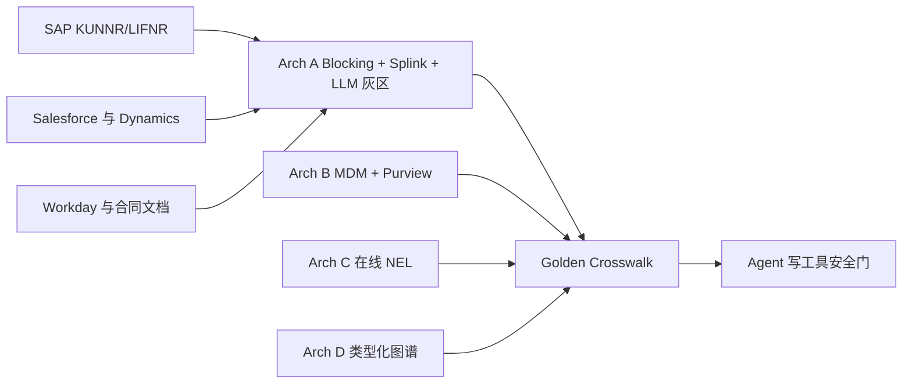
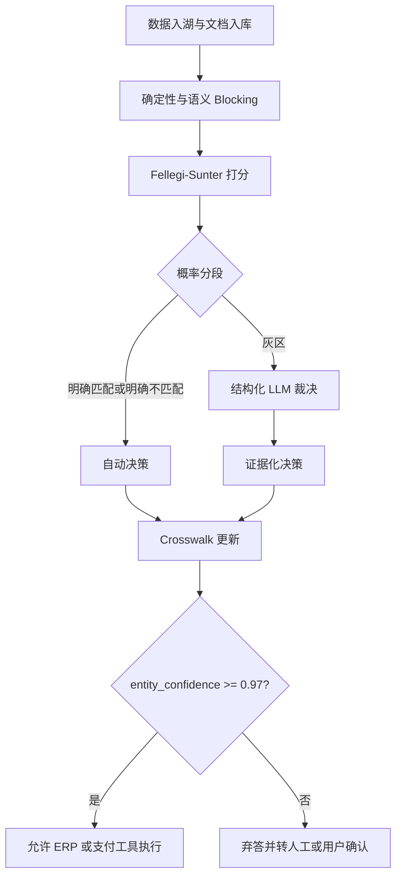
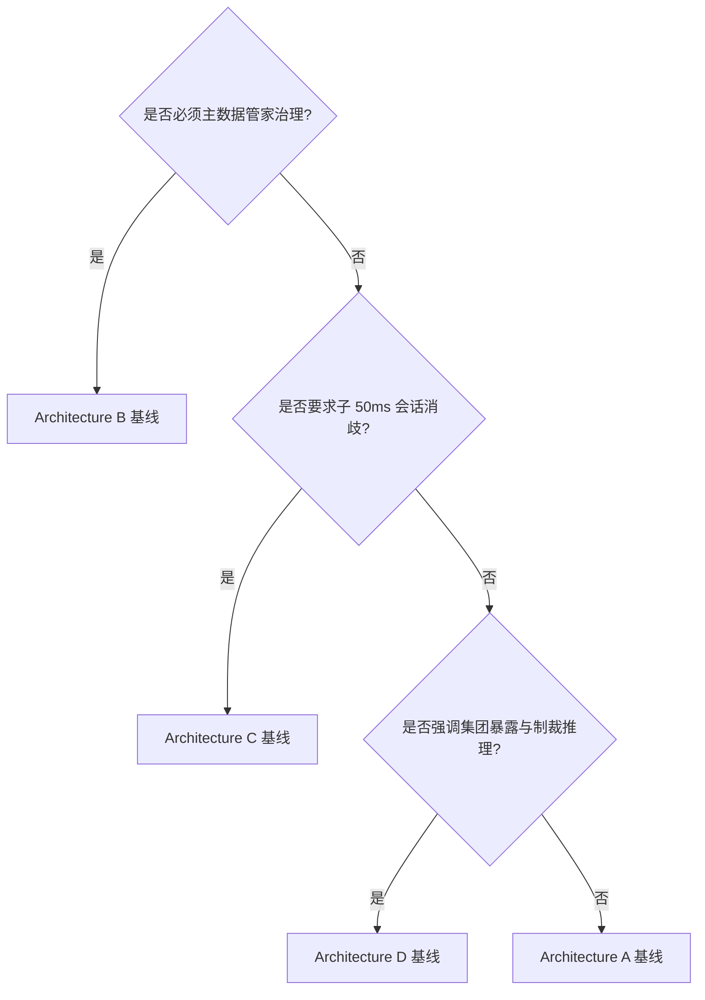

# 企业实体解析与 Golden-ID 归一化选型 FAQ：Splink + LLM 灰区裁决 vs MDM 主数据中台 vs 在线 NEL 解析 vs 类型化等价图谱
> **适用场景**：Customer-360、供应商风险、KYC/制裁、医疗 EMPI，以及需要安全写回的企业智能体流程。
> **决策压力**：系统必须同时避免“同一实体被拆开”和“不同法主体被误并”两类高代价错误。
> **核心产物**：可审计、可回滚、可写回约束的 `canonical_entity_id`。

## 1. 执行摘要
- 企业主数据中同一法主体往往存在大量别名与历史名。
- 不同法主体也可能在文本与向量上表现出极高相似度。
- 仅依赖向量 RAG 会漏掉强别名并放大误并风险。
- 一旦不确定身份进入写工具链路，业务事故概率急剧上升。
- 生产架构必须把“检索召回”与“法主体判定”分层治理。
- 2026 年 Azure 生产实践通常收敛到四类架构。
- Architecture A 适合追求规模化与成本受控的团队。
- Architecture B 适合有强监管与主数据治理要求的企业。
- Architecture C 适合对话时延敏感、需即时澄清的场景。
- Architecture D 适合必须区分等价关系与集团关系的行业。
- 多数组织会按阶段组合两类架构而非单一押注。
- 推荐先落地 A 或 C，再按治理深度引入 B 或 D。

## 2. 适用性与明确非目标
- 本文覆盖 ERP、CRM、HCM 与文档语料混合域的实体解析。
- 本文覆盖多语别名，如 `ACME Ind. Ltd.`、`Acme Industries`、`亚克美工业`。
- 本文覆盖支付、合同、制裁等高风险写回前的身份钉住策略。
- 本文覆盖批处理离线归一与在线会话消歧两种模式。
- 本文不讨论 3.4 #328 的近重复文档 MinHash-LSH 去重。
- 本文不讨论 3.4 #356 的 GraphRAG 主题社区聚合摘要。
- 本文不讨论 3.4 中 Fabric IQ 与 Foundry IQ 的语义本体建模取舍。
- 本文不覆盖与身份无关的数据质量清洗工程。
- 本文不替代法务对复杂股权结构的外部尽调流程。

## 3. 场景与问题物理
- 常见源系统包括 `SAP S/4HANA`、`Salesforce`、`Dynamics 365`、`Workday`。
- 非结构化证据来自 `SharePoint` 合同、发票、开户资料。
- 传统 ID（`KUNNR`、`LIFNR`、本地供应商号）跨系统不稳定。
- 字符串相似度容易把同名异体与关联公司混在一起。
- 向量余弦高并不等于“法律主体同一”。
- 缩写、转写、历史更名会制造高漏判风险。
- 医疗 EMPI 在同名患者上会出现同类误判模式。
- 写回路径的门槛必须显著高于检索路径门槛。

## 4. 四类候选架构
- **Architecture A**：多阶段 Blocking + Fellegi-Sunter + LLM 灰区裁决。
- **Architecture B**：治理型 MDM 中台 + Survivorship 规则 + 数据管家流程。
- **Architecture C**：在线 NEL + 熵门限触发的交互式消歧。
- **Architecture D**：类型化等价/层级图谱 + 可逆 Unmerge 修复。
- Arch-A 通过阻塞显著压缩候选对规模并控制 LLM 成本。
- Arch-B 在审计、可追责与跨系统一致性方面优势明显。
- Arch-C 在会话时延和用户即时确认上体验最佳。
- Arch-D 在制裁、授信与集团暴露分析中语义最完整。

## 5. Architecture A 细节（Fabric + Splink + Foundry）
- 数据先进入 OneLake bronze/silver，再进入实体解析流水线。
- Blocking 同时使用确定性键与语义 canopy。
- 候选对通过 Fellegi-Sunter 进行概率打分。
- 明确匹配与明确不匹配直接自动判定。
- 仅概率灰区进入结构化 LLM 裁决。
- 推荐灰区范围 `0.35 <= P(match) <= 0.88`。
- LLM 输出必须包含证据片段、置信度与可解释理由。
- 判定结果回写 `canonical_entity_id` 跨表映射。
- AI Search 分块索引同步该 crosswalk 用于后续工具过滤。
- Arch-A 可在保持高召回的同时显著降低推理费用。

## 6. Architecture B 细节（Profisee + Purview + Stewardship）
- 数据管家定义字段级 survivorship 与冲突优先级规则。
- Merge/Unmerge 全流程可审计，满足 SOX/HIPAA 诉求。
- Golden Record 通过事件驱动回流 ERP/CRM 业务系统。
- Purview 记录从源到主记录的全链路血缘。
- 高影响合并建议采用 maker-checker 双人审批。
- 当主数据要服务 AI 之外系统时，Arch-B 价值更高。
- 非结构化文档仍需先做 NER/NEL 提取再入 MDM。
- 首期投入通常体现在许可与领域建模周期上。

## 7. Architecture C 细节（在线 NEL + MCP 预解析）
- 会话时先查 alias/BM25/向量混合候选索引。
- bi-encoder 快速召回 top-k 候选实体。
- cross-encoder 输出可校准后验概率。
- 若 `p1 - p2 < δ`，智能体必须弃答并请求澄清。
- Adaptive Card 可展示法名、注册地、税号后缀等线索。
- 用户确认后将实体 ID 钉住到当轮工具参数。
- Arch-C 无需先建设完整离线湖仓管线即可落地。
- 但其缺点是缺少离线传递闭包一致化能力。

## 8. Architecture D 细节（类型化图谱与可逆修复）
- `SAME_AS` 等价边与 `SUBSIDIARY_OF` 层级边必须隔离。
- 集团暴露关系不应反向污染等价簇边界。
- 一条错误桥接边不能导致整簇“雪球式坍塌”。
- 边类型可配置差异化置信阈值与衰减策略。
- min-cut 与弱边诊断用于提前发现合并风险。
- Unmerge 操作需保留版本化 lineage 与重放能力。
- 智能体可同时回答“同一法主体”与“同集团暴露”问题。
- 该架构对金融制裁与授信集中度场景尤为关键。

## 9. 12 维架构对比矩阵
| 维度 | Architecture A | Architecture B | Architecture C | Architecture D |
|---|---|---|---|---|
| 主要目标 | 高规模解析与 LLM 成本受控 | 企业级主数据治理 | 会话内低时延消歧 | 法主体与集团语义分离 |
| 首次价值实现速度 | 快 | 中到慢 | 快 | 中 |
| 离线准确率上限 | 高 | 高 | 中 | 高 |
| 在线时延表现 | 中 | 中 | 最高 | 中 |
| 数据管家流程深度 | 中 | 最高 | 低 | 中 |
| 传递闭包支持 | 高 | 高 | 低 | 高 |
| 可逆 Unmerge 能力 | 中 | 高 | 低 | 最高 |
| 非结构化文档适配 | 高 | 中 | 高 | 中 |
| ERP 写回安全性 | 高 | 最高 | 高 | 高 |
| 成本弹性 | 高 | 中 | 高 | 中 |
| 集团层级推理能力 | 中 | 中 | 低 | 最高 |
| 合规审计完备度 | 高 | 最高 | 中 | 高 |

## 10. 四架构拓扑总览


## 11. 流水线机理（Blocking 到写门禁）


## 12. 架构师选型决策树


### Q1. 为什么纯向量余弦不适合直接做实体归一
- 向量相似度适合召回候选，不适合直接下法主体判决。
- `Bank of China` 与 `Agricultural Bank of China` 可能都在 `cos > 0.91`。
- `IBM` 与 `International Business Machines` 在短文本里反而可能分值偏低。
- 转写、多语言别名会造成语义距离的非线性失真。
- 嵌入更擅长“主题近似”，而不是“法律身份一致”。
- `LLC`、`PLC`、`GmbH` 等后缀具有强法律语义但常被淡化。
- 父子公司语义常被误压到同一邻域簇中。
- 医疗 EMPI 的同名患者问题也遵循同一失败机理。
- 因此向量召回应作为 resolver 输入而非写回依据。

### Q2. Blocking 压缩率、Fellegi-Sunter 与灰区 LLM 成本数学
- 全量两两比对规模是 `N(N-1)/2`，企业级不可承受。
- 候选集记为 `C`，压缩率 `RR = 1 - |C| / (N(N-1)/2)`。
- 确定性键可选 `LEI`、`DUNS`、`TaxID`、邮编、音近编码。
- 语义 canopy 用于补回确定性键漏召的强别名样本。
- Fellegi-Sunter 权重采用 `sum(log2(m_i/u_i))`。
- EM 可在样本分布上估计 `m_i` 与 `u_i` 参数。
- 决策带拆分为自动匹配、自动拒绝、灰区裁决三段。
- 仅 `3%–6%` 灰区进 LLM，通常可实现 `94%–98%` 成本下降。
- 当 `N=10M` 且 blocking 质量高时，候选规模可下降多个数量级。
- LLM 由“主路径”转为“例外路径”，预算更可控。

### Q3. 如何避免传递闭包雪球坍塌并保持可逆修复
- 纯传递闭包在错误桥接边出现时会放大事故半径。
- 一条低质量边可把数百家无关子公司串成单簇。
- 类型化边可避免把“等价”与“归属”关系混淆。
- `SAME_AS` 证据门槛应高于 `SUBSIDIARY_OF`。
- 边阈值可按国家与行业规则进行差异化配置。
- min-cut 与弱边扫描能提前识别高风险桥接点。
- Unmerge 必须保留可审计的 before/after 簇版本。
- 下游修复应支持按版本重放而非全量重算。
- 这样可在不中断业务的前提下控制修复成本。
- 该机制也是审计与合规问责的重要基础。

### Q4. 写工具安全门应如何设计
- 检索阈值与写回阈值必须分离配置。
- 受监管流程建议写门槛从 `entity_confidence >= 0.97` 起步。
- 工具载荷必须包含 `legal_entity_id` 与证据摘要哈希。
- crosswalk 版本过旧或缺失时必须硬拒绝执行。
- 支付、制裁、合同类工具应做服务端 ID 钉住校验。
- 高金额或高风险动作应强制进入人工复核队列。
- 门禁遥测需跟踪弃答率、复核通过率、覆盖率。
- 网关策略应拒绝“未解析实体态”请求。
- 这套门禁把不确定性转化为可治理流程控制。

### Q5. Splink + Foundry + AI Search 的生产实现示例
- 实现目标是把确定性规则、概率模型与 LLM 裁决组合起来。
- Fabric Spark 负责特征工程与并行 blocking。
- Splink 负责概率链接与 EM 参数估计。
- Foundry Batch 仅处理灰区候选，输出结构化证据。
- AI Search 保存 `canonical_entity_id` 供检索与工具过滤。

```python
from splink import DuckDBAPI, Linker
import pandas as pd

records = pd.read_parquet("onelake://silver/entities.parquet")
db = DuckDBAPI()
settings = {
    "link_type": "dedupe_only",
    "blocking_rules_to_generate_predictions": [
        "l.tax_id = r.tax_id",
        "l.postal_code = r.postal_code and l.phonetic_name = r.phonetic_name",
        "l.country = r.country and l.embedding_canopy = r.embedding_canopy"
    ],
    "comparisons": [
        {"output_column_name": "name_sim", "comparison_levels": []},
        {"output_column_name": "address_sim", "comparison_levels": []},
        {"output_column_name": "registry_id_match", "comparison_levels": []}
    ]
}
linker = Linker(records, settings, db_api=db)
linker.training.estimate_u_using_random_sampling(max_pairs=5_000_000)
linker.training.estimate_parameters_using_expectation_maximisation("l.tax_id = r.tax_id")
pred = linker.inference.predict()
grey = pred[(pred["match_probability"] >= 0.35) & (pred["match_probability"] <= 0.88)]
grey.to_parquet("onelake://gold/er_grey_zone.parquet")
```

```python
from openai import AzureOpenAI
import json

client = AzureOpenAI(
    api_version="2026-01-01-preview",
    azure_endpoint="https://<foundry-endpoint>.openai.azure.com/",
    api_key="<managed-through-keyvault>"
)

def adjudicate(pair):
    schema = {
        "type": "object",
        "properties": {
            "decision": {"enum": ["MATCH", "NON_MATCH", "ABSTAIN"]},
            "confidence": {"type": "number"},
            "evidence": {"type": "array", "items": {"type": "string"}},
            "rationale": {"type": "string"}
        },
        "required": ["decision", "confidence", "evidence", "rationale"]
    }
    prompt = {
        "left": pair["left_profile"],
        "right": pair["right_profile"],
        "policy": "Legal entity precision first; no guess without evidence."
    }
    resp = client.responses.create(
        model="gpt-6.1-mini",
        input=[{"role": "user", "content": json.dumps(prompt)}],
        response_format={"type": "json_schema", "json_schema": schema}
    )
    return json.loads(resp.output_text)
```

```json
{
  "tool_name": "erp_vendor_payment_create",
  "preconditions": {
    "entity_confidence_gte": 0.97,
    "crosswalk_version_fresh": true,
    "legal_entity_id_required": true,
    "manual_review_required_if_high_impact": true
  },
  "filters": {
    "azure_ai_search": "canonical_entity_id eq '{legal_entity_id}' and source_quality ge 0.8"
  }
}
```

### Q6. 500K / 10M / 100M 实体规模下的三年 TCO 与 ROI
- 成本曲线受数据规模、治理深度与时延目标共同影响。
- Arch-A 在 blocking 质量稳定时边际成本增长更平滑。
- Arch-B 固定治理投入更高，但跨业务复用价值更大。
- Arch-C 初始投入较低，适合会话优先的业务切入。
- Arch-D 图计算与治理成本增加，但可显著降低合规事故损失。

| 规模 | Architecture A | Architecture B | Architecture C | Architecture D |
|---|---:|---:|---:|---:|
| 500K 实体 | \$0.35M–\$0.65M | \$0.90M–\$1.40M | \$0.30M–\$0.55M | \$0.55M–\$0.95M |
| 10M 实体 | \$1.80M–\$3.20M | \$2.80M–\$4.60M | \$1.10M–\$2.10M | \$2.10M–\$3.60M |
| 100M 实体 | \$9.50M–\$16.00M | \$11.50M–\$19.50M | \$5.80M–\$10.20M | \$10.20M–\$17.80M |

- 在受监管行业，ROI 常由“避免误并事故”主导而非单纯算力成本。
- KYC/制裁场景会因可解释 lineage 获得额外合规收益。
- 医疗 EMPI 场景会因减少重复/拆分病历获得运营收益。
- 供应商风险场景会因法主体准确映射改善授信与履约控制。
- 最终选型应把事故损失期望与运行成本一起计入。

## 13. Day-0 落地清单
- 明确法主体判定目标与写工具风险容忍度。
- 盘点源系统标识符与区域法域字段。
- 定义 canonical ID 编码规范与版本策略。
- 选择首期基线架构及系统边界。
- 区分检索阈值与写回阈值并固化策略。
- 打通弃答与人工升级路径。
- 准备包含多语别名与难负样本的评测集。
- 启用 merge/unmerge 的全链路审计日志。

## 14. Day-2 运营清单
- 定期用新样本重校 Fellegi-Sunter 参数。
- 监控灰区比例漂移与裁决吞吐。
- 复盘人工覆盖与误并根因。
- 轮换并压测高风险工具阈值策略。
- 观察图谱弱边衰减与桥接风险。
- 校验 crosswalk 新鲜度与索引同步 SLA。
- 季度演练回滚与 Unmerge 修复流程。
- 追踪各业务域 TCO、时延与弃答趋势。

## 15. Good fit 与 Not for
| 分类 | 指引 |
|---|---|
| ✅ Good fit | 多源主数据且下游工具执行风险高于召回速度诉求的企业。 |
| ✅ Good fit | 需要可解释、可回滚、可审计实体判定链路的监管行业。 |
| ✅ Good fit | 同时处理 ERP/CRM 与大量非结构化证据的智能体系统。 |
| ⛔ Not for | 单系统、单国家、权威 ID 稳定且几乎无歧义的数据域。 |
| ⛔ Not for | 仅演示问答且永不触发写回动作的轻量场景。 |
| ⛔ Not for | 无法接受“不确定即弃答”治理原则的组织。 |

## 16. 五步实施路径
1. 按时延与治理约束选定基线架构。
2. 建设带版本的 crosswalk 服务与不可变决策记录。
3. 引入灰区裁决与严格写工具安全门。
4. 在制裁/授信域补齐层级图谱语义。
5. 固化管家流程、漂移监控与可逆修复机制。

## 17. Provenance
- `anonymized_reported`：文中指标与模式来自匿名化企业交付观察与可复现实验计算。
