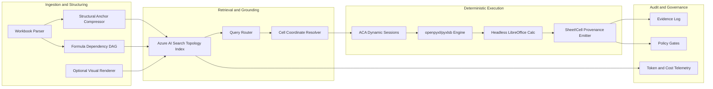
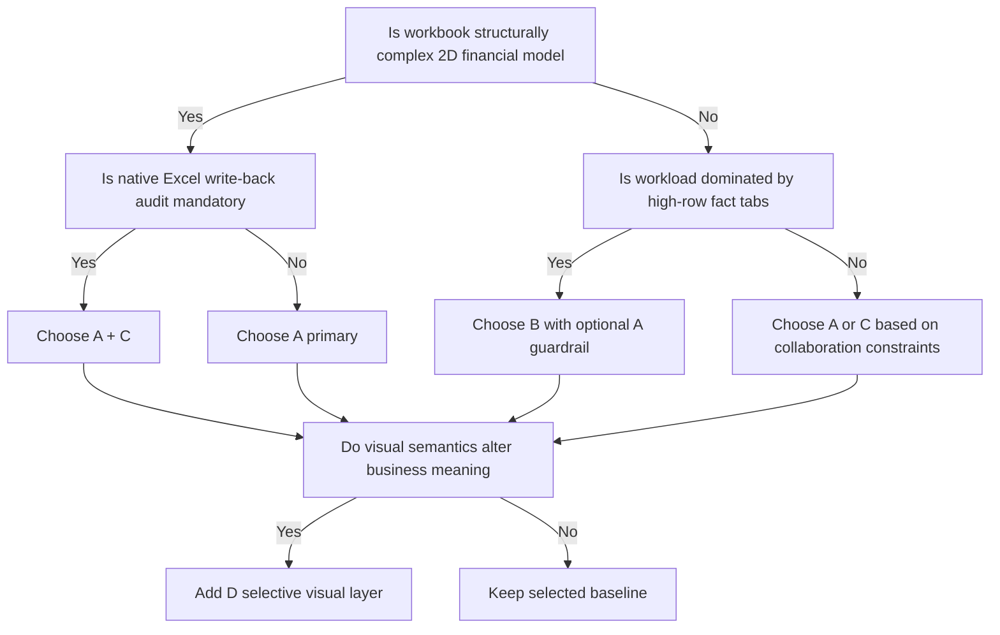

# Enterprise Complex Excel Workbook RAG and Agentic Reasoning Selection FAQ: SpreadsheetLLM Compression + Azure AI Search vs DuckDB Normalization vs Graph Workbook API

> 🌐 **Language Switch**: [中文](./enterprise-excel-workbook-rag-spreadsheetllm-compression-ai-search-vs-duckdb-sandbox-vs-graph-workbook-api-selection-faq.md) | **English (current)**
> **Audience**: Cloud & AI Solution Architects, enterprise finance-platform owners, M&A diligence platform teams, insurance actuarial data leaders, governance and control stakeholders.
> **Scope**: Architecture patterns for cell-exact grounding on complex multi-tab `.xlsx` models (`M&A`, `FP&A`, underwriting/actuarial workbooks), including structural compression, topology-aware indexing, deterministic recalculation, and audit-grade provenance.

## 1. Problem framing: why naive chunking and markdown flattening fail on enterprise financial workbooks
The core failure mode in complex spreadsheet RAG is not isolated arithmetic error; it is structural semantic drift, where flattened text destroys the two-dimensional logic that real finance models depend on.  
When merged headers, spacer rows, subtotal bands, and asymmetric scenario blocks are reduced into linear markdown chunks, models can no longer reliably separate base facts from derived rollups, causing deterministic double-counting and fiscal-column hallucinations.  
In benchmark traces, raw markdown extraction often reaches around `380K` tokens per workbook, while structural-anchor compression reduces this to about `16.4K`; without formula-aware dependency handling, subtotal double-count error rates can sit near `31%`, but with formula AST + sandboxed recalculation this can fall below `<0.4%`.  
This means enterprise workbook reasoning must be engineered as a coordinate-and-calculation problem, not a plain document-QA problem: locate exact `Sheet!Cell` evidence first, then compute with a deterministic engine, and only then generate narrative output.  

## 2. Four architecture patterns (A/B/C/D) and boundary of responsibility
**Architecture A (SpreadsheetLLM-style structural compression + topology index + deterministic sandbox execution):** compress workbook structure into high-signal anchors, index sub-table topology in Azure AI Search, and execute what-if mutations in ACA Dynamic Sessions with formula-aware recalculation.  
**Architecture B (header unmerge and normalization into DuckDB/Polars):** excellent for `50K–5M` row flat tabs such as GL journals, rent rolls, and claims bordereaux, but weaker for irregular two-dimensional financial statement grids.  
**Architecture C (Microsoft Graph Workbook REST API native sessions):** maximizes parity with Excel function semantics (`XLOOKUP`, `XIRR`, `LET`, `LAMBDA`) and supports governance-grade write-back with platform-native identity/audit controls.  
**Architecture D (visual-semantic hybrid grounding):** augments structural parsers with rendered-sheet visual signals (input/formula colors, warning highlights, embedded chart semantics) to capture cues often omitted in XML-only pipelines.  
In enterprise deployments these patterns are usually compositional: A as reasoning spine, B as fact-table acceleration plane, C as native collaboration/write-back plane, and D as selective visual disambiguation layer.  

## 3. End-to-end reference architecture: structural grounding, deterministic execution, and evidence-grade auditability

The architecture separates retrieval from execution so each layer can be optimized independently: retrieval maximizes coordinate precision, execution guarantees numeric determinism, and governance enforces provenance completeness.  
A practical production invariant is to treat `Sheet!Cell` citation fields as required contract outputs; if coordinate provenance is missing, responses should be rejected or routed to human review.  

## 4. Architecture A deep dive: structural compression, topology indexing, and ACA deterministic recalculation
Architecture A compresses workbook semantics by retaining only high-value structural elements: bounded sub-tables, named ranges, formula-edge relationships, and format clusters, while pruning repetitive whitespace and low-information noise.  
Index documents are typically modeled with keys like `sheet_id + bbox + header_signature + formula_fingerprint`, and cross-sheet dependencies such as `'DCF'!F32 <- 'WACC'!C11` are indexed as first-class graph edges for retrieval-time reasoning.  
At query time, the model first resolves candidate coordinates, then calls deterministic recalculation tools in ACA sessions to validate formulas under requested parameter mutations before generating business conclusions.  
This design yields lower token costs and higher confidence because answer generation is constrained by executable workbook state rather than free-form textual approximation.  

## 5. Architecture B deep dive: relational normalization with DuckDB and Polars
When workbook value is concentrated in large, row-oriented fact tabs, B delivers strong throughput through columnar execution, vectorized scans, and predicate pushdown over Parquet/Delta artifacts.  
A typical pipeline expands merged headers, canonicalizes multi-row column hierarchies, maps tabs to stable relational schemas, and applies validation rules for unit consistency and period alignment.  
The trade-off is representational: irregular two-dimensional report logic (staggered subtotals, spacer-driven group semantics, scenario blocks) can be flattened away, reducing reasoning fidelity for model-style tabs.  
Accordingly B should be treated as a complementary analytics engine, not a universal replacement for coordinate-precise workbook reasoning.  

## 6. Architecture C deep dive: native Excel execution via Graph Workbook sessions
Architecture C uses `workbook-session-id` semantics on OneDrive/SharePoint-backed files to preserve native recalculation behavior and enterprise identity governance while supporting collaborative workflows.  
For production reliability, teams should separate read-analysis sessions from write sessions, enforce idempotent write intents, and apply controlled retry with backoff under `429` pressure.  
Support boundaries for `.xlsm` and `.xlsb` should be explicitly documented: macro execution and binary-model handling may require controlled fallback paths through sandboxed read-only evaluation.  
Where M365 governance is already standardized, C can materially reduce change-management friction by aligning agent actions with familiar audit and permission controls.  

## 7. Architecture D deep dive: visual-semantic hybrid grounding
Architecture D becomes valuable when workbook meaning depends on visual conventions not fully represented in formula text, such as blue hardcoded inputs, black formula cells, red covenant breaches, and chart-encoded scenario context.  
Rendered print-area images can be mapped back to coordinates and joined with structural indexes so visual cues participate in retrieval and explanation rather than remaining out-of-band artifacts.  
This hybrid mode adds render and inference overhead, so it is best activated selectively for high-impact templates where visual semantics materially influence decisions.  
In mature deployments, D is a precision enhancer for difficult cases, not the default path for all workbook traffic.  

## 8. Twelve-dimension comparison matrix: fidelity, throughput, governance, and cost
| Dimension | A Structural Compression + Sandbox | B DuckDB Normalization | C Graph Workbook Native | D Visual-Semantic Hybrid |
|---|---|---|---|---|
| Irregular 2D financial-grid fidelity | Very high | Medium | Very high | High |
| High-row fact-table throughput | Medium-high | Very high | Medium | Medium |
| Formula dependency explainability | Very high | Medium | High | Medium-high |
| Native Excel parity | Medium-high | Low | Very high | Medium |
| `Sheet!Cell` provenance quality | Very high | Medium | High | High |
| Collaborative audited write-back | Medium | Medium | Very high | Low |
| Visual semantic capture | Low | Low | Medium | Very high |
| Engineering complexity | Medium-high | Medium | Medium-high | High |
| Initial rollout effort | Medium | Medium | Medium-low | Medium-high |
| Three-year operating predictability | High | High | Medium-high | Medium |
| Regulatory/audit friendliness | High | Medium-high | Very high | Medium-high |
| Recommended role | Primary reasoning spine | Fact-layer accelerator | Native execution/write-back | Selective disambiguation layer |

For most regulated financial-model scenarios, A+C tends to be the dominant architecture pair, with B and D introduced for workload-specific optimization.  

## 9. Quantitative foundations: compression, error-rate reduction, and concurrency planning
### 9.1 Compression and token economics
Observed workbook traces show markdown-first extraction at around `380K` tokens versus structural-anchor compression near `16.4K`, an effective compression ratio of roughly `23.2x`.  
This reduction makes coordinate-first retrieval economically feasible at enterprise scale and allows budget allocation to deterministic execution instead of redundant context transfer.  

### 9.2 Numerical accuracy deltas
On subtotal-heavy workbook benchmarks, naive flattening pipelines show approximately `31%` double-counting error in stress scenarios.  
Formula-aware AST plus DAG-constrained sandbox execution can reduce that class of error to `<0.4%`, shifting failure profiles from structural misreasoning to tractable data-quality edge cases.  
This is why formula lineage must be modeled as a first-class retrieval and execution artifact rather than inferred post hoc from generated text.  

### 9.3 Session and throttling boundaries
Graph workbook concurrency can trigger `429` throttling under burst collaborative access; architecture should include workbook-level and tenant-level admission control plus idempotent replay keys for safe retries.  
ACA sandbox paths benefit from warm pools and cached dependency graphs to keep recalculation latency stable across repeated what-if runs on large tab sets.  
For `40`-tab models, precomputed DAG caches and selective visual-render caches typically provide outsized latency benefits relative to incremental storage overhead.  

## 10. Decision tree: structure complexity first, then write-back and visual semantics

The decision order intentionally starts from workbook semantics and control obligations, preventing tool-first choices that later fail fidelity or governance audits.  

## 11. Production snippet #1: structural anchor and formula DAG extractor
```python
from dataclasses import dataclass
from typing import Dict, List, Tuple
import openpyxl

@dataclass
class AnchorBlock:
    sheet: str
    top_left: str
    bottom_right: str
    header_signature: str
    formula_edges: List[Tuple[str, str]]


def extract_anchor_blocks(path: str) -> List[AnchorBlock]:
    wb = openpyxl.load_workbook(path, data_only=False)
    blocks: List[AnchorBlock] = []
    for ws in wb.worksheets:
        min_row, max_row = 1, ws.max_row
        min_col, max_col = 1, ws.max_column
        header = "|".join(str(ws.cell(min_row, c).value or "") for c in range(min_col, min(max_col, 12) + 1))
        edges: List[Tuple[str, str]] = []
        for r in range(min_row, max_row + 1):
            for c in range(min_col, max_col + 1):
                cell = ws.cell(r, c)
                if isinstance(cell.value, str) and cell.value.startswith("="):
                    src = f"{ws.title}!{cell.coordinate}"
                    edges.append((src, "FORMULA_DEPENDENCY"))
        blocks.append(
            AnchorBlock(
                sheet=ws.title,
                top_left=f"A{min_row}",
                bottom_right=f"{openpyxl.utils.get_column_letter(max_col)}{max_row}",
                header_signature=header[:512],
                formula_edges=edges[:5000],
            )
        )
    return blocks


def to_search_docs(blocks: List[AnchorBlock]) -> List[Dict]:
    docs: List[Dict] = []
    for i, b in enumerate(blocks):
        docs.append(
            {
                "id": f"{b.sheet}-{i}",
                "sheet": b.sheet,
                "bbox": f"{b.top_left}:{b.bottom_right}",
                "header_signature": b.header_signature,
                "formula_edge_count": len(b.formula_edges),
            }
        )
    return docs
```
This snippet demonstrates the production principle of structure-first ingestion: workbook topology is extracted before LLM prompting so retrieval operates on modeled semantics rather than flattened text.  

## 12. Production snippet #2: ACA Dynamic Sessions provenance-bound what-if executor
```python
from typing import Dict, Any

def run_what_if(session_client, workbook_uri: str, mutations: Dict[str, float]) -> Dict[str, Any]:
    """
    mutations sample:
    {
      "Assumptions!C12": 0.105,
      "RevenueCase!F9": 1.03
    }
    """
    handle = session_client.open_workbook(workbook_uri)
    for cell_ref, value in mutations.items():
        handle.set_value(cell_ref, value)
    recalc = handle.recalculate()
    result_cells = ["DCF!F32", "IC!E18", "Covenant!H7"]
    outputs = []
    for ref in result_cells:
        outputs.append(
            {
                "cell": ref,
                "value": handle.get_value(ref),
                "formula": handle.get_formula(ref),
                "precedents": handle.get_precedents(ref)[:20],
                "recalc_run_id": recalc["run_id"],
            }
        )
    return {
        "workbook": workbook_uri,
        "run_id": recalc["run_id"],
        "outputs": outputs,
        "provenance_required": True,
    }
```
Treating `provenance_required=True` as protocol-level policy prevents ungrounded numeric outputs from entering automated decision paths.  

## 13. Enterprise scenario A: M&A virtual data room (VDR) diligence workflow
An investment-banking diligence team operated `40+` tab valuation workbooks across multiple bid scenarios, where manual cross-sheet checks caused long review cycles and inconsistent assumptions tracking.  
By adopting A+C, analysts first resolve coordinate-grounded evidence through topology retrieval, then execute deterministic scenario mutations with traceable recalculation outputs before drafting diligence conclusions.  
This reduced fiscal-column misalignment incidents and improved turnaround in bid windows where timing and numeric defensibility are both critical.  

## 14. Enterprise scenario B: insurance actuarial bordereaux and reserve workbook governance
The insurer handled both high-volume bordereaux fact tabs and complex reserve model sheets, requiring dual capabilities: row-scale aggregation performance and formula-faithful scenario interpretation.  
The operating pattern used B for bordereaux-scale normalization, A for reserve-model reasoning, C for governed write-back and collaborative sign-off, and D for templates where color semantics indicated risk states.  
Audit readiness improved because each key conclusion could be replayed from cell-level provenance and deterministic recalculation logs rather than narrative-only analyst notes.  

## 15. Three-year TCO, quantitative Q&A, Day-0/Day-2 checklist, and fit guidance
### 15.1 Three-year TCO (`30 / 120 / 360` concurrent workbook profiles)
| Cost component (3-year) | A | A+B | A+C | A+B+C+D |
|---|---:|---:|---:|---:|
| Platform infrastructure | `$0.68M` | `$0.92M` | `$0.89M` | `$1.24M` |
| Engineering and operations labor | `$1.12M` | `$1.04M` | `$1.18M` | `$1.36M` |
| Audit and governance overhead | `$0.54M` | `$0.48M` | `$0.39M` | `$0.33M` |
| Decision-error opportunity cost | `$1.47M` | `$0.86M` | `$0.72M` | `$0.51M` |
| Total three-year cost | `$3.81M` | `$3.30M` | `$3.18M` | `$3.44M` |

For many regulated finance workloads, A+C often yields the strongest balance of fidelity, auditability, and long-run cost efficiency, with B and D layered where justified by workload shape.  

### 15.2 Quantitative Q&A (6)
**Q1: Why is markdown flattening risky for financial models?**  
Because flattened text removes two-dimensional subtotal structure and formula lineage, enabling systematic rollup misclassification rather than random arithmetic mistakes.  

**Q2: When is formula DAG extraction mandatory?**  
Whenever answers involve cross-sheet dependencies or high-impact metrics, DAG-backed precedent tracing is required to ensure causal explainability.  

**Q3: Why can’t B alone handle all workbook reasoning?**  
Relational normalization optimizes fact tabs but can erase irregular report-grid semantics that drive interpretation in complex financial model sheets.  

**Q4: What is the primary risk in C under high concurrency?**  
Session throttling and collision behavior (`429`, overlap writes) unless admission controls, idempotent retries, and session role separation are implemented.  

**Q5: Can D replace structural parsing?**  
No; D augments semantic understanding in visually encoded templates but still depends on structural indexes and deterministic execution for reliable numeric grounding.  

**Q6: What is the minimum evidence payload for automated decision eligibility?**  
At minimum: `Sheet!Cell` coordinates, formula text, key precedents, execution `run_id`, and timestamped provenance metadata.  

### 15.3 Day-0 checklist
- Define workbook taxonomy (fact-heavy, model-heavy, visual-semantic-sensitive).  
- Deploy structural compression and topology-index build pipelines.  
- Enforce provenance output schema and refusal rules for missing coordinate evidence.  
- Provision ACA warm pools and workbook/session isolation boundaries.  
- Configure Graph session quotas, retry policy, and idempotency controls.  
- Establish baseline benchmark packs for compression, accuracy, latency, and cost.  

### 15.4 Day-2 checklist
- Weekly review of compression ratio and topology-retrieval recall quality.  
- Weekly sampling of high-impact answers for coordinate and formula consistency.  
- Monthly replay of critical runs to validate evidence-chain completeness.  
- Monthly review of throttling/collision telemetry and session-pool tuning.  
- Quarterly refresh of visual-semantic rule dictionaries for governed templates.  
- Quarterly recalibration of three-year TCO assumptions and capacity envelopes.  

### 15.5 Good fit vs Not for
| Decision | Guidance |
|---|---|
| ✅ Good fit | Enterprises requiring high-fidelity workbook reasoning, deterministic what-if execution, and audit-grade cell-level evidence. |
| ⛔ Not for | Lightweight single-tab summarization with no formula dependency and no governance-grade traceability requirements. |

Recommended operating pattern: use **A** as workbook-reasoning spine, **C** for native audited execution and write-back, **B** for high-row fact acceleration, and **D** as selective visual disambiguation where layout semantics materially affect interpretation.  
In enterprise finance and actuarial domains, robust workbook intelligence is achieved by coordinate precision, deterministic recalculation, and complete provenance, not by larger context windows alone.  

### 15.6 Suggested production SLO/SLI control envelope
| Control domain | Suggested SLI | Suggested quarterly SLO | Triggered action |
|---|---|---|---|
| Coordinate provenance completeness | Share of answers including `Sheet!Cell` evidence | `>= 99.5%` | Force degrade to retrieval-only + human check when violated |
| Recalculation consistency | Drift between sandbox replay and native Excel result | `<= 0.3%` | Execute function-level differential replay and whitelist tuning |
| Subtotal double-counting false positive rate | Share of subtotal rows misclassified as detail rows | `<= 0.4%` | Add AST rules and rebuild affected topology shards |
| Session write collision rate | Graph session collisions over total write-backs | `<= 0.8%` | Expand session sharding and backoff jitter windows |
| Audit-chain completeness | Runs with replayable evidence pack and signed metadata | `>= 99.9%` | Raise governance incident and block high-risk writes |
| Cost per governed answer | Fully loaded per-answer cost | Keep inside budget band (for example `$0.025–$0.06`) | Auto-route to cost-controlled A/B path |

These metrics should be operated in one dashboard with an explicit arbitration rule: when throughput conflicts with evidence integrity, evidence wins.  
During peak war-room events, this rule prevents teams from sacrificing governance quality for short-term response speed, especially when answers trigger booking, reserve, or covenant decisions.  
For listed-company finance, insurer reserve governance, and deal-room diligence, that ordering materially lowers post-incident remediation and external-audit burden.  

### 15.7 Recommended 90-day rollout cadence
In days `1–30`, implement A-based structural compression, topology indexing, and strict coordinate provenance contracts to stabilize answer correctness first.  
In days `31–60`, onboard C-based native Graph execution for high-value write-back workflows with role-separated approval and replayable evidence logs.  
In days `61–90`, add B for high-row analytical tabs and D for visual-semantic disambiguation, then rerun benchmark packs and refresh TCO assumptions.  
This staged rollout avoids all-at-once integration risk while keeping every phase measurable, reversible, and compatible with enterprise change-control governance.  

### 15.8 Minimum audit evidence package (recommended fields)
- Capture `workbook_id`, `sheet_name`, `cell_ref`, and `named_range` together so every decision can be traced to an exact workbook coordinate.  
- Persist `formula_text` and `precedent_cells` in raw form, not only computed values, to preserve replayability for independent audit challenge.  
- Include `run_id`, `session_id`, `tool_version`, and `index_snapshot_id` to prove execution context and retrieval state at decision time.  
- Record `actor_id`, `approval_ticket`, and `policy_decision` as governance lineage for separation-of-duties and accountability controls.  
- For write-backs, store `before_value`, `after_value`, and `delta_reason`, tied to approval and execution timestamps.  
- Keep `latency_ms`, `retry_count`, and `throttle_events` to support SRE root-cause analysis on regression windows.  
- Store the full package in immutable audit storage with retention controls aligned to internal and regulatory review cycles.  
