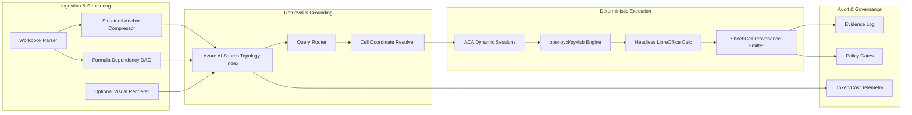
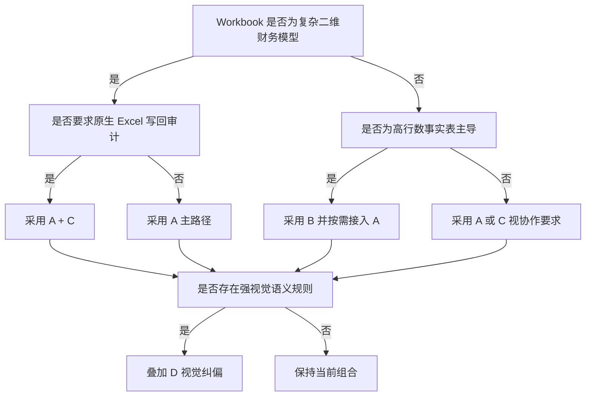

# 企业复杂 Excel 工作簿 RAG 与 Agent 推理选型 FAQ：SpreadsheetLLM 压缩 + AI Search vs DuckDB 归一化 vs Graph Workbook API 原生执行

> 🌐 **Language Switch**：**中文（当前）** | [English](./enterprise-excel-workbook-rag-spreadsheetllm-compression-ai-search-vs-duckdb-sandbox-vs-graph-workbook-api-selection-faq.en.md)
> **受众**：Cloud & AI Solution Architect、企业财务数据平台主管、投行并购分析平台负责人、保险精算建模团队、数据治理与内控团队。
> **范围**：面向 `40` 工作表级复杂 `.xlsx`（M&A、FP&A、承保/精算），对比结构压缩检索、关系化归一、原生 Excel 会话 API 与视觉语义混合方案，给出可落地的 cell-exact grounding 参考架构与治理门禁。

## 1. 问题定义：为何 naive chunking 和 markdown flattening 会在财务工作簿中系统性失真
企业在把复杂 Excel 直接做“按行切块 + Markdown 平铺”时，最常见错误不是单点计算误差，而是系统性语义错位：模型把小计行当明细行、把空白分隔带当结构边界、把跨 sheet 引用当独立事实。  
在 `40` 工作表并含多层合并表头的 M&A 模型里，这类错位会触发双重计数、跨期口径串表和 fiscal column 错位，导致看似“有引用”的答案仍然与真实账簿逻辑不一致。  
基准对比显示，原始 Markdown 展开可达 `380K` tokens，而结构锚点压缩后仅 `16.4K` tokens；若不做公式 DAG 与小计识别，双重计数错误率约 `31%`，引入公式感知执行后可降至 `<0.4%`。  
因此该类任务的核心不是“把表读出来”，而是“把二维结构与公式依赖作为一等公民”，让模型先定位 `Sheet!Cell`，再通过真实计算引擎给出可审计结论。  

## 2. 四种架构模式（A/B/C/D）与职责边界
**Architecture A（SpreadsheetLLM 风格结构压缩 + 拓扑索引 + 沙箱复算）**：通过结构锚点剪枝、倒排聚合和格式簇压缩，把工作簿语义压缩到可检索 token 预算内，并在 ACA Dynamic Sessions 中用真实引擎执行假设变更。  
**Architecture B（表头归一化到 DuckDB/Polars）**：适用于大量平面事实表（总账、租约、赔案明细），对 `50K–5M` 行数据分析效率高，但对二维财务报表与不规则场景块表达能力有限。  
**Architecture C（Graph Workbook API 原生会话）**：直接依赖 Microsoft Graph 的 workbook session 与 Excel 原生函数体系，保证 `XLOOKUP/XIRR/LET/LAMBDA` 一致性并支持审计化写回。  
**Architecture D（视觉语义混合）**：把打印区域渲染为图像并叠加 VLM 布局理解，补足纯 XML 解析难以捕获的颜色语义、视觉标注与嵌入图表信号。  
在生产实践里，A 常作为主路径，B 作为高行数事实层补充，C 作为高保真写回与协作路径，D 作为复杂视觉语义纠偏层。  

## 3. 端到端参考架构：结构压缩检索、坐标归因、沙箱复算与审计落库

该架构强调“检索平面”和“执行平面”解耦：检索层负责找准坐标与依赖，执行层负责算准结果并输出可复核证据。  
当组织要求“回答必须可追溯到具体单元格”时，`Sheet!Cell` provenance 应作为必填字段进入响应协议，缺失即触发拒答或降级到人工复核。  

## 4. Architecture A 详解：结构锚点压缩 + AI Search 拓扑索引 + ACA 复算
A 的关键价值是把“重复空格、空白列、样式噪声”剥离，只保留命名区域、边界框子表、公式引用边和关键格式簇，把 token 预算留给高价值结构。  
在索引层，建议把每个子表块建模为 `sheet_id + bbox + header_signature + formula_fingerprint`，并把跨表依赖如 `'DCF'!F32 <- 'WACC'!C11` 作为图边索引，避免问答阶段再做昂贵全表扫描。  
在执行层，查询先产出候选坐标，再进入 ACA Dynamic Sessions 调用 `openpyxl + calc` 复算，返回值必须携带来源坐标、公式文本、前置依赖摘要和执行时间戳。  
对并发场景，可按 workbook 粒度缓存 DAG 与锚点索引，按 session 粒度隔离参数改写，防止多个分析员互相污染假设输入。  

## 5. Architecture B 详解：多区域表头拆解归一到 DuckDB/Polars
当工作簿核心是高行数事实表时，B 的收益非常明显：列式存储、向量化执行和谓词下推可显著降低扫描成本，并易于接入企业既有 SQL 语义层。  
典型流程是先做合并表头展开与层级列名规范化，再把每个 sheet 映射为 Parquet/Delta 分区，最后由 DuckDB/Polars 执行聚合与窗口分析。  
但该模式对“二维财务语义块”天然不友好，例如交错小计、跨栏场景块、空白行分节，这些语义在行列归一后往往被冲平，导致解释层丢失结构上下文。  
因此 B 最适合作为“事实层引擎”，不应独立承担复杂财务模型推理主链路。  

## 6. Architecture C 详解：Graph Workbook API 原生会话与 Excel 保真执行
C 通过 `workbook-session-id` 在 OneDrive/SharePoint 持久会话中调用原生引擎，最大优势是与 Excel 桌面语义一致，复杂函数与命名区域行为可复现。  
在并发治理上，建议区分只读分析会话与写回会话，写回路径需附带审批上下文与冲突检测策略，并对 `429` 进行指数退避与幂等重放控制。  
对 `.xlsm/.xlsb` 场景，要提前定义支持边界：宏执行与二进制格式解析可能受平台约束，必要时以 A 沙箱路径提供只读推理并保留人工签发环节。  
若企业已有 M365 审计与权限体系，C 能显著降低“外部沙箱写回”引发的合规阻力。  

## 7. Architecture D 详解：视觉语义混合（图像布局 + 文档理解）
D 的典型价值在于补足“颜色/格式即语义”的财务模板，例如蓝色代表硬编码输入、黑色代表公式、红色代表 covenant breach。  
纯结构解析器通常不会把这些视觉约定作为一等信号，模型在解释“哪个值可改、哪个值不可改”时容易误判。  
通过打印区域渲染 + VLM 布局 grounding，可把色彩、边框、批注、嵌入图表标题映射回坐标层，再与 A/C 执行层结合形成双证据链。  
该模式额外增加渲染与推理成本，建议只在“视觉语义显著影响决策”的工作簿上按需启用。  

## 8. 12 维对比矩阵：准确性、可追溯性、吞吐与成本
| 维度 | A 结构压缩+沙箱 | B DuckDB 归一 | C Graph Workbook | D 视觉语义混合 |
|---|---|---|---|---|
| 复杂二维表语义保真 | 很高 | 中 | 很高 | 高 |
| 高频事实表吞吐 | 中高 | 很高 | 中 | 中 |
| 公式依赖可解释性 | 很高 | 中 | 高 | 中高 |
| 原生 Excel 一致性 | 中高 | 低 | 很高 | 中 |
| `Sheet!Cell` 证据链 | 很高 | 中 | 高 | 高 |
| 多人协作写回能力 | 中 | 中 | 很高 | 低 |
| 视觉语义捕获 | 低 | 低 | 中 | 很高 |
| 工程复杂度 | 中高 | 中 | 中高 | 高 |
| 初次落地成本 | 中 | 中 | 中低 | 中高 |
| 三年运营成本可预测性 | 高 | 高 | 中高 | 中 |
| 合规审计友好度 | 高 | 中高 | 很高 | 中高 |
| 推荐定位 | 主路径 | 事实层补充 | 原生执行/写回 | 视觉纠偏 |

矩阵结论是：A+C 常构成主干组合，B 强化明细分析吞吐，D 用于视觉语义高敏场景的精准补偿。  

## 9. 关键量化：压缩收益、误差率与并发边界
### 9.1 Token 压缩
原始 Markdown 展开平均 `380K` tokens，结构锚点压缩后可降至 `16.4K`，压缩比约 `23.2x`。  
压缩后检索召回延迟与提示成本显著下降，使“先定位再计算”成为可持续路径。  

### 9.2 数值准确性
naive RAG 在含多级小计的财务表上双重计数错误率约 `31%`。  
引入公式 AST + DAG + 沙箱复算后，该类错误率可降至 `<0.4%`。  
关键在于将 subtotal/total 识别作为结构规则，而非让模型从文本猜测。  

### 9.3 并发与节流
Graph Workbook 会话在高并发下可能出现 `429`，建议按工作簿与租户双维限流，并设置写回重试幂等键。  
ACA 沙箱路径建议使用 warm pool，确保 what-if 复算在可控 P95 内完成。  
对 `40` tab 级模型，建议把 DAG 构建与视觉渲染前置缓存，避免重复冷启动。  

## 10. 选型决策树：先看结构复杂度，再看写回刚性与视觉语义

该决策树可避免“先选工具再找场景”的反向决策，把结构特性与审计要求作为首要输入。  

## 11. 生产代码片段一：SheetCompressor 结构锚点 + 公式 DAG 提取
```python
from dataclasses import dataclass
from typing import Dict, List, Tuple
import openpyxl

@dataclass
class CellRef:
    sheet: str
    cell: str

@dataclass
class AnchorBlock:
    sheet: str
    top_left: str
    bottom_right: str
    header_signature: str
    formula_edges: List[Tuple[str, str]]


def extract_anchor_blocks(path: str) -> List[AnchorBlock]:
    wb = openpyxl.load_workbook(path, data_only=False)
    blocks: List[AnchorBlock] = []
    for ws in wb.worksheets:
        # 示例：按非空边界框提取子表，真实生产可替换为更精细启发式
        min_row, max_row = 1, ws.max_row
        min_col, max_col = 1, ws.max_column
        header = "|".join(str(ws.cell(min_row, c).value or "") for c in range(min_col, min(max_col, 12) + 1))
        edges: List[Tuple[str, str]] = []
        for r in range(min_row, max_row + 1):
            for c in range(min_col, max_col + 1):
                cell = ws.cell(r, c)
                if isinstance(cell.value, str) and cell.value.startswith("="):
                    src = f"{ws.title}!{cell.coordinate}"
                    # 简化示例：真实实现应使用公式解析器抽取依赖
                    edges.append((src, "FORMULA_DEPENDENCY"))
        blocks.append(
            AnchorBlock(
                sheet=ws.title,
                top_left=f"A{min_row}",
                bottom_right=f"{openpyxl.utils.get_column_letter(max_col)}{max_row}",
                header_signature=header[:512],
                formula_edges=edges[:5000],
            )
        )
    return blocks


def to_search_docs(blocks: List[AnchorBlock]) -> List[Dict]:
    docs = []
    for i, b in enumerate(blocks):
        docs.append(
            {
                "id": f"{b.sheet}-{i}",
                "sheet": b.sheet,
                "bbox": f"{b.top_left}:{b.bottom_right}",
                "header_signature": b.header_signature,
                "formula_edge_count": len(b.formula_edges),
            }
        )
    return docs
```
该代码示例强调“先抽结构，再建索引”，而不是直接把整表文本展开给模型。  

## 12. 生产代码片段二：ACA Dynamic Sessions 单元格归因复算工具
```python
from typing import Dict, Any

def run_what_if(session_client, workbook_uri: str, mutations: Dict[str, float]) -> Dict[str, Any]:
    """
    mutations 示例:
    {
      "Assumptions!C12": 0.105,
      "RevenueCase!F9": 1.03
    }
    """
    handle = session_client.open_workbook(workbook_uri)
    for cell_ref, value in mutations.items():
        handle.set_value(cell_ref, value)
    recalc = handle.recalculate()
    result_cells = ["DCF!F32", "IC!E18", "Covenant!H7"]
    outputs = []
    for ref in result_cells:
        outputs.append(
            {
                "cell": ref,
                "value": handle.get_value(ref),
                "formula": handle.get_formula(ref),
                "precedents": handle.get_precedents(ref)[:20],
                "recalc_run_id": recalc["run_id"],
            }
        )
    return {
        "workbook": workbook_uri,
        "run_id": recalc["run_id"],
        "outputs": outputs,
        "provenance_required": True,
    }
```
实践中建议把 `provenance_required=True` 作为协议级硬约束，缺失坐标来源的结果一律不进入自动决策链。  

## 13. 企业场景一：M&A 虚拟数据室（VDR）质量与口径一致性审阅
某投行在并购尽调中需同时分析 `40+` 个工作表、多个情景版本和跨表估值逻辑，历史流程依赖人工抽样核对，响应速度与一致性难以保障。  
引入 A+C 后，分析员先通过锚点检索定位关键单元格，再在沙箱/原生会话中做参数扰动复算，系统返回带 `Sheet!Cell` 证据的结论。  
上线后，模型辅助审阅把“口径冲突定位时间”从小时级降到分钟级，且显著降低“引用了错误 fiscal 列”的答复风险。  

## 14. 企业场景二：保险精算 bordereaux 与准备金模型审计
保险集团每月接收大批量 bordereaux 明细，同时维护复杂准备金工作簿，既有高行数事实分析需求，也有复杂公式与场景块推演需求。  
团队采用 B 处理明细汇总，A 处理复杂模型推演，C 做审批写回，D 用于识别红色 breach 视觉标注与嵌入图表异常。  
该组合使月度对账与审计准备更稳定：事实层吞吐与模型层可解释性同时提升，审计问询时可快速回放来源坐标与重算链路。  

## 15. 三年 TCO、定量 Q&A、Day-0/Day-2 清单与适配结论
### 15.1 三年 TCO（`30/120/360` 工作簿并发规模）
| 成本项（3 年） | A | A+B | A+C | A+B+C+D |
|---|---:|---:|---:|---:|
| 平台基础设施 | `$0.68M` | `$0.92M` | `$0.89M` | `$1.24M` |
| 工程与运维人力 | `$1.12M` | `$1.04M` | `$1.18M` | `$1.36M` |
| 审计与治理成本 | `$0.54M` | `$0.48M` | `$0.39M` | `$0.33M` |
| 错误决策机会成本 | `$1.47M` | `$0.86M` | `$0.72M` | `$0.51M` |
| 三年综合成本 | `$3.81M` | `$3.30M` | `$3.18M` | `$3.44M` |

对多数高价值财务模型，`A+C` 常是性价比最优主干；若视觉语义影响重大，再按需叠加 D。  

### 15.2 定量 Q&A（6 项）
**Q1：为什么仅做 Markdown flattening 风险高？**  
因为它会丢失二维结构边界和公式依赖，模型容易把 subtotal 当明细导致系统性双重计数。  

**Q2：何时必须引入公式 DAG？**  
只要答案涉及跨 sheet 推导或敏感财务指标，就应强制启用 DAG 与 precedents 引用链。  

**Q3：B 模式为什么不能单独覆盖复杂财务报表？**  
行列归一会弱化不规则二维语义块，导致模型解释层缺失关键上下文。  

**Q4：Graph Workbook API 的主要风险点是什么？**  
并发 `429`、会话冲突与格式支持边界，需要会话隔离与幂等重试策略。  

**Q5：D 模式是否可替代结构解析？**  
不能，D 更适合视觉纠偏，仍需与结构索引和复算引擎组合。  

**Q6：如何定义“可用于自动决策”的最小证据？**  
至少包含 `Sheet!Cell` 坐标、公式文本、前置依赖摘要、执行 run_id 与时间戳。  

### 15.3 Day-0 上线清单
- 建立工作簿分级标准（简单事实表/复杂二维模型/视觉高敏模板）。  
- 上线结构锚点压缩与拓扑索引流水线。  
- 定义 `Sheet!Cell` provenance 响应契约与拒答策略。  
- 建立 ACA 动态会话 warm pool 与隔离策略。  
- 配置 Graph 会话限流、重试和幂等键。  
- 建立基准集（压缩率、误差率、时延、成本）。  

### 15.4 Day-2 运营清单
- 每周复核压缩率与检索召回质量，防止结构退化。  
- 每周抽检关键指标答案的坐标与公式一致性。  
- 每月回放高风险问答 run，检查证据链完整性。  
- 每月复盘 `429` 与会话冲突，优化并发池参数。  
- 每季度更新视觉语义规则库与模板映射。  
- 每季度重估三年 TCO 参数与容量规划。  

### 15.5 Good fit vs Not for
| 结论 | 说明 |
|---|---|
| ✅ Good fit | 需要对复杂财务工作簿做高可信检索、可追溯推理、参数扰动复算与审计证据输出的企业。 |
| ⛔ Not for | 仅做轻量单表摘要、无公式依赖与无审计要求的低风险场景。 |

建议组合：以 **A** 作为复杂工作簿主路径、以 **C** 保障原生执行与写回合规、以 **B** 承担高行数事实分析、以 **D** 补齐视觉语义盲区。  
在企业财务与精算场景中，真正可靠的 Agent RAG 不是“读得多”，而是“定位准、算得准、证据全”。  

### 15.6 SLO/SLI 与风控阈值建议（生产巡检口径）
| 控制面 | 建议 SLI | 建议 SLO（季度） | 触发动作 |
|---|---|---|---|
| 坐标归因完整率 | 回答中带 `Sheet!Cell` 的比例 | `>= 99.5%` | 低于阈值即强制降级为“仅检索+人工复核” |
| 复算一致率 | 沙箱复算与原生 Excel 差异率 | `<= 0.3%` | 启动公式函数白名单与差异定位回放 |
| 双重计数误报率 | subtotal 被误当明细的占比 | `<= 0.4%` | 追加 subtotal AST 规则并重建索引 |
| 并发冲突率 | Graph 会话冲突 / 总写回 | `<= 0.8%` | 自动扩大会话分片并延长抖动退避 |
| 证据链可审计率 | run_id 可回放且证据齐全比例 | `>= 99.9%` | 触发审计告警与流水线阻断 |
| 单问答成本 | 每次问答综合成本 | 维持在预算带内（如 `$0.025–$0.06`） | 自动切换到成本受控路径（A/B） |

建议将上述指标写入统一运营看板，并按“可追溯性优先于吞吐”进行冲突裁决。  
当业务压力高峰导致吞吐与证据完整率发生冲突时，治理策略应优先保留可审计性，并主动限制高风险写回动作。  
对于上市公司财报支持、保险准备金审计与投行交易模型审阅等场景，这一优先级能显著降低事后追责成本。  

### 15.7 实施节奏建议（90 天）
第 `1–30` 天先落地 A 的结构压缩、拓扑索引与坐标归因契约，确保“先答对、可复盘”。  
第 `31–60` 天引入 C 的 Graph 原生执行，把高价值写回流程纳入权限隔离与审计闭环。  
第 `61–90` 天按数据形态引入 B（高行数事实分析）与 D（视觉语义纠偏），并完成基准重跑与成本复盘。  
该节奏可避免一次性“全栈并发上线”带来的排障失焦，同时保证每一阶段都有可验证收益与清晰回滚点。  

### 15.8 审计取证最小数据包（建议字段）
- `workbook_id`、`sheet_name`、`cell_ref` 与 `named_range` 必须同时记录，确保审计时能从问题直达单元格。  
- `formula_text` 与 `precedent_cells` 需要原样保留，避免只存结果值导致复盘失真。  
- `run_id`、`session_id`、`tool_version`、`index_snapshot_id` 用于确认“当时执行环境”与索引版本。  
- `actor_id`、`approval_ticket`、`policy_decision` 作为权限与治理链路证据，支撑责任归属。  
- 对写回操作记录 `before_value`、`after_value`、`delta_reason`，并绑定审批事件时间线。  
- 保留 `latency_ms`、`retry_count`、`throttle_events` 便于排查性能与可用性回归根因。  
- 统一以不可变审计日志存储并设置保留策略，满足内控与外部审计抽样要求。  
