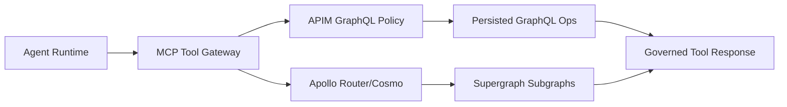
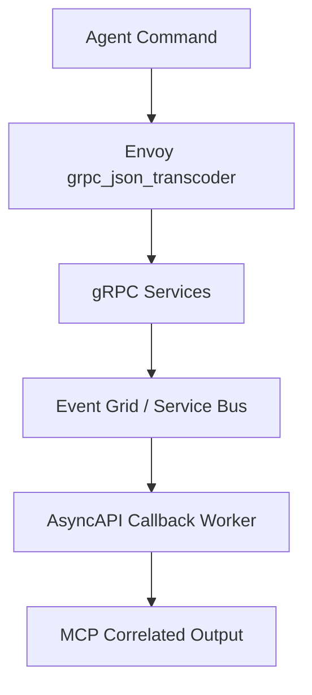

# Enterprise GraphQL / gRPC / AsyncAPI to MCP Tool Federation Selection FAQ: APIM GraphQL Policy Projection vs Apollo Router Supergraph vs Envoy gRPC Transcoding Event Bridge

## 1. Background: integration bottlenecks have moved beyond REST CRUD

Enterprise platforms increasingly expose three primary interface families:

- GraphQL supergraphs,
- gRPC protobuf services,
- AsyncAPI event streams.

Directly exposing these raw interfaces to LLM-generated requests creates new risk classes:

- oversized GraphQL introspection payloads and context exhaustion,
- deep nested query fan-out and N+1 blast radius,
- field-level PII over-fetching,
- protobuf `oneof/int64/enum` serialization mismatch,
- correlation-ID loss in async callbacks.

The design goal is therefore not raw protocol exposure, but governed MCP tool projection by bounded context.

## 2. Three options

**Option A: APIM GraphQL policy gate + persisted-operation MCP projection**

Core controls:

- complexity/depth quota policies,
- persisted-operation allowlist,
- field-level identity checks,
- MCP tool projection by business capability.

**Option B: Apollo Router/Cosmo supergraph + MCP server**

Core controls:

- supergraph-native operation governance,
- persisted query allowlist,
- semantic field pruning and schema-slice discovery.

**Option C: Envoy grpc_json_transcoder + AsyncAPI request-reply bridge**

Core controls:

- protobuf descriptor governance,
- protocol-safe transcoding,
- correlation-ID command-callback stitching.

## 3. 12-dimension selection matrix

| Dimension | Option A: APIM GraphQL Projection | Option B: Apollo Router MCP | Option C: Envoy + Event Bridge |
|---|---|---|---|
| Delivery speed | high | medium | medium |
| GraphQL semantic fidelity | medium | high | low-medium |
| Field-level governance | high | high | medium |
| Query-depth blast protection | high | high | medium |
| gRPC affinity | low | low-medium | high |
| Async event integration | medium | medium | high |
| mTLS/OBO propagation | high | high | high |
| Ops complexity | medium | high | medium-high |
| Token-budget control | high | high | medium |
| Schema evolution governance | high | high | medium |
| 3-year TCO | medium | medium-high | medium |
| Typical fit | centralized governance first | GraphQL-first product orgs | gRPC/event-heavy orgs |

## 4. Option A deep dive: APIM as policy-first GraphQL governor

Option A is usually strongest where governance centralization is a hard requirement.

Typical production posture:

- introspection disabled by default in production,
- strict depth/size limits,
- role-bound field access,
- persisted operations as the only MCP-callable actions.

This minimizes uncontrolled query generation risk and improves audit explainability.

## 5. Option B deep dive: supergraph-native governance with MCP tooling

Option B preserves maximum supergraph semantics.

It is attractive when organizations already operate mature GraphQL federation practices.

Key strengths:

- subgraph-aware routing control,
- operation-level allowlisting,
- richer schema-driven tool discovery.

The tradeoff is higher platform complexity and stronger operational skill requirements.

## 6. Option C deep dive: protocol bridge for gRPC + event-driven command callback

Option C fits organizations dominated by internal gRPC east-west meshes and async settlement/event patterns.

Success depends on:

- descriptor registry discipline,
- strict correlation-ID propagation,
- bounded retry/timeout and idempotency design.

Without these controls, async callback reliability quickly degrades.

## 7. Token budget and blast-radius logic: why persisted operations matter

Arbitrary model-generated GraphQL queries are hard to govern.

Equivalent intent can map to many syntactic forms.

Risk controls become inconsistent.

Persisted operations compress unbounded query space into governed action space.

This enables:

- predictable token envelopes,
- bounded subgraph blast radius,
- enforceable audit trails.

## 8. Policy snippet: APIM GraphQL validation + field-level claim checks

```xml
<policies>
  <inbound>
    <base />
    <validate-graphql-request max-depth="6" max-size="16384" />
    <choose>
      <when condition="@(!context.Principal.Claims.Any(c => c.Type == &quot;roles&quot; &amp;&amp; c.Value == &quot;graph.read.order&quot;))">
        <return-response>
          <set-status code="403" reason="Missing graph.read.order role" />
        </return-response>
      </when>
    </choose>
  </inbound>
  <backend><base /></backend>
  <outbound><base /></outbound>
  <on-error><base /></on-error>
</policies>
```

The policy enforces complexity checks before role-gated field access.

## 9. Diagram A: APIM + Router + MCP projection plane



## 10. Diagram B: gRPC transcoding and async callback bridge



## 11. Azure sizing and 3-year TCO (`$k/month`)

### 11.1 Assumptions

- 42 federated supergraph subgraphs,
- 120 internal gRPC services,
- 280M tool calls/day,
- 65k req/s peak concurrency.

### 11.2 Option A estimate

- APIM Premium + policy extensions: `$132k/month`
- telemetry and audit: `$21k/month`
- operations: `$18k/month`
- total: `$171k/month`
- 3-year: `$6.16M`

### 11.3 Option B estimate

- AKS router plane: `$149k/month`
- schema governance + observability: `$27k/month`
- platform engineering: `$26k/month`
- total: `$202k/month`
- 3-year: `$7.27M`

### 11.4 Option C estimate

- Envoy transcoding gateways: `$121k/month`
- event bridge orchestration: `$33k/month`
- operations: `$24k/month`
- total: `$178k/month`
- 3-year: `$6.41M`

## 12. Scenario A: global omnichannel marketplace with 42-subgraph supergraph

Pain points:

- cross-domain customer/order/catalog queries,
- over-fetch and depth blowups from unrestricted generation,
- uneven subgraph load and blast radius risk.

Recommended approach:

Option A or A+B layered model.

Persisted operations on transaction-critical paths.

Controlled supergraph flexibility on lower-risk analytical paths.

## 13. Scenario B: high-frequency fintech ledger gRPC + async settlement callback

Pain points:

- command/settlement naturally asynchronous,
- correlation-ID loss breaks auditability,
- serialization mismatch can produce silent semantic corruption.

Recommended approach:

Option C as command-callback backbone.

APIM front governance for identity, quota, and abuse controls.

## 14. Deep quantitative Q&A

### 14.1 Q1: when must production GraphQL introspection be disabled?

By default in all production tenants.

Only temporary enablement in tightly controlled debug contexts.

### 14.2 Q2: how should query-depth thresholds be set?

Start from measured safe business depth.

Common initial ranges are 4–6 with iterative refinement.

### 14.3 Q3: how do we avoid int64/oneof/enum mismatch after transcoding?

Use explicit serialization policies and enforce contract tests in CI.

### 14.4 Q4: how should async callback timeout be governed?

Tiered timeout and bounded replay policy.

Escalate to manual compensation workflows after retry ceiling.

### 14.5 Q5: which KPIs measure blast-radius control?

Track:

- subgraphs reachable per tool,
- max fields per operation,
- error propagation path length.

### 14.6 Q6: when should Option B be preferred over A?

When supergraph maturity is high and router operations are already core platform competency.

## 15. Five-step implementation guide (Good fit vs Not for)

**Step 1: shrink free-query space into persisted operation catalog**

Make model-callable actions finite and governed.

**Step 2: build field-level authorization matrix**

Map fields to roles/claims with auditable policy ownership.

**Step 3: enforce cross-protocol contract testing**

Validate GraphQL/gRPC/AsyncAPI consistency continuously.

**Step 4: apply dual limits on rate and complexity**

Combine throughput controls with query-complexity controls.

**Step 5: run quarterly unified risk-cost review**

Review token cost, latency, and authorization incidents in one dashboard.

### 15.1 Q7: good fit vs not for

**Good fit**

- multi-protocol enterprises,
- high-concurrency regulated workloads,
- organizations with clear identity and observability foundations.

**Not for**

- low-volume single-interface systems,
- teams lacking centralized governance and telemetry discipline.

### 15.2 Final recommendation

The core objective is not protocol exposure.

It is governed projection of protocol capabilities into bounded, auditable, evolvable MCP tools.

### 15.3 Q8: how should schema-change blast tests be run?

Run impact simulation before schema promotion.

Estimate affected persisted operations and downstream tool contracts.

### 15.4 Q9: how to control callback replay abuse?

Bind callback signatures to correlation-id and short replay windows.

Reject duplicates after successful terminal state.

### 15.5 Q10: what is the practical steady-state architecture pattern?

Most large enterprises converge on hybrid deployment:

- A for centralized policy gates,
- B for GraphQL-heavy product domains,
- C for gRPC/event-native transactional rails.
