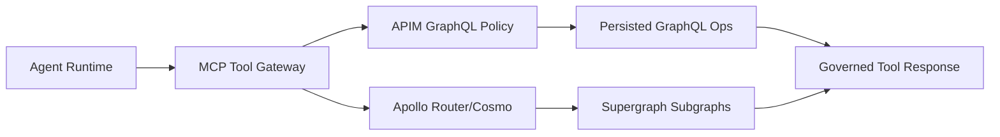
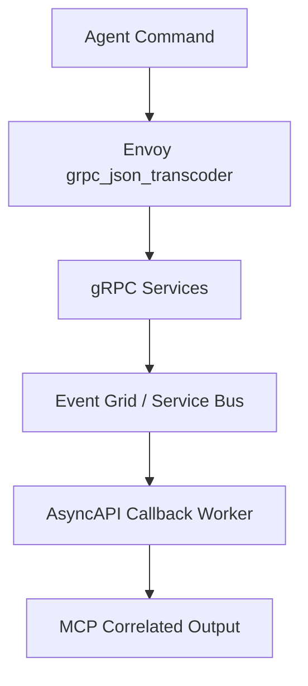

# 企业 GraphQL / gRPC / AsyncAPI 到 MCP 工具联邦选型 FAQ：APIM GraphQL 策略投影 vs Apollo Router Supergraph vs Envoy gRPC 转码事件桥

## 1. 背景：企业工具集成难题已从 REST CRUD 进入 GraphQL/gRPC/事件三栈协同

很多企业已不再以 REST 为唯一服务形态。

线上核心能力常分布在三类接口：

- GraphQL Supergraph。
- gRPC Protobuf 微服务。
- AsyncAPI 事件流。

直接把这些接口原样暴露给大模型，会触发新型风险：

- GraphQL introspection 体积过大导致上下文预算耗尽。
- 查询深度失控引发 N+1 风暴。
- 字段级 PII 过取。
- Protobuf `oneof/int64/enum` 序列化错配。
- 事件回调关联 ID 丢失。

因此需要把原生协议能力“收敛”为可治理的 MCP 工具面。

## 2. 三种路线：A APIM GraphQL 投影，B Apollo Router Supergraph MCP，C Envoy gRPC 转码 + 事件桥

**Option A：APIM GraphQL + Persisted Operation MCP**

核心思路：

- 在 APIM 层约束 GraphQL 查询复杂度。
- 仅允许持久化操作白名单。
- 投影为 bounded-context MCP 工具。

优势是治理集中、接入路径清晰。

**Option B：Apollo Router/Cosmo + MCP Server**

核心思路：

- 保留 Supergraph 语义能力。
- 在 Router 侧做 allowlist 和字段裁剪。
- 结合 schema-slice 工具发现。

优势是 GraphQL 语义完整，演进灵活。

**Option C：Envoy grpc_json_transcoder + AsyncAPI 命令回调桥**

核心思路：

- gRPC 服务通过转码暴露受控 JSON 接口。
- 事件总线承载异步命令回执。
- MCP 侧用 correlation-id 进行会话拼装。

优势是对现有 gRPC/事件系统侵入低。

## 3. 12 维度选型矩阵

| 维度 | Option A：APIM GraphQL 投影 | Option B：Apollo Router MCP | Option C：Envoy 转码 + 事件桥 |
|---|---|---|---|
| 上线速度 | 高 | 中 | 中 |
| GraphQL 语义保真 | 中 | 高 | 低中 |
| 字段级治理 | 高 | 高 | 中 |
| 深度/复杂度防护 | 高 | 高 | 中 |
| gRPC 亲和性 | 低 | 低中 | 高 |
| 异步事件融合 | 中 | 中 | 高 |
| mTLS/OBO 透传 | 高 | 高 | 高 |
| 运维复杂度 | 中 | 高 | 中高 |
| Token 预算可控性 | 高 | 高 | 中 |
| Schema 演进治理 | 高 | 高 | 中 |
| 3 年 TCO | 中 | 中高 | 中 |
| 适用场景 | 多域治理统一入口 | GraphQL 中心化组织 | gRPC/事件密集组织 |

结论通常是分域混合部署。

## 4. Option A 深入：APIM GraphQL 策略门禁与 MCP 投影

Option A 强调治理优先。

常见做法：

- 禁止自由 introspection。
- 限制 query depth/size。
- enforce persisted query。
- 字段级 claim 鉴权。

对合规敏感组织，这种“入口统一治理”价值很高。

## 5. Option B 深入：Apollo Router Supergraph 与 schema-slice 工具化

Option B 适合 GraphQL 成熟组织。

优势在于不牺牲 supergraph 语义能力。

可做：

- 子图级配额。
- 字段级开关。
- 持久化操作白名单。

通过 MCP 工具映射把能力收敛为业务动作，而非任意查询。

## 6. Option C 深入：gRPC 转码与 AsyncAPI 命令回调桥

Option C 适合 gRPC 和事件驱动占主导的组织。

关键是“协议转换后不丢语义、不丢身份、不丢关联”。

建议：

- Protobuf descriptor 统一注册治理。
- correlation-id 全链路透传。
- 事件回调超时与重试有上限。

## 7. Token 预算与 blast-radius：为什么必须把“任意查询”改成“持久化操作”

任意 GraphQL 查询对模型极不友好。

同一业务意图可能生成多种语法等价查询。

治理层无法稳定评估风险。

持久化操作把“无限查询空间”压缩为“有限操作集合”。

这样才能：

- 预测 token 开销。
- 控制子图爆炸范围。
- 做可解释审计。

## 8. 生产策略片段：APIM GraphQL 校验与字段授权

```xml
<policies>
  <inbound>
    <base />
    <validate-graphql-request max-depth="6" max-size="16384" />
    <choose>
      <when condition="@(!context.Principal.Claims.Any(c => c.Type == &quot;roles&quot; &amp;&amp; c.Value == &quot;graph.read.order&quot;))">
        <return-response>
          <set-status code="403" reason="Missing graph.read.order role" />
        </return-response>
      </when>
    </choose>
  </inbound>
  <backend><base /></backend>
  <outbound><base /></outbound>
  <on-error><base /></on-error>
</policies>
```

此片段强调先校验查询复杂度，再校验字段访问角色。

## 9. 架构图一：APIM + Router + MCP 工具投影



## 10. 架构图二：gRPC 转码与事件回调桥



## 11. Azure SKU 与 3 年 TCO（USD $k/month）

### 11.1 假设

- Supergraph 子图：42。
- gRPC 核心服务：120。
- 日均工具调用：2.8 亿次。
- 高峰并发：65k req/s。

### 11.2 Option A

- APIM Premium + Policy 扩展：`$132k/月`
- 观测与审计：`$21k/月`
- 平台运维：`$18k/月`
- 合计：`$171k/月`
- 三年：`$6.16M`

### 11.3 Option B

- AKS Router 集群与控制面：`$149k/月`
- 观测与 schema 治理：`$27k/月`
- 平台工程：`$26k/月`
- 合计：`$202k/月`
- 三年：`$7.27M`

### 11.4 Option C

- Envoy 网关与转码平面：`$121k/月`
- 事件桥与回调编排：`$33k/月`
- 平台运维：`$24k/月`
- 合计：`$178k/月`
- 三年：`$6.41M`

## 12. 场景一：全球全渠道电商 42 子图 Supergraph Agent 集成

痛点：

- 目录、订单、履约、营销跨域查询复杂。
- 任意查询易引发深度风暴与字段越权。

建议：

优先 Option A 或 A+B 组合。

核心交易路径强制 persisted operation。

低风险分析路径可保留受控 supergraph 查询。

## 13. 场景二：高频金融核心账本 gRPC + AsyncAPI 清算回执桥

痛点：

- 账务命令与回执天然异步。
- 关联 ID 丢失会导致状态不可追溯。

建议：

Option C 为核心。

并通过 APIM 做身份与配额前置治理。

## 14. 深度 Q&A（>=5）

### 14.1 Q1：什么时候必须禁用 GraphQL introspection？

生产租户默认禁用。

仅在受控调试租户临时开放。

### 14.2 Q2：如何设定 query depth 阈值？

先从业务拓扑测得安全深度。

常见初始值可在 4–6 范围内迭代。

### 14.3 Q3：如何避免 gRPC 转码后的类型精度问题？

对 int64、oneof、enum 做显式序列化策略。

并在契约测试中强制校验。

### 14.4 Q4：事件回调超时怎么治理？

设置分级超时与幂等重放上限。

超时后进入人工补偿队列。

### 14.5 Q5：如何评估工具爆炸半径是否可控？

跟踪：

- 单工具可达子图数量。
- 单请求最大字段数。
- 异常传播路径长度。

### 14.6 Q6：何时选 B 而非 A？

当组织已深度投资 GraphQL 平台并具备 Router 运维能力。

## 15. 五步落地指南（Good fit vs Not for）

**步骤一：先收敛操作集合**

把自由查询收敛成持久化操作目录。

**步骤二：建立字段级授权矩阵**

字段与角色映射必须可审计。

**步骤三：定义协议桥契约测试**

对 GraphQL/gRPC/AsyncAPI 三栈做一致性回归。

**步骤四：配置并发与复杂度双限流**

同时限制请求速率和查询复杂度。

**步骤五：季度复盘成本与风险**

把 token、延迟、越权事件放在统一看板。

### 15.1 Q7：Good fit 与 Not for

**Good fit：**

- 多协议共存的大型企业。
- 强合规与高并发并存场景。

**Not for：**

- 单体低流量系统。
- 缺乏统一身份治理与可观测能力的团队。

### 15.2 收官建议

企业 MCP 工具联邦的关键，不是把所有协议直接暴露给模型，而是把协议能力治理后投影为“可控、可审计、可演进”的业务工具面。

### 15.3 Q8：Schema 变更如何做上线前冲击评估？

先跑影响面模拟，评估受影响的持久化操作、字段授权规则与下游工具契约，再分批灰度发布。

### 15.4 Q9：如何抑制异步回调重放攻击？

回调签名必须绑定 correlation-id 与短时效 nonce，成功写入终态后拒绝重复回放。

### 15.5 Q10：长期稳态建议采用何种组合？

多数大型企业最终采用 A+B+C 分层组合：A 做统一治理入口，B 承担 GraphQL 语义主平面，C 覆盖 gRPC 与事件回调事务链路。
