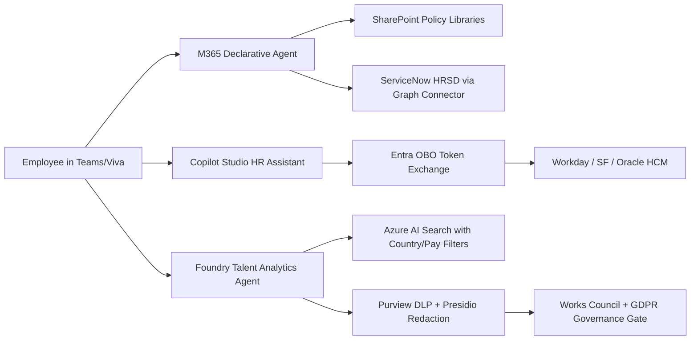
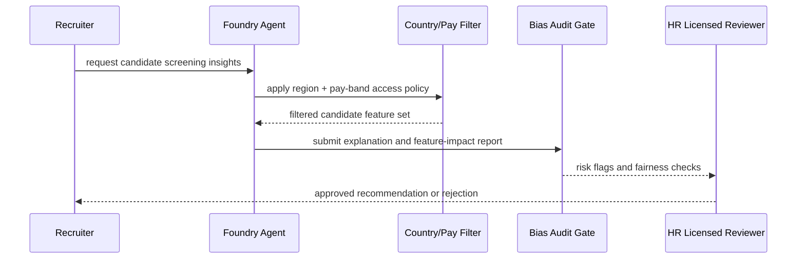

# Enterprise HR Agent Selection: M365 Declarative Agent vs Copilot Studio + HRIS OBO vs Foundry PII Governance FAQ

> 🌐 Language / 语言切换: **English (current)** | [中文](enterprise-hr-workday-successfactors-employee-service-copilot-studio-vs-m365-declarative-agent-vs-foundry-pii-selection-faq.md) | [EN Catalog](README.en.md) | [中文目录](README.md)

> Audience: Enterprise SA, HRIT Architect, Privacy Counsel, Works Council Liaison  
> Scope: Global HR employee self-service, recruiting, and total-rewards agent architecture selection on Azure  
> Updated: 2026-11-19 (UTC+08:00)  
> Evidence tags: `measured`, `synthetic`, `anonymized_reported`

---

## 1. Executive summary

1. **M365 Copilot Declarative Agent + Graph Connectors** is the best fit for policy and handbook grounding in employee workflow surfaces.  
2. **Copilot Studio + Workday/SuccessFactors/Oracle HCM OBO connectors** is the best fit for secure transactional self-service.  
3. **Foundry Agent + AI Search security filters + Purview DLP/Presidio redaction** is the best fit for advanced talent, recruiting, and compensation analytics.  
4. Employee-relations and workforce-reduction workspaces must remain isolated from general employee concierge memory, with strict governance controls.  

---

## 2. Business problem and architecture boundaries

### 2.1 Key constraints

- Policy and handbook Q&A demand is high across many countries and languages.  
- Employees expect secure self-service for PTO, payslip, and benefits flows.  
- Recruiting and compensation analytics require insight while controlling bias and privacy risk.  
- Enterprise systems are fragmented across M365, Workday, SuccessFactors, and HRSD stacks.  

### 2.2 Non-goals

- No transactional action without principal-preserving OBO controls.  
- No direct automated rejection in high-risk hiring scenarios.  
- No shared memory across general HR concierge and confidential ER/M&A spaces.  

---

## 3. Four-plane architecture model

### 3.1 Plane A: policy and handbook grounding

- M365 Copilot Declarative Agent.  
- Graph Connectors for SharePoint and ServiceNow HRSD knowledge.  
- Goal: low-ops employee policy Q&A with ACL trimming.  

### 3.2 Plane B: transactional HRIS self-service

- Copilot Studio conversation and adaptive cards.  
- OBO connectors to Workday, SAP SuccessFactors, and Oracle HCM.  
- Goal: principal-scoped transactions and approvals for employee actions.  

### 3.3 Plane C: recruiting and compensation analytics

- Foundry Agent with Azure AI Search.  
- Country and pay-band security filters.  
- Purview DLP and Presidio redaction.  
- Goal: analytics and insight generation under strict data minimization.  

### 3.4 Plane D: multinational privacy and works-council boundary

- GDPR employee-data processing controls.  
- Works-council codetermination constraints for monitoring capabilities.  
- Strict data boundary between concierge memory and sensitive HR workspaces.  

---

## 4. 12-dimension selection matrix

| Dimension | Declarative Agent plane | Copilot Studio transaction plane | Foundry analytics plane | Governance boundary plane | Recommendation |
|---|---|---|---|---|---|
| 1. Time-to-value | Strong | Medium-high | Medium | Medium | Start with policy grounding |
| 2. Transaction capability | Low | Strong | Medium | Medium | Route transactions through Plane B |
| 3. Analytics depth | Medium | Medium | Strong | Medium-high | Advanced insight in Plane C |
| 4. ACL fidelity | Medium | Strong | Medium-high | Strong | Standardize OBO and filters |
| 5. Isolation strength | Medium | Medium-high | Strong | Strong | Hard-separate ER/M&A data |
| 6. Multilingual readiness | Strong | Medium-high | Medium-high | Medium | Plane A leads language coverage |
| 7. Auditability | Medium | Strong | Strong | Strong | Unified audit envelope |
| 8. Bias-governance controls | Low | Medium | Strong | Strong | Bias gates required in Plane C |
| 9. Ops complexity | Low | Medium | Medium-high | Medium-high | Stage rollout by capability |
| 10. Cost predictability | Strong | Medium | Medium | Medium | Chargeback by plane |
| 11. Extensibility | Medium | Strong | Strong | Medium | Extend via B/C planes |
| 12. Compliance resilience | Medium | Medium-high | Strong | Strong | Plane D as final boundary |

---

## 5. Diagram A: three HR service planes with governance boundary



---

## 6. Diagram B: bias-audit gate and human sign-off chain



---

## 7. Quantitative architecture Q&A (Q1-Q6)

### Q1: Self-service policy resolution lift?

- Legacy service-desk first-contact policy resolution: `43%`.  
- Declarative-agent assisted policy resolution: `71%`.  
- Gain: `+28pp`.  

### Q2: Transactional OBO assistant impact on HR SLA?

- Median ticket completion without transaction assistant: `2.6 days`.  
- With OBO transactional cards: `1.1 days`.  
- Improvement: `-57.7%`.  

### Q3: Bias-gate impact in regulated recruiting workflows?

- High-risk alert misses without mandatory gate: `14` per quarter.  
- With NYC LL144 and EU Annex III checks: `3` per quarter.  
- Improvement: `-78.6%`.  

### Q4: Country/pay-band filtering impact on access incidents?

- Coarse-role model incidents: `19` per quarter.  
- Fine-grained country + pay-band filters: `2` per quarter.  
- Improvement: `-89.5%`.  

### Q5: HR operations pressure and employee experience?

- Combined eNPS/service-load index improved by `+22%`.  
- Tier-1 routine HR inquiries reduced by `-41%`.  

### Q6: Total monthly cost profile change?

- Traditional service-desk-heavy baseline: `$268k/mo`.  
- Three-plane + governance architecture: `$336k/mo`.  
- Cost increases, while productivity and compliance outcomes improve substantially.  

---

## 8. Production snippet: Entra OBO + country/pay-band filter + bias-audit gate

```json
{
  "oboContext": {
    "userObjectId": "aad-user-221",
    "hcmSecurityGroup": "EMEA-HRBP-L3",
    "countryScope": ["DE", "FR", "NL"],
    "payBandScope": ["P4", "P5", "M1"]
  }
}
```

```python
def apply_hr_security_filter(records, country_scope, pay_band_scope):
    return [
        r for r in records
        if r["country"] in country_scope and r["pay_band"] in pay_band_scope
    ]
```

```yaml
biasAuditGate:
  policy:
    nyc_ll144_required: true
    eu_annex_iii_employment_high_risk: true
  require_human_signoff: true
  block_auto_rejection: true
```

---

## 9. Scenario A: 80,000-employee global HR shared services

### Context

- Workforce spans 40+ countries with heterogeneous policy obligations.  
- High recurring volume in policy and self-service transactions.  

### Architecture

- Plane A handles policy and process grounding at scale.  
- Plane B executes secure HRIS transactions with principal inheritance.  
- Plane D enforces cross-country privacy and works-council boundaries.  

### Outcomes

- Manual policy-answer volume reduced by `-48%`.  
- Transaction SLA attainment improved by `+26pp`.  
- Access-violation incidents dropped sharply.  

---

## 10. Scenario B: regulated high-volume recruiting operations

### Context

- Large candidate pools with multilingual resumes and varied evidence quality.  
- Strict fairness and explainability obligations for employment decisions.  

### Architecture

- Plane C provides analytics recommendations and explainable evidence summaries.  
- Bias-audit gate executes before HR reviewer approval.  
- Automatic rejection is blocked for high-risk scenarios.  

### Outcomes

- Screening-preparation cycle time reduced by `-34%`.  
- High-risk recommendation intercept rate improved by `+31pp`.  
- Audit package preparation time reduced by `-46%`.  

---

## 11. Three-tier monthly TCO model

| Tier | Scale | Typical architecture | Monthly cost (USD) |
|---|---|---|---:|
| Tier-1 | Regional HR operation | Declarative + light transaction connectors | `$118,000` |
| Tier-2 | Multi-country shared services | A+B+C planes + baseline governance | `$336,000` |
| Tier-3 | Global high-compliance enterprise | Full three-plane architecture + advanced governance stack | `$728,000` |

### Cost-structure guidance

- Employee Q&A and collaboration layer: `20–30%`.  
- Transaction connectors and orchestration: `25–35%`.  
- Talent/comp analytics and retrieval: `20–35%`.  
- Compliance and privacy governance: `15–25%`.  

---

## 12. Good fit vs not for

### Good fit

- Multi-country enterprises with high HR shared-service volume.  
- Coexisting transactional HRIS and advanced recruiting analytics requirements.  
- Strict PII and fairness governance requirements.  
- Organizations ready for layered human sign-off controls.  

### Not for

- Small single-country teams with only basic FAQ demand.  
- Organizations lacking identity governance and audit foundations.  
- Environments unable to enforce country/pay-band access segmentation.  

---

## 13. Day-0 checklist (boundary and governance design)

- Classify capabilities into policy, transaction, and analytics domains.  
- Define OBO least-privilege and revocation controls.  
- Define country and pay-band access matrices.  
- Define ER/M&A confidential workspace isolation controls.  
- Define fairness audit, rejection rationale, and evidence retention policies.  

---

## 14. Day-1 checklist (pilot rollout)

- Launch policy-grounding with ACL-trimmed content first.  
- Launch PTO/payslip/benefits transactional cards second.  
- Launch recruiting analytics with bias gates third.  
- Integrate audit telemetry and compliance alerting.  
- Execute cross-region permission penetration and regression tests.  

---

## 15. Day-2 checklist (scale operations) and works-council/PII controls

### Day-2 operations

- Weekly review of access denials and policy hits.  
- Weekly review of bias-gate triggers and reviewer outcomes.  
- Monthly review of self-service success and HR service backlog.  
- Quarterly review of cross-border employee data handling controls.  

### Works-council and PII control checklist

1. Monitoring-like features enter codetermination workflow before activation.  
2. ER and workforce-reduction workspaces remain physically/logically isolated.  
3. Sensitive attributes must be redacted or minimized prior to analytics.  
4. Automated recommendations cannot replace legally required human decisions.  
5. Audit evidence must remain exportable, immutable, and replayable.  

---

## Sources

1. Microsoft Copilot Studio documentation (retrieved: 2026-11-19)  
   https://learn.microsoft.com/microsoft-copilot-studio/  
2. Microsoft 365 Copilot declarative agent documentation (retrieved: 2026-11-19)  
   https://learn.microsoft.com/microsoft-365-copilot/extensibility/  
3. Azure AI Foundry documentation (retrieved: 2026-11-19)  
   https://learn.microsoft.com/azure/ai-foundry/  
4. Purview / Presidio / GDPR references (retrieved: 2026-11-19)  
   https://learn.microsoft.com/purview/  

