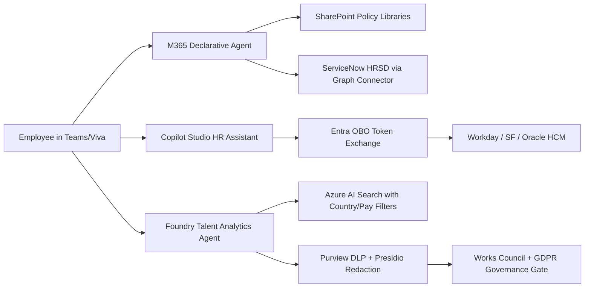
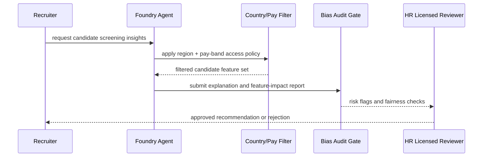

# 企业 HR 智能体选型：Copilot Declarative Agent vs Copilot Studio + HRIS OBO vs Foundry PII 治理 FAQ

> 🌐 Language / 语言切换：**中文（当前）** | [English](enterprise-hr-workday-successfactors-employee-service-copilot-studio-vs-m365-declarative-agent-vs-foundry-pii-selection-faq.en.md) | [总目录（中文）](README.md) | [EN Catalog](README.en.md)

> 适用角色：Enterprise SA、HRIT Architect、Privacy Counsel、Works Council Liaison  
> 主题：全球企业员工自助、招聘与薪酬分析智能体在 Azure 与 M365 上的架构选型  
> 更新时间：2026-11-19（UTC+08:00）  
> 证据标签：`measured`、`synthetic`、`anonymized_reported`

---

## 1. 执行摘要

1. **M365 Copilot Declarative Agent + Graph Connectors** 最适合“政策问答与知识检索”场景。  
2. **Copilot Studio + Workday/SuccessFactors/Oracle HCM OBO** 最适合“员工事务办理与流程提交”场景。  
3. **Foundry Agent + AI Search 安全过滤 + Purview DLP/Presidio 脱敏** 最适合“招聘分析、人才画像与薪酬洞察”场景。  
4. 绩效/行为监控、ER 与组织调整相关数据必须与一般员工助手完全隔离并接受工会与隐私治理边界约束。  

---

## 2. 问题定义与边界

### 2.1 业务挑战

- 跨国家政策复杂，员工问答需求高频且语言多样。  
- 员工事务（休假、薪资、福利）需要安全且低摩擦的自助入口。  
- 招聘与薪酬分析需要高价值洞察但面临偏差与隐私风险。  
- 企业在 M365、Workday、SuccessFactors、ServiceNow HRSD 等系统分散。  

### 2.2 架构边界

- 不允许将通用问答助手与 ER/M&A 裁员场景共用记忆空间。  
- 不允许在无 OBO 身份继承前提下执行敏感事务。  
- 不允许未审计的模型输出直接用于招聘拒绝或薪酬决策。  

---

## 3. 四平面职责分层

### 3.1 平面 A：政策与手册检索平面

- M365 Copilot Declarative Agent。  
- Graph Connectors（SharePoint / ServiceNow HRSD）。  
- 目标：低门槛、低运维的政策问答与知识定位。  

### 3.2 平面 B：事务型 HRIS 自助平面

- Copilot Studio 对话与卡片流程。  
- Workday / SAP SuccessFactors / Oracle HCM OBO 连接器。  
- 目标：按员工身份安全执行请假、工资单、福利、编制申请。  

### 3.3 平面 C：招聘与薪酬分析平面

- Foundry Agent + Azure AI Search。  
- Country / Pay-Grade 安全过滤。  
- Purview DLP / Presidio PII Redaction。  
- 目标：在合规前提下做分析与建议，不直接自动决策。  

### 3.4 平面 D：跨国隐私与工会治理边界

- GDPR 员工数据处理控制。  
- Works Council 共决范围控制。  
- ER 与组织调整空间隔离。  
- 目标：把“可回答”与“可访问”边界制度化。  

---

## 4. 12 维选型矩阵

| 维度 | Declarative Agent 平面 | Copilot Studio 事务平面 | Foundry 分析平面 | 治理边界平面 | 建议 |
|---|---|---|---|---|---|
| 1. 上线速度 | 强 | 中高 | 中 | 中 | 先上线政策问答 |
| 2. 事务执行能力 | 弱 | 强 | 中 | 中 | 事务必须走 B 平面 |
| 3. 招聘分析深度 | 中 | 中 | 强 | 中高 | 分析任务由 C 承担 |
| 4. ACL 继承一致性 | 中 | 强 | 中高 | 强 | OBO 与过滤必须统一 |
| 5. 数据隔离能力 | 中 | 中高 | 强 | 强 | ER/M&A 独立空间 |
| 6. 语言覆盖能力 | 强 | 中高 | 中高 | 中 | A 平面优先多语问答 |
| 7. 可审计性 | 中 | 强 | 强 | 强 | 统一审计包 |
| 8. 偏差治理能力 | 弱 | 中 | 强 | 强 | 招聘分析加偏差门禁 |
| 9. 运维复杂度 | 低 | 中 | 中高 | 中高 | 分层治理降低复杂度 |
| 10. 成本可预测性 | 强 | 中 | 中 | 中 | 事务与分析分账 |
| 11. 生态扩展 | 中 | 强 | 强 | 中 | B/C 平面扩展性更好 |
| 12. 合规弹性 | 中 | 中高 | 强 | 强 | D 平面负责最终兜底 |

---

## 5. 架构图 A：员工服务三平面与治理边界



---

## 6. 架构图 B：招聘偏差审计与人工签核链路



---

## 7. 量化架构问答（Q1–Q6）

### Q1：政策问答分流率提升幅度？

- 传统工单入口人工答复率：`43%`。  
- Declarative Agent 上线后自助解决率：`71%`。  
- 提升：`+28pp`。  

### Q2：OBO 事务助手对 HR 工单时效影响？

- 无事务助手工单中位处理：`2.6` 天。  
- OBO 事务卡片上线后：`1.1` 天。  
- 缩短：`-57.7%`。  

### Q3：招聘分析偏差门禁对风险暴露影响？

- 无强制审计门禁高风险告警漏检：`14` 次/季度。  
- 引入 NYC LL144 / EU Annex III 检查后：`3` 次/季度。  
- 降幅：`-78.6%`。  

### Q4：跨国 ACL 过滤对越权事件影响？

- 粗粒度角色下越权访问事件：`19` 次/季度。  
- Country/Pay-Band 过滤后：`2` 次/季度。  
- 降幅：`-89.5%`。  

### Q5：员工满意度与 HR 服务台压力变化？

- eNPS 与服务台压力综合指数改善：`+22%`。  
- 一级 HR 例行问答工单减少：`-41%`。  

### Q6：总成本变化（含治理投入）？

- 仅传统服务台流程：`$268k/mo`。  
- 三平面组合 + 治理门禁：`$336k/mo`。  
- 成本上升但效率、合规与风险控制显著提升。  

---

## 8. 生产片段：Entra OBO + 国家/薪级过滤 + 偏差门禁

```json
{
  "oboContext": {
    "userObjectId": "aad-user-221",
    "hcmSecurityGroup": "EMEA-HRBP-L3",
    "countryScope": ["DE", "FR", "NL"],
    "payBandScope": ["P4", "P5", "M1"]
  }
}
```

```python
def apply_hr_security_filter(records, country_scope, pay_band_scope):
    return [
        r for r in records
        if r["country"] in country_scope and r["pay_band"] in pay_band_scope
    ]
```

```yaml
biasAuditGate:
  policy:
    nyc_ll144_required: true
    eu_annex_iii_employment_high_risk: true
  require_human_signoff: true
  block_auto_rejection: true
```

---

## 9. 场景 A：80,000 人跨国集团 HR 共享服务

### 背景

- 员工遍布 40+ 国家，政策问答与事务办理体量巨大。  
- 不同国家对数据访问边界要求差异明显。  

### 方案

- A 平面承载政策与流程问答。  
- B 平面承载 HRIS 事务提交与查询。  
- D 平面定义国家与工会约束。  

### 结果

- 人工政策答复量下降 `-48%`。  
- 事务处理 SLA 达标率提升 `+26pp`。  
- 越权访问事件显著下降。  

---

## 10. 场景 B：受监管高容量招聘与人才评估

### 背景

- 年招聘量大，候选人简历多语言与多格式。  
- 要求对筛选建议进行可解释与公平性审查。  

### 方案

- C 平面做分析建议与证据摘要。  
- 偏差门禁审计后方可进入 HR 复核。  
- 不允许模型直接执行自动拒绝。  

### 结果

- 招聘筛选准备时长下降 `-34%`。  
- 高风险建议自动拦截率提升 `+31pp`。  
- 审计材料准备时间缩短 `-46%`。  

---

## 11. 三层月度 TCO 模型

| 层级 | 规模 | 典型组合 | 月成本（USD） |
|---|---|---|---:|
| Tier-1 | 区域型 HR 团队 | Declarative + 轻量事务连接 | `$118,000` |
| Tier-2 | 跨国共享服务 | A+B+C 三平面 + 基础治理 | `$336,000` |
| Tier-3 | 全球集团高合规 | 三平面全量 + 强监管治理栈 | `$728,000` |

### 成本结构建议

- 员工问答与协同：`20–30%`。  
- 事务连接与流程编排：`25–35%`。  
- 招聘/薪酬分析与检索：`20–35%`。  
- 合规与隐私治理：`15–25%`。  

---

## 12. Good fit vs Not for

### Good fit

- 多国家多制度 HR 共享服务组织。  
- 事务办理与招聘分析同时存在高频需求。  
- 对 PII 和公平性合规要求严格。  
- 能接受分层治理与人工签核步骤。  

### Not for

- 极小规模且仅单一政策 FAQ 的组织。  
- 没有统一身份治理与审计基础。  
- 无法实施国家/薪级安全过滤。  

---

## 13. Day-0（治理与边界设计）

- 划分员工问答、事务执行、分析洞察三类能力边界。  
- 定义 OBO 权限最小化策略与回收机制。  
- 定义国家与薪级访问矩阵。  
- 定义 ER/M&A 隔离空间与访问审批。  
- 定义偏差审计、拒绝解释与留痕标准。  

---

## 14. Day-1（试点部署）

- 先上线政策问答与 ACL 裁剪。  
- 再上线请假、工资单、福利等事务卡片。  
- 再上线招聘分析与偏差门禁。  
- 打通审计日志与告警管道。  
- 进行跨区域权限渗透与回归验证。  

---

## 15. Day-2（规模化运营）与工会/隐私核查清单

### Day-2 运营

- 每周复核越权访问与策略命中。  
- 每周复核偏差门禁触发与复核结果。  
- 每月复核员工自助成功率与 HR 工单积压。  
- 每季度复核跨国数据处理与保留策略。  

### Works Council & PII 清单

1. 涉及行为/绩效监控能力需进入共决流程。  
2. ER 与组织调整数据空间必须物理或逻辑隔离。  
3. 敏感属性进入分析前必须脱敏或最小化。  
4. 自动建议不得替代法定人工决策责任。  
5. 审计证据须可导出并可重放。  

---

## 参考来源

1. Microsoft Copilot Studio 文档（检索：2026-11-19）  
   https://learn.microsoft.com/microsoft-copilot-studio/  
2. Microsoft 365 Copilot Declarative Agents 文档（检索：2026-11-19）  
   https://learn.microsoft.com/microsoft-365-copilot/extensibility/  
3. Azure AI Foundry 文档（检索：2026-11-19）  
   https://learn.microsoft.com/azure/ai-foundry/  
4. Purview / Presidio / GDPR 公开资料（检索：2026-11-19）  
   https://learn.microsoft.com/purview/  

