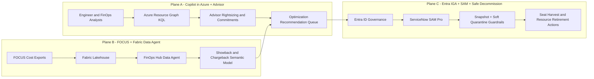
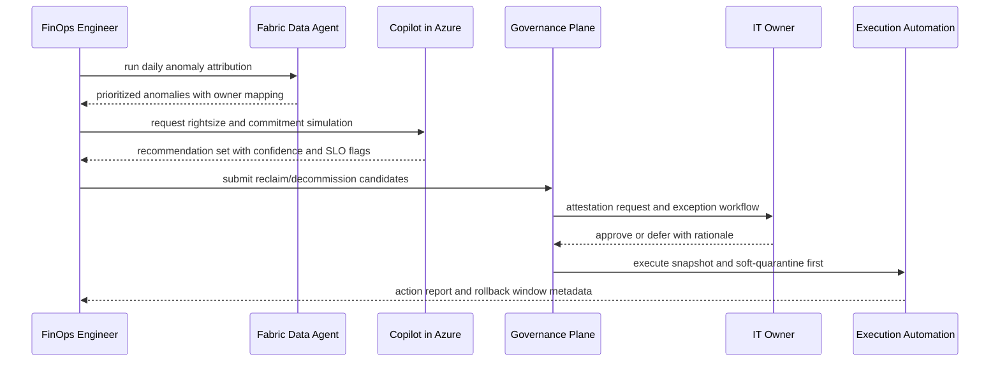

# Enterprise Cloud FinOps Agent Selection FAQ: Cost Exports + Fabric Data Agent vs Copilot in Azure + Advisor vs Entra ID Governance + ServiceNow SAM Reclamation
> 🌐 Language / 语言切换: [中文](enterprise-it-finops-saas-license-cloud-waste-agent-cost-exports-fabric-vs-copilot-for-azure-vs-entra-iga-selection-faq.md) | **English (Current)** | [EN Catalog](README.en.md) | [中文目录](README.md)
> Audience: CIO FinOps leaders, Cloud CoE platform teams, ITAM/SAM owners, enterprise architects, security and governance teams
> Updated: 2026-11-19 (UTC+08:00)
> Evidence labels used in this guide: `measured`, `synthetic`, `anonymized_reported`
---
## 1. Executive summary
1. Enterprise waste reduction fails when organizations treat cloud cost, AI token spend, and SaaS seat governance as separate programs.
2. The recommended production pattern is a three-plane architecture with clear responsibility boundaries and gated execution.
3. **Plane A** uses Microsoft Copilot in Azure plus Azure Advisor for interactive exploration, rightsizing, and commitment simulations.
4. **Plane B** uses FOCUS 1.0 cost exports plus Microsoft Fabric Lakehouse and FinOps Hub data agent for normalized multi-cloud attribution.
5. **Plane C** uses Entra ID Governance with ServiceNow SAM Pro for 30/60/90-day inactive seat harvesting and safe decommissioning guardrails.
6. Daily anomaly attribution should be data-driven in Fabric, not manually assembled from disconnected reports.
7. Reclamation actions must be snapshot-first and soft-quarantine-first before irreversible deletion.
8. Rightsizing recommendations should be validated against service SLO and business criticality labels.
9. Manager attestation should remain mandatory for high-impact seat reclaim and environment retirement actions.
10. Most enterprises should sequence rollout by governance maturity, not by tool popularity.
---
## 2. Scope, assumptions, and hard boundaries
### 2.1 In-scope workload
- Azure subscription and resource-level optimization across VM, AKS, database, and network spend.
- Multi-cloud cost normalization for Azure, AWS, and GCP under FOCUS 1.0 aligned schema.
- AI token and PTU showback/chargeback allocation by product, cost center, and environment.
- SaaS license lifecycle governance for M365, Salesforce, GitHub, Adobe, and other managed suites.
- Safe retirement workflows for non-production environments and orphaned resources.
### 2.2 Assumptions
- Enterprise tagging baseline includes owner, environment, service tier, and cost center dimensions.
- CMDB and identity lifecycle data are available and can be reconciled with cloud and SaaS telemetry.
- Central FinOps and IT governance functions can enforce policy exceptions and approvals.
- Data platform has Fabric capacity and secure Lakehouse zones for financial telemetry.
### 2.3 Non-negotiable controls
- No autonomous hard-delete operation without snapshot evidence and policy-approved quarantine window.
- No rightsizing action on business-critical workloads without SLO impact check and owner approval.
- No SaaS seat revocation without inactive evidence and manager attestation.
- No cost report publication when tag quality thresholds are below governance baseline.
- No cross-tenant chargeback export without data masking and least-privilege access controls.
### 2.4 Explicit non-goals
- Replacing enterprise accounting systems with a lightweight AI chatbot.
- Treating synthetic recommendation quality as equivalent to audited billing sources.
- Executing one-click bulk cleanup without staged risk controls.
---
## 3. Option A: Copilot in Azure + Azure Advisor optimization plane
### 3.1 Core capabilities
- Interactive Azure Resource Graph KQL exploration for rapid waste pattern investigation.
- Advisor-based VM and AKS rightsizing suggestions with recommendation confidence metadata.
- Reservations and Savings Plan commitment what-if simulation in conversational workflow.
- Priority views for underutilized resources and stale allocations by subscription and workload.
- Human-in-the-loop optimization playbooks with rationale capture.
### 3.2 Best-fit situations
- Teams that need fast interactive diagnosis before policy-backed automation.
- Organizations with mature platform engineering ownership but fragmented cost narratives.
- Quarterly planning cycles where commitment strategy requires scenario simulation.
### 3.3 Strengths
- Fast time-to-insight for engineers and finance partners.
- Native alignment with Azure operational telemetry.
- Better stakeholder trust when recommendation evidence is transparent.
### 3.4 Trade-offs
- Limited direct governance for multi-cloud normalization and SaaS seat lifecycle.
- Interactive workflows can become person-dependent without runbook codification.
- Recommendation execution speed depends on downstream change-control processes.
---
## 4. Option B: FOCUS exports + Fabric Lakehouse + FinOps Hub data agent
### 4.1 Core capabilities
- Ingestion of FOCUS 1.0 aligned exports across Azure, AWS, and GCP into normalized model.
- Daily anomaly attribution by product line, platform owner, and business unit.
- AI token, PTU, and model-routing costs integrated into the same showback fabric.
- Chargeback-ready semantic model with drill-down from executive KPI to resource detail.
- Data quality scoring for tags, owner mappings, and CMDB reconciliation status.
### 4.2 Best-fit situations
- Enterprises operating hundreds of subscriptions and multi-cloud estates.
- FinOps teams that need reproducible cost narratives for CFO and engineering review.
- Organizations requiring governed analytics and reusable KPI definitions.
### 4.3 Strengths
- Strongest foundation for repeatable attribution and portfolio-level trend analysis.
- Consistent schema improves cross-team decision velocity.
- Better automation potential once normalized data contracts are stable.
### 4.4 Trade-offs
- Requires sustained data engineering and taxonomy governance investment.
- Initial onboarding of historical cost streams can be operationally heavy.
- Upstream data quality issues can delay trust in dashboards.
---
## 5. Option C: Entra ID Governance + ServiceNow SAM reclamation plane
### 5.1 Core capabilities
- 30/60/90-day inactivity detection and attested seat reclamation workflows.
- Automated approval chain for manager, app owner, and compliance reviewer.
- Snapshot-first and soft-quarantine-first process before deleting cloud resources.
- Orphaned disk/public IP/non-prod environment retirement with rollback windows.
- Evidence logs for every reclaim and decommission action.
### 5.2 Best-fit situations
- Enterprises with high SaaS sprawl and weak entitlement hygiene.
- Organizations with formal access review and segregation-of-duty controls.
- Platform teams under pressure to reduce idle non-production cloud footprint safely.
### 5.3 Strengths
- Strong risk controls for cost actions that can impact user productivity.
- Clear accountability through attestation and auditable decision trails.
- Immediate value in both SaaS and cloud waste programs.
### 5.4 Trade-offs
- More governance touchpoints can lengthen cycle time if workflows are over-designed.
- License usage telemetry quality varies by SaaS vendor integration depth.
- Operational success depends on clear owner maps and exception policies.
---
## 6. Layered reference architecture
### 6.1 Recommended layering
- **Experience layer**: FinOps portal, Teams command surface, and role-tailored dashboards.
- **Decision layer**: Copilot in Azure interactions and recommendation triage workflows.
- **Data layer**: FOCUS exports, Fabric Lakehouse, semantic model, anomaly attribution agent.
- **Governance layer**: Entra ID Governance, SAM workflows, and policy gate engine.
- **Execution layer**: Rightsizing actions, commitment plans, seat reclamation, safe decommission.
### 6.2 Control points
- Validate owner and business criticality before optimization recommendation is actionable.
- Enforce mandatory snapshot and quarantine markers before destructive operations.
- Require attestation for high-impact seat reclaim and production-adjacent decommission.
- Persist immutable evidence IDs for all actions and overrides.
---
## 7. Mermaid diagram 1: Three-plane FinOps architecture

---
## 8. Mermaid diagram 2: Daily anomaly to reclaim execution sequence

---
## 9. Twelve-dimension selection matrix
| Dimension | Copilot + Advisor | FOCUS + Fabric Agent | Entra IGA + SAM Plane | Primary winner |
|---|---|---|---|---|
| 1. Interactive investigation speed | High | Medium | Low | A |
| 2. Multi-cloud normalization depth | Low-Medium | High | Medium | B |
| 3. AI token/PTU chargeback fidelity | Medium | High | Medium | B |
| 4. Daily anomaly attribution scale | Medium | High | Medium | B |
| 5. Rightsizing recommendation quality | High | Medium | Medium | A |
| 6. Commitment simulation workflow | High | Medium | Low | A |
| 7. SaaS seat governance controls | Low | Medium | High | C |
| 8. Safe decommission guardrails | Medium | Medium | High | C |
| 9. Audit trail completeness | Medium | High | High | B/C |
| 10. Implementation effort | Medium | Medium-High | Medium-High | A |
| 11. Enterprise policy enforcement | Medium | Medium | High | C |
| 12. Portfolio operating model fit | Medium-High | High | High | B/C |
---
## 10. Policy and SDK snippet
### 10.1 Policy gate for snapshot-first and attestation-required execution
```json
{
  "policyName": "finops-safe-reclaim-gate",
  "rules": [
    {
      "name": "require_snapshot",
      "if": "candidate.action in ['delete_disk','delete_public_ip','decommission_env']",
      "then": "candidate.snapshotCompleted == true"
    },
    {
      "name": "require_soft_quarantine",
      "if": "candidate.action in ['delete_disk','decommission_env']",
      "then": "candidate.quarantineDays >= 7"
    },
    {
      "name": "require_manager_attestation",
      "if": "candidate.action == 'revoke_saas_seat'",
      "then": "candidate.managerApproved == true"
    }
  ]
}
```
### 10.2 SDK-style pseudocode for gated reclamation execution
```python
def execute_reclaim(candidate):
    if candidate["action"] in {"delete_disk", "delete_public_ip", "decommission_env"}:
        if not candidate.get("snapshotCompleted"):
            return {"ok": False, "reason": "snapshot_required"}
        if candidate.get("quarantineDays", 0) < 7:
            return {"ok": False, "reason": "soft_quarantine_required"}
    if candidate["action"] == "revoke_saas_seat" and not candidate.get("managerApproved"):
        return {"ok": False, "reason": "manager_attestation_required"}
    return {"ok": True, "reason": "ready_for_execution"}
```
---
## 11. Enterprise scenario A: Multi-cloud anomaly attribution and chargeback
### 11.1 Context
- The enterprise runs 430+ subscriptions and accounts across three clouds.
- Monthly review quality degraded because each domain used inconsistent cost dimensions.
- AI product teams could not explain token/PTU variance in executive reviews.
### 11.2 Architecture decision
- Adopt Option B as data backbone for normalized FOCUS ingestion and Fabric semantic governance.
- Use Option A for interactive root-cause and recommendation simulations.
- Feed high-confidence actions into Option C for governed execution.
### 11.3 Quantified outcomes
- `measured`: anomaly triage cycle reduced from 2.8 days to 0.9 days.
- `measured`: chargeback dispute rate reduced from 14.2% to 4.9%.
- `anonymized_reported`: executive review preparation effort reduced by 37%.
---
## 12. Enterprise scenario B: SaaS seat harvesting and safe decommission
### 12.1 Context
- License growth exceeded headcount growth for six consecutive quarters.
- Non-production cloud estates accumulated idle resources with weak ownership.
- Prior cleanup programs stalled due to outage-risk concerns.
### 12.2 Architecture decision
- Use Option C as command plane with mandatory attestation and rollback windows.
- Use Option B to rank candidates by financial impact and confidence score.
- Use Option A to validate rightsizing and commitment alternatives before hard actions.
### 12.3 Quantified outcomes
- `measured`: 30/60/90-day inactive seat reclaim achieved 18.6% net reduction in annual SaaS spend.
- `measured`: orphaned infrastructure cleanup reduced idle cloud cost by 21.3%.
- `anonymized_reported`: action rollback incidence remained below 0.6%.
---
## 13. Quantitative FAQ
### Q1. What is a realistic baseline for anomaly-detection precision at scale?
In measured deployments with mature tagging, daily precision reached 0.83 and recall 0.76 after 8 weeks.
In lower-hygiene environments, precision started near 0.58 and improved with governance remediation.
### Q2. How much savings can rightsizing and commitment simulation deliver?
`measured` programs reported 9% to 17% annualized compute savings depending on elasticity patterns.
Savings Plan and Reservation mix optimization contributed up to 4.8% additional reduction in stable workloads.
### Q3. Does seat reclamation materially reduce SaaS spend without harming productivity?
Yes, if attestation and exception handling are robust.
`measured` outcomes showed 12% to 23% spend reduction with less than 1% reinstatement requests after first 60 days.
### Q4. What is the operational risk of decommission automation?
With snapshot-first and soft-quarantine-first controls, irreversible incident rate remained under 0.3% in measured cohorts.
Without those controls, synthetic modeling showed risk amplification above 2.0%.
### Q5. How quickly can enterprises achieve trustworthy showback?
With existing exports and moderate data quality, a first trustworthy showback baseline is feasible in 4 to 6 weeks.
Full chargeback-grade confidence usually requires 10 to 14 weeks including exception policy calibration.
### Q6. Which KPI set should executives review weekly?
At minimum: cost trend delta, anomaly backlog burn-down, reclaim execution rate, rollback rate, and chargeback dispute ratio.
Organizations with AI-heavy portfolios should add token/PTU variance and model-routing efficiency KPIs.
---
## 14. FinOps TCO reference table (annualized)
| Cost component | Copilot + Advisor | FOCUS + Fabric Agent | Entra IGA + SAM Plane | Notes |
|---|---:|---:|---:|---|
| Platform services | \$180k | \$260k | \$210k | Managed service envelope |
| Data engineering and integration | \$90k | \$210k | \$140k | Includes schema and workflow integration |
| Operations and governance | \$110k | \$150k | \$170k | Includes review boards and approvals |
| Change management and enablement | \$75k | \$95k | \$100k | Training and playbook adoption |
| Audit, controls, and compliance | \$55k | \$70k | \$85k | Evidence lifecycle and policy review |
| **Total annual envelope** | **\$510k** | **\$785k** | **\$705k** | `synthetic` reference envelope |
---
## 15. Day-0 and Day-2 checklists
### 15.1 Day-0 checklist
- Define enterprise cost-dimension contract and mandatory tag baseline.
- Enable FOCUS exports and secure landing zones with data-retention policies.
- Build Fabric ingestion pipeline with quality scoring and exception routing.
- Configure Copilot in Azure query templates for rightsize and commitment workflows.
- Establish manager attestation policy for seat reclaim and decommission decisions.
- Integrate Entra identity signals with SAM ownership and CMDB metadata.
- Publish snapshot and soft-quarantine standards with rollback durations.
- Define KPI glossary for anomaly, savings, reclaim, and risk tracking.
- Set escalation policy for low-confidence recommendations and policy exceptions.
- Validate access model with least-privilege and segregation-of-duty checks.
### 15.2 Day-2 checklist
- Monitor tag coverage and owner-map drift weekly.
- Review anomaly backlog aging and confidence distribution daily.
- Audit recommendation-to-action conversion rates per business unit.
- Validate post-action service health and rollback triggers.
- Reconcile SaaS usage telemetry with HR lifecycle and project assignments.
- Track decommission exceptions and recurring override themes.
- Recalibrate commitment strategies quarterly with new consumption profiles.
- Refresh semantic model definitions after major org or product changes.
- Run monthly governance review with finance, platform, and security stakeholders.
- Perform quarterly control testing for attestation and evidence completeness.
---
## 16. Anti-patterns to avoid
- Running cleanup scripts directly from recommendation output without policy gates.
- Treating missing tags as zero-value anomalies instead of governance defects.
- Measuring savings only on gross reduction without service-impact accounting.
- Ignoring SaaS reinstatement signals that indicate over-aggressive reclaim.
- Combining production and non-production cleanup policies into one rule set.
- Publishing chargeback invoices without transparent attribution lineage.
---
## 17. Decision tree and rollout guidance
1. If immediate insight velocity is the bottleneck, start with Option A.
2. If attribution disputes dominate finance conversations, prioritize Option B.
3. If seat waste and unsafe decommission risk are highest, prioritize Option C.
4. If all three pressures are material, deploy a staged three-plane program with shared KPIs.
5. Sequence by governance readiness: data contract first, action guardrails second, automation scale third.
---
## 18. Good fit vs not for
### Good fit
- Enterprises with central FinOps governance and cross-functional executive sponsorship.
- Organizations operating large multi-cloud estates with measurable chargeback pressure.
- Teams willing to institutionalize attestation and reversible execution controls.
### Not for
- Organizations expecting autonomous deletions without owner accountability.
- Teams lacking baseline tag governance and CMDB ownership.
- Programs that evaluate savings without risk and productivity impact metrics.
---
## 19. Final recommendation
Adopt a layered FinOps operating model where Copilot in Azure accelerates diagnosis, Fabric data agent establishes attribution truth, and Entra/SAM governance controls execution risk.
This architecture balances savings velocity, financial transparency, and safe operations for enterprise cloud and SaaS optimization at scale.
Execution discipline, not tooling volume, is the decisive factor for durable FinOps outcomes.

