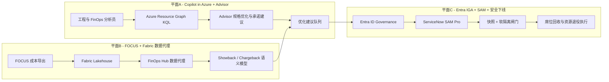
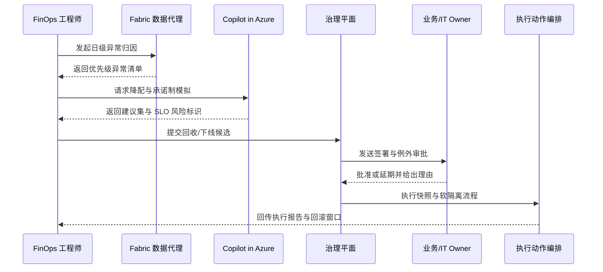

# 企业云 FinOps 智能体选型 FAQ：Cost Exports + Fabric 数据代理 vs Copilot in Azure + Advisor vs Entra ID Governance + ServiceNow SAM 回收平面
> 🌐 Language / 语言切换: **中文（当前）** | [English](enterprise-it-finops-saas-license-cloud-waste-agent-cost-exports-fabric-vs-copilot-for-azure-vs-entra-iga-selection-faq.en.md) | [中文目录](README.md) | [EN Catalog](README.en.md)
> 适用对象：CIO FinOps 负责人、Cloud CoE 平台团队、ITAM/SAM 管理者、企业架构师、安全与治理团队
> 更新时间：2026-11-19（UTC+08:00）
> 本文数据标签：`measured`、`synthetic`、`anonymized_reported`
---
## 1. 执行摘要
1. 企业降本长期失效的根因，通常是把云成本、AI Token 成本、SaaS 席位治理拆成孤立项目。
2. 推荐采用三平面生产架构，并明确每个平面的责任边界与执行闸门。
3. **平面 A**：Microsoft Copilot in Azure + Azure Advisor，侧重交互式分析、规格优化、承诺制模拟。
4. **平面 B**：FOCUS 1.0 Cost Exports + Microsoft Fabric Lakehouse + FinOps Hub 数据代理，侧重跨云归因与计费口径统一。
5. **平面 C**：Microsoft Entra ID Governance + ServiceNow SAM Pro，侧重 30/60/90 天闲置席位回收与安全下线治理。
6. 日级异常归因应在 Fabric 内做可复核流水，不应依赖人工拼接报表。
7. 任何删除类动作都必须先快照、先软隔离，再进入不可逆阶段。
8. 规格优化建议必须叠加 SLO 与业务关键级别校验。
9. 高影响席位回收与环境下线必须保留管理者签署。
10. 落地节奏应按治理成熟度推进，而不是按工具热度推进。
---
## 2. 范围、假设与硬边界
### 2.1 范围定义
- Azure VM、AKS、数据库、网络等资源的成本优化。
- Azure/AWS/GCP 跨云 FOCUS 成本口径统一与归因。
- AI Token/PTU 成本按产品、成本中心、环境进行 showback/chargeback。
- M365、Salesforce、GitHub、Adobe 等 SaaS 席位生命周期治理。
- 非生产环境与孤儿资源的安全退役流程。
### 2.2 基础假设
- 企业已建立 owner、environment、service-tier、cost-center 等标签基线。
- CMDB、身份生命周期与云账单数据可对齐。
- FinOps 与 IT 治理组织具备策略执行权与例外审批机制。
- Fabric 容量和安全湖仓分区可承载财务遥测。
### 2.3 不可放松控制
- 未完成快照与隔离窗口，不得执行硬删除。
- 业务关键工作负载未经 SLO 风险评估不得直接降配。
- 无闲置证据与管理者签署，不得回收 SaaS 席位。
- 标签质量未达阈值，不得发布正式成本归因报表。
- 跨租户 chargeback 导出必须经过脱敏与最小权限控制。
### 2.4 明确非目标
- 不以聊天式助手替代企业财务核算系统。
- 不把合成推理结果等同于审计级账单事实。
- 不做一键式批量清理且跳过风险控制。
---
## 3. 方案 A：Copilot in Azure + Advisor 优化平面
### 3.1 核心能力
- 通过 Azure Resource Graph KQL 快速定位浪费模式。
- 使用 Advisor 做 VM/AKS 规格优化建议并输出置信度。
- 做 Reservations/Savings Plan 承诺制容量情景模拟。
- 形成按订阅、业务线、平台组的浪费优先级视图。
- 保留人工复核与执行理由沉淀。
### 3.2 适用场景
- 需要先快速定位问题，再逐步工程化治理的团队。
- 平台工程能力较强但成本叙事碎片化的组织。
- 需要季度承诺制规划模拟的企业。
### 3.3 优势
- 洞察速度快，工程与财务沟通门槛低。
- 与 Azure 原生运维数据天然对齐。
- 推荐证据可追溯，便于建立信任。
### 3.4 代价
- 对跨云统一归因与 SaaS 治理覆盖有限。
- 交互式流程若无运行手册，容易依赖个人经验。
- 推荐到执行速度受下游变更流程影响。
---
## 4. 方案 B：FOCUS 导出 + Fabric Lakehouse + FinOps 数据代理
### 4.1 核心能力
- 采集 Azure/AWS/GCP FOCUS 对齐数据并统一建模。
- 日级异常归因可下钻到产品、团队、成本中心。
- AI Token 与 PTU 成本纳入统一 showback/chargeback 平面。
- 语义模型支持从高层 KPI 到资源明细的追踪。
- 内置标签质量、归属映射、CMDB 对齐质量评分。
### 4.2 适用场景
- 拥有数百订阅与多云资产的企业集团。
- 需要向 CFO 与工程团队提供一致成本叙事。
- 需要审计可复核、口径可复用的数据治理体系。
### 4.3 优势
- 归因能力最强，组合级趋势分析稳定。
- 统一 schema 可显著提升跨团队决策效率。
- 数据契约稳定后，自动化空间大。
### 4.4 代价
- 需要持续数据工程和主数据治理投入。
- 历史账单回灌和对齐前期工作量较大。
- 上游质量差会拖慢看板可信度建立。
---
## 5. 方案 C：Entra IGA + ServiceNow SAM 回收与安全下线平面
### 5.1 核心能力
- 30/60/90 天不活跃检测与席位回收审批流程。
- 经理、应用 owner、合规 reviewer 的分层签署。
- 删除前快照与软隔离窗口作为强制前置条件。
- 对孤儿磁盘、公网 IP、非生产环境做可回滚退役。
- 每次回收与下线保留完整证据轨迹。
### 5.2 适用场景
- SaaS 扩张快、权限卫生薄弱的企业。
- 已建立访问评审和职责分离要求的组织。
- 需要在降低浪费同时控制中断风险的平台团队。
### 5.3 优势
- 高风险动作可控，审计责任边界清晰。
- 通过签署机制保障业务影响可解释。
- 对 SaaS 与云浪费可同步产生价值。
### 5.4 代价
- 治理节点过多会拉长执行周期。
- 不同 SaaS 厂商使用遥测深度差异较大。
- 对 owner 映射与例外策略依赖高。
---
## 6. 分层解耦参考架构
### 6.1 分层建议
- **体验层**：FinOps 门户、Teams 指令入口、角色化仪表板。
- **决策层**：Copilot in Azure 交互分析与推荐分流。
- **数据层**：FOCUS 导出、Fabric Lakehouse、归因代理、语义模型。
- **治理层**：Entra ID Governance、SAM 审批流、策略闸门。
- **执行层**：规格优化、承诺制调整、席位回收、资源退役。
### 6.2 控制点
- 推荐动作前强制校验 owner 与业务关键级别。
- 删除类动作前强制校验快照与隔离标记。
- 高影响席位回收与下线动作强制签署。
- 所有执行与例外都要绑定不可变证据 ID。
---
## 7. Mermaid 图 1：三平面 FinOps 参考拓扑

---
## 8. Mermaid 图 2：日级异常到执行闭环序列

---
## 9. 12 维选型矩阵
| 维度 | Copilot + Advisor | FOCUS + Fabric 代理 | Entra IGA + SAM 平面 | 主胜出 |
|---|---|---|---|---|
| 1. 交互式排障速度 | 高 | 中 | 低 | A |
| 2. 跨云归一化深度 | 中低 | 高 | 中 | B |
| 3. AI Token/PTU 分摊精度 | 中 | 高 | 中 | B |
| 4. 日级异常归因规模 | 中 | 高 | 中 | B |
| 5. 规格优化建议质量 | 高 | 中 | 中 | A |
| 6. 承诺制模拟能力 | 高 | 中 | 低 | A |
| 7. SaaS 席位治理能力 | 低 | 中 | 高 | C |
| 8. 安全下线闸门能力 | 中 | 中 | 高 | C |
| 9. 审计链完整度 | 中 | 高 | 高 | B/C |
| 10. 实施复杂度 | 中 | 中高 | 中高 | A |
| 11. 策略执行刚性 | 中 | 中 | 高 | C |
| 12. 组合运营适配度 | 中高 | 高 | 高 | B/C |
---
## 10. 策略与 SDK 片段
### 10.1 快照优先与签署优先的策略闸门
```json
{
  "policyName": "finops-safe-reclaim-gate",
  "rules": [
    {
      "name": "require_snapshot",
      "if": "candidate.action in ['delete_disk','delete_public_ip','decommission_env']",
      "then": "candidate.snapshotCompleted == true"
    },
    {
      "name": "require_soft_quarantine",
      "if": "candidate.action in ['delete_disk','decommission_env']",
      "then": "candidate.quarantineDays >= 7"
    },
    {
      "name": "require_manager_attestation",
      "if": "candidate.action == 'revoke_saas_seat'",
      "then": "candidate.managerApproved == true"
    }
  ]
}
```
### 10.2 执行前校验伪代码
```python
def execute_reclaim(candidate):
    if candidate["action"] in {"delete_disk", "delete_public_ip", "decommission_env"}:
        if not candidate.get("snapshotCompleted"):
            return {"ok": False, "reason": "snapshot_required"}
        if candidate.get("quarantineDays", 0) < 7:
            return {"ok": False, "reason": "soft_quarantine_required"}
    if candidate["action"] == "revoke_saas_seat" and not candidate.get("managerApproved"):
        return {"ok": False, "reason": "manager_attestation_required"}
    return {"ok": True, "reason": "ready_for_execution"}
```
---
## 11. 场景 A：跨云异常归因与分摊对账
### 11.1 场景背景
- 企业在三朵云中运行 430+ 订阅与账号。
- 月度评审因口径不一致导致争议反复。
- AI 产品线无法解释 Token/PTU 波动来源。
### 11.2 架构决策
- 以方案 B 作为归因主干，统一 FOCUS 导入与语义口径。
- 以方案 A 作为交互排障与模拟层。
- 高置信动作通过方案 C 执行并保留签署证据。
### 11.3 量化结果
- `measured`：异常排查周期由 2.8 天降至 0.9 天。
- `measured`：chargeback 争议率由 14.2% 降至 4.9%。
- `anonymized_reported`：高层评审准备工时下降 37%。
---
## 12. 场景 B：SaaS 席位回收与安全下线
### 12.1 场景背景
- 席位成本连续六个季度增速高于人头增速。
- 非生产云环境长期堆积闲置资源。
- 历史清理项目因中断风险担忧推进缓慢。
### 12.2 架构决策
- 方案 C 作为执行指挥平面，强制签署与可回滚窗口。
- 方案 B 负责候选动作优先级与财务影响排序。
- 方案 A 负责动作前降配与承诺制替代模拟。
### 12.3 量化结果
- `measured`：30/60/90 天席位回收带来 18.6% 年化 SaaS 成本下降。
- `measured`：孤儿资源清理带来 21.3% 云闲置成本下降。
- `anonymized_reported`：回滚事件保持在 0.6% 以下。
---
## 13. 量化 FAQ
### Q1：大规模日级异常归因的精度基线是多少？
在标签治理成熟场景，8 周后 `measured` 精度可达 0.83，召回可达 0.76。
标签治理较弱场景起步精度通常约 0.58，需要先做数据质量修复。
### Q2：规格优化与承诺制模拟的常见节省区间是多少？
`measured` 项目中，计算成本年化节省常见在 9% 到 17%。
稳定负载通过 Savings Plan/Reservation 组合可再增加约 4.8% 降幅。
### Q3：席位回收会不会明显影响业务效率？
在签署与例外机制完善前提下，`measured` 节省常见为 12% 到 23%。
首个 60 天的席位恢复申请通常低于 1%。
### Q4：自动化下线的主要风险有多大？
采用快照优先与软隔离优先时，不可逆事件率在 `measured` 样本中低于 0.3%。
在 `synthetic` 评估中，跳过这些闸门会把风险放大到 2.0% 以上。
### Q5：多快可以建立可信的 showback？
若导出链路与标签基础中等，4~6 周可形成首版可信 showback。
达到可用于正式 chargeback 的成熟度通常需要 10~14 周。
### Q6：高层每周应看哪些指标？
建议至少包含：成本趋势偏差、异常积压燃尽、执行转化率、回滚率、争议率。
AI 重负载团队还应增加 Token/PTU 波动与模型路由效率指标。
---
## 14. FinOps 年化 TCO 参考表
| 成本项 | Copilot + Advisor | FOCUS + Fabric 代理 | Entra IGA + SAM 平面 | 说明 |
|---|---:|---:|---:|---|
| 平台服务 | \$180k | \$260k | \$210k | 托管服务成本 |
| 数据工程与集成 | \$90k | \$210k | \$140k | schema 与流程对接 |
| 运行与治理 | \$110k | \$150k | \$170k | 评审与审批运营 |
| 变更与赋能 | \$75k | \$95k | \$100k | 培训与流程固化 |
| 合规与审计 | \$55k | \$70k | \$85k | 证据生命周期管理 |
| **年化合计** | **\$510k** | **\$785k** | **\$705k** | `synthetic` 参考区间 |
---
## 15. Day-0 / Day-2 清单
### 15.1 Day-0（上线前）
- 定义企业成本维度契约与强制标签基线。
- 开启 FOCUS 导出并配置安全落地区。
- 建立 Fabric 入湖、质量评分、例外路由流水线。
- 配置 Copilot in Azure 的 KQL 分析模板。
- 建立席位回收与下线动作的签署策略。
- 打通 Entra 身份、SAM 拥有者、CMDB 映射。
- 发布快照与软隔离标准及回滚时长。
- 固化异常、节省、执行、风险 KPI 口径。
- 定义低置信建议升级与人工复核机制。
- 用最小权限和职责分离校验访问模型。
### 15.2 Day-2（运营中）
- 每周监控标签覆盖率和 owner 漂移。
- 每日追踪异常积压老化与置信度分布。
- 统计建议到执行的转化率与原因。
- 校验执行后服务健康和回滚触发情况。
- 对齐 SaaS 使用遥测与 HR 生命周期变化。
- 追踪下线例外并治理高频模式。
- 按季度重算承诺制策略与消费画像。
- 组织和产品变更后及时更新语义模型。
- 每月组织财务、平台、安全联合评审。
- 每季度做签署链与证据链控制测试。
---
## 16. 需要避免的反模式
- 直接把推荐结果喂给删除脚本，不经过策略闸门。
- 把缺失标签当作低成本异常而不是治理缺陷。
- 只看毛节省，不看服务影响与业务代价。
- 忽略席位恢复信号，导致过度回收。
- 把生产与非生产清理策略混为一套规则。
- 在归因链条不透明时直接发布 chargeback 账单。
---
## 17. 决策树与推进建议
1. 如果主要瓶颈是定位速度，先落地方案 A。
2. 如果主要争议是归因口径，优先方案 B。
3. 如果主要痛点是席位与下线风险，优先方案 C。
4. 若三类痛点并存，采用三平面分期建设并统一 KPI。
5. 推进顺序建议：先数据契约，再执行闸门，最后自动化规模化。
---
## 18. Good fit / Not for
### Good fit
- 具备集中 FinOps 治理与跨部门赞助的企业。
- 多云规模大且 chargeback 压力高的组织。
- 愿意落实签署与可回滚执行控制的团队。
### Not for
- 期待无人负责自动删除的组织。
- 缺乏标签治理与 CMDB owner 的团队。
- 只关注节省数字、不关注风险与体验代价的项目。
---
## 19. 最终建议
采用“Copilot 快速诊断 + Fabric 归因真相 + Entra/SAM 风险可控执行”的三平面架构。
该方案能够在企业规模下平衡节省速度、财务透明度与操作安全性。
真正决定成败的不是工具数量，而是治理纪律与持续执行能力。

