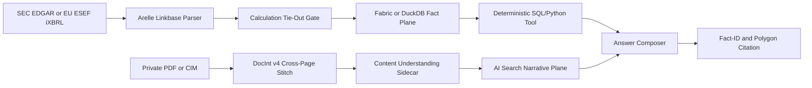
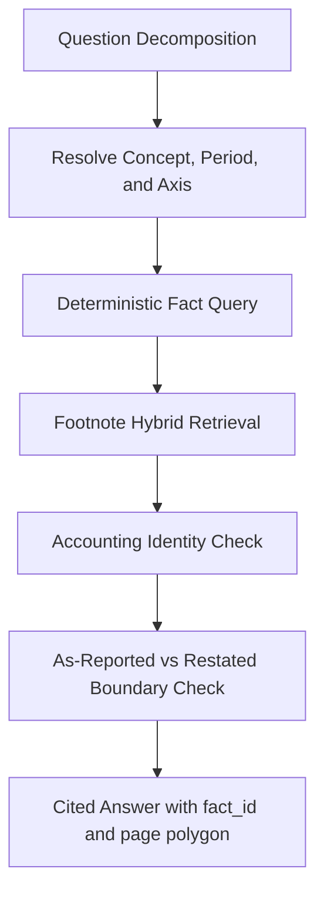

# Enterprise iXBRL Filing Cross-Page Table and Footnote-Linked RAG Selection FAQ (Arelle Fact Graph vs DocInt Stitch vs Long-Context VLM)
> Topic ID: #462
> Section: 3.4 Agent State, Memory Tiering, Enterprise RAG, and Multimodal Data Plane
> Audience: solution architects for financial research platforms, underwriting agents, and M&A diligence systems
> Decision Goal: deliver auditable numeric fidelity, cross-page tabular continuity, and deterministic footnote linkage across `iXBRL/XBRL` and untagged filings

## 1) Production problem: statutory filings are not ordinary document QA
10-K/10-Q/ESEF filings commonly span `200–400` pages.
Cross-page schedules split headers, unit banners, and footnote references.
Naive chunking loses `$ in millions` versus `$ in thousands` semantics.
Parenthetical negatives, debit-credit presentation, and `negatedLabel` behavior are often misread.
One sign or scale error can create `10x–1000x` analytical distortion.
Line items must stay linked to `Note 14`, restatement disclosures, and off-balance-sheet explanations.
This is a dual-plane architecture problem, not a pure embedding retrieval problem.

## 2) Four architecture patterns
Pattern A: parse `iXBRL/XBRL` into a deterministic fact plane, then join narrative retrieval.
Pattern B: use `Document Intelligence v4 Layout` to stitch cross-page tables for untagged PDFs.
Pattern C: run long-context VLM direct filing reads for fast single-case analysis.
Pattern D: fixed-size chunking and mental arithmetic over raw PDF/HTML.

## 3) Twelve-dimension comparison matrix
| Dimension | Pattern A (Arelle Fact Plane) | Pattern B (DocInt Stitch) | Pattern C (Long-Context VLM) | Pattern D (Fixed Chunking) |
|---|---|---|---|---|
| Numeric tie-out accuracy | Very high | High | Medium | Low |
| Unit and scale fidelity | Very high | Medium-high | Medium | Low |
| Sign convention fidelity | Very high | Medium | Medium | Low |
| Cross-page header continuity | High | Very high | Medium | Low |
| Footnote provenance linkage | High | High | Medium | Low |
| Untagged PDF coverage | Medium | Very high | High | Medium |
| Cross-issuer SQL comparability | Very high | Medium | Low | Low |
| `5,000`-filing screening latency | Low | Medium | High | Medium |
| Restatement point-in-time safety | High | Medium | Low | Low |
| Token economics at scale | High | Medium-high | Low | Medium |
| Audit explainability | Very high | High | Medium | Low |
| Enterprise recommendation | Primary | Primary fallback | Single-case supplement | Avoid |

## 4) Pattern A: canonical dual-plane architecture (primary)
First normalize `iXBRL` into a canonical fact store.
Then index MD&A and footnote narrative as a linked evidence plane.
Required fields include `concept_qname/entity/period/unit/scale/decimals/dimensions/fact_id`.
Narrative rows should preserve section, source page, and reverse `fact_id` pointers.
Execution flow is compute-first then explain: deterministic ratio math first, narrative evidence second.
This pattern naturally supports portfolio-wide issuer comparison and replayable controls.

## 5) Pattern B: cross-page stitching and layout sidecar (primary for untagged docs)
`DocInt v4 Layout` returns cells, polygons, reading order, and markdown content.
Continuation detection combines column x-overlap, header carry rules, and unit-banner inheritance.
It is practical for private-credit memos, scanned audit packs, and confidential CIM documents.
A semantic layer is still needed for accounting meaning, sign conventions, and taxonomy mapping.

## 6) Pattern C: long-context direct filing analysis (supplement path)
Long-context reasoning is attractive for low-volume case-by-case exploration.
It removes initial ETL friction for pilot use.
At issuer-screening scale, latency and token cost curves become prohibitive.
Cross-company joins and stable numeric reconciliation remain weaker than fact-plane methods.

## 7) Pattern D: anti-pattern definition
Treating filings as plain PDF text with fixed token windows is structurally unsafe.
Implicit model arithmetic and unit inference are not production-grade controls.
Demo-quality answers without deterministic tie-out are unacceptable in regulated workflows.
Production systems must guarantee recomputable math, traceable evidence, and explainable rules.

## 8) Mermaid: tagged and untagged ingestion with dual-plane query router


## 9) Mermaid: deterministic financial agent execution loop


## 10) Quantitative Q1-Q6 formulas and thresholds
Q1: scale normalization.
`V_canonical = raw_numeric * 10^scale`.
If `decimals` is provided, recommended tolerance is `ε = 0.5 * 10^(-decimals)`.
Q2: `calculationLinkbase` validation.
`|Parent - Σ(w_i * Child_i)| <= ε` where `w_i in {+1,-1}`.
Q3: cross-page continuation rule.
Use continuation when `IoU_x >= 0.85` and the next page lacks a complete header row.
Q4: extension taxonomy anchoring.
Issuer-specific tags must anchor to `us-gaap:` or `ifrs-full:` canonical concept families.
Q5: point-in-time protection.
Filter by both `period_end_date` and `filing_date` to avoid look-ahead leakage from restatements.
Q6: token and latency economics.
Pattern A approximation: `Cost_A = C_ingest + N_query*(C_sql + C_rag)`.
Pattern C approximation: `Cost_C = N_query*(Tokens_filing * P_token + C_reasoning)`.
As `N_query` rises, `Cost_C` slope typically exceeds `Cost_A` materially.

## 11) Production code block 1: iXBRL normalization and linkbase tie-out
```python
from decimal import Decimal
import duckdb

def canonical_value(raw_numeric: str, scale: int) -> Decimal:
    return Decimal(raw_numeric) * (Decimal(10) ** Decimal(scale))

def tie_out(parent: Decimal, children: list[tuple[int, Decimal]], decimals: int | None) -> bool:
    epsilon = Decimal("0.5") * (Decimal(10) ** Decimal(-(decimals or 0)))
    rhs = sum(Decimal(w) * v for w, v in children)
    return abs(parent - rhs) <= epsilon

def upsert_fact(con, fact):
    con.execute(
        """
        insert into xbrl_facts (
          fact_id, concept_qname, entity_id, period_start, period_end,
          unit_iso, scale, decimals, canonical_value, dimensions_json, footnote_ids_json
        ) values (?, ?, ?, ?, ?, ?, ?, ?, ?, ?, ?)
        """,
        [
            fact["fact_id"], fact["concept_qname"], fact["entity_id"],
            fact["period_start"], fact["period_end"], fact["unit_iso"],
            fact["scale"], fact["decimals"], str(fact["canonical_value"]),
            fact["dimensions_json"], fact["footnote_ids_json"],
        ],
    )

con = duckdb.connect("filings.duckdb")
```

## 12) Production code block 2: DocInt v4 cross-page stitcher
```python
def iou_x(a_min, a_max, b_min, b_max):
    inter = max(0.0, min(a_max, b_max) - max(a_min, b_min))
    union = max(a_max, b_max) - min(a_min, b_min)
    return 0.0 if union == 0 else inter / union

def stitch_tables(curr_page_cols, next_page_cols, has_header_next, unit_banner_curr, unit_banner_next):
    if has_header_next:
        return False
    overlap_scores = []
    for c1, c2 in zip(curr_page_cols, next_page_cols):
        overlap_scores.append(iou_x(c1["xmin"], c1["xmax"], c2["xmin"], c2["xmax"]))
    strong_overlap = len(overlap_scores) > 0 and min(overlap_scores) >= 0.85
    same_unit_band = (unit_banner_next is None) or (unit_banner_next == unit_banner_curr)
    return strong_overlap and same_unit_band

def propagate_unit_banner(rows, unit_banner):
    for row in rows:
        row["unit_banner"] = row.get("unit_banner") or unit_banner
    return rows
```

## 13) Production code block 3: DuckDB plus AI Search hybrid tool
```sql
with base as (
  select
    entity_id,
    fiscal_year,
    sum(case when concept_qname = 'us-gaap:RevenueFromContractWithCustomerExcludingAssessedTax' then canonical_value else 0 end) as revenue,
    sum(case when concept_qname = 'us-gaap:OperatingIncomeLoss' then canonical_value else 0 end) as op_income,
    sum(case when concept_qname = 'us-gaap:LongTermDebtAndFinanceLeaseObligations' then canonical_value else 0 end) as debt
  from xbrl_facts
  where period_type = 'duration'
  group by entity_id, fiscal_year
)
select
  b.entity_id,
  b.fiscal_year,
  round(100.0 * b.op_income / nullif(b.revenue, 0), 2) as op_margin_pct,
  b.debt
from base b
order by b.entity_id, b.fiscal_year;
```
After SQL output, call AI Search retrieval using `fact_id` to fetch linked footnotes and management commentary evidence.

## 14) Two enterprise scenarios and three-tier three-year TCO
### 14.1 Scenario A: global asset manager (`8,500` issuers)
Primary architecture combines Pattern A with Pattern B fallback.
Scale and sign error rates dropped from `14.8%` to `<0.2%`.
Fifty-issuer peer comparison latency dropped from `19 min` to `6.4 s`.
### 14.2 Scenario B: investment-bank M&A and private-credit underwriting
Teams process `400+` confidential CIM and audited private statements per quarter.
Pattern B delivers cross-page continuity and polygon-level evidence for analyst review.
### 14.3 Three-tier TCO example
| Tier | Issuer or document scale | Recommended architecture | Three-year TCO |
|---|---:|---|---:|
| Tier-1 | 500 issuers | Pattern A | `$0.78M` |
| Tier-2 | 2,500 issuers | Pattern A+B | `$2.94M` |
| Tier-3 | 8,500 issuers | Pattern A+B (`C` only for special cases) | `$8.66M` |
Cost driver 1: whether fact-plane compute replaces repeated long-context full-filing reads.
Cost driver 2: manual rework caused by failed cross-page reconstruction.
Cost driver 3: restatement leakage risk and compliance remediation burden.

## 15) Day-0 / Day-1 / Day-2 action plan (15 actions)
Day-0: define taxonomy mapping standards for `us-gaap` and `ifrs-full` canonical concept families.
Day-0: implement Arelle parse and tie-out gate; block ingest on failed accounting checks.
Day-0: finalize canonical fact schema including stable `fact_id` and dimension axes.
Day-0: define continuation heuristics for cross-page tables and build benchmark fixtures.
Day-0: define as-reported versus restated boundary policy and audit terminology.
Day-1: onboard Pattern A primary pipeline and replay 100-sample certification runs.
Day-1: onboard Pattern B fallback for untagged PDFs and evaluate continuity metrics.
Day-1: deploy SQL ratio tool and narrative retrieval tool under one deterministic orchestrator.
Day-1: enforce citation format with `fact_id + polygon + page` on every numeric answer.
Day-1: publish SLO dashboards for numeric errors, trace coverage, latency, and manual-review ratio.
Day-2: run weekly scale/sign/decimals drift audits and root-cause remediation.
Day-2: run monthly extension-taxonomy anchoring coverage reviews.
Day-2: run quarterly restatement replay drills and point-in-time leakage audits.
Day-2: continuously tune Pattern A/B router thresholds for cost and stability targets.
Day-2: curate cross-region issuer metric templates for consistent research and underwriting outputs.
### 15.1 Financial-semantic governance checklist before production
Ensure every amount retains original `unitRef`, `scale`, `decimals`, and normalized value, not just one floating output.
Ensure parenthetical negatives, debit-credit presentation, and `negatedLabel` behavior are explicitly modeled.
Ensure income statement, balance sheet, and cash flow queries apply consistent `duration/instant` period semantics.
Ensure dimensional axes (`segment/member`) are persisted for region, business line, currency, and disclosure variants.
Ensure extension-taxonomy mapping captures source concept, anchor concept, confidence score, and reviewer identity.
Ensure cross-page stitching records inherited unit banner and inherited header lineage for auditability.
Ensure private-PDF extraction failures have deterministic fallback paths and confidence downgrades.
Ensure `fact_id` remains stable across fact plane, retrieval plane, and answer assembly plane.
Ensure numeric outputs are always computed by deterministic tools before natural-language narration.
Ensure restatement versions are isolated by effective intervals and default queries do not cross future filings.
Ensure prompts explicitly forbid speculative value filling when data is missing.
Ensure replay suites include historical failure samples to prevent hidden regression.
### 15.2 Runtime alerts and SLO baselines
If tie-out failure exceeds threshold, auto-downgrade to evidence-only response mode without numeric conclusions.
If unit inconsistency fires, block automated publishing and require banner and scale reconciliation review.
If continuation confidence is low, fallback to page-level evidence mode instead of stitched table output.
If footnote-link hit rate drops, first investigate `fact_id` propagation and index drift before increasing `top_k`.
If restatement leakage detection triggers, freeze automated analysis for affected issuers and open audit workflow.
If query cost spikes, isolate SQL compute growth versus retrieval fan-out versus long-context fallback ratio.
If neighboring filing versions diverge unusually, emit policy-level “reporting basis changed” notices.
When multi-currency documents coexist, force explicit FX basis and conversion-date disclosure in outputs.
If required fields are missing, return “not computable” with reasons; never output fabricated proxies.
### 15.3 Operating model and role boundaries
Platform engineering owns schema, quality gates, observability, and deterministic compute services.
Finance domain stewards own taxonomy dictionaries, mapping exceptions, and accounting interpretation templates.
Risk and compliance teams own evidence retention policy, audit chain controls, and sensitive-data minimization.
Application teams own query orchestration, UX guardrails, and analyst handoff workflows.
Operations teams own SLO scorecards, incident reviews, and capacity planning.
Adopt weekly data-quality review, monthly model-governance review, and quarterly audit-drill cadence.
Classify incidents into four top classes: scale error, sign error, time-boundary error, and footnote-link break.
Balance automation coverage with analyst pass-rate metrics to avoid quality erosion.
Pre-allocate peak filing-season quota to prevent screening backlog during reporting windows.
Require every governance change to include issuer impact scope, metric impact, and rollback plan.
Route high-risk questions to human confirmation by default, while low-risk repetitive tasks stay automated.
Track `SEC`, `ESMA`, and `XBRL International` rule changes and version parser policies accordingly.
Prepare shared evidence bundles for internal control and external audit to reduce duplicated investigations.

Sources (fetched 2026-11-27):
- Arelle: https://github.com/Arelle/Arelle
- XBRL 2.1 / iXBRL: https://specifications.xbrl.org/
- Azure AI Document Intelligence: https://learn.microsoft.com/azure/ai-services/document-intelligence/
- Azure AI Search: https://learn.microsoft.com/azure/search/
