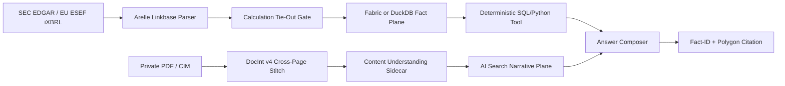
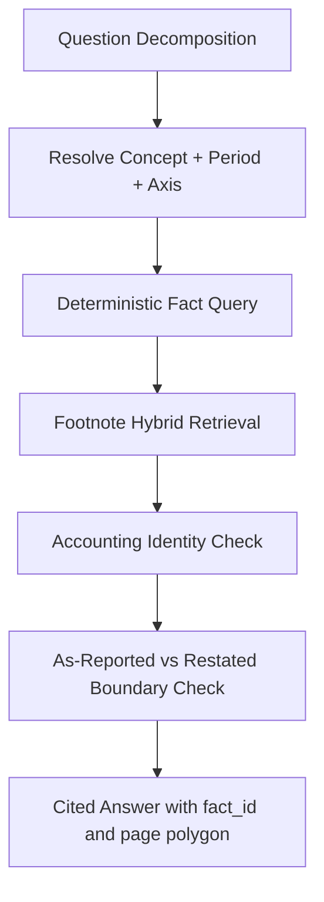

# 企业 iXBRL 财报跨页表格与附注关联 RAG 选型 FAQ（Arelle Fact Graph vs DocInt Stitch vs Long-Context VLM）
> Topic ID: #462
> Section: 3.4 智能体状态存储、记忆分层、企业 RAG 与多模态数据面
> 目标读者：企业金融研究平台、投行投研中台、风控和并购尽调智能体架构师
> 决策目标：在 `iXBRL/XBRL` 与非结构化财报 PDF 并存场景下，实现数值可核验、附注可回溯、跨公司可批量比较

## 1) 生产问题：财报问答不是“普通文档检索”
10-K/10-Q/ESEF 年报常见 `200–400` 页。
跨页附表会把列头、单位横幅和脚注引用切碎。
朴素分块会丢失 “`$ in millions` / `$ in thousands`” 单位语义。
同一报表中括号负数、借贷方向和 `negatedLabel` 规则容易被误读。
一旦符号或倍率出错，会出现 `10x–1000x` 幻觉级财务偏差。
财报中的 line item 还必须与 `Note 14`、重述说明、或表外风险段落建立证据链。
因此该问题本质是“结构化事实 + 叙事附注”的双平面融合，而非单平面向量检索。

## 2) 四类架构路线总览
Pattern A：`Arelle` 解析 `iXBRL/XBRL`，先建立可计算事实平面，再接入叙事检索平面。
Pattern B：`Document Intelligence v4 Layout` 做跨页表格续接，主攻无标签 PDF 与私募材料。
Pattern C：长上下文 VLM 一次性整本阅读，适合单案快速尽调但不适合大规模筛选。
Pattern D：固定 token 分块 + 模型心算，属于高风险反模式。

## 3) 12 维对比矩阵（核心决策维度）
| 维度 | Pattern A（Arelle+Fact Plane） | Pattern B（DocInt Stitch） | Pattern C（Long-Context VLM） | Pattern D（固定分块） |
|---|---|---|---|---|
| 数值 tie-out 准确性 | 极高 | 中高 | 中 | 低 |
| 单位/倍率保真 | 极高 | 中高 | 中 | 低 |
| 借贷符号一致性 | 极高 | 中 | 中 | 低 |
| 跨页列头连续性 | 高 | 极高 | 中 | 低 |
| 附注关联可追溯 | 高 | 中高 | 中 | 低 |
| 未标注 PDF 覆盖 | 中 | 极高 | 高 | 中 |
| 跨公司 SQL 可比性 | 极高 | 中 | 低 | 低 |
| 5000 份批量时延 | 低 | 中 | 高 | 中 |
| restatement 时间点隔离 | 高 | 中 | 低 | 低 |
| 推理成本可控性 | 高 | 中高 | 低 | 中 |
| 治理审计可解释性 | 极高 | 高 | 中 | 低 |
| 企业推荐结论 | 主路径 | 非标补位 | 单案补充 | 禁用 |

## 4) Pattern A：双平面规范化财报架构（主推）
先把 `iXBRL` 解析为可计算事实集，再把 MD&A 与附注文本作为证据平面。
事实平面字段建议至少包含 `concept_qname/entity/period/unit/scale/decimals/dimensions/fact_id`。
叙事平面保留章节、段落、表格来源页、和 `fact_id` 反向引用。
回答时先算后引：先用 SQL/Python 得出比率，再回查附注解释和管理层口径。
该路线天然支持跨公司横向比较与历史点位复盘。

## 5) Pattern B：跨页表格续接与布局侧车（无标签文档主推）
`DocInt v4 Layout` 可输出单元格、页坐标、reading order、以及 markdown 结构。
通过列坐标 IoU、单位横幅继承、和“页首无列头”规则，识别跨页续表。
对私募投顾材料、审计报告扫描件、CIM 私有文档尤其实用。
缺点是财务语义仍需后续规则层补齐，例如借贷方向与科目语义映射。

## 6) Pattern C：长上下文整本阅读（补充路径）
长上下文模型适合少量文档的快速对话。
在 `N` 很小时无需搭建 ETL 与索引体系。
但当进入 `1000+` 发行人筛选时，延迟与 token 成本会急剧上升。
并且跨公司对比难以做稳定 SQL join，审计追溯粒度也较弱。

## 7) Pattern D：反模式说明
把财报当成普通 PDF 文本做固定窗口分块会系统性破坏表结构。
模型心算与隐式单位推断会产生不可控误差。
“看似能答”的 demo 在审计和监管场景不可用。
企业生产必须要求数值可重算、来源可定位、规则可解释。

## 8) Mermaid：Tagged + Untagged 双通道采集与查询路由


## 9) Mermaid：确定性财务智能体执行环


## 10) Q1-Q6 量化判据（可复现公式）
Q1：倍率归一化公式。
`V_canonical = raw_numeric * 10^scale`。
若 `decimals` 存在，容差建议 `ε = 0.5 * 10^(-decimals)`。
Q2：`calculationLinkbase` 校验。
`|Parent - Σ(w_i * Child_i)| <= ε`，其中 `w_i in {+1,-1}`。
Q3：跨页续表判据。
列坐标重叠 `IoU_x >= 0.85` 且下一页缺失完整列头时判定为 continuation。
Q4：扩展 taxonomy 锚定。
发行人自定义 concept 必须映射回 `us-gaap:` 或 `ifrs-full:` 主概念集合。
Q5：时点隔离。
查询条件同时约束 `period_end_date` 与 `filing_date`，避免 restatement 向前泄漏。
Q6：成本比较。
Pattern A 近似 `Cost_A = C_ingest + N_query*(C_sql + C_rag)`。
Pattern C 近似 `Cost_C = N_query*(Tokens_filing * P_token + C_reasoning)`。
当 `N_query` 增大时，通常 `Cost_C` 斜率显著高于 `Cost_A`。

## 11) 生产代码块一：iXBRL 规范化与 linkbase tie-out
```python
from decimal import Decimal
import duckdb

def canonical_value(raw_numeric: str, scale: int) -> Decimal:
    return Decimal(raw_numeric) * (Decimal(10) ** Decimal(scale))

def tie_out(parent: Decimal, children: list[tuple[int, Decimal]], decimals: int | None) -> bool:
    epsilon = Decimal("0.5") * (Decimal(10) ** Decimal(-(decimals or 0)))
    rhs = sum(Decimal(w) * v for w, v in children)
    return abs(parent - rhs) <= epsilon

def upsert_fact(con, fact):
    con.execute(
        """
        insert into xbrl_facts (
          fact_id, concept_qname, entity_id, period_start, period_end,
          unit_iso, scale, decimals, canonical_value, dimensions_json, footnote_ids_json
        ) values (?, ?, ?, ?, ?, ?, ?, ?, ?, ?, ?)
        """,
        [
            fact["fact_id"], fact["concept_qname"], fact["entity_id"],
            fact["period_start"], fact["period_end"], fact["unit_iso"],
            fact["scale"], fact["decimals"], str(fact["canonical_value"]),
            fact["dimensions_json"], fact["footnote_ids_json"],
        ],
    )

con = duckdb.connect("filings.duckdb")
```

## 12) 生产代码块二：DocInt v4 跨页续表拼接器
```python
def iou_x(a_min, a_max, b_min, b_max):
    inter = max(0.0, min(a_max, b_max) - max(a_min, b_min))
    union = max(a_max, b_max) - min(a_min, b_min)
    return 0.0 if union == 0 else inter / union

def stitch_tables(curr_page_cols, next_page_cols, has_header_next, unit_banner_curr, unit_banner_next):
    if has_header_next:
        return False
    overlap_scores = []
    for c1, c2 in zip(curr_page_cols, next_page_cols):
        overlap_scores.append(iou_x(c1["xmin"], c1["xmax"], c2["xmin"], c2["xmax"]))
    strong_overlap = len(overlap_scores) > 0 and min(overlap_scores) >= 0.85
    same_unit_band = (unit_banner_next is None) or (unit_banner_next == unit_banner_curr)
    return strong_overlap and same_unit_band

def propagate_unit_banner(rows, unit_banner):
    for row in rows:
        row["unit_banner"] = row.get("unit_banner") or unit_banner
    return rows
```

## 13) 生产代码块三：DuckDB + AI Search 混合工具
```sql
with base as (
  select
    entity_id,
    fiscal_year,
    sum(case when concept_qname = 'us-gaap:RevenueFromContractWithCustomerExcludingAssessedTax' then canonical_value else 0 end) as revenue,
    sum(case when concept_qname = 'us-gaap:OperatingIncomeLoss' then canonical_value else 0 end) as op_income,
    sum(case when concept_qname = 'us-gaap:LongTermDebtAndFinanceLeaseObligations' then canonical_value else 0 end) as debt
  from xbrl_facts
  where period_type = 'duration'
  group by entity_id, fiscal_year
)
select
  b.entity_id,
  b.fiscal_year,
  round(100.0 * b.op_income / nullif(b.revenue, 0), 2) as op_margin_pct,
  b.debt
from base b
order by b.entity_id, b.fiscal_year;
```
上游 SQL 输出后，再以 `fact_id` 聚合发起 AI Search 检索对应附注段落与管理层解释。

## 14) 两个企业场景与三档三年 TCO
### 14.1 场景 A：全球资管投研平台（8500 发行人）
主路径采用 Pattern A，私有文档缺标签部分由 Pattern B 补位。
规模化后数值倍率/符号错误率从 `14.8%` 降到 `<0.2%`。
50 发行人对比延迟从 `19 min` 降到 `6.4 s`。
### 14.2 场景 B：投行并购与私募授信尽调
每季度处理 `400+` 份私有 CIM 与审计报表。
Pattern B 提供跨页续表与坐标级证据，分析师人工复核效率显著提升。
### 14.3 三档三年 TCO（示例）
| 规模 | 文档/发行人量级 | 推荐主架构 | 三年 TCO |
|---|---:|---|---:|
| Tier-1 | 500 发行人 | Pattern A | `$0.78M` |
| Tier-2 | 2500 发行人 | Pattern A+B | `$2.94M` |
| Tier-3 | 8500 发行人 | Pattern A+B（C 仅特案） | `$8.66M` |
成本主因一：是否可用事实平面替代长上下文整本重读。
成本主因二：跨页表格恢复失败带来的人工复核返工工时。
成本主因三：restatement 泄漏导致的误判成本与合规成本。

## 15) Day-0 / Day-1 / Day-2（15 项执行动作）
Day-0：定义 taxonomy 映射规范，明确 `us-gaap/ifrs-full` 主概念字典。
Day-0：建立 Arelle 解析与 tie-out 门禁，不通过不得入库。
Day-0：设计 canonical fact schema，固化 `fact_id` 与维度轴字段。
Day-0：制定跨页续表规则（IoU、列头、单位横幅继承）与测试集。
Day-0：定义 as-reported 与 restated 的时间边界策略与审计口径。
Day-1：接入 Pattern A 主链路并跑 100 份样本回放。
Day-1：接入 Pattern B 补位链路并跑无标签 PDF 样本评测。
Day-1：建立 SQL 比率工具与附注检索工具的编排策略。
Day-1：上线引用证据格式（`fact_id + polygon + page`）并强制返回。
Day-1：落地 SLO 看板（数值误差、回溯完整率、查询时延、人工复核比）。
Day-2：每周抽样校验 scale/sign/decimals 误差并追踪根因。
Day-2：每月评估扩展 taxonomy 锚定覆盖率并补齐映射。
Day-2：每季度演练 restatement 回放与时间点隔离审计。
Day-2：持续优化 Pattern A/B 路由阈值，控制总成本与稳定性。
Day-2：沉淀跨区域发行人标准指标集，支持统一投研口径复用。
### 15.1 财务语义治理补充清单（上线前强制核查）
检查所有金额是否保留原始 `unitRef`、`scale`、`decimals` 与归一化值四元组，禁止仅保存单一浮点结果。
检查括号金额、借贷方向和 `negatedLabel` 解析逻辑是否被显式建模，避免在推理层临时猜测正负号。
检查损益表、资产负债表、现金流量表是否采用统一口径的期间维度映射，防止 `duration/instant` 混淆。
检查维度轴（segment/member）是否完整入库，特别是地区、业务线、币种和会计口径扩展成员。
检查扩展 taxonomy 映射是否记录“原 concept -> 锚定 concept -> 置信度 -> 复核人”链路，支持审计追责。
检查跨页续表算法是否保留“继承了哪个单位横幅、继承了哪组列头、为何判定续表”的解释字段。
检查私有 PDF 抽取失败回退路径是否明确，例如表格失败时切换段落证据并降低自动化置信输出等级。
检查 `fact_id` 是否在事实平面、检索平面、回答平面三处保持稳定主键，防止证据断链。
检查所有数值结论是否先经过确定性工具计算，再允许模型组织语言，禁止“先生成后补算”流程。
检查 restatement 版本是否使用独立有效期区间，且默认查询不得跨越未来披露时间。
检查模型提示词中是否显式禁止“未找到数据时猜测填补”，并要求返回缺失原因与补采建议。
检查回放体系是否包含历史错误样本，确保每次策略升级都能复现实例并验证误差回归。
### 15.2 运行期告警与 SLO 基线（建议默认）
当数值 tie-out 失败率超过阈值时应自动降级到“仅证据检索，不给数值结论”模式。
当单位不一致告警触发时应阻断自动摘要发布，并提示人工复核单位横幅与倍率归一结果。
当跨页续表置信度低于阈值时应回退到页级引用回答，避免拼接错误污染结论。
当附注链接命中率下降时应优先排查 `fact_id` 传播链与索引字段漂移，而不是盲目增大 `top_k`。
当 restatement 泄漏检测命中时应冻结相关发行人自动分析任务并触发审计工单。
当查询成本突然上升时应拆解是 SQL 计算膨胀、检索召回膨胀，还是长上下文兜底比例异常。
当同一发行人在相邻版本出现异常跳变时应自动生成“口径变更提示”，避免业务误解为经营突变。
当跨币种文档进入同一分析批次时必须强制展示汇率口径与折算时点，防止隐式混算。
当数据缺失导致比率不可计算时应返回“不可计算”与原因，不得给出看似完整但无依据的值。
### 15.3 组织流程与角色分工建议
平台团队负责事实平面 schema、质量闸门和运行时可观测。
财务域专家负责 taxonomy 映射词典、口径变更解释模板和异常复核策略。
风控合规团队负责审计留痕标准、证据保留周期和敏感数据最小暴露原则。
应用团队负责查询编排、用户体验、告警分级与人工接管流程。
运营团队负责 SLO 周报、误差复盘、成本看板和容量预测。
建议建立“周度数据质量例会 + 月度模型治理评审 + 季度审计演练”三层机制。
建议将关键错误类型（倍率错、符号错、时点错、附注断链）作为四大一级故障分类。
建议把“自动化覆盖率”与“人工复核通过率”联合考核，防止单纯追求自动化比例。
建议为重大报表季（年报、半年报）设置临时弹性配额，避免高峰期因限流造成分析积压。
建议在知识库变更中强制附带“影响发行人范围、影响指标、回滚方案”三项说明。
建议将高风险问题默认转人工确认，而低风险高频问题走自动批处理，提高整体吞吐与稳健性。
建议持续追踪 `SEC`、`ESMA`、`XBRL International` 规则更新并映射到解析规则版本。
建议对外部审计与内部稽核准备同源证据包，减少重复取证与沟通成本。
### 15.4 财报问答输出格式与人机协作规范
对于任何包含金额、比率、增长率的回答，必须附带“计算公式、数据来源期间、单位口径、是否含重述”的四字段摘要。
对于跨期比较，必须明确同比、环比、滚动十二个月三种口径中的具体一种，禁止混用并行展示却不解释。
对于管理层叙事引用，必须区分“事实披露段落”与“观点性表述段落”，避免把观点句当作审计事实。
对于图表解读，必须输出“图表标题、坐标含义、异常点解释、证据段落链接”四项，避免纯主观结论。
对于未命中概念映射的问题，应返回“待映射 concept 列表 + 推荐锚定候选 + 置信度”，支持财务专家快速补全。
对于单位不一致但可修复的问题，应返回“自动修复值 + 原值 + 修复规则 + 风险提示”，禁止静默覆盖。
对于涉及并购、减值、重组的一次性项目，应提示“可比性受限”并给出剔除口径与保留口径双轨结果。
对于财务违规高风险提问（舞弊、虚增、异常交易），应自动提升证据阈值并要求至少两条独立来源交叉验证。
对于人工复核任务，建议输出“最少必要复核点清单”，例如单位横幅、期间边界、附注关联、重述状态四项。
对于批量筛选任务，建议输出“通过/待复核/驳回”三类标签与触发原因，便于研究员快速分流后续工作。

来源（抓取日期 2026-11-27）：
- Arelle: https://github.com/Arelle/Arelle
- XBRL 2.1 / iXBRL: https://specifications.xbrl.org/
- Azure AI Document Intelligence: https://learn.microsoft.com/azure/ai-services/document-intelligence/
- Azure AI Search: https://learn.microsoft.com/azure/search/
