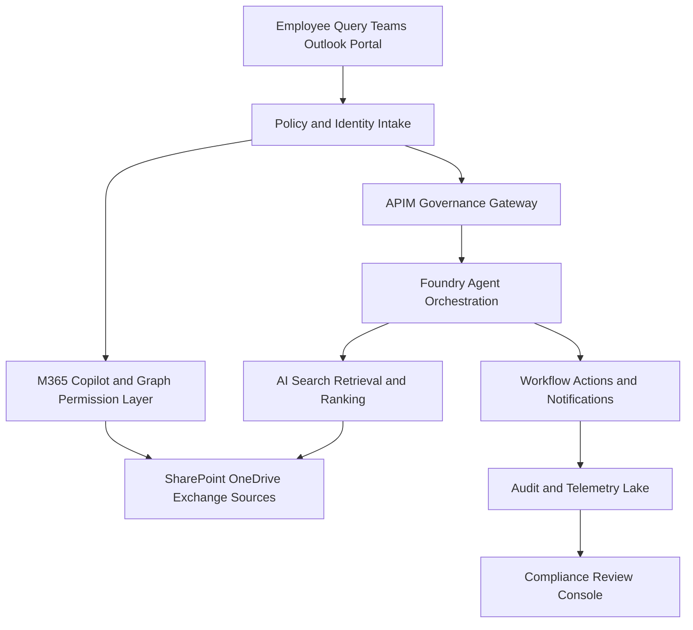
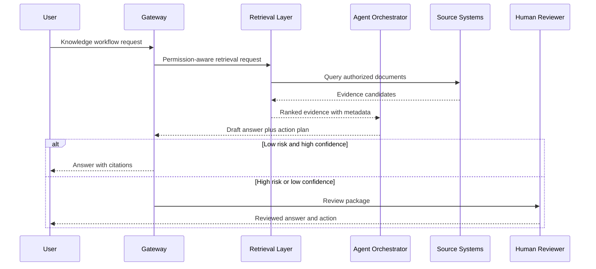

# Enterprise Knowledge-Workflow Agent Selection FAQ: SharePoint/Graph Copilot vs Foundry RAG Governance
> 🌐 **Language / 语言切换**: **[🇨🇳 中文版](enterprise-knowledge-workflow-agent-sharepoint-graph-copilot-vs-foundry-rag-governance-selection-faq.md)** | **[🇬🇧 English](enterprise-knowledge-workflow-agent-sharepoint-graph-copilot-vs-foundry-rag-governance-selection-faq.en.md)** | **[📚 Back to Index](README.en.md)**
> Evidence labels: `measured` / `synthetic` / `anonymized_reported`
> Retrieval date: 2026-11-22

## 1) Executive Summary: Enterprise knowledge agents succeed on governable authorization, not fluent phrasing
Enterprise knowledge-workflow agents
are often introduced
for policy search,
internal Q&A,
document summarization,
meeting follow-up generation,
and cross-team knowledge synchronization.
At first glance,
this appears to be
just a better chatbot.
In production,
the decisive question is different:
can the system answer
under the correct permission boundary
with auditable evidence.
When identity and authorization drift,
a highly accurate answer
can still become a compliance incident.
Architecture selection
therefore must optimize for
identity inheritance,
authorization-aware retrieval,
traceable evidence binding,
and end-to-end audit closure.
This guide compares four patterns:
M365 Copilot with Graph inheritance,
Foundry plus AI Search RAG platforming,
APIM governance-first entry,
and an enterprise dual-layer hybrid model.

## 2) Scenario boundaries: knowledge Q&A versus knowledge workflows versus executable document operations
Knowledge-workflow agents
are not only Q&A endpoints.
They usually coordinate
content repositories,
process engines,
approval systems,
and collaboration channels.
Typical tasks include
finding policy evidence,
extracting obligations,
creating action items,
routing ownership,
and escalating SLA risks.
The failure mode
is not merely
an incorrect sentence.
It can trigger
wrong operational actions
or unauthorized exposure
of sensitive internal content.
Selection decisions must cover
retrieval planes,
authorization planes,
workflow planes,
and governance planes together,
instead of reducing architecture
to a simplistic
model-plus-vector-store pattern.

## 3) Verifiable sources and evidence labeling
Source 1 (`measured`): Microsoft Graph documentation  
https://learn.microsoft.com/graph/

Source 2 (`measured`): SharePoint documentation  
https://learn.microsoft.com/sharepoint/

Source 3 (`measured`): Microsoft 365 Copilot documentation  
https://learn.microsoft.com/microsoft-365-copilot/

Source 4 (`measured`): Azure AI Foundry documentation  
https://learn.microsoft.com/azure/ai-foundry/

Source 5 (`measured`): Azure AI Search documentation  
https://learn.microsoft.com/azure/search/

Source 6 (`measured`): Azure API Management documentation  
https://learn.microsoft.com/azure/api-management/

Source 7 (`anonymized_reported`): anonymized enterprise rollout retrospectives.  
Source 8 (`synthetic`): latency, retrieval-quality, and per-1,000-query cost models.  
Scope note:
this document focuses on
enterprise application and service architecture
without low-level implementation internals.

## 4) Path A: M365 Copilot plus Graph-native permission inheritance
The strongest advantage
of this path is
native permission alignment.
Responses are grounded
on existing user boundaries,
which significantly reduces
authorization drift risk.
For organizations already deep in M365,
this path usually delivers
the fastest time-to-value.
It is effective for
employee knowledge Q&A,
policy lookup,
and routine document interpretation.
Its boundary appears
when you require
complex multi-source retrieval orchestration,
external data fusion,
or deeply customized tool workflows.
For that reason,
this path is best used
as a high-trust knowledge entry layer,
not always
as the only execution substrate.

## 5) Path B: Foundry plus AI Search as a governed enterprise RAG platform
This path emphasizes
decoupled governance
between retrieval and reasoning.
AI Search handles
indexing and recall behavior.
Foundry handles
model orchestration and evaluation loops.
The combination supports
domain-specific retrieval policies,
quality gates,
and iterative optimization.
It fits organizations needing
heterogeneous data ingestion,
cross-domain expansion,
and retrieval-quality tuning over time.
The major challenge is
permission mapping complexity.
If authorization projection is incomplete,
you can end up with
high recall quality
but invalid visibility boundaries.
Therefore,
identity and ACL projection design
must be treated
as first-class platform work.

## 6) Path C: APIM governance front door with multiple knowledge backends
This path positions APIM
as the unified governance ingress.
Before traffic reaches
reasoning or retrieval layers,
the gateway can enforce
identity checks,
quota policies,
risk-based routing,
and deterministic audit stamps.
For multi-team platform sharing,
this pattern improves
policy consistency
and operational observability.
It is especially useful
when many agents
reuse shared knowledge infrastructure
under bursty concurrency
and strict chargeback requirements.
The trade-off is
higher architectural layering.
Teams must define
clear ownership boundaries,
so the gateway remains
a policy plane
rather than an overloaded business-logic monolith.

## 7) Path D: dual-layer hybrid architecture (recommended for large enterprises)
In large enterprises,
the most stable pattern
is often a dual-layer model.
M365-native permission inheritance
provides the high-trust entry surface.
Foundry plus AI Search
provides the scalable
multi-source knowledge-workflow core.
APIM serves
as the policy consistency plane.
This combination preserves
authorization integrity
while unlocking
cross-domain extensibility.
With unified correlation keys,
organizations can trace
who asked what,
which evidence was cited,
and which operations were executed.
That full chain
is critical for
audit, compliance, and accountable operations.

## 8) Mermaid: enterprise knowledge-workflow reference topology

## 9) 12-dimension enterprise comparison matrix
| Dimension | M365 Copilot + Graph | Foundry + AI Search | APIM front-door multi-backend | Dual-layer hybrid |
|---|---|---|---|---|
| First-release delivery speed | High | Medium | Medium | Medium |
| Permission inheritance consistency | High | Medium-High | Medium-High | High |
| Retrieval-policy customizability | Medium | High | High | High |
| Cross-source knowledge fusion | Medium | High | High | High |
| Observability and audit depth | Medium-High | High | High | High |
| Multi-tenant governance fit | Medium | High | High | High |
| Platform operations complexity | Low-Medium | Medium-High | Medium-High | High |
| High-concurrency scaling | Medium | High | High | High |
| Domain decoupling capability | Medium | High | High | High |
| Unit-cost optimization headroom | Medium | High | High | High |
| Compliance landing effort | Low-Medium | Medium-High | Medium-High | Medium-High |
| Three-year evolution elasticity | Medium-High | High | High | High |

## 10) Mermaid: request, retrieval, evidence, and action boundary flow

## 11) Quant table: quality, latency, and per-1,000-query economics (`synthetic`)
| Metric | M365 Copilot + Graph | Foundry + AI Search | APIM front-door multi-backend | Dual-layer hybrid |
|---|---:|---:|---:|---:|
| End-to-end P95 latency (ms) | 1,980 | 1,720 | 1,860 | 1,640 |
| Evidence hit ratio (`anonymized_reported`) | 0.74 | 0.82 | 0.80 | 0.85 |
| Unauthorized-access interception effectiveness (`anonymized_reported`) | 0.92 | 0.88 | 0.91 | 0.94 |
| Human-review ratio (`anonymized_reported`) | 0.18 | 0.16 | 0.15 | 0.13 |
| Monthly cost index (baseline=1) | 1.00 | 1.21 | 1.15 | 1.18 |
| Cost per 1,000 knowledge requests (USD, `synthetic`) | 11.6 | 10.4 | 10.8 | 9.9 |
| Scale inflection (thousand concurrent sessions) | <4 | >6 | >5 | >5 |
| Recommended role | Trusted entry | Retrieval core | Governance plane | Enterprise target state |

Interpretation:
for fast internal launch,
M365-first often wins.
When domain complexity grows,
Foundry and hybrid architectures
tend to outperform
on long-run quality and cost efficiency.

## 12) Decision tree: 30-day launch with staged evolution
Step one checks
authorization requirements.
If strict M365 permission inheritance
is mandatory,
start with native entry.
Step two checks
knowledge-source heterogeneity.
If sources are highly diverse,
prioritize a RAG platform core.
Step three checks
cross-team governance demands.
If platform reuse is expected,
introduce APIM early.
Step four checks
organizational maturity.
Mature platform teams
can design dual-layer architecture directly.
Resource-constrained teams
should close one high-value scenario first,
then expand incrementally
with governed patterns.

## 13) Common anti-patterns
Anti-pattern one:
semantic retrieval
without permission trimming.
Consequence:
high relevance with high exposure risk.
Anti-pattern two:
embedding all policy logic
inside prompts only.
Outcome:
weak traceability and high drift.
Anti-pattern three:
no unified audit correlation key.
Impact:
Q&A, retrieval, and execution trails cannot be joined.
Anti-pattern four:
measuring only answer accuracy,
ignoring downstream workflow impact.
Operational effect:
silent operational errors.
Anti-pattern five:
enabling write actions by default,
then adding human review later.
Risk:
amplified blast radius for erroneous actions.

## 14) Production-readiness checklist
1. Permission inheritance and least-privilege matrix are defined.  
2. Evidence-return format and citation policy are standardized.  
3. Gateway-level auth, quota, and audit controls are enabled.  
4. Human-review thresholds for high-risk actions are enforced.  
5. Unified correlation keys exist across Q&A and execution logs.  
6. Index refresh SLA and rollback procedures are documented.  
7. End-to-end telemetry and anomaly alerting are in place.  
8. Injection and privilege-abuse defenses are policy-tested.  
9. Legal, audit, and business approvals are completed.  
10. Graceful degradation and read-only emergency modes are ready.  
11. Cost-per-1,000 and evidence-hit dashboards are operational.  
12. Quarterly knowledge governance and cleanup routines are scheduled.  

## 15) Practical FAQ (8 questions)
### Q1: Why is permission inheritance the first architecture priority?
Because authorization failures
create broader organizational impact
than ordinary answer inaccuracies.

### Q2: When is an M365-native route the best first choice?
When most enterprise knowledge
lives in M365
and fast launch under strict permissions matters.

### Q3: When is Foundry plus AI Search mandatory?
When sources are heterogeneous,
retrieval tuning is continuous,
and domain expansion is expected.

### Q4: What is APIM’s most critical role in this pattern?
It provides a reusable governance entry
for auth, quotas, audit, and policy routing.

### Q5: How should teams measure ROI?
Track four indicator groups:
evidence hit ratio,
human-review ratio,
resolution time,
and cost per 1,000 requests.

### Q6: What causes the most frequent launch failures?
Misalignment between permission trimming
and indexing or retrieval strategy.

### Q7: Is dual-layer architecture always superior?
No.
For small single-domain scenarios,
native-first architectures may be faster and simpler.

### Q8: How to define Good fit vs Not for?
Good fit:
organizations with clear governance
for identity, retrieval, and lifecycle controls.
Not for:
teams seeking unmanaged quick wins
without sustained index and policy operations.
