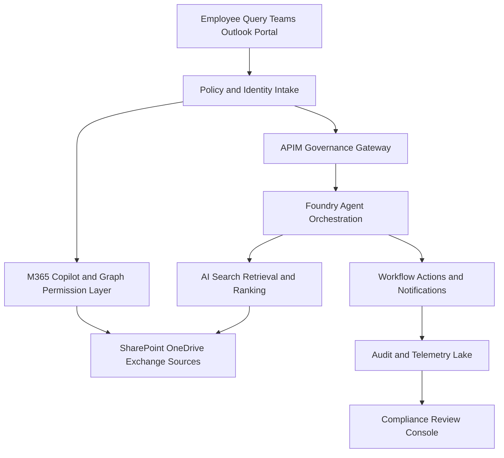
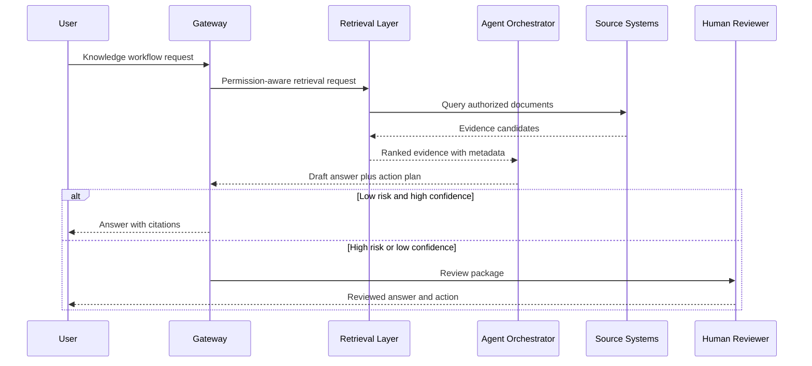

# 企业知识工作流智能体选型 FAQ：SharePoint/Graph Copilot vs Foundry RAG 治理架构
> 🌐 **Language / 语言切换**: **[🇨🇳 中文版](enterprise-knowledge-workflow-agent-sharepoint-graph-copilot-vs-foundry-rag-governance-selection-faq.md)** | **[🇬🇧 English](enterprise-knowledge-workflow-agent-sharepoint-graph-copilot-vs-foundry-rag-governance-selection-faq.en.md)** | **[📚 返回目录](README.md)**
> 证据标签：`measured` / `synthetic` / `anonymized_reported`
> 抓取日期：2026-11-22

## 1) 执行摘要：知识工作流智能体的核心不是“能回答”，而是“可授权地回答”
企业知识工作流智能体
常用于
政策检索、
制度问答、
文档摘要、
会议后续任务分解、
以及跨部门知识同步。
从表面看，
它像一个高质量问答助手。
但在生产环境里，
最关键的问题是：
它能否在正确权限下回答，
并给出可追溯证据。
如果授权模型错误，
即使回答再准确，
也可能造成越权泄露。
因此架构选型必须围绕
身份继承、
文档权限裁剪、
检索可解释性、
和审计闭环展开。
本指南比较四类主路径：
M365 Copilot + Graph 权限继承、
Foundry + AI Search RAG 平台、
APIM 治理网关前置模式、
以及双层组合型企业架构。

## 2) 场景边界：知识问答、知识工作流与文档执行自动化
知识工作流智能体
并不止做“问答”。
它往往连接
文档仓库、
流程系统、
审批系统、
和协作平台。
典型任务包括：
查找政策依据、
提取关键信息、
生成行动项、
分发到负责人、
并在超时后催办。
这类任务的风险
不是“答错一句话”这么简单，
而是可能触发
错误流程动作
或越权传播敏感文件。
所以选型必须同步评估
检索层、
授权层、
流程层、
与治理层，
避免把系统设计
简化成“模型 + 向量库”。

## 3) 可验证来源与证据标签
来源 1（`measured`）：Microsoft Graph 文档  
https://learn.microsoft.com/graph/

来源 2（`measured`）：SharePoint 文档  
https://learn.microsoft.com/sharepoint/

来源 3（`measured`）：Microsoft 365 Copilot 文档  
https://learn.microsoft.com/microsoft-365-copilot/

来源 4（`measured`）：Azure AI Foundry 文档  
https://learn.microsoft.com/azure/ai-foundry/

来源 5（`measured`）：Azure AI Search 文档  
https://learn.microsoft.com/azure/search/

来源 6（`measured`）：Azure API Management 文档  
https://learn.microsoft.com/azure/api-management/

来源 7（`anonymized_reported`）：匿名化企业知识平台落地复盘。  
来源 8（`synthetic`）：检索时延、命中率与每千问答成本测算模型。  
说明：
本文聚焦企业应用与服务架构，
不讨论底层实现细节。

## 4) 路径 A：M365 Copilot + Graph 权限原生继承
该路径的核心价值是
“权限天然一致”。
智能体回答时
直接基于用户已有权限边界，
能显著降低越权风险。
对已有 M365 深度落地企业，
它常是最快见效方案。
在员工知识问答、
日常制度检索、
会议纪要归档等场景，
此路径交付效率高。
但它也有边界。
当企业需要
复杂跨源检索编排、
外部数据融合、
或定制化工具执行链时，
仅依赖原生路径
可能难以满足扩展需求。
因此它适合作为
高可信知识入口层，
而不是全部能力承载层。

## 5) 路径 B：Foundry + AI Search 的企业 RAG 平台
该路径强调
检索与推理解耦治理。
AI Search 负责索引与召回，
Foundry 负责模型编排与评测，
可建立更细粒度
的检索策略与回答门禁。
它适合
多知识域并行、
跨数据源融合、
和持续优化检索质量的组织。
其优势在于可扩展性强，
可按业务域
分别优化语义召回与重排策略。
其挑战在于
权限映射和文档裁剪复杂度上升。
若权限继承设计不严谨，
就会引入“索引有了、权限错了”的风险。

## 6) 路径 C：APIM 前置治理 + 多后端知识引擎
该路径把 APIM 作为
统一策略入口。
它可在调用进入后端前
执行身份校验、
配额限制、
风险路由、
与审计打点。
在多团队共享知识引擎时，
该路径能显著提升
跨团队治理一致性。
尤其在
多个智能体复用同一知识底座、
并发高峰明显、
且需要分租户计费回溯时，
前置网关价值突出。
代价是架构层次增加，
需要清晰定义
网关策略责任边界，
避免“所有逻辑都堆到网关”。

## 7) 路径 D：双层组合架构（推荐的大企业模式）
在大型企业中，
常见的稳定解法是双层组合：
M365 原生权限层
负责高可信入口，
Foundry RAG 平台
负责复杂知识工作流。
APIM 作为统一治理平面
提供策略一致性。
这种方式的好处是
既保留权限继承优势，
又获得跨源扩展能力。
同时，
通过统一审计主键，
可把“谁问了什么、引用了什么、执行了什么”
完整串联。
这对合规与追责
都非常关键。

## 8) Mermaid：企业知识工作流智能体分层参考拓扑

## 9) 12 维企业选型对比矩阵
| 维度 | M365 Copilot+Graph | Foundry+AI Search | APIM 前置多后端 | 双层组合架构 |
|---|---|---|---|---|
| 首版上线速度 | 高 | 中 | 中 | 中 |
| 权限继承一致性 | 高 | 中高 | 中高 | 高 |
| 检索策略可定制性 | 中 | 高 | 高 | 高 |
| 跨源知识融合能力 | 中 | 高 | 高 | 高 |
| 可观测与审计深度 | 中高 | 高 | 高 | 高 |
| 多租户治理能力 | 中 | 高 | 高 | 高 |
| 平台运维复杂度 | 低中 | 中高 | 中高 | 高 |
| 高并发扩展弹性 | 中 | 高 | 高 | 高 |
| 业务域解耦能力 | 中 | 高 | 高 | 高 |
| 单问答成本优化空间 | 中 | 高 | 高 | 高 |
| 合规落地难度 | 低中 | 中高 | 中高 | 中高 |
| 三年演进弹性 | 中高 | 高 | 高 | 高 |

## 10) Mermaid：请求、检索、证据与执行流

## 11) 量化表：检索质量、时延与每千问答成本（`synthetic`）
| 指标 | M365 Copilot+Graph | Foundry+AI Search | APIM 前置多后端 | 双层组合 |
|---|---:|---:|---:|---:|
| P95 端到端时延（ms） | 1,980 | 1,720 | 1,860 | 1,640 |
| 检索证据命中率（`anonymized_reported`） | 0.74 | 0.82 | 0.80 | 0.85 |
| 越权拦截有效率（`anonymized_reported`） | 0.92 | 0.88 | 0.91 | 0.94 |
| 人工复核率（`anonymized_reported`） | 0.18 | 0.16 | 0.15 | 0.13 |
| 月度总成本指数（基线=1） | 1.00 | 1.21 | 1.15 | 1.18 |
| 每千问答成本（美元，`synthetic`） | 11.6 | 10.4 | 10.8 | 9.9 |
| 规模拐点（千并发会话） | <4 | >6 | >5 | >5 |
| 推荐定位 | 高可信入口 | 检索优化核心 | 治理与多后端中台 | 企业长期目标 |

解读：
若目标是快速上线内部问答，
M365 路径通常优先。
当知识域复杂度上升，
Foundry 与组合架构
在长期质量与成本上更有优势。

## 12) 决策树：30 天内完成首发与演进路径
第一步看权限要求。
若必须严格继承 M365 权限，
优先从原生路径启动。
第二步看知识源复杂度。
若跨源多且结构差异大，
优先建设 RAG 中台。
第三步看治理要求。
若跨团队共享能力强，
应尽早加入 APIM 治理入口。
第四步看组织能力。
平台团队成熟
可直接设计双层组合。
团队资源有限时，
应先做高价值场景闭环，
再逐步扩展。
第五步看治理节奏。
若审计要求高频抽检，
应提前设计
证据快照保留窗口、
检索版本冻结点、
与流程回放能力。
第六步看运营模式。
若多个业务域共用底座，
应建立
季度级知识治理例会、
跨域变更公告机制、
和统一回归用例库。

## 13) 常见反模式
反模式一：
只做语义检索，
不做权限裁剪。
后果是命中高但越权风险高。
反模式二：
把所有业务逻辑硬编码在提示词里。
后果是治理不可追溯，
版本漂移严重。
反模式三：
无统一审计主键。
后果是问答、检索、执行日志无法关联。
反模式四：
只看回答准确率，
不看执行后果。
后果是流程动作错误难以及时发现。
反模式五：
先开放写操作，
后补人工审批。
后果是错误写入风险放大。

## 14) 生产就绪检查清单
1. 已建立权限继承与最小权限矩阵。  
2. 已建立检索证据回传与引用规范。  
3. 已在网关层启用配额、鉴权、审计。  
4. 已定义高风险动作人工复核阈值。  
5. 已建立问答与执行统一追踪主键。  
6. 已建立知识索引更新 SLA 与回滚策略。  
7. 已接入端到端可观测与异常告警。  
8. 已建立提示注入与越权访问拦截规则。  
9. 已完成法务、审计、业务三方签核。  
10. 已配置故障降级与只读应急模式。  
11. 已建立每千问答成本与命中率看板。  
12. 已建立季度知识治理与清理机制。  

## 15) 实战 FAQ（8 问）
### Q1：为什么权限继承是第一优先级？
因为知识工作流智能体
一旦越权，
影响范围远大于单次答错。

### Q2：何时优先 M365 原生路径？
当内部知识主要在 M365，
且你需要快速上线并保留权限一致性。

### Q3：何时必须引入 Foundry+AI Search？
当知识源异构复杂、
检索策略需持续优化、
并且需要跨域扩展时。

### Q4：APIM 在知识智能体中最关键的价值是什么？
统一治理入口，
让鉴权、配额、审计与路由策略
可复用、可版本化。

### Q5：如何衡量知识智能体 ROI？
看四组指标：
命中率、
复核率、
处理时效、
每千问答成本。

### Q6：最常见的上线失败点是什么？
权限裁剪逻辑与索引策略脱节，
导致“能找到但不该看到”。

### Q7：双层组合是否一定更好？
不是。
在小规模单一知识域，
原生路径通常更简洁高效。

### Q8：Good fit vs Not for 如何界定？
Good fit：
有明确权限治理和知识生命周期管理能力的企业。
Not for：
希望零治理快速上线且长期不维护索引体系的团队。
