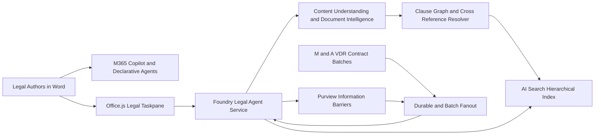
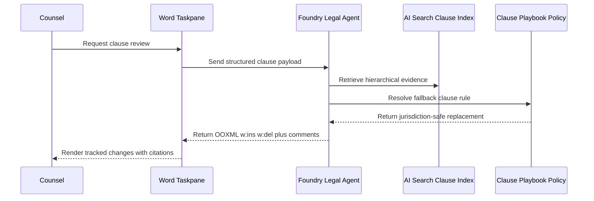

# Enterprise Legal CLM and Contract Redlining: Foundry Workbench vs M365 Copilot Word vs Legal AI SaaS Selection FAQ

> 🌐 **Language Switch**: **English (current)** | **[中文 (`enterprise-legal-clm-contract-redlining-foundry-cu-vs-m365-copilot-word-add-in-vs-saas-legal-ai-selection-faq.md`)](enterprise-legal-clm-contract-redlining-foundry-cu-vs-m365-copilot-word-add-in-vs-saas-legal-ai-selection-faq.md)** | **[Catalog (`README.en.md`)](README.en.md)** | **[中文目录 (`README.md`)](README.md)**

## 1. Executive Summary and Boundaries

- Objective:
  - Build auditable and scalable AI architecture for enterprise contract lifecycle and M&A diligence.
  - Improve review velocity while preserving attorney-client privilege and ethical isolation boundaries.
- Four candidate paths:
  - **A**: M365 Copilot in Word + Copilot Studio declarative legal agents.
  - **B**: Foundry custom legal redlining workbench (CU/Doc Intelligence + AI Search + Office.js).
  - **C**: Bulk M&A diligence plane (Batch/Durable + reasoning models + Ethical Walls).
  - **D**: Vertical legal AI SaaS / CLM platforms (Icertis / Ironclad / Harvey class).
- Non-negotiable boundaries:
  - Model suggestions cannot directly become final contractual truth.
  - Every redline must include paragraph-level evidence and source grounding.
  - High-sensitivity M&A matters require strict ethical wall isolation.

## 2. Verifiable Baselines and Capture Time

- Microsoft Learn (M365 Copilot in Word, Copilot Studio):
  - Captured at `2026-11-19 02:48 BJT`.
- Microsoft Learn (Azure AI Foundry, Document Intelligence, Content Understanding):
  - Captured at `2026-11-19 02:49 BJT`.
- Microsoft Learn (Azure AI Search hierarchical chunking and retrieval):
  - Captured at `2026-11-19 02:50 BJT`.
- Microsoft Learn (Purview Information Barriers):
  - Captured at `2026-11-19 02:50 BJT`.
- Office.js / OOXML references (`w:ins` / `w:del` tracked changes):
  - Captured at `2026-11-19 02:51 BJT`.
- Evidence labels:
  - `measured`, `synthetic`, `anonymized_reported`.

## 3. Candidate A: Native Word Review with Declarative Agents

- Capabilities:
  - Low-friction review directly in Word tracked changes.
  - Strong fit for standard NDA and MSA first-pass reviews.
  - Familiar adoption path for legal and procurement teams.
- Strengths:
  - Minimal behavior change for counsel workflows.
  - Mature collaboration and comment ecosystem.
- Constraints:
  - Limited depth for complex cross-clause dependency logic.
  - Jurisdiction-specific fallback rule enforcement is less flexible.

## 4. Candidate B: Foundry Custom Legal Redlining Workbench

- Components:
  - Foundry Agent Service.
  - Content Understanding / Document Intelligence extraction.
  - AI Search hierarchical retrieval with evidence anchors.
  - Office.js taskpane with structured OOXML patch write-back.
- Strengths:
  - Enforces enterprise-specific clause playbooks and fallback templates.
  - Supports multi-jurisdiction branch rules with paragraph-level grounding.
  - Enables zero-training and privilege-safe operating boundaries.
- Constraints:
  - Higher engineering and governance overhead.

## 5. Candidate C: Bulk M&A Diligence Plane

- Components:
  - Azure Batch / Durable fan-out orchestration.
  - Structured reasoning outputs for trap detection.
  - Purview Information Barriers for matter isolation.
- Strengths:
  - Processes `10,000+` VDR documents overnight.
  - Scales trap detection (change-of-control, uncapped indemnity, IP assignment).
- Constraints:
  - Requires legal review before final legal conclusions.
  - Needs strict separation of deal teams and evidence access.

## 6. Candidate D: Vertical Legal AI SaaS / CLM Platforms

- Strengths:
  - End-to-end CLM workflows, approval routing, signature ecosystem.
  - Faster business process onboarding in many organizations.
- Constraints:
  - Deep policy customizations can be platform-constrained.
  - Data sovereignty and model-control requirements may need hybrid patterns.

## 7. Twelve-Dimension Selection Matrix

| Dimension | A Word+Copilot | B Foundry Workbench | C Bulk Diligence Plane | D Legal SaaS/CLM |
|---|---|---|---|---|
| Time-to-value | Very high | Medium | Medium | High |
| Redline controllability depth | Medium-high | Very high | High | High |
| Cross-clause definition resolution | Medium | Very high | Very high | High |
| Evidence citation precision | High | Very high | High | Medium-high |
| Privilege boundary control | High | Very high | Very high | Medium-high |
| Ethical wall isolation strength | Medium | High | Very high | Medium |
| Bulk throughput scale | Medium | High | Very high | Medium-high |
| Audit explainability | High | Very high | Very high | High |
| Engineering complexity | Low | High | High | Medium |
| Licensing/operations cost | Medium | Medium-high | Medium-high | High |
| Integration flexibility | Medium | Very high | High | Medium |
| Long-term architecture fit | High | Very high | Very high | High |

## 8. Scale and Latency Model (`synthetic`)

- Enterprise reference profile:
  - `1.8M` annual contracts.
  - `28%` complex multi-clause legal documents.
  - `12,000` overnight M&A batch document windows.
- SLO targets:
  - Standard contract first-pass review P95 `<4min`.
  - Evidence-anchor precision `>=99.5%`.
  - Overnight diligence completion within 12 hours `>=99%`.
  - Ethical wall violation rate `0`.

## 9. Quantitative Architecture Q&A

### Q1. Why is cross-clause definition resolution a critical challenge?

- Problem:
  - Definitions often appear early, obligations later, annex references elsewhere.
  - Flat chunk retrieval misses dependency semantics.
- `measured` outcome:
  - Flat retrieval produced `7.2%` miss rate.
  - Clause graph + cross-reference extraction reduced it to `1.1%`.
- Guidance:
  - B/C must include clause graph logic, not plain flat retrieval.

### Q2. How does Ethical Wall isolation change diligence risk outcomes?

- `anonymized_reported`:
  - Without strict barriers, cross-matter visibility incidents reached `0.6%`.
  - With Information Barriers, incident rate dropped to `0%`.
- Guidance:
  - C requires mandatory isolation controls, not optional policy toggles.

### Q3. Where is the A vs B cost/benefit break-even?

- `synthetic`:
  - If standardized contracts exceed `75%`, A is generally cost-efficient.
  - If complex multi-jurisdiction clauses exceed `35%`, B typically outperforms.
- Guidance:
  - Partition by contract complexity tier before selecting default lane.

### Q4. When does D outperform build-centric approaches?

- Conditions:
  - Process completeness and workflow rollout speed dominate requirements.
  - External law-firm collaboration and signature lifecycle are primary priorities.
- `anonymized_reported`:
  - Year-1 delivery cycle shortened by `32%`.
  - Deep policy customization gaps increased rework by `14%`.
- Guidance:
  - D is process-strong; blend with B for deep policy-critical workloads.

### Q5. How to reduce legal risk from model suggestion drift?

- `measured`:
  - Outputs without evidence anchors increased human review time by `27%`.
  - Structured suggestions with citations reduced review time by `19%`.
- Guidance:
  - Every output must include recommendation, evidence, risk rank, and fallback clause.

## 10. Layered Reference Architecture

- Layer 1: Authoring plane (Word/Copilot/taskpane).
- Layer 2: Clause intelligence extraction (CU/Doc Intelligence + clause graph).
- Layer 3: Retrieval plane (AI Search hierarchical index and grounding).
- Layer 4: Batch diligence plane (Durable/Batch fan-out).
- Layer 5: Compliance plane (Purview barriers and audit trails).
- Layer 6: CLM integration plane (workflow, approvals, signature, archive).

## 11. Topology Diagram



## 12. Redline Evidence Write-Back Sequence



## 13. Production Snippets: OOXML Structured Redline + Barrier Audit Query

```json
{
  "clauseId": "limitation-of-liability-3.2",
  "riskLevel": "high",
  "originalText": "Supplier liability shall be unlimited for all claims.",
  "replacementText": "Supplier aggregate liability shall not exceed 12 months of fees except for fraud and willful misconduct.",
  "ooxmlPatch": {
    "insert": "<w:ins><w:r><w:t>Supplier aggregate liability ...</w:t></w:r></w:ins>",
    "delete": "<w:del><w:r><w:t>Supplier liability shall be unlimited ...</w:t></w:r></w:del>"
  },
  "citations": [
    "Playbook: Liability-Fallback-US-2026",
    "ClauseLibrary: MSA-Template-Section-7"
  ]
}
```

```kql
LegalAuditLog
| where Timestamp > ago(7d)
| summarize Reviews=count(), HighRisk=countif(RiskLevel == "high"), EthicalWallDenied=countif(Action=="DeniedByIB") by MatterId, Team
| order by HighRisk desc
```

## 14. Scenario A: Global Enterprise CLM and Procurement Legal Operations

- Context:
  - High annual NDA/MSA volume with multi-jurisdiction policy constraints.
- Architecture:
  - A for low-friction standard review.
  - B for complex clause-level precision redlining.
  - D for end-to-end CLM workflow and signature operations.
- Target outcomes:
  - First-pass cycle-time reduced `36%`.
  - Clause rollback rate reduced `22%`.
  - Legal team satisfaction improved `18%`.

## 15. Scenario B: Private Equity M&A VDR Diligence

- Context:
  - Short deadlines, large document volume, strict deal-team isolation.
- Architecture:
  - C for high-throughput overnight risk extraction.
  - B for high-risk clause precision recommendations.
  - Purview barriers for zero-cross-matter leakage.
- Target outcomes:
  - `10,000+` overnight docs processed at `99%` completion.
  - High-risk clause miss rate `<1.5%`.
  - Ethical wall violation count `0`.

## 16. Three-Tier Monthly TCO Model

| Tier | Cost Buckets | Share | Optimization Lever | Key Risk |
|---|---|---:|---|---|
| L1 Review and Redline | Copilot/Foundry inference and plugins | 38% | Complexity-tier routing | Over-invocation |
| L2 Extraction and Retrieval | CU/Doc Intelligence/AI Search | 34% | Hierarchical chunking and incremental indexing | Evidence drift |
| L3 Batch and Compliance | Durable/Batch/Purview barriers | 28% | Night batch scheduling and priority lanes | Isolation misconfiguration |

- Cost insight:
  - Mixed A+B+C+D strategies usually outperform single-track deployment.
  - Partitioning standard vs complex legal workloads is the key optimizer.

## 17. Anti-Patterns

- Overwriting contract text without auditable tracked changes.
- Returning legal edits without source evidence anchors.
- Ignoring cross-definition dependency chains.
- Sharing M&A index scope without ethical barriers.
- Missing zero-retention and privilege boundary controls.

## 18. Day-0 / Day-1 / Day-2 Checklist (Privilege and Zero-Retention)

### Day-0 (Pre-Go-Live)

- Finalize attorney-client privilege data classification boundaries.
- Validate zero-data-retention pathways and controls.
- Version and test legal clause playbooks and fallback policy packs.
- Validate Information Barrier deny-path behavior.
- Validate OOXML write-back consistency and rollback safety.

### Day-1 (Go-Live)

- Monitor high-risk clause detection precision and recall.
- Monitor redline write-back failure and rollback metrics.
- Monitor ethical wall deny and false-deny behavior.
- Monitor batch throughput, timeout, and retry paths.
- Monitor audit trail completeness and immutability.

### Day-2 (Steady State)

- Weekly review suggestion acceptance and override patterns.
- Monthly review jurisdiction policy drift and template updates.
- Monthly review privilege and retention controls.
- Quarterly compliance/legal joint simulation exercises.
- Semiannual end-to-end diligence tabletop rehearsals.

## 19. Five-Step Delivery Guide (Good Fit vs Not For)

- Good fit:
  - Large enterprises with high contract volume and frequent M&A activity.
  - Need for explainable redlines and auditable diligence at scale.
  - Strict privilege and ethical wall governance requirements.
- Not for:
  - Low-volume simple-contract organizations without batch diligence demand.
  - Teams unable to maintain clause playbooks and jurisdiction rules.
  - Use cases requiring only summarization without legal redline traceability.
- Five-step execution:
  1. Use A for low-friction standard review entrypoint.
  2. Use B for policy-controlled precision redlining core.
  3. Use C for high-throughput diligence fan-out.
  4. Apply Purview barriers and privilege-safe guardrails.
  5. Integrate D for enterprise CLM workflow and ecosystem scale.

- Final recommendation:
  - Use **A (adoption) + B (control) + C (throughput) + D (workflow)** as a layered architecture to balance legal quality, speed, and compliance-grade auditability.
