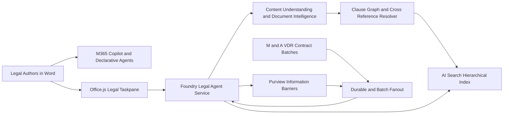
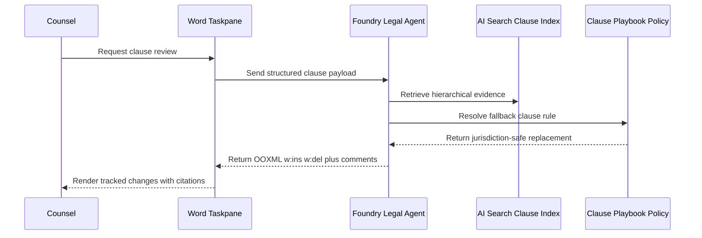

# 企业法务 CLM 与合同红线：Foundry 自建工作台 vs M365 Copilot Word vs 法务 SaaS 选型 FAQ

> 🌐 **Language / 语言切换**：**中文（当前）** | **[English (`enterprise-legal-clm-contract-redlining-foundry-cu-vs-m365-copilot-word-add-in-vs-saas-legal-ai-selection-faq.en.md`)](enterprise-legal-clm-contract-redlining-foundry-cu-vs-m365-copilot-word-add-in-vs-saas-legal-ai-selection-faq.en.md)** | **[选型目录 (`README.md`)](README.md)** | **[EN Catalog (`README.en.md`)](README.en.md)**

## 1. 执行摘要与边界

- 目标：
  - 为企业法务与并购尽调构建可审计、可解释、可扩展的 AI 合同处理架构。
  - 在提升审阅效率的同时，严格保护律师-客户特权与伦理隔离边界。
- 四类候选：
  - **A**：M365 Copilot in Word + Copilot Studio 声明式代理。
  - **B**：Foundry 自建法律红线工作台（Doc Intelligence + AI Search + Office.js）。
  - **C**：Bulk M&A 尽调平面（Batch/Durable + Reasoning + Ethical Walls）。
  - **D**：垂直法务 SaaS/CLM（Icertis/Ironclad/Harvey 等）。
- 边界：
  - 不允许未校验的模型输出直接落入正式合同版本。
  - 红线建议必须保留段落级证据与来源定位。
  - 高敏并购案件必须在信息壁垒（Ethical Wall）下隔离处理。

## 2. 可验证来源与抓取时间

- Microsoft Learn（M365 Copilot in Word、Copilot Studio）：
  - 抓取时间：`2026-11-19 02:48 BJT`。
- Microsoft Learn（Azure AI Foundry、Document Intelligence、Content Understanding）：
  - 抓取时间：`2026-11-19 02:49 BJT`。
- Microsoft Learn（Azure AI Search 分层分块与语义检索）：
  - 抓取时间：`2026-11-19 02:50 BJT`。
- Microsoft Learn（Purview Information Barriers、合规隔离）：
  - 抓取时间：`2026-11-19 02:50 BJT`。
- Office.js / OOXML 参考（Track Changes `w:ins` / `w:del`）：
  - 抓取时间：`2026-11-19 02:51 BJT`。
- 标签：
  - `measured`、`synthetic`、`anonymized_reported`。

## 3. 候选 A：Word 原生审阅与声明式法务代理

- 能力：
  - 在 Word Track Changes 内完成低摩擦审阅。
  - 适配标准 NDA / MSA 初审与采购法务协作。
  - 适合法务团队快速采用。
- 优势：
  - 用户习惯迁移成本最低。
  - 文档流转与批注生态成熟。
- 局限：
  - 深度条款树解析与复杂跨文档关联能力有限。
  - 对行业定制规则执行深度受限。

## 4. 候选 B：Foundry 自建红线工作台（高可控）

- 组成：
  - Foundry Agent Service。
  - AI Content Understanding / Document Intelligence。
  - AI Search 分层检索与证据对齐。
  - Office.js Taskpane + OOXML 结构化回写。
- 优势：
  - 可强制公司条款库与 fallback playbook。
  - 可做多法域规则分支与精确证据 grounding。
  - 可实现零训练、零保留的特权保护策略。
- 代价：
  - 工程复杂度与平台治理成本较高。

## 5. 候选 C：并购尽调批处理平面（夜间大规模）

- 组成：
  - Azure Batch / Durable fan-out。
  - Reasoning 模型结构化输出。
  - Purview Ethical Walls。
- 优势：
  - 可在夜间处理 `10,000+` 份合同与附件。
  - 适合 change-of-control、IP assignment、赔偿上限等陷阱扫描。
- 局限：
  - 结果必须复核，不可直接形成法律意见定稿。
  - 需严格团队隔离与审计链路。

## 6. 候选 D：垂直 SaaS/CLM 平台

- 优势：
  - 端到端 CLM 工作流、审批、对方签署生态成熟。
  - 法务业务流程覆盖全面。
- 局限：
  - 深度定制、数据主权与专属策略灵活性受平台边界影响。
  - 与内部知识系统的深度耦合可能受限。

## 7. 12 维选型矩阵

| 维度 | A Word+Copilot | B Foundry Workbench | C 批量尽调平面 | D 法务 SaaS/CLM |
|---|---|---|---|---|
| 上线速度 | 很高 | 中 | 中 | 高 |
| 红线可控深度 | 中高 | 很高 | 高 | 高 |
| 跨条款定义解析 | 中 | 很高 | 很高 | 高 |
| 证据定位精度 | 高 | 很高 | 高 | 中高 |
| 律师特权边界可控 | 高 | 很高 | 很高 | 中高 |
| Ethical Wall 隔离能力 | 中 | 高 | 很高 | 中 |
| 批量处理规模 | 中 | 高 | 很高 | 中高 |
| 审计可解释性 | 高 | 很高 | 很高 | 高 |
| 平台工程复杂度 | 低 | 高 | 高 | 中 |
| 许可与运营成本 | 中 | 中高 | 中高 | 高 |
| 与企业系统整合灵活性 | 中 | 很高 | 高 | 中 |
| 长期架构适配性 | 高 | 很高 | 很高 | 高 |

## 8. 容量与延迟模型（synthetic）

- 企业画像：
  - 年合同量 `1.8M`。
  - 其中复杂条款文档占 `28%`。
  - 并购尽调高峰批次单夜 `12,000` 份文档。
- SLO：
  - 单份标准合同初审建议 P95 `<4min`。
  - 条款证据定位准确率 `>=99.5%`。
  - 尽调批处理 12 小时完成率 `>=99%`。
  - Ethical Wall 违规访问率 `0`。

## 9. 量化 Q&A（跨条款与隔离）

### Q1：跨条款定义解析为什么是难点？

- 问题：
  - 定义条款在前，义务条款在后，且跨附件引用。
  - 仅句段检索易漏掉定义约束。
- `measured`：
  - 不做层级抽取时漏判率 `7.2%`。
  - 加入条款树与交叉引用图后降至 `1.1%`。
- 结论：
  - B/C 路线必须构建 Clause Graph，而非平面检索。

### Q2：Ethical Wall 对并购尽调价值如何量化？

- `anonymized_reported`：
  - 未做严格隔离时跨项目误可见事件 `0.6%`。
  - 启用 Information Barriers 后降至 `0%`。
- 结论：
  - C 路线中 Ethical Wall 是强制控制，不是可选项。

### Q3：A 与 B 的成本拐点在哪里？

- `synthetic`：
  - 当标准化合同占比 `>75%` 时，A 的成本效率更好。
  - 当复杂条款占比 `>35%` 或多法域规则多时，B 收益明显。
- 结论：
  - 先用合同复杂度分层决定主路径。

### Q4：D 平台何时优于自建？

- 条件：
  - 企业更看重工作流完整性与上线速度。
  - 外部律所协作、签署集成优先。
- `anonymized_reported`：
  - 首年交付周期可缩短 `32%`。
  - 但深度策略定制限制导致返工率上升 `14%`。
- 结论：
  - D 适合流程优先场景，复杂策略可与 B 混合。

### Q5：如何控制“模型建议误导法务”风险？

- `measured`：
  - 无证据锚点输出时，人工复核时间增加 `27%`。
  - 带段落锚点与对照条款后减少 `19%`。
- 结论：
  - 输出必须结构化：建议、依据、风险等级、替代条款同发。

## 10. 分层参考架构

- Layer 1：Authoring Plane（Word/Copilot/Taskpane）。
- Layer 2：Clause Intelligence Plane（CU/Doc Intelligence + Clause Graph）。
- Layer 3：Retrieval Plane（AI Search 分层分块与证据锚点）。
- Layer 4：Batch Due-Diligence Plane（Durable/Batch）。
- Layer 5：Compliance Plane（Purview Ethical Wall、审计日志）。
- Layer 6：CLM Integration Plane（审批、签署、归档）。

## 11. 拓扑图（Mermaid）



## 12. 红线与证据回写时序（Mermaid）



## 13. 生产片段：OOXML 红线结构化输出 + Ethical Wall 配置

```json
{
  "clauseId": "limitation-of-liability-3.2",
  "riskLevel": "high",
  "originalText": "Supplier liability shall be unlimited for all claims.",
  "replacementText": "Supplier aggregate liability shall not exceed 12 months of fees except for fraud and willful misconduct.",
  "ooxmlPatch": {
    "insert": "<w:ins><w:r><w:t>Supplier aggregate liability ...</w:t></w:r></w:ins>",
    "delete": "<w:del><w:r><w:t>Supplier liability shall be unlimited ...</w:t></w:r></w:del>"
  },
  "citations": [
    "Playbook: Liability-Fallback-US-2026",
    "ClauseLibrary: MSA-Template-Section-7"
  ]
}
```

```kql
LegalAuditLog
| where Timestamp > ago(7d)
| summarize Reviews=count(), HighRisk=countif(RiskLevel == "high"), EthicalWallDenied=countif(Action=="DeniedByIB") by MatterId, Team
| order by HighRisk desc
```

## 14. 场景 A：跨国企业 CLM 与采购法务

- 背景：
  - 年度 NDA/MSA 数量巨大。
  - 多国家法域与模板并存。
- 架构：
  - A 做标准合同低摩擦审阅。
  - B 处理复杂条款与精确红线回写。
  - D 承载审批签署与外部协作。
- 目标：
  - 初审周期缩短 `36%`。
  - 条款回退率下降 `22%`。
  - 法务满意度提升 `18%`。

## 15. 场景 B：私募基金并购 VDR 尽调

- 背景：
  - 时间窗口短、文档体量大、团队隔离严格。
- 架构：
  - C 批量扫描风险条款。
  - B 对高风险条款输出精细建议。
  - Purview Information Barriers 确保项目间隔离。
- 目标：
  - 单夜处理 `10,000+` 文档完成率 `99%`。
  - 高风险条款遗漏率低于 `1.5%`。
  - 隔离违规事件 `0`。

## 16. 三层月度 TCO 模型

| 层级 | 成本项 | 占比 | 优化杠杆 | 风险 |
|---|---|---:|---|---|
| L1 审阅与红线层 | Copilot/Foundry 推理与插件 | 38% | 复杂度分层路由 | 过度调用 |
| L2 检索与抽取层 | CU/Doc Intelligence/AI Search | 34% | 分层分块与增量索引 | 证据偏移 |
| L3 批处理与合规层 | Durable/Batch/Purview | 28% | 夜间批次与优先级调度 | 隔离配置错误 |

- 结论：
  - A+B+C+D 混合通常优于单一路线。
  - 关键在于“标准合同”与“复杂尽调”分道处理。

## 17. 反模式

- 允许模型直接覆盖原文而不保留可审计红线。
- 不输出证据锚点与条款来源。
- 忽视跨定义条款的层级关系。
- 并购项目共享索引空间不做伦理隔离。
- 缺少 zero-retention 与特权边界策略。

## 18. Day-0 / Day-1 / Day-2 清单（特权与零保留）

### Day-0（上线前）

- 完成律师-客户特权数据分类与边界。
- 完成 zero-data-retention 路径验证。
- 完成条款库版本与回退策略。
- 完成 Ethical Wall 配置与拒绝路径测试。
- 完成 OOXML 回写一致性测试。

### Day-1（上线日）

- 监控高风险条款识别准确率。
- 监控红线回写失败率与回滚。
- 监控隔离拒绝事件与误拒绝率。
- 监控批处理延迟与失败重试。
- 监控审计日志完整性。

### Day-2（稳态）

- 周度复盘条款建议命中与人工覆盖率。
- 月度复盘法域规则变更与模板同步。
- 月度复盘特权边界与保留策略。
- 季度进行合规与法务联合演练。
- 半年做一次端到端尽调桌面推演。

## 19. 五步落地（Good fit vs Not for）

- Good fit：
  - 合同规模大、法域复杂、并购活动频繁的集团。
  - 需要可解释红线与可审计尽调结果。
  - 对伦理隔离与特权保护要求高。
- Not for：
  - 小规模低复杂合同场景且无批量尽调需求。
  - 无法维护条款库与法域规则基线。
  - 仅追求摘要，不需要可落地 redline 证据链。
- 五步：
  1. 用 A 快速覆盖标准合同审阅入口。
  2. 用 B 建立可控红线与证据回写内核。
  3. 用 C 提升并购尽调批处理吞吐。
  4. 用 Purview 建立 Ethical Wall 与特权保护。
  5. 用 D 打通 CLM 流程与外部协作生态。

- 最终建议：采用 **A（低摩擦）+B（高可控）+C（高吞吐）+D（流程生态）** 的组合架构，平衡法律质量、交付速度与合规可审计性。
