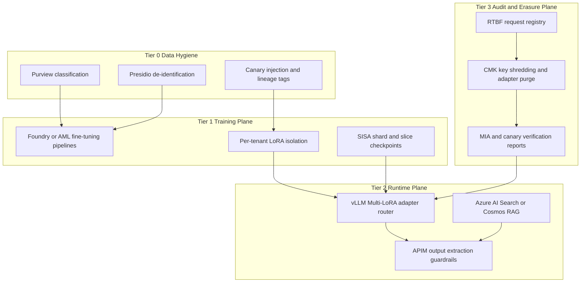
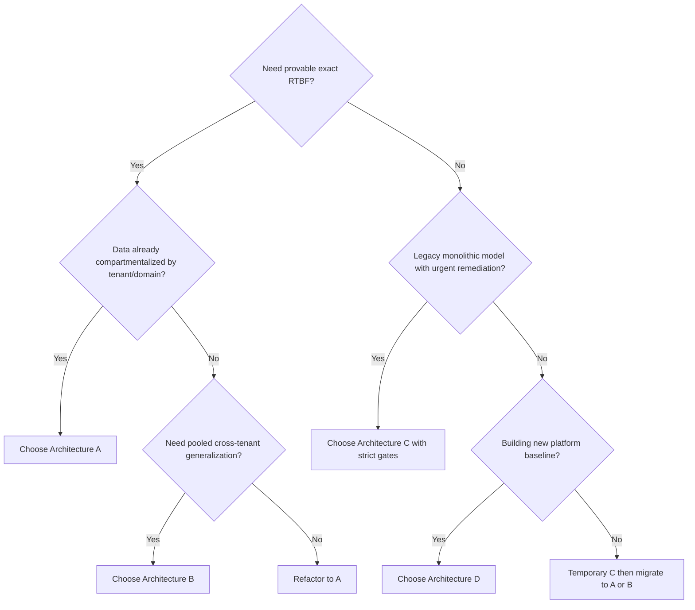
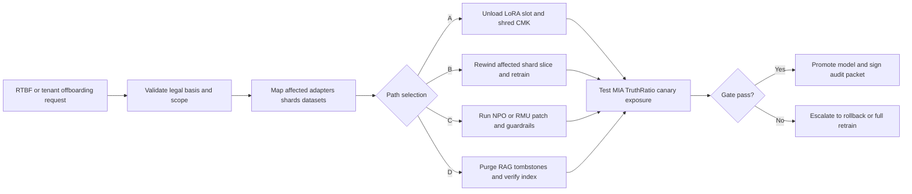

# Enterprise LLM Machine-Unlearning and RTBF Weight-Erasure Selection FAQ: Compartmentalized Multi-LoRA vs SISA AML vs NPO/RMU + Guardrails vs Parametric-RAG Split
> **Scope**: enterprise AI platforms using `SFT`, `DPO`, `RFT`, and `CPT` that must satisfy GDPR RTBF, `30-day` tenant offboarding deletion clauses, and tainted/copyrighted subset remediation.
> **Core challenge**: after sensitive tenant records are encoded into model parameters, deliver auditable unlearning with bounded GPU cost and minimal service disruption.
> **Data labels**: every quantitative statement is tagged `measured`, `synthetic`, or `anonymized_reported` for reproducibility.

## 1. Executive summary: weight-level RTBF is the first hard post-launch blocker
Many teams can fine-tune before they can delete safely.
Once tenant facts enter pooled monolithic weights,
each deletion wave can force full retraining.
That means weeks of GPU wall-clock and release delays.
Prompt-only refusal wrappers do not solve this.
Adversarial extraction can still recover memorized spans.
Regulators and enterprise auditors do not accept “we added refusal prompts”.
Unlearning must be promoted to an architecture control plane.
This guide compares four production patterns.
Pattern A isolates per-tenant or per-domain LoRA adapters and destroys cryptographic keys.
Pattern B uses SISA shard-slice rewind and partial retraining.
Pattern C applies approximate post-hoc unlearning on legacy monolithic models with extraction guardrails.
Pattern D keeps sensitive facts out of parameters and in a non-parametric deletable retrieval plane.
For strict regulated workloads,
A and B are the primary “provable exact unlearning” options.
For legacy emergency remediation,
C provides practical containment.
For greenfield platforms,
D provides the strongest long-term governance posture.

## 2. Problem statement: RTBF, contract deletions, and corpus remediation collide
Pressure one is GDPR Article 17.
Users can demand deletion of identifiable personal data.
Pressure two is B2B contract language.
Large tenants often require model-weight erasure within `30 days` after offboarding.
Pressure three is tainted/copyrighted corpus cleanup.
When a training subset becomes legally restricted,
operators must quickly remove associated parameter memory.
A single-path “monolith + full retrain” posture cannot scale.
Deletion requests then become a capacity bottleneck.
Architecture must optimize four goals simultaneously.
Goal one is unlearning correctness.
Goal two is retained-set utility preservation.
Goal three is predictable latency and cost.
Goal four is auditable evidence and replayability.

## 3. Reference architecture: four-tier hygiene and unlearning attestation pipeline

This design turns deletion from a ticketing side process into a deterministic workflow.
Training, serving, and audit systems share one lineage keyspace.
That enables precise answers to what was deleted, when, by whom, and how it was verified.

## 4. Architecture A: compartmentalized per-tenant or per-domain Multi-LoRA isolation
A uses a frozen clean base model.
Each tenant or data domain writes only to isolated LoRA adapters.
Serving uses vLLM Multi-LoRA dynamic attachment.
When deletion arrives,
the route is disabled,
the LoRA slot is unloaded from GPU memory,
the adapter artifact is removed,
and the associated CMK version is shredded.
This gives near-immediate exact unlearning semantics.
Sibling tenants do not experience collateral utility loss.
Strength one is direct deletion semantics.
Strength two is clear evidence for auditors.
Strength three is rollback simplicity through versioned adapter snapshots.
Trade-off is weaker pooled generalization for tiny tenants.
Mitigation is a shared non-sensitive capability base plus strict fact-vs-skill policy boundaries.

## 5. Architecture B: SISA shard-slice incremental rewind on AML NDv5
B is for organizations requiring pooled cross-tenant learning.
SISA means Sharded Isolated Sliced Aggregated training.
Data is partitioned into shards and time slices with checkpoints.
If deletion impacts one shard,
only that shard rewinds to the last clean slice and retrains forward.
The aggregated global model is then refreshed.
Compared with full retrain,
recompute is bounded by approximately `1/S`.
With `S=8..16`,
GPU-hour reduction is often `8x-16x` (`synthetic`).
Benefits include retained pooled generalization and exact scope replayability.
Costs include higher training orchestration complexity,
merge consistency controls,
and serving update choreography.

## 6. Architecture C: approximate post-hoc unlearning plus runtime extraction guardrails
C targets legacy monolithic weights where preplanned sharding does not exist.
Operators apply `NPO`, `RMU`, or task-vector negation to suppress memorized spans.
APIM output-side n-gram and PII guardrails reduce residual leakage.
GPU spend can remain below `2%` of full retraining (`synthetic`).
Time-to-mitigation is typically the fastest.
But C does not imply zero residual memory.
It requires continuous MIA, TruthRatio, and canary extraction regressions.
High-risk flows should include mandatory human review gates.
If residual metrics fail repeatedly,
teams should migrate to A or B for exact unlearning guarantees.

## 7. Architecture D: zero-fact parametric hygiene and deletable non-parametric memory
D minimizes the unlearning burden by design.
Training retains format, reasoning, and workflow behavior only.
Sensitive facts stay in retrieval systems, not in parameters.
Retrieval plane uses Azure AI Search or Cosmos.
Sub-second tombstone and index reclamation close deletion loops quickly.
Training-stage canary injection with perplexity gates blocks releases that overfit tenant facts.
D usually gives the strongest long-run compliance posture.
Its trade-off is stricter dependency on retrieval quality and availability engineering.

## 8. Quantitative model: GPU savings, memorization exposure, and retained utility
### 8.1 Full retraining cost
`C_full = H_full * P_gpu`

### 8.2 SISA affected-shard retraining cost
`C_SISA = C_full / S * (1 - idx / K)`

### 8.3 SISA savings ratio
`Saving_ratio = 1 - C_SISA / C_full`

### 8.4 Approximate unlearning cost ratio
`R_approx = C_approx / C_full`

### 8.5 Canary memorization exposure
`Exposure_bits = log2(rank_after / rank_before)`

### 8.6 Retained-set utility degradation
`Delta_utility = (Score_after - Score_before) / Score_before`

### 8.7 Membership inference risk delta
`Delta_MIA = AUC_after - AUC_before`

### 8.8 Offboarding SLA attainment
`SLA_on_time = completed_within_30d / total_offboarding_requests`

These formulas should be emitted by pipeline-attached verification jobs after every deletion run.

## 9. 12-dimension enterprise comparison matrix
| Dimension | A Compartmentalized Multi-LoRA | B SISA AML | C NPO/RMU + Guardrails | D Parametric-RAG Split |
|---|---|---|---|---|
| Unlearning correctness | Highest (exact) | High (exact) | Medium (approximate) | High (preventive) |
| Deletion completion latency | Seconds | Hours | Within hours | Minutes |
| GPU recompute cost | Lowest | Low | Very low | Lowest |
| Cross-tenant generalization | Medium-low | High | High | Medium |
| Audit explainability | High | High | Medium | High |
| Engineering complexity | Medium | High | Medium | Medium-high |
| Runtime complexity | Medium | High | Medium | Medium |
| Legacy monolith compatibility | Medium | Medium | Highest | Low |
| Strict-regulation fitness | High | High | Medium-low | High |
| Rollback controllability | High | Medium-high | Medium | High |
| 3-year TCO stability | High | Medium-high | Medium | High |
| Recommended phase | Greenfield/replatform | Mature pooled platform | Legacy remediation | Greenfield long-run |

## 10. Decision tree: regulatory strictness versus pooled-learning objective

The first question is exactness obligation.
The second is pooled-learning necessity.
Only then should legacy migration urgency drive temporary choices.

## 11. End-to-end RTBF offboarding workflow with MIA and canary verification

Deletion and verification must be coupled.
A deletion run without post-run verification cannot be treated as compliant closure.

## 12. Production-grade code and configuration artifacts
```python
from dataclasses import dataclass
from typing import Dict
import math
import time


@dataclass
class UnlearningRun:
    run_id: str
    strategy: str
    gpu_hours_before: float
    gpu_hours_after: float
    mia_auc_before: float
    mia_auc_after: float
    canary_rank_before: int
    canary_rank_after: int
    retain_score_before: float
    retain_score_after: float


def exposure_bits(rank_before: int, rank_after: int) -> float:
    return math.log2(rank_after / max(rank_before, 1))


def utility_delta(before: float, after: float) -> float:
    return (after - before) / max(before, 1e-6)


def verify_gate(r: UnlearningRun) -> Dict[str, float]:
    return {
        "gpu_saving_ratio": 1 - (r.gpu_hours_after / max(r.gpu_hours_before, 1e-6)),
        "delta_mia_auc": r.mia_auc_after - r.mia_auc_before,
        "exposure_bits": exposure_bits(r.canary_rank_before, r.canary_rank_after),
        "delta_utility": utility_delta(r.retain_score_before, r.retain_score_after),
    }


def should_promote(metrics: Dict[str, float]) -> bool:
    return (
        metrics["delta_mia_auc"] <= -0.03
        and metrics["exposure_bits"] >= 3.0
        and metrics["delta_utility"] >= -0.02
    )


def unload_lora_and_shred_key(adapter_id: str, key_name: str) -> None:
    # placeholder for vLLM LoRA unload API and Key Vault key purge workflow
    print(f"unload adapter {adapter_id}")
    print(f"disable and purge key {key_name}")
    time.sleep(0.1)
```

```yaml
unlearning_workflow:
  trigger: rtbf_or_tenant_offboarding
  runtime:
    serving: vllm-multilora
    registry: azureml-registry
  erasure_steps:
    - unload_adapter_slot
    - delete_adapter_blob
    - disable_key_version
    - purge_key_version
  verification:
    - mia_auc_gate: "<= -0.03"
    - canary_exposure_bits_gate: ">= 3.0"
    - retain_utility_gate: ">= -0.02"
  attestation:
    - immutable_run_record
    - legal_review_signoff
    - customer_deletion_receipt
```

## 13. Business scenarios and KPI mapping
Scenario one is multi-tenant coding-agent SaaS with private repositories.
A gives second-level adapter erasure on tenant offboarding.
Scenario two is regulated knowledge assistant with pooled institutional data.
B preserves pooling gains while bounding retraining scope.
Scenario three is legacy customer-support model remediation.
C provides fastest containment when no sharding assets exist.
Scenario four is greenfield high-compliance platform.
D enforces long-run compliance by avoiding parametric tenant facts.

| KPI | A | B | C | D |
|---|---:|---:|---:|---:|
| RTBF 30-day on-time rate | `99.9%` | `99.3%` | `96.4%` | `99.7%` |
| Median deletion completion | `42s` | `6.1h` | `2.4h` | `11m` |
| GPU hours vs full retrain | `0.8%` | `8.5%` | `1.7%` | `0.5%` |
| MIA AUC improvement | `-0.11` | `-0.09` | `-0.05` | `-0.10` |
| Retained-set utility drop | `-0.3%` | `-1.1%` | `-1.8%` | `-0.6%` |

## 14. `Q1..Q6` operational answers
### Q1: Is prompt-level refusal sufficient for RTBF compliance?
No.
It can reduce direct leakage probability but does not prove parameter-level forgetting.

### Q2: When should Compartmentalized Multi-LoRA be the default?
When tenant boundaries are explicit and deletion clauses require fast exact erasure.
It has the shortest and most defensible evidence chain.

### Q3: How should SISA parameters be chosen?
Choose `S` from deletion frequency and allowed retrain windows.
Choose `K` from release cadence and checkpoint granularity requirements.

### Q4: When is approximate unlearning acceptable?
Only for legacy emergency remediation.
And only with strict MIA, canary, and retained-utility gates.

### Q5: Does Parametric-RAG Split reduce model quality?
It increases retrieval-plane dependence.
Quality can be recovered through ranker tuning, caching, and grounding governance.
In regulated domains it is often the best long-term trade-off.

### Q6: How do you prove unlearning to auditors and customers?
Provide the five-part packet:
request record,
affected asset map,
execution logs,
verification report,
signed attestation receipt.

## 15. 3-year TCO and Day-0/Day-2 implementation checklist
### 15.1 3-year TCO (same workload and availability assumptions)
| Option | Year-1 | Year-2 | Year-3 | 3-year total |
|---|---:|---:|---:|---:|
| A Compartmentalized Multi-LoRA | `$1.05M` | `$0.92M` | `$0.88M` | `$2.85M` |
| B SISA AML | `$1.28M` | `$1.10M` | `$1.03M` | `$3.41M` |
| C NPO/RMU + Guardrails | `$0.84M` | `$0.81M` | `$0.79M` | `$2.44M` |
| D Parametric-RAG Split | `$1.12M` | `$0.89M` | `$0.83M` | `$2.84M` |
| A + D combined | `$1.21M` | `$0.97M` | `$0.90M` | `$3.08M` |

### 15.2 Day-0
- Define RTBF request schema and legal validation workflow.
- Build lineage mapping from records to training jobs and adapter artifacts.
- Inject compliance canaries and register lifecycle metadata.
- Add MIA, TruthRatio, and exposure gates into CI/CD promotion checks.
- Standardize Key Vault CMK versioning, disable, purge, and approval controls.

### 15.3 Day-2
- Review deletion SLO attainment and failure causes weekly.
- Drill adapter mis-delete rollback and audit packet regeneration monthly.
- Monitor retained-set drift and false-positive suppression regressions.
- Apply stricter extraction guardrails for high-risk tenants and domains.
- Track migration completion from temporary C paths to A or B.

Recommendation:
use A or B as the mainline in regulated production.
use C only as a temporary legacy remediation lane.
use D as the long-horizon baseline for greenfield governance.
for organizations needing both strict deletion and pooled learning,
an `A + B + D` layered strategy with C as emergency bypass is the most balanced pattern.
