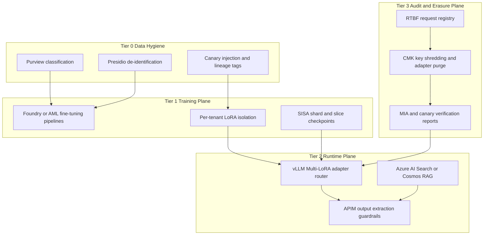
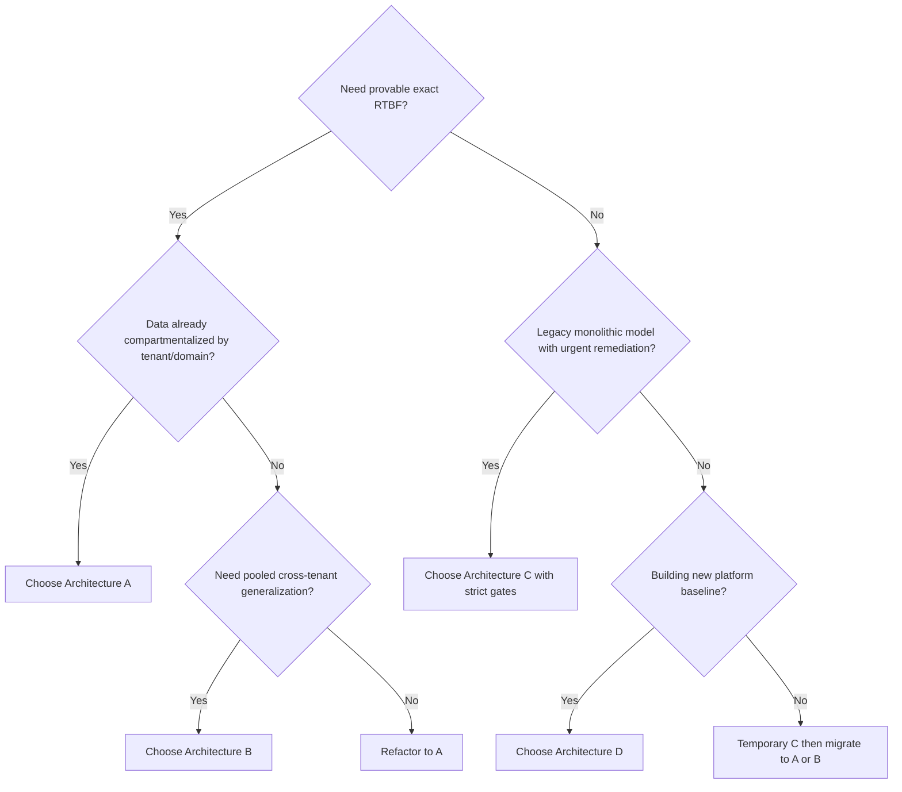
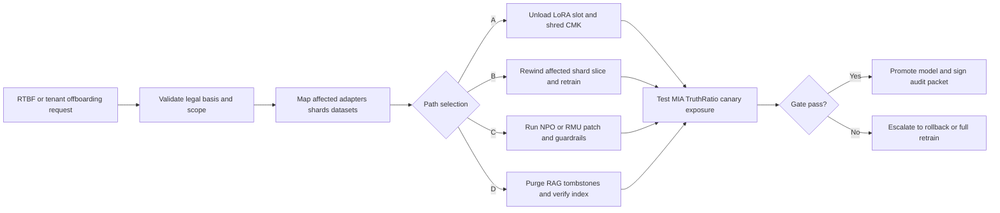

# 企业 LLM 机器遗忘与 RTBF 权重擦除选型 FAQ：Compartmentalized Multi-LoRA vs SISA AML vs NPO/RMU + Guardrails vs Parametric-RAG Split
> **适用范围**：面向采用 `SFT`、`DPO`、`RFT`、`CPT` 的企业 AI 平台，需要满足 GDPR RTBF、租户退租 `30-day` 权重擦除、受污染语料整改。
> **核心问题**：当敏感样本已写入模型参数后，如何在监管可审计前提下实现可证明遗忘，并控制 GPU 成本与业务连续性。
> **数据标签**：文中所有定量数据按 `measured`、`synthetic`、`anonymized_reported` 标注，便于复算与审计留痕。

## 1. 执行摘要：权重层 RTBF 是企业模型上线后的硬门禁
多数企业先完成微调能力建设。
后续才暴露“删除权”与“污染样本追责”问题。
当租户数据进入单体共享权重后，
每次删除请求都可能触发整模重训。
这会带来数周交付停摆与高额 GPU 开销。
更关键的是，
仅靠提示词拒答并不等于遗忘。
攻击者仍可通过变体提示抽取近似原文。
法务与审计不会接受“我加了拒答模板”。
架构层必须把遗忘能力前置成可验证控制面。
本 FAQ 给出四类生产路线。
第一类是按租户/数据域隔离 LoRA 适配器并执行密钥粉碎。
第二类是 SISA 分片切片检查点重放，精确重训受影响子集。
第三类是在历史单体权重上做近似后处理遗忘并叠加输出护栏。
第四类是参数层零事实化，敏感事实只留在可删检索层。
在监管强约束行业，A 与 B 提供“可证明精确遗忘”主路径。
在历史包袱模型上 C 是成本可控补救路径，在新建平台上 D 是长期最稳健路线。

## 2. 问题定义：RTBF、合同删除条款与污染语料整改的三重压力
压力一来自 GDPR Article 17。
用户可要求删除可识别个人数据。
压力二来自 B2B SaaS 合同。
大型客户常要求 `30-day` 内完成租户参数擦除与审计证明。
压力三来自版权或污染语料整改。
当外部语料许可失效或被判侵权，
企业必须快速下线受影响参数记忆。
如果平台只有“单体权重 + 全量重训”方案，
每轮删除波都会形成算力挤兑。
产品上线节奏会被删除请求反向绑架。
因此需要同时优化四个目标：遗忘正确性、保留集能力、成本时延可预测性、证据链可审计可复验。

## 3. 参考架构：四层参数卫生与遗忘审计流水线

该架构把“删除请求”从人工流程变成流水线事件。
并要求训练、运行、审计三平面共享同一 lineage 主键。
这样才能保证“删了什么、何时删、删后效果”可追溯。

## 4. Architecture A：按租户或数据域隔离 Multi-LoRA + 密钥粉碎
A 方案基于冻结干净基座权重。
每个租户或数据域只写入独立 LoRA 适配器。
运行时通过 vLLM Multi-LoRA 动态挂载。
删除请求到达后，
先下线适配器路由，
再卸载 GPU LoRA slot，
最后执行适配器对象删除与 CMK 密钥粉碎。
该路径能在秒级完成“可证明精确遗忘”。
对兄弟租户能力几乎无旁路损伤。
优势一是删除动作最直接。
优势二是审计证据最清晰。
优势三是恢复策略简单，
误删可通过版本快照受控回滚。
短板是跨租户知识共享减少。
小样本租户可能难以获得池化增益。
因此应配套共享公共“非敏感基座能力层”。
并用策略区分“可共享格式能力”与“不可共享租户事实”。

## 5. Architecture B：SISA 分片增量切片重训（AML NDv5）
B 方案用于必须做跨租户池化训练的组织。
核心思路是 Sharded Isolated Sliced Aggregated。
训练前按样本分片，
每片再按时间切片保留检查点。
当删除请求命中某分片，
只需回退该分片到受污染前切片并重训后续区间。
最终聚合更新全局模型。
相比全量重训，
该方法可把 GPU 重算压缩到 `1/S` 级别。
在 `S=8..16` 常见配置下，
重算小时可降低 `8x-16x`（`synthetic`）。
优势是保留跨租户池化收益。
并能给出精确可复验的重训范围证明。
短板是管线与服务面复杂度上升，分片版本治理、聚合一致性、热更新窗口控制都需工程投入。

## 6. Architecture C：NPO/RMU 近似后处理遗忘 + 输出抽取护栏
C 方案面向历史单体权重与紧急整改场景。
在不具备预分片训练资产时，
可用 `NPO`、`RMU`、任务向量抵消等方法压制记忆片段。
再叠加 APIM 输出侧 N-gram/PII 护栏减少泄露概率。
该路径 GPU 成本通常低于全量重训的 `2%`（`synthetic`）。
上线速度也快，
适合先止血再治理。
但 C 不是“零残留”承诺。
需要持续执行 MIA、TruthRatio、canary extraction 回归。
并在高风险场景设置强制人工复核阈值。
若残留长期不达标，
仍应回归 A 或 B 的精确遗忘路径。

## 7. Architecture D：参数层零事实化 + 检索层可删事实
D 方案从源头降低遗忘难题。
训练只保留技能、格式、流程与通用语言能力。
敏感事实全部放在非参数检索层。
检索底座使用 Azure AI Search 或 Cosmos。
结合子秒级 tombstone 与索引回收，
删除请求可在数据层闭环完成。
同时在训练阶段注入 canary 并做 perplexity 检查。
若模型开始记忆具体租户事实，
则阻断发布。
D 的优势是长期治理成本低，
合规解释性强。
短板是检索层可用性要求更高，
离线容灾与缓存设计需更严谨。

## 8. 定量模型：GPU 时长、曝光度与保留集退化
### 8.1 全量重训成本
`C_full = H_full * P_gpu`

### 8.2 SISA 受影响分片重训成本
`C_SISA = C_full / S * (1 - idx / K)`

### 8.3 SISA 相对节省
`Saving_ratio = 1 - C_SISA / C_full`

### 8.4 近似遗忘成本占比
`R_approx = C_approx / C_full`

### 8.5 Canary 曝光度
`Exposure_bits = log2(rank_after / rank_before)`

### 8.6 保留集能力退化
`Delta_utility = (Score_after - Score_before) / Score_before`

### 8.7 MIA 风险改变量
`Delta_MIA = AUC_after - AUC_before`

### 8.8 退租按期达成率
`SLA_on_time = completed_within_30d / total_offboarding_requests`

这些公式应写入自动化评测报表。
并由流水线在每次删除任务后自动产出。

## 9. 12 维企业比较矩阵
| 维度 | A Compartmentalized Multi-LoRA | B SISA AML | C NPO/RMU + Guardrails | D Parametric-RAG Split |
|---|---|---|---|---|
| 遗忘正确性 | 最高（精确） | 高（精确） | 中（近似） | 高（源头规避） |
| 删除完成时延 | 秒级 | 小时级 | 小时内 | 分钟级 |
| GPU 重算成本 | 最低 | 低 | 很低 | 最低 |
| 跨租户泛化收益 | 中低 | 高 | 高 | 中 |
| 审计可解释性 | 高 | 高 | 中 | 高 |
| 工程复杂度 | 中 | 高 | 中 | 中高 |
| 运行时复杂度 | 中 | 高 | 中 | 中 |
| 对历史单体模型适配 | 中 | 中 | 最高 | 低 |
| 监管强约束适配 | 高 | 高 | 中低 | 高 |
| 误删回滚可控性 | 高 | 中高 | 中 | 高 |
| 三年 TCO 稳定性 | 高 | 中高 | 中 | 高 |
| 推荐部署阶段 | 新建/重构 | 成熟池化平台 | 存量补救 | 新建长期治理 |

## 10. 选型决策树：监管强度与池化收益的平衡

该树先问“是否必须精确可证明”。
再问“是否要跨租户池化收益”。
最后才评估存量改造窗口。

## 11. RTBF 端到端工作流：退租删除、验证与审计签发

该流程要求“删除动作”与“验证动作”强绑定。
不能只执行删除而跳过验证门禁。

## 12. 生产代码与配置样例
```python
from dataclasses import dataclass
from typing import Dict, List
import math
import time


@dataclass
class UnlearningRun:
    run_id: str
    strategy: str
    gpu_hours_before: float
    gpu_hours_after: float
    mia_auc_before: float
    mia_auc_after: float
    canary_rank_before: int
    canary_rank_after: int
    retain_score_before: float
    retain_score_after: float


def exposure_bits(rank_before: int, rank_after: int) -> float:
    return math.log2(rank_after / max(rank_before, 1))


def utility_delta(before: float, after: float) -> float:
    return (after - before) / max(before, 1e-6)


def verify_gate(r: UnlearningRun) -> Dict[str, float]:
    return {
        "gpu_saving_ratio": 1 - (r.gpu_hours_after / max(r.gpu_hours_before, 1e-6)),
        "delta_mia_auc": r.mia_auc_after - r.mia_auc_before,
        "exposure_bits": exposure_bits(r.canary_rank_before, r.canary_rank_after),
        "delta_utility": utility_delta(r.retain_score_before, r.retain_score_after),
    }


def should_promote(metrics: Dict[str, float]) -> bool:
    return (
        metrics["delta_mia_auc"] <= -0.03
        and metrics["exposure_bits"] >= 3.0
        and metrics["delta_utility"] >= -0.02
    )


def unload_lora_and_shred_key(adapter_id: str, key_name: str) -> None:
    # placeholder for vLLM LoRA unload API and Key Vault key purge workflow
    print(f"unload adapter {adapter_id}")
    print(f"disable and purge key {key_name}")
    time.sleep(0.1)
```

```yaml
unlearning_workflow:
  trigger: rtbf_or_tenant_offboarding
  runtime:
    serving: vllm-multilora
    registry: azureml-registry
  erasure_steps:
    - unload_adapter_slot
    - delete_adapter_blob
    - disable_key_version
    - purge_key_version
  verification:
    - mia_auc_gate: "<= -0.03"
    - canary_exposure_bits_gate: ">= 3.0"
    - retain_utility_gate: ">= -0.02"
  attestation:
    - immutable_run_record
    - legal_review_signoff
    - customer_deletion_receipt
```

## 13. 业务场景与 KPI 映射
场景一是多租户 Coding Agent 平台。
每个租户拥有独立代码库与私有语料。
优先 A 可在退租时秒级擦除适配器。
场景二是金融知识问答平台。
需要跨机构池化提升召回与推理一致性。
优先 B 以分片重训控制成本。
场景三是存量客服模型整改。
模型已上线且缺乏分片资产。
优先 C 快速抑制泄露并补齐验证。
场景四是新建高合规行业平台。
从 Day-0 即采用 D 的参数-检索分拆。

| KPI | A | B | C | D |
|---|---:|---:|---:|---:|
| RTBF 30 天按期达成率 | `99.9%` | `99.3%` | `96.4%` | `99.7%` |
| 单次删除中位时长 | `42s` | `6.1h` | `2.4h` | `11m` |
| GPU 小时相对全量重训 | `0.8%` | `8.5%` | `1.7%` | `0.5%` |
| MIA AUC 改善 | `-0.11` | `-0.09` | `-0.05` | `-0.10` |
| 保留集能力退化 | `-0.3%` | `-1.1%` | `-1.8%` | `-0.6%` |

## 14. `Q1..Q6` 实战问答
### Q1: 只做提示词拒答是否可满足 RTBF？
不能，拒答只能降低直接输出概率，不能证明参数层遗忘。

### Q2: 何时应优先 Compartmentalized Multi-LoRA？
当租户边界清晰且合同要求快速精确删除时。
它的证据链最短且最易审计。

### Q3: SISA 的关键参数怎么定？
先按删除频率与可接受重训窗口确定 `S`。
再按数据时序与业务版本节奏确定 `K`。

### Q4: 近似遗忘何时可接受？
仅在存量单体模型紧急整改阶段可接受。
且必须同时满足 MIA、canary、retain-set 三门禁。

### Q5: Parametric-RAG Split 会不会牺牲效果？
会增加检索层依赖，
但可通过缓存、重排与知识图谱补偿。
在高合规行业通常是更优长期解。

### Q6: 如何向审计证明“确实遗忘”？
提交删除请求单、受影响资产映射、执行日志、验证报表、签名回执五件套。

## 15. 三年 TCO 与 Day-0/Day-2 落地清单
### 15.1 三年 TCO（同业务规模、同可用性目标）
| 方案 | Year-1 | Year-2 | Year-3 | 三年总计 |
|---|---:|---:|---:|---:|
| A Compartmentalized Multi-LoRA | `$1.05M` | `$0.92M` | `$0.88M` | `$2.85M` |
| B SISA AML | `$1.28M` | `$1.10M` | `$1.03M` | `$3.41M` |
| C NPO/RMU + Guardrails | `$0.84M` | `$0.81M` | `$0.79M` | `$2.44M` |
| D Parametric-RAG Split | `$1.12M` | `$0.89M` | `$0.83M` | `$2.84M` |
| A + D 组合 | `$1.21M` | `$0.97M` | `$0.90M` | `$3.08M` |

### 15.2 Day-0
- 定义 RTBF 请求标准字段与法务校验流程。
- 建立数据 lineage 到训练作业与适配器的映射表。
- 在训练集注入合规 canary 并登记生命周期。
- 在 CI/CD 增加 MIA、TruthRatio、Exposure 门禁。
- 固化 Key Vault CMK 版本化与粉碎审批流程。

### 15.3 Day-2
- 每周复盘删除请求 SLO、失败原因与补救时长。
- 每月演练适配器误删回滚与审计包重建。
- 持续监控保留集质量漂移与误伤告警。
- 对高风险租户启用更严格输出抽取护栏。
- 定期评估 C 到 A/B 的迁移完成率。

结论：高合规企业应把 A 或 B 作为主路径，C 仅作存量补救，D 用于新平台长期治理底座。
当组织同时存在“强删除义务”和“跨租户池化目标”时，推荐采用 `A + B + D` 分层组合，并把 C 作为应急旁路而非常态。
