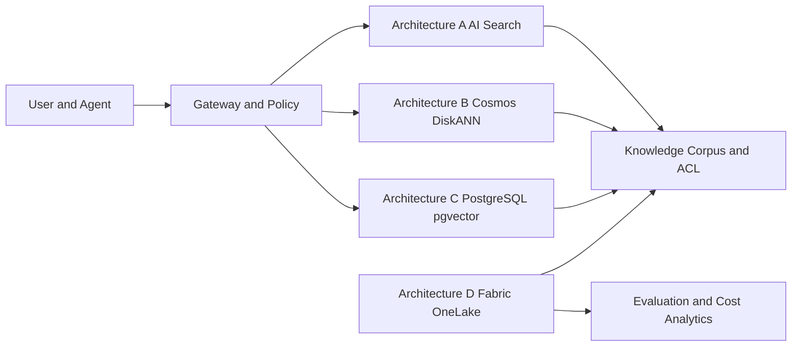
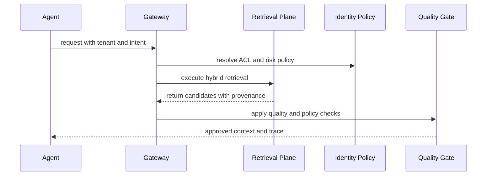
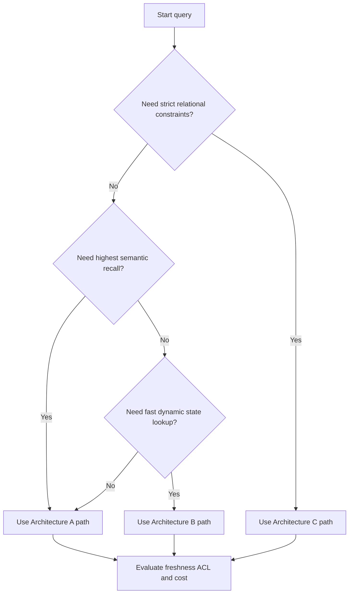

# Enterprise LLMOps cost-anomaly response selection FAQ: token budget sentry vs tier throttle vs fallback cache vs human approval
> **Use case**: enterprise agent operations under traffic spikes with token-cost anomalies, budget alarms, and service-degradation response.
> **Decision pressure**: balance cost ceilings, service continuity, user experience, and governance complexity.
> **Goal**: build an alertable, throttle-capable, and rollback-safe enterprise LLMOps cost-anomaly response architecture.

## 1. Executive summary
- Enterprise RAG success depends on permission-safe fresh retrieval, not vector recall alone.
- Recommended baseline uses AI Search as primary retrieval plane.
- Add Cosmos DiskANN for high-throughput dynamic session-feature paths.
- Add PostgreSQL pgvector where relational consistency is strict.
- Add Fabric OneLake for lakehouse governance and analytics feedback loops.
- Combined deployment requires unified chunk policy, ACL mapping, and evaluation gates.
- Track freshness, permission leakage, retrieval drift, and cost per answered case.
- Define retrieval and fallback paths by business criticality tiers.

## 2. Scope and non-goals
- Scope: multi-tenant enterprise knowledge platforms with frequent updates.
- Scope: agentic workflows combining tool invocation and retrieval grounding.
- Scope: organizations needing unified governance, observability, and FinOps.
- Non-goal: single-user lightweight personal knowledge search.
- Non-goal: purely offline analytics with no online answering.
- Non-goal: shortcuts bypassing ACL governance.

## 3. Common failure anatomy
- Document updates and vector updates diverge, causing stale answers.
- ACL mapping drift causes leakage or false denial.
- Single retrieval strategy cannot satisfy mixed business intents.
- Offline-only metrics hide online answer degradation.
- Flat cost models trigger budget instability at peak.
- Missing fallback paths turns local failures into broad outages.

## 4. Four candidate architectures
- **Architecture A**: token budget sentry lane for offline baseline regression gates.
- **Architecture B**: tier throttle lane for staged traffic validation.
- **Architecture C**: fallback cache lane for compliance sign-off workflows.
- **Architecture D**: FinOps budget-lock lane for hard cost ceilings and auto-degrade protection.
- A is strongest for cross-platform semantic portability.
- B is strongest for managed Azure operator efficiency.
- C is strongest for tenant/application-level cost governance.
- D is strongest for enterprise budget closure and accountability.

## 5. Architecture A details (Eval Harness)
- Unified trace/span/metric semantics across runtimes and model providers.
- Easy integration with open-source analysis and custom alerting stacks.
- Well suited for multi-cloud and hybrid environments.
- Requires disciplined schema evolution and sampling controls.
- Best as the enterprise observability standards layer.

## 6. Architecture B details (Shadow Canary)
- Fast onboarding using App Insights, Log Analytics, and Workbooks.
- Native integration with Azure RBAC, alerts, and automation actions.
- Lower operational barrier for platform-wide standard rollout.
- Requires cardinality and log-volume governance to avoid telemetry explosion.
- Best as the default managed Azure observability lane.

## 7. Architecture C details (Policy Approval)
- Records token and call consumption by tenant, app, model, and region.
- Policy plane can enforce quota, throttling, budget gates, and anomaly blocks.
- Clear accountability boundaries for chargeback and showback.
- Requires reconciliation with downstream service telemetry to avoid drift.
- Best for multi-tenant commercial and internal accountability scenarios.

## 8. Architecture D details (FinOps Budget Lock)
- Maps A/B/C telemetry into unified financial allocation domains.
- Translates technical metrics into BU/product/customer cost views.
- Enables forecasting, overspend alerting, and optimization feedback loops.
- Requires strong data governance and finance collaboration.
- Best for group-level FinOps platform governance.

## 9. Twelve-dimension comparison matrix
| Dimension | Architecture A | Architecture B | Architecture C | Architecture D |
|---|---|---|---|---|
| End-to-end traceability | Very high | High | Medium-high | Very high |
| Onboarding speed | Medium-high | Very high | High | Medium-high |
| Cost attribution precision | Medium-high | High | Very high | Very high |
| Governance consistency | High | Very high | High | Very high |
| Budget alarm capability | High | High | Very high | Very high |
| Cross-platform portability | Very high | Medium | Medium-high | High |
| Operations complexity | Medium-high | Medium | Medium-high | High |
| Cost predictability | Medium-high | High | Very high | Very high |
| Multi-tenant governance | High | High | Very high | Very high |
| Audit traceability | Very high | Very high | Very high | Very high |
| Elastic scalability | High | Very high | High | High |
| Suggested role | Primary retrieval plane | Dynamic hybrid plane | Transactional consistency plane | Governance backbone plane |

## 10. Enterprise agent observability and attribution topology

## 11. Query execution and permission-governance sequence

## 12. Retrieval-path decision tree

### Q1. What is the first principle for enterprise RAG selection
- Permission-safe freshness takes precedence over offline-only scores.
- Recall quality and governance consistency must be co-designed.
- Fallback paths are mandatory for local-failure containment.
- Chunk and ACL standards must be unified.
- Evaluation gates should be embedded in release flow.
- Online drift in quality and cost must be continuously tracked.
- Criticality tiers should govern retrieval path choice.

### Q2. How should A/B/C/D collaborate
- A serves as the default primary retrieval plane.
- B adds dynamic low-latency enhancements.
- C enforces relational and transactional constraints.
- D powers governance analytics and batch-stream feedback.
- Unified gateway and identity policy is required.
- Unified evaluation and cost dashboards are required.
- Unified tracing keys are required for audit closure.

### Q3. How to quantify quality latency and cost
- Quality gain can be modeled as `Gain = α*Recall + β*ACL_Precision - γ*Latency`.
- Unit economics can be modeled as `Cost_per_answer = (Retrieval + Model + Ops) / Answers`.
- Freshness should be governed by `Freshness_lag` and update SLA.
- Compare cache-hit and recompute path economics.
- Track success cost and remediation cost separately.
- Measure SLO impact of fallback-path selection.
- Quantified outcomes should gate release decisions.

### Q4. How to build in permission and compliance controls
- Enforce identity and ACL checks before retrieval.
- Return provenance and policy tags with retrieval outputs.
- Route high-risk queries to approval or human review.
- Apply masking and minimum-disclosure for sensitive fields.
- Audit logs must cover query retrieval and answer chain.
- Multi-tenant isolation should be pressure-tested regularly.
- Compliance exceptions must be remediated with closure tracking.

### Q5. Guidance for `5M/50M/500M` monthly query tiers
- `5M`: A baseline with B dynamic enhancement.
- `50M`: A+B dual plane with D governance feedback.
- `500M`: A+B+C+D full-stack collaboration with domain segmentation.
- All tiers need unified quality gates.
- All tiers need permission-consistency inspection.
- All tiers need budget thresholds and alerting.
- All tiers need quarterly parameter recalibration.

### Q6. Anti-patterns and go-live checklist
- Anti-pattern: offline recall focus without online permission checks.
- Anti-pattern: decoupled corpus and index update lifecycle.
- Anti-pattern: no fallback strategy and no remediation plan.
- Anti-pattern: total cost tracking without unit-effective cost.
- Pre-go-live: validate ACL freshness trace and fallback contracts.
- Pre-audit: validate evidence completeness and field consistency.
- Post-go-live: monitor quality and cost drift trends.

## 13. Day-0 checklist
- Define knowledge and permission domains
- Standardize chunk schema
- Standardize ACL mapping
- Build retrieval fallback strategy
- Set quality gate thresholds
- Define tracing standards
- Set cost dashboard baselines
- Complete pressure and replay tests
- Finalize rollback strategy
- Archive audit evidence

## 14. Day-2 operations checklist
- Weekly recall review
- Weekly permission leakage review
- Weekly freshness_lag review
- Monthly cost-structure review
- Monthly fallback-hit review
- Monthly privilege cleanup
- Quarterly benchmark reruns
- Quarterly threshold recalibration
- Continuous remediation closure
- Continuous evidence-catalog maintenance

## 15. Good fit vs Not for
- Good fit: multi-tenant enterprise knowledge platforms
- Good fit: strict permission and audit workloads
- Good fit: online and offline governance collaboration
- Not for: single-user lightweight search
- Not for: no-permission-governance workloads
- Not for: teams without evaluation and observability capability

## 16. Five-step rollout guide
- Step 1: Segment knowledge and permission domains
- Step 2: Deploy A primary plane
- Step 3: Attach B/C enhancement paths
- Step 4: Attach D governance feedback
- Step 5: Quarterly optimize and recalibrate

## 17. Quarterly governance metrics
- Track Recall at k
- Track ACL precision
- Track Freshness lag
- Track P95 retrieval latency
- Track Cost per successful answer
- Track Failure remediation cost
- Track Fallback hit ratio
- Track Permission anomaly rate
- Track Audit evidence completeness
- Track SLA compliance
- Track SLO budget burn
- Track Alert noise ratio
- Track Recovery duration
- Track Capacity utilization
- Track Cache hit ratio
- Track Index update success
- Track Exception closure ratio
- Track Policy drift alerts
- Track Platform stability score
- Track Cross-domain collaboration efficiency
- Track Query rejection ratio
- Track Sensitive-field leak ratio
- Track Model retry share
- Track Tenant isolation anomaly rate
- Track Feedback-ingest latency
- Track Relational-filter error ratio
- Track Replay pass ratio
- Track Release rollback ratio
- Track Evaluation coverage
- Track Governance overhead ratio
- [RQ-01] Retrieval quality lag volatility.
- [RQ-02] Retrieval quality deviation distribution.
- [RQ-03] Retrieval quality anomaly clusters.
- [RQ-04] Retrieval quality ticket backlog.
- [RQ-05] Retrieval quality threshold drift.
- [RQ-06] Retrieval quality approval congestion.
- [RQ-07] Retrieval quality recovery stability.
- [RQ-08] Retrieval quality pass-rate trend.
- [PG-01] Permission governance lag volatility.
- [PG-02] Permission governance deviation distribution.
- [PG-03] Permission governance anomaly clusters.
- [PG-04] Permission governance ticket backlog.
- [PG-05] Permission governance threshold drift.
- [PG-06] Permission governance approval congestion.
- [PG-07] Permission governance recovery stability.
- [PG-08] Permission governance pass-rate trend.
- [FG-01] Freshness governance lag volatility.
- [FG-02] Freshness governance deviation distribution.
- [FG-03] Freshness governance anomaly clusters.
- [FG-04] Freshness governance ticket backlog.
- [FG-05] Freshness governance threshold drift.
- [FG-06] Freshness governance approval congestion.
- [FG-07] Freshness governance recovery stability.
- [FG-08] Freshness governance pass-rate trend.
- [CG-01] Cost governance lag volatility.
- [CG-02] Cost governance deviation distribution.
- [CG-03] Cost governance anomaly clusters.
- [CG-04] Cost governance ticket backlog.
- [CG-05] Cost governance threshold drift.
- [CG-06] Cost governance approval congestion.
- [CG-07] Cost governance recovery stability.
- [CG-08] Cost governance pass-rate trend.
- [FS-01] Fallback strategy lag volatility.
- [FS-02] Fallback strategy deviation distribution.
- [FS-03] Fallback strategy anomaly clusters.
- [FS-04] Fallback strategy ticket backlog.
- [FS-05] Fallback strategy threshold drift.
- [FS-06] Fallback strategy approval congestion.
- [FS-07] Fallback strategy recovery stability.
- [FS-08] Fallback strategy pass-rate trend.
- [AO-01] Audit operations lag volatility.
- [AO-02] Audit operations deviation distribution.
- [AO-03] Audit operations anomaly clusters.
- [AO-04] Audit operations ticket backlog.
- [AO-05] Audit operations threshold drift.
- [AO-06] Audit operations approval congestion.
- [AO-07] Audit operations recovery stability.
- [AO-08] Audit operations pass-rate trend.
- [CC-01] Cross-domain collaboration lag volatility.
- [CC-02] Cross-domain collaboration deviation distribution.
- [CC-03] Cross-domain collaboration anomaly clusters.
- [CC-04] Cross-domain collaboration ticket backlog.
- [CC-05] Cross-domain collaboration threshold drift.
- [CC-06] Cross-domain collaboration approval congestion.
- [CC-07] Cross-domain collaboration recovery stability.
- [CC-08] Cross-domain collaboration pass-rate trend.
- [RE-01] Release engineering lag volatility.
- [RE-02] Release engineering deviation distribution.
- [RE-03] Release engineering anomaly clusters.
- [RE-04] Release engineering ticket backlog.
- [RE-05] Release engineering threshold drift.
- [RE-06] Release engineering approval congestion.
- [RE-07] Release engineering recovery stability.
- [RE-08] Release engineering pass-rate trend.

## 18. Data provenance note
- `anonymized_reported`: capacity quality and cost ranges are synthesized from anonymized enterprise programs with reproducible assumptions.
- Preserve index versions, policy versions, benchmark batch IDs, and audit trace IDs.
- Archive business KPIs, technical evidence, and governance reports in layered stores.
- Recompute TCO and thresholds when corpus shape or policy changes.
