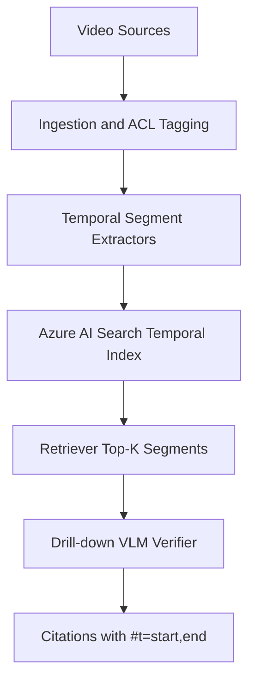
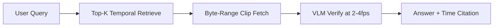
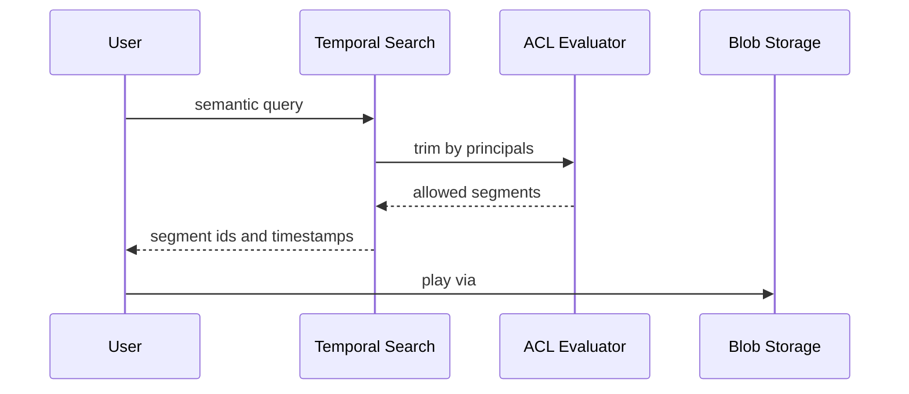

# Enterprise Long-Form Video and Screenshare Temporal RAG Selection FAQ: Content Understanding vs Video Indexer vs Clip Embedding vs Two-Stage Drill-Down

> 🌐 **Language Switch**: [中文](./enterprise-long-form-video-screenshare-temporal-rag-content-understanding-vs-video-indexer-vs-clip-embedding-vlm-drilldown-selection-faq.md) | **English (current)**
> **Audience**: Cloud & AI Solution Architects, multimodal platform engineers, knowledge engineering teams, SRE, compliance, and industry operations teams.
> **Context**: Enterprise knowledge often lives in long Teams recordings, SOP walkthrough videos, and inspection footage where plain text RAG misses time-anchored visual evidence.

## 1. Why video RAG is not just ASR plus embeddings

Long-form video contains speech, screen text, scene transitions, and non-verbal motion signals.

ASR-only pipelines miss silent but critical events such as transient error codes or visual defects.

Frame-only pipelines can explode token and indexing costs at archive scale.

Production design must balance temporal explainability, ACL safety, recall quality, and spend efficiency.

## 2. Four multimodal data-plane architecture patterns

Architecture A uses Azure AI Content Understanding for shot-aligned structured extraction into temporal index segments.

Architecture B uses Azure AI Video Indexer with cloud plus Arc-enabled edge indexing for constrained WAN sites.

Architecture C uses AKS GPU adaptive keyframing and native clip embeddings for rich non-verbal semantics.

Architecture D uses coarse retrieval followed by on-demand fine-grained verification over candidate windows only.

These patterns are composable; the most resilient approach defines a baseline retriever plus selective verifier.

## 3. Reference topology: temporal indexing with selective verification



This topology separates full archive indexing from high-detail verification to contain token burn.

A practical segment key is `video_id + start_ms + end_ms + acl_hash` for traceability and replay safety.

## 4. Architecture A: Content Understanding plus temporal segment index

A creates shot/slide-aligned segments combining diarized ASR, OCR text, and schema-guided visual summaries.

Results are returned with `#t=start,end` playback pointers so users can verify evidence directly.

A works especially well for enterprise training, KT recordings, and process walkthrough archives.

Its critical governance challenge is ACL inheritance and revocation propagation from source systems.

A can underperform where key evidence is visual-only and has little speech or text signal.

## 5. Architecture B: Video Indexer cloud-edge collaboration

B provides turnkey diarization, OCR, entity/topic timelines, and edge-first indexing for remote sites.

Arc edge extension is valuable where raw 4K uploads are expensive or unreliable over WAN.

B accelerates time-to-value for multimodal analytics and can act as a strong baseline layer.

Its tradeoff is lower deep customization compared with fully custom embedding pipelines.

Many enterprises start with B, then add C or D where business recall requirements intensify.

## 6. Architecture C: AKS GPU adaptive keyframe plus clip embeddings

C applies SSIM/scene-adaptive keyframing and multimodal encoders such as SigLIP or InternVideo2.

It captures non-verbal anomalies missed by caption-only retrieval, including safety and UI motion artifacts.

At `50,000+` annual video hours, C can materially reduce ingestion cost per hour through adaptive sparsification.

The tradeoff is higher platform complexity for model lifecycle, GPU scheduling, and evaluation operations.

C is strongest when visual-semantic recall is a first-order KPI rather than a nice-to-have signal.

## 7. Architecture D: coarse-to-fine agentic drill-down

D retrieves coarse temporal windows first, then uses byte-range or HLS slicing for targeted high-detail checks.

Only candidate windows are verified at 2–4 fps, avoiding full-video high-fps inference costs.

This pattern is effective for deictic queries such as flashes, brief dialogs, or transient state changes.

Its quality depends on first-stage recall quality and robust trigger criteria for second-stage verification.

Treat D as a precision booster over a strong baseline retriever, not as the sole retrieval engine.

## 8. Core formulas: token economics, tIoU, bandwidth, and revoke SLA

Full-video 1FPS cost: `Cost_full = Frames_total * Tokens_per_frame * Price_per_token`.

Two-stage cost: `Cost_two_stage = K * Window_seconds * fps_verify * Tokens_per_frame * Price_per_token`.

Temporal localization quality uses `tIoU@0.5` and recall against labeled windows.

Edge bandwidth savings: `Saving = 1 - (Metadata_upload / Raw_video_upload)`.

Revocation propagation SLA: `T_revoke = T_event + T_reindex + T_cache_evict`.



## 9. Twelve-dimension quantitative matrix

| Dimension | A Content Understanding | B Video Indexer | C Custom Embedding | D Two-Stage Drill-Down |
|---|---|---|---|---|
| Time-to-production | High | High | Medium | Medium-High |
| Temporal explainability | High | Medium-High | Medium | High |
| Non-verbal visual recall | Medium | Medium | High | High |
| WAN-constrained fit | Medium | High | Medium | High |
| Customization headroom | Medium | Medium-Low | High | High |
| Ops complexity | Medium | Medium | High | Medium-High |
| Index cost controllability | Medium-High | Medium-High | High | High |
| Hyper-scale suitability | High | High | Medium-High | High |
| ACL governance fit | High | High | Medium-High | High |
| Deictic query handling | Medium | Medium | Medium-High | High |
| 3-year TCO competitiveness | Medium-High | Medium-High | High | High |
| Edge deployment alignment | Medium | High | Medium | High |

## 10. ACL and citation replay control flow



Replay links must enforce alignment between SAS scope and segment-level ACL decisions.

Short TTL and single-use signatures reduce replay and link-sharing exposure.

## 11. Production snippets: temporal index schema and drill-down helper

```json
{
  "name": "video-temporal-segments",
  "fields": [
    {"name":"segment_id","type":"Edm.String","key":true,"filterable":true},
    {"name":"video_id","type":"Edm.String","filterable":true},
    {"name":"start_ms","type":"Edm.Int64","filterable":true,"sortable":true},
    {"name":"end_ms","type":"Edm.Int64","filterable":true,"sortable":true},
    {"name":"asr_text","type":"Edm.String","searchable":true},
    {"name":"ocr_text","type":"Edm.String","searchable":true},
    {"name":"visual_summary","type":"Edm.String","searchable":true},
    {"name":"acl_principals","type":"Collection(Edm.String)","filterable":true}
  ]
}
```

```python
from dataclasses import dataclass

@dataclass
class CandidateWindow:
    video_url: str
    start_s: float
    end_s: float

def build_range_header(start_byte: int, end_byte: int) -> dict[str, str]:
    return {'Range': f'bytes={start_byte}-{end_byte}'}

def estimate_clip_cost(seconds: float, fps: float, tokens_per_frame: int, price_per_1k: float) -> float:
    frames = max(int(seconds * fps), 1)
    tokens = frames * tokens_per_frame
    return (tokens / 1000.0) * price_per_1k

def should_drill_down(retrieval_score: float, tiou_conf: float) -> bool:
    return retrieval_score > 0.55 and tiou_conf < 0.80
```

## 12. Enterprise scenarios and KPI table

Scenario 1: global R&D with `40,000` hours of Teams KT and incident screenshare archives requiring timestamp-verifiable answers.

A+D improves temporal evidence precision while keeping verification spend bounded.

Scenario 2: power-grid substation drone and CCTV inspection under constrained WAN and strict visual anomaly recall requirements.

B+C reduces WAN pressure and improves visual-only anomaly retrieval outcomes.

| KPI | Scenario 1 A+D | Scenario 2 B+C |
|---|---:|---:|
| tIoU@0.5 Recall | `0.84` | `0.81` |
| Mean evidence latency | `2.9s` | `3.4s` |
| Ingestion unit cost | `$3.8/h` | `$4.2/h` |
| WAN upload reduction | `42%` | `68%` |
| ACL revoke P95 | `11min` | `13min` |

### 3-year TCO (5K / 50K / 250K video hours)

| Architecture path | 5K h/year | 50K h/year | 250K h/year | 3-year total |
|---|---:|---:|---:|---:|
| A Content Understanding | `$0.72M` | `$4.10M` | `$18.20M` | `$23.02M` |
| B Video Indexer | `$0.68M` | `$3.86M` | `$17.74M` | `$22.28M` |
| C Custom Embedding | `$0.80M` | `$3.20M` | `$12.90M` | `$16.90M` |
| D Two-Stage Drill | `$0.62M` | `$2.98M` | `$13.44M` | `$17.04M` |
| A+D hybrid | `$0.76M` | `$3.44M` | `$14.10M` | `$18.30M` |
| B+C hybrid | `$0.82M` | `$3.38M` | `$13.56M` | `$17.76M` |

## 13. Day-0 / Day-1 / Day-2 checklist

### Day-0

1. Define source categories, ACL authority systems, and citation replay compliance requirements.

2. Standardize temporal segment schema and deterministic segment IDs.

3. Configure Top-K defaults, drill-down triggers, and per-query budget guardrails.

4. Wire revocation events with deterministic reindex and cache invalidation workflow.

5. Design edge upload fallback and delayed-sync controls for low-bandwidth sites.

6. Baseline tIoU, recall, latency, and unit-cost acceptance criteria.

### Day-1

1. Monitor segment recall and false-retrieval distributions daily.

2. Monitor drill-down trigger ratio and per-query verification cost daily.

3. Audit citation playback links and ACL correctness weekly.

4. Review edge upload backlog and retry behavior weekly.

5. Evaluate model-version impact on recall weekly.

6. Refresh ASR/OCR domain lexicon tuning weekly.

### Day-2

1. Recompute full-vs-two-stage cost deltas monthly and tune guardrails.

2. Review revoke-SLA misses monthly and isolate bottleneck stages.

3. Verify edge-cloud index consistency monthly.

4. Run quarterly red-team tests for citation replay and access bypass attempts.

5. Update visual anomaly taxonomy and labels quarterly.

6. Publish quarterly multimodal retrieval quality and cost governance report.

## 14. Quantitative Q&A (Q1 to Q6)

### Q1: What is the cost gap between full-video 1FPS and two-stage drill-down?

For a 60-minute video at 1FPS, 320 tokens/frame, and `$0.01` per 1K tokens, full-pass cost is about `$11.52`.

With Top-5 windows, 20 seconds each, and 3FPS verification, estimated cost is about `$0.96`.

### Q2: How is SSIM scene-adaptive dedup ratio estimated on 60-minute screenshare?

If adaptive keyframing keeps only `32%` of sampled frames, dedup ratio is about `68%`.

That ratio maps directly to embedding writes and index footprint reduction.

### Q3: How should tIoU@0.5 recall be interpreted?

A prediction counts as hit when overlap with labeled segment reaches at least `0.5`.

If 84 of 100 evaluated queries hit, then `Recall@tIoU0.5 = 0.84`.

### Q4: How much WAN bandwidth can Arc edge indexing save?

If raw upload is `120TB/month` and metadata-first upload is `38TB/month`, saving is about `68.3%`.

Savings also reduce retry storms and stabilize processing windows on fragile links.

### Q5: How is ACL revocation propagation SLA decomposed?

If event delivery takes `2min`, reindex takes `6min`, and cache eviction takes `3min`, total is `11min`.

When SLA is breached, optimize the longest stage first and alert by stage-level SLO.

### Q6: When should A+D be preferred over B+C?

Prefer A+D for knowledge-heavy screenshare archives requiring strict temporal explainability.

Prefer B+C for edge-heavy visual inspection workloads with stronger non-verbal recall requirements.

## 15. Good fit, not-for, and runtime alert dictionary

Good fit: enterprises with large video knowledge estates, strict ACL controls, and timestamp-verifiable evidence needs.

Not for: short-video catalogs without strict ACL trimming or temporal evidence requirements.

| Alert key | Trigger | Immediate action | Owner |
|---|---|---|---|
| `temporal_recall_drop` | tIoU recall declines persistently | Roll back model and recalibrate retrieval mapping | Retrieval Team |
| `drilldown_cost_spike` | Verification cost spikes | Reduce Top-K and tighten window length | FinOps Team |
| `acl_revoke_sla_breach` | Revoke propagation exceeds SLA | Force cache eviction and accelerate reindex lane | Platform Security |
| `edge_upload_backlog` | Edge upload backlog grows | Reprioritize queue and increase burst capacity | Edge Operations |
| `sas_replay_anomaly` | SAS reuse anomaly detected | Revoke tokens and rotate signing policy | Security Team |
| `ocr_asr_drift` | Domain term recognition degrades | Refresh lexicon and trigger incremental rerun | Data Engineering |
| `segment_schema_mismatch` | Segment schema contract mismatch | Pause ingest and execute migration | Platform Engineering |
| `vlm_verify_timeout` | Verifier timeout ratio rises | Lower FPS and switch fallback model | Application Team |

### References (retrieved on 2026-11-24)

1. Azure AI Content Understanding: https://learn.microsoft.com/azure/ai-services/content-understanding/

2. Azure AI Video Indexer documentation: https://learn.microsoft.com/azure/azure-video-indexer/

3. Azure AI Search documentation: https://learn.microsoft.com/azure/search/

4. Azure Arc overview: https://learn.microsoft.com/azure/azure-arc/overview

5. Azure Blob range header operations: https://learn.microsoft.com/rest/api/storageservices/specifying-the-range-header-for-blob-service-operations

6. Azure OpenAI model concepts: https://learn.microsoft.com/azure/ai-services/openai/concepts/models

These references anchor temporal indexing, edge deployment, replay safety, and staged verification design choices.

Thresholds should be tuned continuously against domain workload patterns, compliance posture, and archive growth curves.
