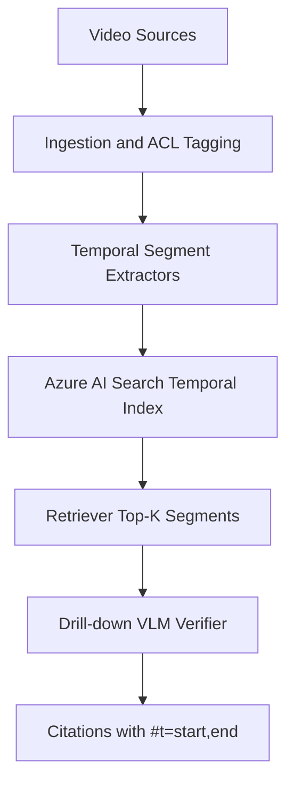
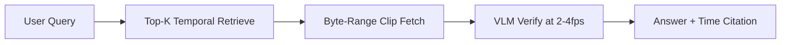
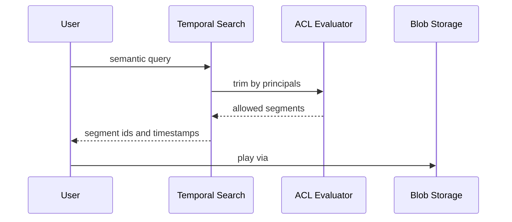

# 企业长视频与屏幕录制 Temporal RAG 选型 FAQ：Content Understanding vs Video Indexer vs Clip Embedding vs 两阶段 Drill-Down

> 🌐 **Language Switch**：**中文（当前）** | [English](./enterprise-long-form-video-screenshare-temporal-rag-content-understanding-vs-video-indexer-vs-clip-embedding-vlm-drilldown-selection-faq.en.md)
> **适用对象**：Cloud & AI Solution Architect、多模态平台团队、知识工程团队、SRE、数据合规与行业运营团队。
> **问题背景**：企业大量知识沉淀在 Teams 培训录屏、SOP 视频与巡检视频中，传统文本 RAG 无法定位时间片段与视觉语义细节。

## 1. 为什么视频 RAG 不等于“做一次 ASR 再向量化”

长视频包含语音、屏幕文字、场景变化与非语言动作，单一路径会丢失关键证据。

如果只做 ASR，UI 弹窗错误码和无声视觉异常通常不会进入检索结果。

如果只做帧嵌入，语义成本会在大规模归档下迅速膨胀并压垮索引预算。

企业级方案必须兼顾可解释时间锚点、ACL 安全裁剪、成本与可扩展性。

## 2. 四类多模态数据面架构与边界

Architecture A 用 Azure AI Content Understanding 生成 shot 对齐结构化片段并写入 Temporal 索引。

Architecture B 用 Video Indexer（云 + Arc 边缘）快速提供语音、OCR、主题与实体时间线。

Architecture C 用 AKS GPU 自定义关键帧和 clip embedding，专注非语言视觉语义召回。

Architecture D 采用粗召回 + 细验证两阶段，按需抽取候选 15–30 秒窗口做高帧率核验。

四种路径可以组合，关键是先定义“召回基线”与“二次核验触发条件”。

## 3. 全局参考：时间片段索引与按需核验



该拓扑把“全量结构化索引”与“按需高精细验证”解耦，可避免全量 VLM Token 爆炸。

建议统一 segment 主键为 `video_id + start_ms + end_ms + acl_hash`，便于审计与回放。

## 4. Architecture A：Content Understanding + Temporal Segment Index

A 通过镜头/幻灯片切换切片，融合 diarized ASR、OCR 和结构化视觉描述写入时间段文档。

检索结果返回 `#t=start,end`，用户可直接播放证据片段而不是通篇查找。

A 在知识管理场景中落地效率高，尤其适合企业培训、KT 和流程录屏库。

关键治理点是 ACL 继承与撤权传播，确保 SharePoint/Entra 权限变化可在索引侧快速生效。

A 的弱项是对无文本、无语音但存在视觉异常的场景召回能力有限。

## 5. Architecture B：Video Indexer 云边协同

B 可快速产出多说话人分离、OCR、实体时间线与主题标签，平台化能力成熟。

Arc 边缘扩展适合工厂、变电站等带宽受限环境，先本地处理再上传摘要结果。

在 WAN 成本敏感或原始 4K 视频上传受限场景，B 的部署价值显著。

短板是深度定制与自定义语义控制空间相对有限，需要和自研检索层配合补齐。

B 常被用作快速起步层，再按业务难点逐步接入 C 或 D 的精细能力。

## 6. Architecture C：AKS GPU 自定义 keyframe + clip embedding

C 用 SSIM/场景变化检测做自适应抽帧，再用 SigLIP/Marengo/InternVideo2 编码多向量语义。

此路径能捕捉文本管道遗漏的视觉事件，如 PPE 违规、画面抖动异常或 CAD 视口错位。

在年视频时长超过 `50,000` 小时时，C 常可实现 `60–75%` 的单位摄取成本优化。

代价是 GPU 编排、模型更新和评测体系都需自建，工程门槛高于托管方案。

C 适用于对视觉语义召回有硬指标的高价值行业场景。

## 7. Architecture D：两阶段粗到细 Agentic Drill-Down

D 先从轻量索引取 Top-K 时间窗，再用 Byte-Range 或 HLS 切片提取候选子片段做细粒度核验。

仅对 15–30 秒窗口按需采样 2–4 fps 帧序列，避免全视频高帧率推理成本。

它特别擅长处理指代式问题，如“重启 Pod 前一秒闪过的错误码是什么”。

D 的关键在于召回窗口要足够稳，否则二阶段再强也无法弥补一阶段漏召回。

建议把 D 设计为“核验加速器”而非唯一检索入口。

## 8. 核心公式：Token 成本、tIoU、带宽与撤权 SLA

全视频 1FPS 成本近似 `Cost_full = Frames_total * Tokens_per_frame * Price_per_token`。

两阶段成本近似 `Cost_two_stage = K * Window_seconds * fps_verify * Tokens_per_frame * Price_per_token`。

时间定位准确可用 `tIoU@0.5` 与 Recall 评估，目标通常要求 Recall 稳定在业务阈值以上。

边缘索引带宽节省可估算 `Saving = 1 - (Metadata_upload / Raw_video_upload)`。

ACL 撤权传播 SLA 可定义为 `T_revoke = T_event + T_reindex + T_cache_evict`。



## 9. 12 维定量矩阵（中文）

| 维度 | A Content Understanding | B Video Indexer | C 自定义 Embedding | D 两阶段 Drill-Down |
|---|---|---|---|---|
| 上线速度 | 高 | 高 | 中 | 中高 |
| 时间锚点可解释性 | 高 | 中高 | 中 | 高 |
| 非语言视觉召回 | 中 | 中 | 高 | 高 |
| 带宽受限适配 | 中 | 高 | 中 | 高 |
| 自定义空间 | 中 | 中低 | 高 | 高 |
| 运维复杂度 | 中 | 中 | 高 | 中高 |
| 索引成本可控性 | 中高 | 中高 | 高 | 高 |
| 大规模扩展性 | 高 | 高 | 中高 | 高 |
| ACL 传播可治理性 | 高 | 高 | 中高 | 高 |
| 指代式问答能力 | 中 | 中 | 中高 | 高 |
| 三年 TCO 竞争力 | 中高 | 中高 | 高 | 高 |
| 适配边缘站点 | 中 | 高 | 中 | 高 |

## 10. ACL 与时间证据回放流程



回放链路必须验证 User Delegation SAS 与段级 ACL 一致，避免链接越权复用。

建议为每个证据链接设置短 TTL 与一次性签名策略。

## 11. 生产片段：Temporal Index Schema + Python Drill-Down

```json
{
  "name": "video-temporal-segments",
  "fields": [
    {"name":"segment_id","type":"Edm.String","key":true,"filterable":true},
    {"name":"video_id","type":"Edm.String","filterable":true},
    {"name":"start_ms","type":"Edm.Int64","filterable":true,"sortable":true},
    {"name":"end_ms","type":"Edm.Int64","filterable":true,"sortable":true},
    {"name":"asr_text","type":"Edm.String","searchable":true},
    {"name":"ocr_text","type":"Edm.String","searchable":true},
    {"name":"visual_summary","type":"Edm.String","searchable":true},
    {"name":"acl_principals","type":"Collection(Edm.String)","filterable":true}
  ]
}
```

```python
from dataclasses import dataclass

@dataclass
class CandidateWindow:
    video_url: str
    start_s: float
    end_s: float

def build_range_header(start_byte: int, end_byte: int) -> dict[str, str]:
    return {'Range': f'bytes={start_byte}-{end_byte}'}

def estimate_clip_cost(seconds: float, fps: float, tokens_per_frame: int, price_per_1k: float) -> float:
    frames = max(int(seconds * fps), 1)
    tokens = frames * tokens_per_frame
    return (tokens / 1000.0) * price_per_1k

def should_drill_down(retrieval_score: float, tiou_conf: float) -> bool:
    return retrieval_score > 0.55 and tiou_conf < 0.80
```

## 12. 企业场景与 KPI（40,000h 归档 / 电网巡检）

场景一：全球研发组织沉淀 `40,000` 小时 Teams KT 与故障屏幕录制，需要分钟级可追溯问答。

采用 A+D 后，时间片段命中准确率提升，且全量推理成本受控。

场景二：电网变电站无人机与 CCTV 巡检，WAN 受限且视觉异常识别要求高。

采用 B+C 组合后，边缘带宽压力下降并提升无声异常的召回能力。

| KPI 指标 | 场景一 A+D | 场景二 B+C |
|---|---:|---:|
| tIoU@0.5 Recall | `0.84` | `0.81` |
| 平均检索到证据延迟 | `2.9s` | `3.4s` |
| 视频摄取单位成本 | `$3.8/h` | `$4.2/h` |
| WAN 上传流量降幅 | `42%` | `68%` |
| ACL 撤权传播 P95 | `11min` | `13min` |

### 三年 TCO（5K / 50K / 250K 视频小时）

| 架构路径 | 5K h/year | 50K h/year | 250K h/year | 三年总成本 |
|---|---:|---:|---:|---:|
| A Content Understanding | `$0.72M` | `$4.10M` | `$18.20M` | `$23.02M` |
| B Video Indexer | `$0.68M` | `$3.86M` | `$17.74M` | `$22.28M` |
| C Custom Embedding | `$0.80M` | `$3.20M` | `$12.90M` | `$16.90M` |
| D Two-Stage Drill | `$0.62M` | `$2.98M` | `$13.44M` | `$17.04M` |
| A+D 混合 | `$0.76M` | `$3.44M` | `$14.10M` | `$18.30M` |
| B+C 混合 | `$0.82M` | `$3.38M` | `$13.56M` | `$17.76M` |

## 13. Day-0 / Day-1 / Day-2 落地清单

### Day-0

1. 明确视频源分类、ACL 来源系统与证据回放合规要求。

2. 建立统一时间片段 schema 与段级主键规范。

3. 设定初始 Top-K、drill-down 触发阈值与成本预算。

4. 配置撤权事件总线并定义索引刷新策略。

5. 规划边缘站点上传策略与离线补传机制。

6. 确立 tIoU、Recall、成本与延迟的联合验收基线。

### Day-1

1. 每日监控段级检索召回和误召回分布。

2. 每日监控 drill-down 触发比例与单位查询成本。

3. 每周抽检时间证据链接有效性与 ACL 正确性。

4. 每周复盘边缘上传失败与重传时延。

5. 每周审查模型版本变更对召回质量的影响。

6. 每周校准 OCR 与 ASR 词典以提升企业术语命中。

### Day-2

1. 每月重算全量与两阶段成本差，更新预算护栏。

2. 每月复盘撤权传播 SLA 未达标根因。

3. 每月评估边缘索引与云索引一致性。

4. 每季度做红队演练验证越权回放风险。

5. 每季度更新场景词典与视觉异常标签体系。

6. 每季度发布多模态检索质量与成本治理报告。

## 14. 六个量化问答（Q1~Q6）

### Q1: 全视频 1FPS 与两阶段 drill-down 成本差多少？

设 60 分钟视频、1FPS、每帧 320 token、每千 token `$0.01`，全量成本约 `$11.52`。

若两阶段只核验 Top-5 且每窗 20 秒、3FPS，则成本约 `$0.96`，显著低于全量方案。

### Q2: 60 分钟屏幕录制的场景去重比如何估算？

若 SSIM 自适应切片后保留关键帧占原始抽帧 `32%`，去重比约 `68%`。

该比值可直接转化为 embedding 写入量与索引成本下降比例。

### Q3: tIoU@0.5 Recall 如何解读？

当预测片段与标注片段重叠达到 `0.5` 以上即计为命中。

若 100 个问题中命中 84 个，则 `Recall@tIoU0.5 = 0.84`。

### Q4: Arc 边缘索引能节省多少 WAN 带宽？

若原始上传 `120TB/月`，边缘摘要后上传 `38TB/月`，节省比约 `68.3%`。

在高时延链路下，这还会带来更稳定的处理窗口与更少重传失败。

### Q5: ACL 撤权传播 SLA 如何分解？

若事件送达 `2min`、索引刷新 `6min`、缓存驱逐 `3min`，则总传播约 `11min`。

SLA 不达标时应优先定位最长环节并建立分段告警。

### Q6: 何时优先 A+D，何时优先 B+C？

知识问答与屏幕录制为主且强调证据可解释时，A+D 更稳健。

边缘站点多且视觉异常为主时，B+C 能兼顾带宽与视觉召回深度。

## 15. Good fit / Not for 与运行告警字典

Good fit：视频知识资产规模大、合规要求高且需要时间证据可追溯的企业级多模态 RAG。

Not for：仅有短视频片段、无需 ACL 精细控制且无时间定位需求的轻量搜索场景。

| 告警键 | 触发条件 | 即时动作 | 责任团队 |
|---|---|---|---|
| `temporal_recall_drop` | tIoU Recall 持续下降 | 回滚模型并重训索引映射 | 检索团队 |
| `drilldown_cost_spike` | 二阶段成本异常上升 | 收紧 Top-K 和窗口时长 | FinOps 团队 |
| `acl_revoke_sla_breach` | 撤权传播超 SLA | 强制缓存失效并加速重建 | 平台安全团队 |
| `edge_upload_backlog` | 边缘上传积压增长 | 扩容缓冲与重排上传队列 | 边缘运维团队 |
| `sas_replay_anomaly` | SAS 链接复用异常 | 立即吊销令牌并轮换签名策略 | 安全团队 |
| `ocr_asr_drift` | 术语识别显著下滑 | 更新词典并触发增量重跑 | 数据工程团队 |
| `segment_schema_mismatch` | 片段 schema 不兼容 | 停止写入并执行版本迁移 | 平台工程团队 |
| `vlm_verify_timeout` | 核验超时率攀升 | 降低 fps 并切换备用模型 | 应用团队 |

### 参考来源（抓取日期：2026-11-24）

1. Azure AI Content Understanding: https://learn.microsoft.com/azure/ai-services/content-understanding/

2. Azure AI Video Indexer documentation: https://learn.microsoft.com/azure/azure-video-indexer/

3. Azure AI Search documentation: https://learn.microsoft.com/azure/search/

4. Azure Arc overview: https://learn.microsoft.com/azure/azure-arc/overview

5. Azure Blob Storage REST range requests: https://learn.microsoft.com/rest/api/storageservices/specifying-the-range-header-for-blob-service-operations

6. Azure OpenAI GPT-4.1 models: https://learn.microsoft.com/azure/ai-services/openai/concepts/models

以上来源用于约束视频索引、边缘部署、时间回放与二阶段核验的工程边界。

阈值应基于业务领域、合规要求与视频分布特征持续迭代。
