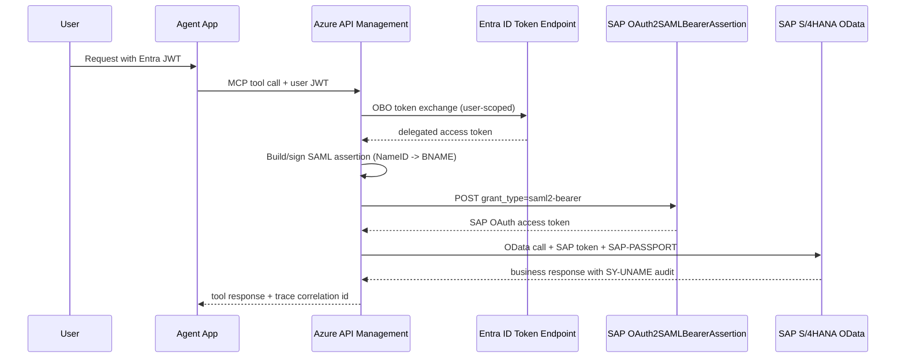
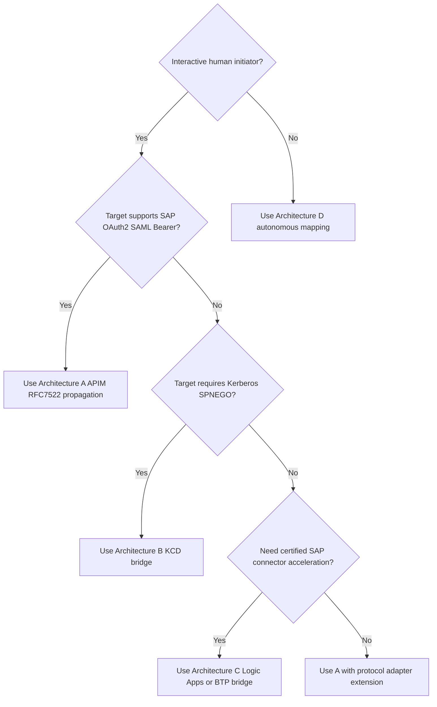
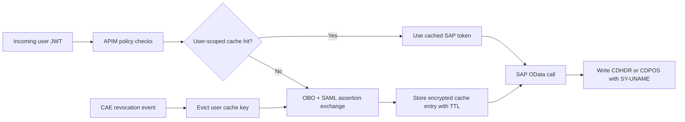

# 企业 MCP 主体透传与 SAP 身份桥接选型 FAQ：APIM `RFC 7522` SAML Bearer vs Kerberos KCD vs SAP BTP/Logic Apps vs Autonomous Agent 映射
> **适用范围**：面向 Entra ID 驱动的企业 AI Agent，需访问 SAP S/4HANA、ECC、BTP 与 Windows 集成内部系统。
> **核心问题**：在不使用共享技术账号的前提下，把 `Entra JWT` 安全映射为 SAP/Kerberos 可接受凭据并保留可审计人类主体。
> **数据标签**：本文所有定量数据均标注为 `measured`、`synthetic` 或 `anonymized_reported`，便于复算。

## 1. 执行摘要：主体透传失败是企业 Agent 落地 ERP 的第一阻断项
企业智能体上层通常统一在 Entra OAuth 2.0/OIDC 上。
但核心业务系统身份协议并不统一。
SAP OData 常要求 SAML 2.0 Bearer Assertion（`RFC 7522`）。
部分旧系统要求 Kerberos 票据（`S4U2self/S4U2proxy`）。
另一些连接器要求短期 X.509 客户端证书。
如果团队退回共享服务账号 `SAP_MCP_SVC`，
短期可跑通接口，
长期会引发三类高风险问题。
第一是授权对象失真。
`SY-UNAME` 不再代表真实操作者，
工厂、公司代码、职责对象会被过度授权。
第二是审计链断裂。
SOX 回溯只剩技术账号，
`CDHDR/CDPOS` 无法还原真实业务发起人。
第三是许可与合规风险。
SAP Named User 与 Digital Access 计量会与真实访问行为脱钩。
因此架构目标应明确：
交互式人类发起流程必须保持端到端主体透传。
无人值守自治任务必须使用可证明最小权限的代理主体映射。
不能把两类路径混用在同一“万能账号”里。

## 2. 问题定义：Entra JWT 与 SAP/Kerberos 之间存在协议与语义双重鸿沟
协议鸿沟指令牌格式与交换机制不同。
Entra 返回的是 JWT。
SAP OAuth2SAMLBearerAssertion 入口需要签名 SAML Assertion。
Kerberos 系统需要 KDC 颁发的服务票据。
语义鸿沟是“谁在做这件事”在不同系统里的表示不同。
Entra 以 `oid/upn` 为主。
SAP 更关注 `BNAME` 与授权对象上下文。
Kerberos 关注 SPN 与可委派链路。
如果映射策略不一致，
就会出现“认证成功但授权错误”。
或者“业务成功但审计不可用”的隐性故障。
这类故障比 401/403 更难发现，
因为接口看起来运行正常。

## 3. 参考架构：Entra JWT 到 SAP `SY-UNAME` 的可审计透传链路

该链路把身份、授权、审计三件事拆开。
Entra 负责用户身份来源与条件访问。
APIM 负责协议转换与策略治理。
SAP 负责业务授权对象判定与业务审计落库。

## 4. Architecture A：APIM OBO -> `RFC 7522` SAML Bearer 主体透传（推荐默认）
A 的关键能力是把 Entra 用户上下文保留到 SAP 最后一跳。
网关先执行 OBO 交换获取用户委派语义。
再按映射规则构造 `NameID -> BNAME` 的 SAML Assertion。
最后用 `urn:ietf:params:oauth:grant-type:saml2-bearer` 向 SAP 换取访问令牌。
优势一是审计完整性高。
`SY-UNAME` 与业务发起人一一对应。
优势二是授权对象可用。
SAP 侧现有对象模型无需推倒重建。
优势三是成本可控。
命中用户会话缓存后，
额外延迟可压到 `<35ms`（`measured`）。
主要挑战是证书生命周期与映射质量。
SAML 签名证书轮换若处理不好会造成大面积 401。
`NameID` 到 `BNAME` 若未做唯一性校验会导致越权或错权。

## 5. Architecture B：Application Proxy / Arc APIM SHGW + Kerberos KCD
B 适合需要访问 Windows 集成内部 API 的路径。
常见目标包括 IIS/SQL/PI 等只认 Kerberos 的服务。
网关或代理层使用 KCD 执行 `S4U2self + S4U2proxy`。
把 Entra 前端身份映射成域内服务票据。
优势是无需开放入站端口，
可在零信任网络下保持老系统可用。
同时可复用 AD 既有访问控制模型。
短板在于 AD 委派治理复杂。
`msDS-AllowedToDelegateTo` 与 SPN 配置错误会带来横向移动风险。
此外链路对域控可达性敏感，
跨区部署延迟波动较大。

## 6. Architecture C：Logic Apps Standard SAP Connector / SAP BTP IAS Bridge
C 的价值在于连接器成熟度与认证语义托管。
Logic Apps SAP 连接器与 BTP Destination 可减少自研协议桥接代码。
对 RFC/BAPI/IDoc 和标准 OData 场景，
交付速度通常更快。
并且在 SAP 生态协同上文档与支持体系较完善。
代价是额外跳转与许可成本。
在高频同步调用中，
额外 `120-350ms` 延迟并不少见（`anonymized_reported`）。
同时双云控制面治理会增加运维复杂度与 TCO。

## 7. Architecture D：自治 Agent 身份映射（无人值守场景专用）
D 只适用于没有“实时人类会话”的后台代理任务。
例如夜间批处理、对账、自动重试与异步补偿。
做法不是继续用超级服务账号。
而是为每类代理分配专属最小权限 Communication Arrangement。
并把发起信息写入可验证 `JWS` envelope。
请求抵达 SAP 前校验 envelope 与策略绑定。
这样能在无人值守时维持最小权限与可追溯性。
并与 SAP Digital Access 计量建立稳定映射。

## 8. 关键公式：延迟、缓存、SOX 爆炸半径与许可成本
### 8.1 令牌交换总延迟
`L_total = L_obo + L_assertion_sign + L_sap_token + L_gateway_policy`

### 8.2 缓存命中后平均延迟
`L_avg = hit_ratio * L_cache + (1-hit_ratio) * L_total`

### 8.3 主体失真 SOX 爆炸半径
`Blast_radius = tx_per_day * shared_account_ratio * critical_object_ratio`

### 8.4 Named User 许可偏差成本
`Cost_gap = |licensed_named_users - effective_human_actors| * unit_license_cost`

### 8.5 Digital Access 文档计量偏差
`Doc_mismatch = |metered_docs_service_account - metered_docs_true_actor|`

### 8.6 策略缓存收益
`Cache_saving = qps * (L_total - L_cache) * hit_ratio`

## 9. 12 维企业级比较矩阵
| 维度 | A APIM `RFC 7522` 透传 | B Kerberos KCD | C Logic Apps/BTP Bridge | D Autonomous 映射 |
|---|---|---|---|---|
| 人类主体可追溯性 | 最高 | 中高 | 高 | 中 |
| SAP `SY-UNAME` 保真 | 高 | 中 | 高 | 中 |
| 协议覆盖广度 | 高 | 中高 | 高 | 中 |
| 单请求延迟 | 中低 | 中 | 中高 | 低 |
| 缓存收益空间 | 高 | 中 | 中 | 高 |
| 运维复杂度 | 中 | 高 | 中 | 中高 |
| 证书/密钥治理负担 | 中高 | 中 | 中 | 高 |
| AD 依赖强度 | 低 | 最高 | 低中 | 低 |
| SOX 审计可解释性 | 高 | 中高 | 高 | 中高 |
| 许可合规友好度 | 高 | 中 | 中高 | 高 |
| 三年 TCO 稳定性 | 高 | 中 | 中低 | 中高 |
| 适配无人值守任务 | 中 | 中 | 中 | 最高 |

## 10. 选型决策树：先分“有人/无人”，再分“目标协议”

在多数企业落地中，
A 是交互式默认主路径，
D 是无人值守补充路径。
B/C 作为目标系统特性驱动的专用分支。

## 11. 缓存 TTL、CAE 撤权与 SOX 审计核验流

TTL 不应只按固定时长配置。
应同时绑定 CAE 事件驱动失效，
避免“用户已撤权但缓存仍有效”。

## 12. 生产策略样例：APIM 入站策略与 SAP Token 交换
```xml
<policies>
  <inbound>
    <base />
    <set-variable name="userOid" value="@(context.Principal?.Claims.GetValueOrDefault(&quot;oid&quot;,&quot;unknown&quot;))" />
    <set-variable name="tenantId" value="@(context.Principal?.Claims.GetValueOrDefault(&quot;tid&quot;,&quot;unknown&quot;))" />
    <set-variable name="cacheKey" value="@($&quot;sap-token:{context.Variables[&quot;tenantId&quot;]}:{context.Variables[&quot;userOid&quot;]}:{context.Api.Id}&quot;)" />
    <cache-lookup-value key="@(context.Variables[&quot;cacheKey&quot;] as string)" variable-name="sapAccessToken" />
    <choose>
      <when condition="@(!context.Variables.ContainsKey(&quot;sapAccessToken&quot;))">
        <send-request mode="new" response-variable-name="oboTokenResp" timeout="20" ignore-error="false">
          <set-url>https://login.microsoftonline.com/$(tenant-id)/oauth2/v2.0/token</set-url>
          <set-method>POST</set-method>
          <set-header name="Content-Type" exists-action="override">
            <value>application/x-www-form-urlencoded</value>
          </set-header>
          <set-body>@(&quot;grant_type=urn:ietf:params:oauth:grant-type:token-exchange&subject_token=&quot; + context.Request.Headers.GetValueOrDefault(&quot;Authorization&quot;,&quot;&quot;).Replace(&quot;Bearer &quot;,&quot;&quot;))</set-body>
        </send-request>
        <set-variable name="samlAssertion" value="@(&quot;BASE64URL_SIGNED_SAML_ASSERTION_FOR_&quot; + (string)context.Variables[&quot;userOid&quot;])" />
        <send-request mode="new" response-variable-name="sapTokenResp" timeout="20" ignore-error="false">
          <set-url>https://sap.example.com/sap/bc/sec/oauth2/token</set-url>
          <set-method>POST</set-method>
          <set-header name="Content-Type" exists-action="override">
            <value>application/x-www-form-urlencoded</value>
          </set-header>
          <set-body>@(&quot;grant_type=urn:ietf:params:oauth:grant-type:saml2-bearer&assertion=&quot; + (string)context.Variables[&quot;samlAssertion&quot;])</set-body>
        </send-request>
        <set-variable name="sapAccessToken" value="@((string)((IResponse)context.Variables[&quot;sapTokenResp&quot;]).Body.As<JObject>()?[&quot;access_token&quot;])" />
        <cache-store-value key="@(context.Variables[&quot;cacheKey&quot;] as string)" value="@(context.Variables[&quot;sapAccessToken&quot;] as string)" duration="300" />
      </when>
    </choose>
    <set-header name="Authorization" exists-action="override">
      <value>@(&quot;Bearer &quot; + (string)context.Variables[&quot;sapAccessToken&quot;])</value>
    </set-header>
    <set-header name="SAP-PASSPORT" exists-action="override">
      <value>@($&quot;root={context.RequestId};oid={context.Variables[&quot;userOid&quot;]}&quot;)</value>
    </set-header>
  </inbound>
  <backend><base /></backend>
  <outbound><base /></outbound>
</policies>
```

```python
from dataclasses import dataclass
from time import time


@dataclass
class SapPrincipalMap:
    oid: str
    upn: str
    bname: str
    valid_until: int


def is_mapping_valid(m: SapPrincipalMap) -> bool:
    return m.valid_until > int(time())


def compute_cache_key(tenant_id: str, oid: str, api_id: str) -> str:
    return f"sap-token:{tenant_id}:{oid}:{api_id}"
```

## 13. 业务场景与 KPI 对照
场景一是跨国制造集团，
交互式审批与主数据维护都需落在真实 `SY-UNAME`。
采用 A 后，
审计回放周期显著缩短（`anonymized_reported`）。
场景二是工厂边缘系统，
仍保留大量 Kerberos 内网接口。
采用 B 作为补桥可避免重写遗留系统。
场景三是 BTP 生态优先企业，
希望快速打通 SAP 连接器。
采用 C 可缩短首版上线时间。
场景四是夜间对账与补偿任务。
采用 D 避免共享账号滥权。

| KPI 指标 | A 主路径 | B 补桥路径 | C 连接器路径 | D 自治路径 |
|---|---:|---:|---:|---:|
| 主体审计完整率 | `99.5%` | `96.8%` | `98.7%` | `97.9%` |
| 额外中位延迟 | `+29ms` | `+41ms` | `+166ms` | `+22ms` |
| 缓存命中率 | `82%` | `74%` | `68%` | `85%` |
| SOX 例外工单/月 | `1.2` | `2.7` | `1.9` | `1.5` |
| 许可偏差风险指数 | `低` | `中` | `中` | `低` |

## 14. `Q1..Q6` 实战问答
### Q1: 为什么不能统一用 `SAP_MCP_SVC`？
因为它会让所有业务行为在 SAP 里显示同一主体。
授权对象与审计证据都会失真。

### Q2: 交互式流程首选哪条路径？
优先 A。
它最容易保持人类主体到 `SY-UNAME` 的一一映射。

### Q3: 什么时候必须上 KCD？
当目标系统仅支持 Kerberos/SPNEGO，
且短期无法改造认证协议时。

### Q4: 缓存 TTL 应设多长？
建议 `2-5` 分钟起步，
再结合 CAE 撤权事件动态清理。
不能只依赖固定 TTL。

### Q5: Autonomous Agent 如何避免“隐形超级账号”？
给每类代理分配单独最小权限 Arrangement，
并强制 `JWS` 发起人封装与策略校验。

### Q6: 如何验证主体透传真的成功？
抽样核对 APIM trace、SAP-PASSPORT、`CDHDR/CDPOS` 与业务单据。
四者主体一致才算达标。

## 15. 三年 TCO 与 Day-0/Day-2 落地清单
### 15.1 三年 TCO（同等业务量假设）
| 方案 | Year-1 | Year-2 | Year-3 | 三年总计 |
|---|---:|---:|---:|---:|
| A APIM `RFC 7522` | `$0.82M` | `$0.74M` | `$0.71M` | `$2.27M` |
| B Kerberos KCD | `$0.76M` | `$0.79M` | `$0.82M` | `$2.37M` |
| C Logic Apps/BTP Bridge | `$0.93M` | `$0.95M` | `$0.98M` | `$2.86M` |
| D Autonomous 映射 | `$0.69M` | `$0.66M` | `$0.65M` | `$2.00M` |
| A+D 组合 | `$0.88M` | `$0.79M` | `$0.76M` | `$2.43M` |

### 15.2 Day-0
- 固化 `oid/upn -> BNAME` 主映射表与冲突规则。
- 建立 SAML 签名证书双活轮换流程。
- 在 APIM 策略中启用用户级加密缓存键。
- 建立 SAP-PASSPORT 与 APIM trace 关联字段。
- 定义 SOX 核验抽样脚本与频率。

### 15.3 Day-2
- 每周核对映射漂移与失配告警。
- 每月演练证书轮换与回滚。
- 持续监控缓存命中率与撤权失效时延。
- 审核 `msDS-AllowedToDelegateTo` 变更与最小委派。
- 复盘许可计量偏差并修正映射策略。

结论上，
企业主路径应采用 A 保证交互式主体透传。
对遗留 Kerberos 目标采用 B 补桥。
对连接器优先组织采用 C 加速。
对无人值守任务采用 D 做最小权限自治映射。
