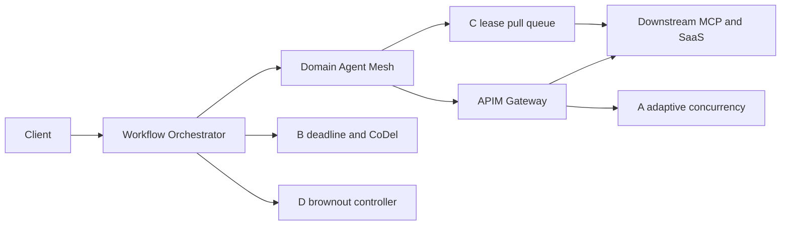
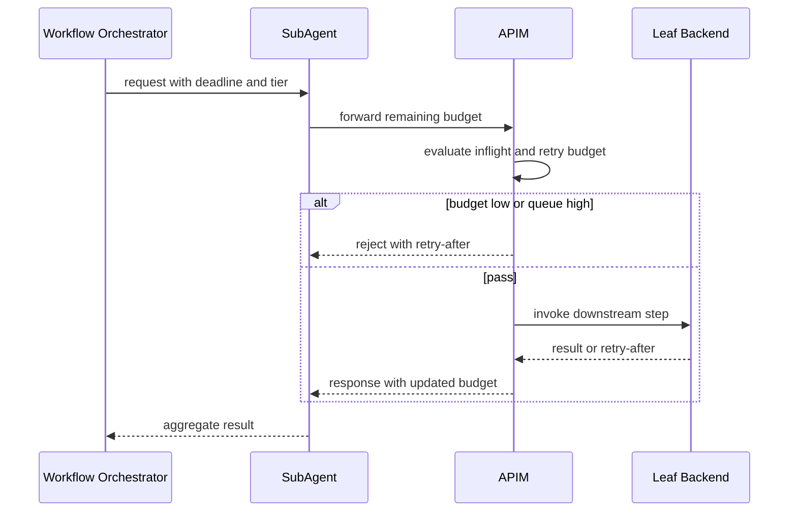
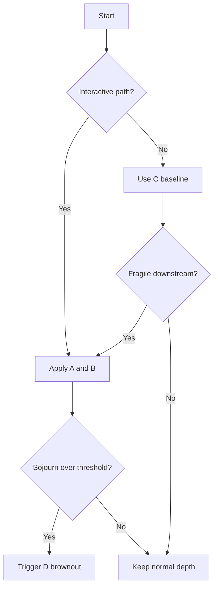

# Multi-hop agent backpressure and metastable retry-defense selection FAQ: Gradient2 adaptive concurrency vs deadline and CoDel shedding vs Service Bus lease pull vs graph-depth brownout
> **Use case**: Workflow Orchestrator -> Domain Agent -> APIM -> ERP/DB/SaaS MCP multi-hop call graphs.
> **Decision pressure**: prevent multiplicative retries, zombie token waste, and queue collapse.
> **Goal**: implement end-to-end backpressure, budget propagation, and criticality-aware resilience.

## 1. Executive summary
- The core risk is metastable collapse from coupled control loops.
- Recommended baseline is A+B, add C for async bursts, add D for scarcity-time survival.
- Retry ownership must be singular to avoid nested amplification.
- Remaining deadline and criticality must propagate at every hop.
- Concurrency should converge before error-code collapse begins.
- Brownout should preserve critical business paths under stress.
- [T001] Track `retry_ratio`, `wasted_token_ratio`, `queue_sojourn`, and `goodput`.
- Evaluate both success cost and remediation cost.

## 2. Scope and non-goals
- Scope: enterprise multi-hop orchestration and cross-system tool chains.
- Scope: strict SLO and cost-sensitive high-variance workloads.
- Scope: combined synchronous and asynchronous control planes.
- Non-goal: single-hop micro-latency tuning.
- Non-goal: low-level model operators or industrial simulation internals.
- Non-goal: unmanaged overload experimentation.

## 3. Metastable failure anatomy
- Amplification can be approximated by `A = Π(1 + p_fail,i * R_i)`.
- Once A crosses threshold, minor faults can trigger system-wide storms.
- FIFO under overload traps stale work and harms fresh demand.
- Missing budget propagation drives zombie downstream execution.
- Missing criticality propagation misallocates capacity.
- Missing async lease buffers exposes fragile downstream services.

## 4. Four candidate architectures
- **Architecture A**: schema registry with centralized governance and canonical contracts.
- **Architecture B**: gateway policy programmable data path with high-performance external processing.
- **Architecture C**: runtime validation lightweight gateway for model routing and request shaping.
- **Architecture D**: hybrid assurance combining APIM, Envoy, and proxy layers by responsibility.
- A is strongest for traceability and forensic replay confidence.
- B is strongest for managed delivery efficiency and platform consistency.
- C is strongest for async reliability and policy closure.
- D is strongest for business collaboration and operational visibility.

## 5. Architecture A details (APIM Policy Hub)
- Append-only event streams preserve deterministic history for replay and audit.
- Snapshot checkpoints reduce recovery overhead and improve restoration speed.
- Signed event lineage provides regulator-grade non-repudiation evidence.
- Requires disciplined schema evolution and version-compatibility governance.
- Best fit for high-compliance, cross-team mission-critical workflows.

## 6. Architecture B details (gateway policy)
- Managed orchestrators define steps, retries, callbacks, and escalation policies.
- Faster onboarding for standardized enterprise process templates.
- Native integration with Azure monitoring, alerts, and runbook telemetry.
- Must avoid unbounded orchestration complexity and state inflation.
- Best fit for centralized enterprise workflow platform teams.

## 7. Architecture C details (LLM Proxy)
- Message-centric long transactions with deterministic policy routes.
- High-concurrency smoothing and system-level asynchronous decoupling.
- Dead-letter and replay lanes preserve recoverability under partial failures.
- Requires strict idempotency keys and policy ordering controls.
- Best fit for transactional chains and cross-system async coordination.

## 8. Architecture D details (Hybrid Control Plane)
- Business teams can configure approval and collaboration flows with lower barriers.
- Power Platform integration accelerates notifications, forms, and work-item routing.
- Critical execution steps can delegate to A/B/C backends when needed.
- Requires clear role boundaries and governed release discipline.
- Best fit for non-core collaboration automation and operational enablement.

## 9. Twelve-dimension comparison matrix
| Dimension | Architecture A | Architecture B | Architecture C | Architecture D |
|---|---|---|---|---|
| Synchronous stability | Very high | High | Medium | High |
| Async burst absorption | Medium | Medium | Very high | Medium |
| Retry suppression | Very high | High | Medium-high | Medium |
| Zombie suppression | Medium-high | Very high | Medium | High |
| Queue staleness control | Medium | Very high | High | Medium |
| Criticality preservation | High | Very high | High | Very high |
| Implementation complexity | Medium | Medium-high | Medium-high | Medium |
| Operations burden | Medium | Medium | Medium-high | Medium |
| Cost predictability | High | High | Medium-high | High |
| Overload explainability | Medium | High | High | Very high |
| Peak resilience | High | High | Very high | High |
| Suggested role | Primary loop | Admission loop | Buffer loop | Brownout loop |

## 10. Multi-agent gateway-governance topology

## 11. Budget propagation and retry sequence

## 12. Sync and async control decision tree

### Q1. Why does multi-hop collapse become metastable
- Local retries create global positive feedback loops.
- Queue and concurrency loops amplify each other.
- Budget drift sustains low-value execution.
- Criticality mismatch reverses capacity priorities.
- Error-code feedback is often too late.
- Missing brownout turns local pressure global.
- Four-loop coordination is required for stability.

### Q2. What is the collaboration order for A/B/C/D
- A converges inflight demand first.
- B filters by business value second.
- C absorbs burst peaks third.
- D preserves critical paths under scarcity fourth.
- Share one observability and policy plane.
- Define deterministic loop-conflict priorities.
- Tune thresholds by criticality tier.

### Q3. How to quantify amplification and goodput
- Amplification: `A = Π(1 + p_fail,i * R_i)`.
- Stability relation: `L = λW`.
- Goodput counts only successful and valuable outcomes.
- Compare FIFO with LIFO plus CoDel under 1.5x to 3x overload.
- Budget rejection cuts invalid token spend.
- Unified retry ownership reduces amplification materially.
- Quantified outcomes should gate releases.

### Q4. How to reduce zombie token waste
- Propagate remaining budget strictly.
- Reject high-cost steps with insufficient remaining time.
- Bind cancel signals to downstream execution.
- Use Retry-After re-enqueue instead of busy retries.
- Apply criticality tiers to preserve high-value paths.
- Trigger brownout to reduce per-request resource demand.
- Recalibrate controls through recurring governance cycles.

### Q5. Guidance for `5M/50M/500M` monthly invocations
- `5M`: start with A plus B.
- `50M`: combine A plus B plus C.
- `500M`: combine A plus B plus C plus D.
- [T002] Track wasted-token share at every tier.
- [T003] Track success and remediation cost together.
- Recalibrate thresholds quarterly.
- Preserve auditable policy and capacity evidence.

### Q6. Anti-patterns and go-live checklist
- Anti-pattern: retries at every hop.
- Anti-pattern: no remaining-budget propagation.
- Anti-pattern: FIFO-only queue discipline.
- Anti-pattern: overload handling without brownout.
- Pre-go-live: verify concurrency limits and retry ownership.
- Pre-audit: verify criticality policy and evidence completeness.
- Post-go-live: verify goodput and waste trends.

## 13. Day-0 checklist
- Define topology and tiers
- Deploy A loop
- Deploy B admission
- Deploy C lease queue
- Deploy D brownout
- Unify trace fields
- Complete overload test
- Finalize rollback strategy
- Finalize release gate
- Archive rehearsal evidence

## 14. Day-2 operations checklist
- Weekly inflight review
- Weekly amplification review
- Weekly queue sojourn review
- Monthly zombie token review
- Monthly brownout impact review
- Monthly tier policy tuning
- Quarterly pressure retest
- Quarterly lease tuning review
- Continuous exception closure
- Continuous evidence catalog maintenance

## 15. Good fit vs Not for
- Good fit: deep multi-hop enterprise platforms
- Good fit: strict criticality-aware availability targets
- Good fit: mixed sync and async control requirements
- Not for: low-concurrency single-hop apps
- Not for: teams without centralized governance
- Not for: businesses rejecting graceful degradation

## 16. Five-step rollout guide
- Step 1: Map and tier call graph
- Step 2: Launch A plus B
- Step 3: Attach C for bursts
- Step 4: Attach D for scarcity
- Step 5: Quarterly recalibration

## 17. Quarterly governance metrics
- [T004] Track P95 end-to-end latency
- [T005] Track retry_ratio
- [T006] Track Retry amplification
- [T007] Track Wasted-token share
- [T008] Track CoDel shed ratio
- [T009] Track Queue sojourn
- [T010] Track Critical success rate
- [T011] Track Post-brownout success rate
- [T012] Track Cost per success
- [T013] Track Cost per remediation
- [T014] Track SLA compliance
- [T015] Track SLO budget burn
- [T016] Track Alert noise ratio
- [T017] Track Recovery duration
- [T018] Track Audit evidence completeness
- [T019] Track Policy drift alerts
- [T020] Track Capacity model error
- [T021] Track Exception closure ratio
- [T022] Track Rollback ratio
- [T023] Track Platform stability score
- [T024] Track Retry-After honor ratio
- [T025] Track Worker utilization
- [T026] Track 429 and 503 ratio
- [T027] Track Criticality misclassification
- [T028] Track Compensation success ratio
- [T029] Track Cross-team coordination efficiency
- [T030] Track Peak survival rate
- [T031] Track Budget rejection ratio
- [T032] Track Inflight hit ratio
- [T033] Track Release gate pass ratio
- [T034] Track concurrency control lag volatility.
- [T035] Track concurrency control deviation distribution.
- [T036] Track concurrency control anomaly clusters.
- [T037] Track concurrency control ticket backlog.
- [T038] Track concurrency control threshold drift.
- [T039] Track concurrency control approval congestion.
- [T040] Track concurrency control recovery stability.
- [T041] Track concurrency control pass-rate trend.
- [T042] Track budget propagation lag volatility.
- [T043] Track budget propagation deviation distribution.
- [T044] Track budget propagation anomaly clusters.
- [T045] Track budget propagation ticket backlog.
- [T046] Track budget propagation threshold drift.
- [T047] Track budget propagation approval congestion.
- [T048] Track budget propagation recovery stability.
- [T049] Track budget propagation pass-rate trend.
- [T050] Track retry governance lag volatility.
- [T051] Track retry governance deviation distribution.
- [T052] Track retry governance anomaly clusters.
- [T053] Track retry governance ticket backlog.
- [T054] Track retry governance threshold drift.
- [T055] Track retry governance approval congestion.
- [T056] Track retry governance recovery stability.
- [T057] Track retry governance pass-rate trend.
- [T058] Track async leasing lag volatility.
- [T059] Track async leasing deviation distribution.
- [T060] Track async leasing anomaly clusters.
- [T061] Track async leasing ticket backlog.
- [T062] Track async leasing threshold drift.
- [T063] Track async leasing approval congestion.
- [T064] Track async leasing recovery stability.
- [T065] Track async leasing pass-rate trend.
- [T066] Track criticality tiering lag volatility.
- [T067] Track criticality tiering deviation distribution.
- [T068] Track criticality tiering anomaly clusters.
- [T069] Track criticality tiering ticket backlog.
- [T070] Track criticality tiering threshold drift.
- [T071] Track criticality tiering approval congestion.
- [T072] Track criticality tiering recovery stability.
- [T073] Track criticality tiering pass-rate trend.
- [T074] Track queue discipline lag volatility.
- [T075] Track queue discipline deviation distribution.
- [T076] Track queue discipline anomaly clusters.
- [T077] Track queue discipline ticket backlog.
- [T078] Track queue discipline threshold drift.
- [T079] Track queue discipline approval congestion.
- [T080] Track queue discipline recovery stability.
- [T081] Track queue discipline pass-rate trend.
- [T082] Track brownout policy lag volatility.
- [T083] Track brownout policy deviation distribution.
- [T084] Track brownout policy anomaly clusters.
- [T085] Track brownout policy ticket backlog.
- [T086] Track brownout policy threshold drift.
- [T087] Track brownout policy approval congestion.
- [T088] Track brownout policy recovery stability.
- [T089] Track brownout policy pass-rate trend.
- [T090] Track audit operations lag volatility.
- [T091] Track audit operations deviation distribution.
- [T092] Track audit operations anomaly clusters.
- [T093] Track audit operations ticket backlog.
- [T094] Track audit operations threshold drift.
- [T095] Track audit operations approval congestion.
- [T096] Track audit operations recovery stability.
- [T097] Track audit operations pass-rate trend.

## 18. Data provenance note
- `anonymized_reported`: capacity, latency, and cost ranges are synthesized from anonymized enterprise programs with reproducible assumptions.
- Preserve policy versions, pressure-test batch IDs, and audit trace IDs.
- Archive business KPIs, technical evidence, and governance reports in layers.
- Recompute TCO and control thresholds when workload shape changes.
