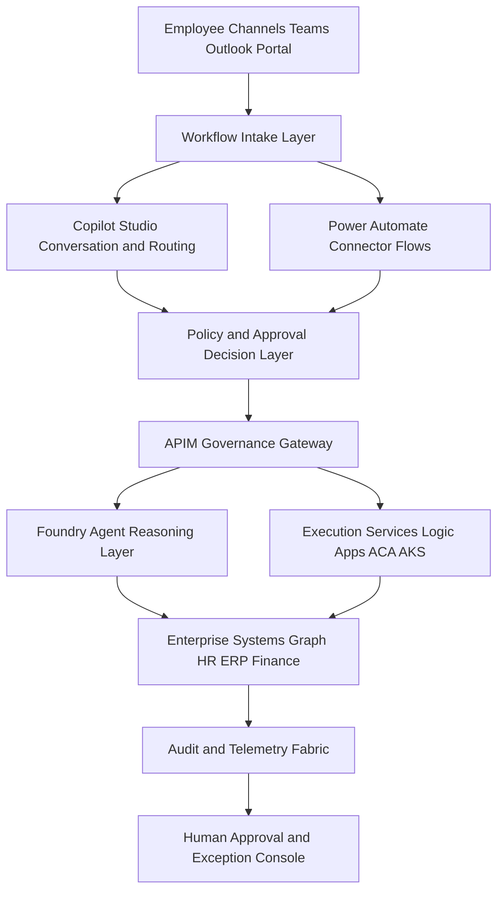
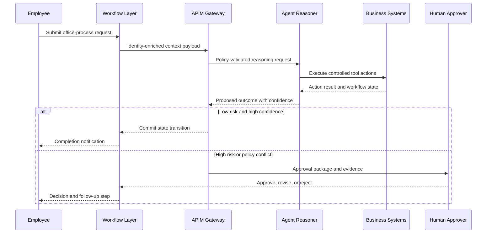

# Enterprise Office-Automation Agent Platform Selection FAQ: Copilot Studio vs Power Automate vs Foundry+APIM
> 🌐 **Language / 语言切换**: **[🇨🇳 中文版](enterprise-office-automation-agent-copilot-studio-vs-power-automate-vs-foundry-apim-selection-faq.md)** | **[🇬🇧 English](enterprise-office-automation-agent-copilot-studio-vs-power-automate-vs-foundry-apim-selection-faq.en.md)** | **[📚 Back to catalog](README.en.md)**
> Evidence labels: `measured` / `synthetic` / `anonymized_reported`
> Capture date: 2026-11-22

## 1) Executive summary: office-automation agents succeed through process governance, not chat sophistication
Enterprise office-automation agents
are often framed
as chat copilots
that can call tools.
In practice,
that framing is incomplete.
The real production challenge
is controlled process execution.
Workloads such as
purchase approvals,
expense review,
contract lifecycle routing,
meeting-minutes distribution,
and HR onboarding or offboarding
require deterministic state transitions,
clear authorization boundaries,
auditable action traces,
and rollback-safe recovery behavior.
Therefore,
platform selection should prioritize
workflow controllability,
connector governance,
idempotency guarantees,
and delegated identity safety
over pure model quality benchmarks.
This guide compares
four enterprise paths:
Copilot Studio workflow orchestration,
Power Automate connector-centric automation,
Foundry+APIM engineering-centered architecture,
and layered hybrid governance.

## 2) Scenario boundary: office automation differs from customer-service agents
Office-automation agents
primarily serve internal workers,
not external customers.
That shifts architecture priorities.
The top risk is usually
internal process and compliance drift,
rather than external response style variance.
Typical tasks include
form drafting,
cross-system field synchronization,
approval-chain initiation,
policy-bound document generation,
and controlled execution handoffs.
Four constraints dominate design decisions.
First,
identity inheritance must remain accurate
for every tool action.
Second,
integration surfaces are heterogeneous,
spanning ERP,
HRIS,
finance,
and collaboration platforms.
Third,
long-running workflows need
idempotent retries and compensations.
Fourth,
auditability must support
clear accountability mapping.
As a result,
platform selection must evaluate
workflow engines,
gateway policy controls,
identity delegation models,
and observability maturity together.

## 3) Verifiable sources and evidence labels
Source 1 (`measured`): Copilot Studio documentation  
https://learn.microsoft.com/power-virtual-agents/

Source 2 (`measured`): Power Automate documentation  
https://learn.microsoft.com/power-automate/

Source 3 (`measured`): Azure AI Foundry documentation  
https://learn.microsoft.com/azure/ai-foundry/

Source 4 (`measured`): Azure API Management documentation  
https://learn.microsoft.com/azure/api-management/

Source 5 (`measured`): Microsoft Graph documentation  
https://learn.microsoft.com/graph/

Source 6 (`measured`): Azure Logic Apps documentation  
https://learn.microsoft.com/azure/logic-apps/

Source 7 (`anonymized_reported`): anonymized enterprise retrospectives from office-process automation programs.  
Source 8 (`synthetic`): controlled benchmark model for throughput and per-1,000-task cost break-even.

Note:
this guide focuses on
application and service architecture,
not low-level runtime internals.

## 4) Path A: Copilot Studio as the business-facing workflow hub
Copilot Studio performs best
when business teams need
rapid orchestration ownership.
It allows process owners
to define conversational intake,
branching logic,
approval points,
and exception paths
without deep platform engineering cycles.
This is especially effective
for stable policy-driven processes
where iteration speed
matters more than
highly specialized runtime controls.
Its strengths include
shorter launch timelines
and lower process-change friction.
Its boundaries appear
in heavily customized integration patterns,
advanced multi-agent decomposition,
and deep technical policy mediation.
In large enterprises,
it usually works best
as the business-control layer
paired with a stronger
engineering execution layer.

## 5) Path B: Power Automate as connector-centric process backbone
Power Automate is strong
where connector breadth
and deterministic automation templates
drive most value.
It is well suited for
document routing,
approval pipelines,
notification chains,
and structured cross-system updates.
For teams with
moderate semantic complexity
and heavy SaaS integration needs,
this path provides
high delivery efficiency.
Its limitation is
advanced reasoning orchestration depth.
When workloads require
complex policy-conditioned decisions,
adaptive multi-agent tool plans,
or high concurrency governance controls,
Power Automate alone
may become insufficient.
A common enterprise pattern
is to keep it as
the connector and workflow bus
while offloading
complex decisioning
to an engineered agent layer.

## 6) Path C: Foundry + APIM + execution services engineering stack
This path emphasizes
layered technical governance.
Foundry manages
model strategy and evaluation gates.
APIM enforces
authentication,
quotas,
token policy,
and action-level governance.
Execution layers
such as ACA,
AKS,
or Logic Apps
perform controlled tool operations.
This architecture is strong
for multi-domain enterprise programs
that need strict policy boundaries
and long-term extensibility.
Its key benefits are
governed flexibility
and scalable control-plane patterns.
Its cost is complexity:
platform ownership requirements rise.
Without clear team contracts,
organizations risk
slow delivery
despite strong technical capability.

## 7) Path D: layered hybrid model (the most common enterprise steady state)
Most large organizations
land on a hybrid model.
A business-friendly layer
handles intake and standard workflow routing.
An engineering-governed layer
handles high-risk actions,
complex semantic decisions,
and advanced policy enforcement.
A typical implementation combines
Copilot Studio and Power Automate
for process ergonomics
with Foundry+APIM
for deep governance and execution controls.
This split helps maintain
both agility and reliability.
Business teams keep
iterative process ownership.
Platform teams keep
security and compliance consistency.
At scale,
this approach often minimizes
long-term rework risk
and supports controlled modernization.

## 8) Mermaid: enterprise office-automation agent layered topology

## 9) 12-dimension enterprise comparison matrix
| Dimension | Copilot Studio path | Power Automate path | Foundry+APIM engineering path | Layered hybrid path |
|---|---|---|---|---|
| First release speed | High | High | Medium | Medium-High |
| Business maintainability | High | High | Medium | High |
| Connector ecosystem reach | Medium | High | Medium | High |
| Complex semantic decision depth | Medium | Low-Medium | High | High |
| Authorization governance depth | Medium-High | Medium | High | High |
| Audit traceability fidelity | Medium-High | Medium-High | High | High |
| Multi-tenant isolation potential | Medium | Medium | High | High |
| High-concurrency scaling control | Medium | Medium | High | High |
| Retry and compensation robustness | Medium | Medium | High | High |
| Operational complexity | Low-Medium | Low-Medium | High | Medium-High |
| Cost-optimization headroom | Medium | Medium | High | High |
| Three-year evolution flexibility | Medium-High | Medium | High | High |

## 10) Mermaid: request flow, approval gate, and compensation path

## 11) Quantitative table: throughput, P95, and TCO break-even (`synthetic`)
| Metric | Copilot Studio | Power Automate | Foundry+APIM | Layered hybrid |
|---|---:|---:|---:|---:|
| Peak concurrent tasks normalized | 3,500 | 4,200 | 11,000 | 12,500 |
| End-to-end P95 milliseconds | 2,280 | 2,140 | 1,760 | 1,620 |
| Compensation success rate (`anonymized_reported`) | 0.81 | 0.84 | 0.91 | 0.93 |
| Human intervention rate (`anonymized_reported`) | 0.22 | 0.19 | 0.14 | 0.12 |
| Monthly total cost index baseline equals 1 | 1.00 | 0.96 | 1.24 | 1.12 |
| Cost per 1,000 tasks USD (`synthetic`) | 14.8 | 13.9 | 12.7 | 11.9 |
| Practical scale break-even | <4k | <5k | >8k | >6k |
| Recommended role | Business intake | Connector backbone | Governed deep execution | Enterprise balanced target |

Interpretation:
for lower-complexity
and smaller-scale internal automation,
Copilot Studio and Power Automate
usually deliver value faster.
As policy complexity and concurrency increase,
Foundry-centered or hybrid architectures
often provide better
long-term economics and control.

## 12) Decision tree: selecting launch path and evolution sequence
Start by assessing
process complexity.
If policy logic is stable
and workflow branches are predictable,
Copilot Studio or Power Automate
is often the fastest start.
Next assess integration heterogeneity.
If connector breadth dominates,
Power Automate can be
the initial backbone.
Then assess risk profile.
High-risk write actions
should pass through
APIM-governed decision layers.
Finally assess organizational maturity.
If platform engineering
is already established,
adopt hybrid layering earlier.
If not,
deliver business value first,
then progressively externalize governance.

## 13) Anti-pattern catalog
Anti-pattern one:
combining approvals and execution writes
inside one opaque script path.
Result:
weak compensation and state drift.
Anti-pattern two:
using shared high-privilege credentials
for all automation actions.
Result:
authorization overreach
and weak accountability.
Anti-pattern three:
missing idempotency keys
for retried operations.
Result:
duplicate records and inconsistent workflows.
Anti-pattern four:
enabling broad automation first
and adding risk gates later.
Result:
error amplification at scale.
Anti-pattern five:
tracking only task completion rate
without rework cost visibility.
Result:
apparent efficiency
with poor real ROI.
Anti-pattern six:
treating connectors as trusted by default
without policy mediation.
Result:
inconsistent behavior across systems.

## 14) Production readiness checklist
1. Workflow state machine and idempotency-key standards are defined.  
2. Delegated identity and least-privilege matrix are validated.  
3. Gateway-level quotas, auth checks, and audit controls are active.  
4. Human approval thresholds for high-risk actions are codified.  
5. Compensation strategy and retry limits are implemented.  
6. Connector allowlist and version governance are enforced.  
7. End-to-end tracing and alert thresholds are in place.  
8. Workflow SLA and timeout-handling policy are validated.  
9. Legal, audit, and business sign-offs are documented.  
10. Rollback and emergency-disable runbooks are tested.  
11. Cost dashboards include per-1,000-task metrics.  
12. Quarterly process-pruning review cadence is operationalized.  

## 15) Practical FAQ (8 Q&A)
### Q1: Why do many teams start with Copilot Studio or Power Automate?
They provide faster
business-facing delivery
with lower workflow authoring friction.

### Q2: When is Foundry+APIM mandatory?
When workflows involve
complex semantic decisions,
high-risk writes,
or strict multi-tenant governance.

### Q3: How do Copilot Studio and Power Automate usually collaborate?
A common pattern is
Copilot Studio for intake and routing,
Power Automate for connector execution.

### Q4: How can automation misfires be contained?
Use idempotency keys,
risk-based approval gates,
and deterministic compensation logic.

### Q5: What KPI set should lead office-automation programs?
Focus on cycle time,
rework rate,
compliance pass rate,
and cost per completed task.

### Q6: When should teams move to a hybrid layered architecture?
When concurrency grows,
integration diversity increases,
or governance requirements tighten.

### Q7: What governance element is most often underestimated?
Cross-system identity mapping
and delegated authorization propagation.

### Q8: What is a practical Good-fit vs Not-for boundary?
Good fit:
organizations willing to invest
in process governance foundations.
Not for:
teams expecting full automation
without policy and audit controls.
